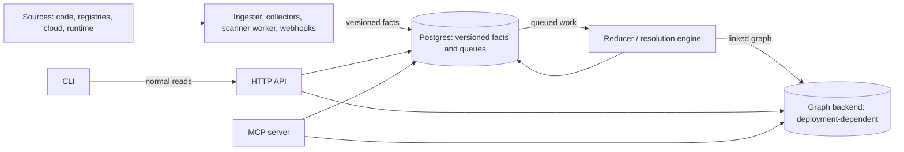

# Eshu

**A self-hosted context graph that connects your code, dependencies, supply
chain, infrastructure, and runtime into one queryable, evidence-backed source of
truth — for engineers and the AI assistants working beside them.**

Status: you run Eshu yourself, on your laptop or as a shared team service. See
[Maturity At A Glance](#maturity-at-a-glance) for what is supported today.

<p align="center">
  <a href="LICENSE">
    
  </a>
  <a href="https://github.com/eshu-hq/eshu/actions/workflows/test.yml">
    
  </a>
  <a href="docs/public/reference/code-coverage.md">
    
  </a>
  <a href="docs/public/index.md">
    
  </a>
  
  
  
  
</p>

Eshu indexes source code, dependencies, container images, infrastructure, deployment
config, runtime topology, external collector facts, and documentation into one queryable
graph. A graph here means linked records you can walk: a function links to its callers, a
service links to what deploys it, and each link keeps the evidence that supports it. You
and your assistants query that graph instead of re-deriving the answer from five
repositories, three dashboards, a Helm chart, and a Terraform module.

A common first job is **supply-chain traceability**: follow one vulnerable dependency
through the images that ship it, the workloads that run them, and the source and Terraform
that own them, with evidence at each step.

Use Eshu to ask:

- "Which deployed images contain this vulnerable package, and what source and Terraform own them?"
- "Who calls this function across all indexed repos?"
- "What deploys this service to production?"
- "Which workloads share this database, queue, or secret?"
- "What breaks if I change this Terraform module?"
- "Show the evidence behind this service-to-infrastructure link."

## When To Use Eshu, And When Not To

Use Eshu when you need linked answers across code, infrastructure, and runtime, and you
need to see the evidence behind each link. It fits teams that can run a self-hosted
service (software you operate yourself) or a local stack.

Don't use Eshu as a plain text search tool, a log store, or a metrics database. It
doesn't replace your code search, logging, or monitoring. It reads from sources like
those and links what it finds. If you only need one repo's text, your editor is simpler.

## What Eshu Can Do

These map to the capability families in the `get_capability_catalog` MCP tool and the
[MCP Reference](docs/public/reference/mcp-reference.md).

| Capability area | What you get |
| --- | --- |
| Code intelligence | Find symbols, callers, call chains, imports, inheritance, complexity, and dead-code candidates across 20+ languages. <!-- capability-state: id=code_search.symbol_lookup state=general_availability --> <!-- product-claim: id=readme.code-intelligence.language-breadth --> |
| Code-to-cloud tracing | Trace source code toward cloud infrastructure, attach evidence to each observed hop, and report an explicit unresolved gap when required bridge evidence is missing. <!-- capability-state: id=code_to_cloud.trace_exposure_path state=general_availability --> <!-- product-claim: id=readme.code-to-cloud.evidence-continuity --> |
| Supply-chain traceability | Track dependencies across 13 package ecosystems, reconcile 4 advisory sources (CISA KEV, FIRST EPSS, OSV, NVD), and follow SBOM-to-image attachments with subject-digest evidence. These reads are served by external collectors (package registry, container registry, CI/CD, SBOM/attestation, advisory feeds, provider security alerts) that are off in a default deploy: enable them with `ESHU_COLLECTOR_INSTANCES_JSON` plus provider credentials, otherwise the `list_*` supply-chain tools return well-formed empty pages. <!-- capability-state: id=supply_chain.impact_findings.list state=gated --> <!-- product-claim: id=readme.supply-chain.default-gated --> |
| Vulnerability reachability | Go reachability via govulncheck <!-- capability-state: id=reachability.go.govulncheck state=general_availability -->; value-flow reachability for Python, TypeScript, and JavaScript <!-- capability-state: id=reachability.python.value_flow state=gated --> <!-- capability-state: id=reachability.typescript.value_flow state=gated --> <!-- capability-state: id=reachability.javascript.value_flow state=gated -->; bounded JVM reachability <!-- capability-state: id=reachability.jvm.bounded state=preview -->. <!-- product-claim: id=readme.reachability.summary state=unguarded --> |
| Security and IAM posture | Surface hardcoded secrets, secret-access paths, and IAM trust and privilege chains with the evidence behind each finding. <!-- capability-state: id=security.hardcoded_secrets state=general_availability --> <!-- capability-state: id=secrets_iam.secret_access_paths.list state=general_availability --> <!-- product-claim: id=readme.security-iam.evidence-backed-findings --> |
| Change-risk analysis | Ask for blast radius, shared dependencies, change surface, and direct versus transitive relationships before a change lands. <!-- capability-state: id=platform_impact.blast_radius state=general_availability --> <!-- product-claim: id=readme.change-risk.blast-radius --> |
| IaC and re-platforming | Find unmanaged resources, propose Terraform import plans, and compose multi-cloud re-platforming plans. <!-- capability-state: id=replatforming.plan.readiness state=general_availability --> <!-- product-claim: id=readme.replatforming.plan-readiness --> |
| AI assistant context | Serve indexed truth through 172 read-only MCP tools so Codex, Claude, Cursor, VS Code, and other clients answer with evidence instead of guessing. <!-- capability-state: id=capability_catalog.list state=general_availability --> <!-- product-claim: id=readme.mcp-tool-count.indexed-truth --> |
| Operations visibility | Track ingestion, reducer queues, graph writes, runtime drift, freshness, health, metrics, traces, and logs. <!-- capability-state: id=freshness.changed_since state=general_availability --> <!-- product-claim: id=readme.operations-visibility.freshness --> |
| Extensibility | Add parsers, collectors, package-registry sources, Terraform providers, and language support with fixture-backed tests. |

The Go code coverage badge links to an advisory package report. It is one signal, not a replacement for replay, golden-corpus, or full-corpus proof.

## Pick Your First Path

| I want to... | Start here |
| --- | --- |
| Get one successful local run and first answer | [First successful run](docs/public/getting-started/first-successful-run.md) |
| Try the full API and MCP service stack on my laptop | [Docker Compose](https://github.com/eshu-hq/eshu-deploy/blob/main/docs/run-locally/docker-compose.md) |
| Develop Eshu or run one local workspace service | [Local binaries](docs/public/run-locally/local-binaries.md) |
| Connect Codex, Claude, Cursor, or VS Code | [Connect MCP](docs/public/mcp/index.md) |
| Deploy Eshu as a shared team service | [Kubernetes deployment](https://github.com/eshu-hq/eshu-deploy/blob/main/docs/kubernetes/index.md) |
| Deploy on EKS | [EKS deployment](https://github.com/eshu-hq/eshu-deploy/blob/main/docs/eks/index.md) |
| Monitor, debug, or tune a deployment | [Operate Eshu](docs/public/operate/index.md) |
| Code on Eshu with an AI agent | [Code with agents](docs/public/guides/coding-with-agents.md) |
| Understand the architecture | [How Eshu works](docs/public/concepts/how-it-works.md) |
| Contribute | [Contributing](CONTRIBUTING.md) |

## Quickstart

Start with [First successful run](docs/public/getting-started/first-successful-run.md). It
gets you to one indexed repo and one useful answer. To build from this checkout, run:

```bash
./scripts/install-local-binaries.sh
export PATH="$(go env GOPATH)/bin:$PATH"
eshu mcp setup --platform codex
```

Paste in the client config it prints, open your repo as the workspace, and restart your
client. Then ask it to list the indexed repositories. If yours shows up, you're in. Want
the full stack with the HTTP API? Take the Compose path above. A healthy process alone
doesn't mean you're done. The index needs to be ready and a query needs to come back.

## How It Works

Here's the short version. Parsers and collectors read your repos, infra files, images,
packages, and runtime signals. They emit versioned facts into Postgres instead of writing
the graph directly. The reducer claims that queued work, links the evidence, and writes
the graph. You read it back through the API, the MCP server, or the CLI. See
[How Eshu works](docs/public/concepts/how-it-works.md) and [Architecture](docs/public/architecture.md).

## How The Repositories Fit Together

Eshu is split across repositories in the `eshu-hq` organization. This repo holds the core.
Satellites hold the API, clients, workers, and collectors. You run it all from `eshu-deploy`.



In words: sources feed intake, which stores versioned facts in Postgres; the reducer links them into the graph backend; the API and MCP server read from there, and the CLI reads through the API. To run it, use [eshu-deploy](https://github.com/eshu-hq/eshu-deploy). The graph backend is deployment-dependent; see the deployment and architecture docs for options and proof state.

### Repository Map

Eshu spans 31 repositories: this core, the API, CLI, and MCP server, shared libraries,
runtime workers, deployment assets, and 19 collectors. Each collector reads one outside
system and emits facts. The reducer owns the linked truth. You'll find every repo in
[REPOSITORIES.md](REPOSITORIES.md), one friendly line each. Check
[Collector And Reducer Readiness](docs/public/reference/collector-reducer-readiness.md) first.

## Interfaces

You've got four ways in. Pick the one that fits your hands.

| You want | Go here |
| --- | --- |
| Local setup, indexing, and operator commands | [CLI Reference](docs/public/reference/cli-reference.md) |
| An assistant that answers with evidence | [Connect MCP](docs/public/mcp/index.md) |
| Automation and platform integration | [HTTP API](docs/public/reference/http-api.md) |
| A shared team service on Kubernetes | [Kubernetes deployment](https://github.com/eshu-hq/eshu-deploy/blob/main/docs/kubernetes/index.md) |

## Configuration

Use `eshu config` for local defaults. Services take environment variables. You'll touch
`ESHU_API_KEY`, `ESHU_SERVICE_URL`, `ESHU_FILESYSTEM_HOST_ROOT`, `ESHU_REPOSITORY_RULES_JSON`,
`ESHU_COLLECTOR_INSTANCES_JSON`, and `ESHU_HOME` most often. Collectors stay off until you
enable them and add credentials. Defaults live in [Configuration](docs/public/reference/configuration.md)
and the [Environment Variable Reference](docs/public/reference/env-registry.md). Run
`eshu config validate` to check your setup. Keep secrets out of Git.

## Deploy Or Run It

Pick a path above and follow its guide. The assets live in [eshu-deploy](https://github.com/eshu-hq/eshu-deploy),
with a Compose guide for your laptop and a Kubernetes guide for a shared service. Under the
hood, Eshu needs Postgres for facts and queues, plus a graph backend your deployment picks.
Collectors only watch. They never write to your systems, and only the reducer writes linked
truth. Leave a collector off and Eshu won't touch that system at all. See
[Service Runtimes](docs/public/deployment/service-runtimes.md) for runtime ownership.

Once it's running, check health first. Then check whether indexing actually finished. A live
process doesn't prove the index is complete. If answers look stale, confirm the index is
ready and the reducer queue has drained. Start at [Operate Eshu](docs/public/operate/index.md).

## Development

Build and test from the Go module root. The Go version is pinned in `go/go.mod`. Try
`cd go && go test ./cmd/eshu -count=1` first. From the repo root, `make help` lists targets,
`make pre-push` runs the fast checks, `make pre-pr` runs the fuller set, and `make prove`
needs no credentials. [DEVELOPING.md](DEVELOPING.md) and the [Local Testing Runbook](docs/public/reference/local-testing.md)
will point you at the right check.

## Documentation

New here? Read [First Successful Run](docs/public/getting-started/first-successful-run.md), then
[Start Here](docs/public/start-here.md), then [Connect MCP](docs/public/mcp/index.md). Then follow your job.

The docs live in eight buckets. Here's where each one really lives:

- **Getting started** — [First Successful Run](docs/public/getting-started/first-successful-run.md) and the rest of [getting-started/](docs/public/getting-started/), plus [Run locally](docs/public/run-locally/index.md).
- **Guides** — [All Guides](docs/public/guides/index.md): task-focused walkthroughs once Eshu is running.
- **Concepts** — [Understand Eshu](docs/public/understand/index.md) and [How Eshu works](docs/public/concepts/how-it-works.md): the system model in plain words.
- **Reference** — [Reference](docs/public/reference/index.md): commands, settings, APIs, and contracts to look up.
- **Architecture** — [Architecture](docs/public/architecture.md): runtime boundaries and who owns what.
- **Diagrams** — [docs/diagrams/](docs/diagrams/): the standalone Mermaid sources. Most pages also carry their own inline diagrams.
- **Decisions** — [Decisions](docs/public/decisions/index.md): how choices are recorded and where the records live.
- **Contributing** — [Contributing](docs/public/contributing.md) and the root [CONTRIBUTING.md](CONTRIBUTING.md): how to help, from first patch to PR.

| Your job | Start here |
| --- | --- |
| Index repos and ask questions | [Use Eshu](docs/public/use/index.md) |
| Run a shared service | [Deploy Eshu](https://github.com/eshu-hq/eshu-deploy/blob/main/docs/kubernetes/index.md) |
| Keep it healthy | [Operate Eshu](docs/public/operate/index.md) |
| Learn how it fits together | [Understand Eshu](docs/public/understand/index.md) |
| Add collectors or language support | [Extend Eshu](docs/public/extend/index.md) |
| Change Eshu with an AI agent | [Code with agents](docs/public/guides/coding-with-agents.md) |
| Look up commands and settings | [CLI Reference](docs/public/reference/cli-reference.md) |

## Maturity At A Glance

| Area | Status |
| --- | --- |
| Local Docker Compose stack | Supported |
| Local Eshu service from checkout | Supported for development and workspace-local use |
| MCP server | Supported |
| Kubernetes deployment | Supported through Helm |
| Graph backend | Deployment-dependent; your deployment selects it. See [Architecture](docs/public/architecture.md). |
| Optional collectors | Varies by collector; see [Collector And Reducer Readiness](docs/public/reference/collector-reducer-readiness.md) |

## Project

Most code lives in [go/](go/). The console lives in [apps/console/](apps/console/), and these
docs start in [docs/public/](docs/public/). The [Helm chart](https://github.com/eshu-hq/eshu-deploy/tree/main/helm/eshu)
and [observability assets](https://github.com/eshu-hq/eshu-deploy/tree/main/observability) live in eshu-deploy.

- [Contributing](CONTRIBUTING.md)
- [Security policy](SECURITY.md)
- [Testing guide](TESTING.md)
- [Developer guide](DEVELOPING.md)
- [License](LICENSE)

Eshu is self-hosted and does not require outbound vendor telemetry. When
observability is enabled, it uses your configured OTLP and Prometheus targets.
