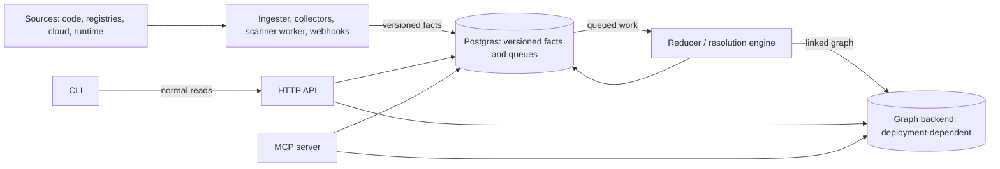

# Eshu

**A self-hosted context graph that connects your code, dependencies, supply
chain, infrastructure, and runtime into one queryable, evidence-backed source of
truth — for engineers and the AI assistants working beside them.**

Status: you run Eshu yourself, on your laptop or as a shared team service. See
[Maturity At A Glance](#maturity-at-a-glance) for what is supported today.

<p align="center">
  <a href="LICENSE">
    
  </a>
  <a href="https://github.com/eshu-hq/eshu/actions/workflows/test.yml">
    
  </a>
  <a href="docs/public/reference/code-coverage.md">
    
  </a>
  <a href="docs/public/index.md">
    
  </a>
  
  
  
  
</p>

Eshu indexes source code, dependencies, container images, infrastructure,
deployment config, runtime topology, external collector facts, and documentation
into one queryable graph. A graph here means linked records you can walk: a
function links to its callers, a service links to what deploys it, and each link
keeps the evidence that supports it. You and your assistants query that graph
instead of re-deriving the answer from five repositories, three dashboards, a
Helm chart, and a Terraform module.

A common first job is **supply-chain traceability**: follow one vulnerable
dependency through the container images that ship it, the workloads that run
them, and the source and Terraform that own them, with evidence at each step.

Use Eshu to ask:

- "Which deployed images contain this vulnerable package, and what source and
  Terraform own them?"
- "Who calls this function across all indexed repos?"
- "What deploys this service to production?"
- "Which workloads share this database, queue, or secret?"
- "What breaks if I change this Terraform module?"
- "Show the evidence behind this service-to-infrastructure link."

## When To Use Eshu, And When Not To

Use Eshu when you need linked answers across code, infrastructure, and runtime,
and you need to see the evidence behind each link. It fits teams that can run a
self-hosted service (software you operate yourself) or a local stack.

Do not use Eshu as a plain text search tool, a log store, or a metrics database.
It does not replace your code search, logging, or monitoring systems. It reads
from sources like those and links what it finds. If you only need to search one
repository's text, your editor or code host is simpler.

## What Eshu Can Do

These map to the capability families reported by the `get_capability_catalog`
MCP tool and the public tool families in
[MCP Reference](docs/public/reference/mcp-reference.md).

| Capability area | What you get |
| --- | --- |
| Code intelligence | Find symbols, callers, call chains, imports, inheritance, complexity, and dead-code candidates across 20+ languages. <!-- capability-state: id=code_search.symbol_lookup state=general_availability --> <!-- product-claim: id=readme.code-intelligence.language-breadth --> |
| Code-to-cloud tracing | Trace source code toward cloud infrastructure, attach evidence to each observed hop, and report an explicit unresolved gap when required bridge evidence is missing. <!-- capability-state: id=code_to_cloud.trace_exposure_path state=general_availability --> <!-- product-claim: id=readme.code-to-cloud.evidence-continuity --> |
| Supply-chain traceability | Track dependencies across 13 package ecosystems, reconcile 4 advisory sources (CISA KEV, FIRST EPSS, OSV, NVD), and follow SBOM-to-image attachments with subject-digest evidence. These reads are served by external collectors (package registry, container registry, CI/CD, SBOM/attestation, advisory feeds, provider security alerts) that are off in a default deploy: enable them with `ESHU_COLLECTOR_INSTANCES_JSON` plus provider credentials, otherwise the `list_*` supply-chain tools return well-formed empty pages. <!-- capability-state: id=supply_chain.impact_findings.list state=gated --> <!-- product-claim: id=readme.supply-chain.default-gated --> |
| Vulnerability reachability | Go reachability via govulncheck <!-- capability-state: id=reachability.go.govulncheck state=general_availability -->; value-flow reachability for Python, TypeScript, and JavaScript <!-- capability-state: id=reachability.python.value_flow state=gated --> <!-- capability-state: id=reachability.typescript.value_flow state=gated --> <!-- capability-state: id=reachability.javascript.value_flow state=gated -->; bounded JVM reachability <!-- capability-state: id=reachability.jvm.bounded state=preview -->. <!-- product-claim: id=readme.reachability.summary state=unguarded --> |
| Security and IAM posture | Surface hardcoded secrets, secret-access paths, and IAM trust and privilege chains with the evidence behind each finding. <!-- capability-state: id=security.hardcoded_secrets state=general_availability --> <!-- capability-state: id=secrets_iam.secret_access_paths.list state=general_availability --> <!-- product-claim: id=readme.security-iam.evidence-backed-findings --> |
| Change-risk analysis | Ask for blast radius, shared dependencies, change surface, and direct versus transitive relationships before a change lands. <!-- capability-state: id=platform_impact.blast_radius state=general_availability --> <!-- product-claim: id=readme.change-risk.blast-radius --> |
| IaC and re-platforming | Find unmanaged resources, propose Terraform import plans, and compose multi-cloud re-platforming plans. <!-- capability-state: id=replatforming.plan.readiness state=general_availability --> <!-- product-claim: id=readme.replatforming.plan-readiness --> |
| AI assistant context | Serve indexed truth through 171 read-only MCP tools so Codex, Claude, Cursor, VS Code, and other clients answer with evidence instead of guessing. <!-- capability-state: id=capability_catalog.list state=general_availability --> <!-- product-claim: id=readme.mcp-tool-count.indexed-truth --> |
| Operations visibility | Track ingestion, reducer queues, graph writes, runtime drift, freshness, health, metrics, traces, and logs. <!-- capability-state: id=freshness.changed_since state=general_availability --> <!-- product-claim: id=readme.operations-visibility.freshness --> |
| Extensibility | Add parsers, collectors, package-registry sources, Terraform providers, and language support with fixture-backed tests. |

The Go code coverage badge links to an advisory package report. It is one signal, not a replacement for replay, golden-corpus, or full-corpus proof.

## Pick Your First Path

| I want to... | Start here |
| --- | --- |
| Get one successful local run and first answer | [First successful run](docs/public/getting-started/first-successful-run.md) |
| Try the full API and MCP service stack on my laptop | [Docker Compose](https://github.com/eshu-hq/eshu-deploy/blob/main/docs/run-locally/docker-compose.md) |
| Develop Eshu or run one local workspace service | [Local binaries](docs/public/run-locally/local-binaries.md) |
| Connect Codex, Claude, Cursor, or VS Code | [Connect MCP](docs/public/mcp/index.md) |
| Deploy Eshu as a shared team service | [Kubernetes deployment](https://github.com/eshu-hq/eshu-deploy/blob/main/docs/kubernetes/index.md) |
| Deploy on EKS | [EKS deployment](https://github.com/eshu-hq/eshu-deploy/blob/main/docs/eks/index.md) |
| Monitor, debug, or tune a deployment | [Operate Eshu](docs/public/operate/index.md) |
| Code on Eshu with an AI agent | [Code with agents](docs/public/guides/coding-with-agents.md) |
| Understand the architecture | [How Eshu works](docs/public/concepts/how-it-works.md) |
| Contribute | [Contributing](CONTRIBUTING.md) |

## Quickstart

Follow [First successful run](docs/public/getting-started/first-successful-run.md)
for the full guide. It takes you to one indexed repository and one useful answer.
In short, for a local build from this checkout:

```bash
./scripts/install-local-binaries.sh
export PATH="$(go env GOPATH)/bin:$PATH"
eshu mcp setup --platform codex
```

Apply the printed client config, open your target repository as the client
workspace, and restart the client. Success check: ask the client to list the
indexed repositories for the current workspace and confirm your repository
appears. For the full container stack with the HTTP API, use the Compose path in
the table above instead. A healthy process alone is not success; the index must
be ready and a bounded query must return.

## How It Works

Data in: repositories, deployment and infrastructure files, container and
package data, runtime signals, and facts from external collectors (small
programs that observe one source system). Parsers and collectors emit versioned
facts (dated, numbered records) instead of writing the graph directly. Facts are
stored in Postgres and queued. The reducer, also called the resolution engine,
claims that work, links evidence across sources, and writes the graph. The API,
MCP server (Model Context Protocol, the tool interface AI assistants use), and
CLI then read the same linked data. Read
[How Eshu works](docs/public/concepts/how-it-works.md) for the full pipeline and
[Architecture](docs/public/architecture.md) for runtime ownership.

## How The Repositories Fit Together

Eshu is split across repositories in the `eshu-hq` organization. This repository
(`eshu`) holds the core. Satellites hold the extracted API, clients, workers, and
collectors. You run the whole system with the deploy assets in `eshu-deploy`.



In words: sources feed intake, which stores versioned facts in Postgres; the reducer links them into the graph backend; the API and MCP server read from there, and the CLI reads through the API. To run it, use [eshu-deploy](https://github.com/eshu-hq/eshu-deploy). The graph backend is deployment-dependent; see the deployment and architecture docs for options and proof state.

### Repository Map

Eshu spans 31 repositories: this core, the extracted API, CLI, and MCP
server, shared libraries (`eshu-sdk`, `eshu-agent-kit`), runtime workers
(ingester, workflow, webhook, extension host, scanner worker), deployment
assets (`eshu-deploy`), and 19 collectors. Each collector reads one
outside system — cloud accounts, registries, trackers, observability
tools — and emits source facts only; the reducer owns linked truth.

The full list, one plain sentence per repository and grouped by family,
lives in [REPOSITORIES.md](REPOSITORIES.md). Start there when you need to
find which repository owns a piece of the system. See
[Collector And Reducer Readiness](docs/public/reference/collector-reducer-readiness.md)
before you enable a collector family.

## Interfaces

- **CLI:** local setup, indexing, analysis, and operator commands.
- **MCP:** assistant-facing tools for Codex, Claude, Cursor, VS Code, and other
  MCP clients.
- **HTTP API:** automation and platform integration.
- **Helm:** split-service Kubernetes deployment for shared team use.

## Configuration

Use `eshu config` for local CLI defaults and environment variables for service
settings. The full catalog is the
[Environment Variable Reference](docs/public/reference/env-registry.md) and
[Configuration](docs/public/reference/configuration.md). Start with these:

| Name | Required | Default | Meaning |
| --- | --- | --- | --- |
| `ESHU_API_KEY` | For API-backed CLI use | None | Bearer token (secret key) for the HTTP API and MCP service. Keep it in your environment, not in a config file you commit. |
| `ESHU_SERVICE_URL` | For a hosted service | None | Base HTTPS address of a running Eshu service. |
| `ESHU_FILESYSTEM_HOST_ROOT` | For Compose indexing | None | Host folder that holds the repositories to index. Use an absolute path. |
| `ESHU_REPOSITORY_RULES_JSON` | For Compose indexing | None | Which repositories to index, as JSON rules. |
| `ESHU_COLLECTOR_INSTANCES_JSON` | To enable collectors | None; collectors stay off | Turns on external collectors. You also need provider credentials. Without it, supply-chain list tools return empty pages. |
| `ESHU_HOME` | No | `~/.eshu` | Folder for the local CLI `.env` file that `eshu config` reads and writes. |

Run `eshu config validate` to check your environment. Do not commit API keys or
other secrets.

## Deploy Or Run It

Pick one path from [Pick Your First Path](#pick-your-first-path): local binaries
from this checkout, the full Compose stack, a hosted service someone runs for
you, or Kubernetes for a shared team service. Deployment assets live in
[eshu-deploy](https://github.com/eshu-hq/eshu-deploy). Start with its
[Docker Compose guide](https://github.com/eshu-hq/eshu-deploy/blob/main/docs/run-locally/docker-compose.md)
or [Kubernetes deployment](https://github.com/eshu-hq/eshu-deploy/blob/main/docs/kubernetes/index.md).
For which runtime owns which job, see
[Service Runtimes](docs/public/deployment/service-runtimes.md).

### Eshu Dependencies

| This core needs | It talks to | It never touches |
| --- | --- | --- |
| Postgres for facts, queues, status, and content | The configured graph backend (deployment-dependent) | Your source systems in write mode; collectors observe and emit facts |
| A graph backend your deployment selects | API, MCP, and CLI read surfaces over the same stored data | Canonical graph writes from collectors; only the reducer writes linked truth |
| Optional collectors with their own credentials | Registries, cloud, and work systems you configure | Collectors you did not enable; they stay off by default |

## Operations And Troubleshooting

Check health first, then check whether indexing finished; a live process does not prove the index is complete. Use [Operate Eshu](docs/public/operate/index.md) for health, freshness, and troubleshooting. If answers look stale, confirm the index is ready and the reducer queue has drained.

## Development

Build and test from the Go module root. The Go version is pinned in `go/go.mod`.

```bash
go version
cd go && go test ./cmd/eshu -count=1
```

Useful checks from the repo root `Makefile`: `make help` (list targets),
`make pre-push` (fast local checks before a push), `make pre-pr` (fuller local
checks before a pull request), and `make prove` (credential-free conformance
checks). See [DEVELOPING.md](DEVELOPING.md), [TESTING.md](TESTING.md), and the
[Local Testing Runbook](docs/public/reference/local-testing.md) for the right
check for your change.

## Documentation

If you only read three pages first, read these:

1. [First Successful Run](docs/public/getting-started/first-successful-run.md)
2. [Start Here](docs/public/start-here.md)
3. [Connect MCP](docs/public/mcp/index.md)

The full documentation is organized by job:

- [Use Eshu](docs/public/use/index.md): index repositories and ask code or
  infrastructure questions.
- [Deploy Eshu](https://github.com/eshu-hq/eshu-deploy/blob/main/docs/kubernetes/index.md): install the shared
  service with Helm or follow the EKS runbook.
- [Operate Eshu](docs/public/operate/index.md): health checks, telemetry, and
  troubleshooting.
- [Understand Eshu](docs/public/understand/index.md): architecture, graph model,
  and runtime modes.
- [Extend Eshu](docs/public/extend/index.md): collectors, components, language
  support, and plugin contracts.
- [Code with agents](docs/public/guides/coding-with-agents.md): repo rules,
  required proof, and the safe workflow for AI-assisted changes.
- [Reference](docs/public/reference/cli-reference.md): CLI, API, MCP,
  configuration, telemetry, and backend details.

## Maturity At A Glance

| Area | Status |
| --- | --- |
| Local Docker Compose stack | Supported |
| Local Eshu service from checkout | Supported for development and workspace-local use |
| MCP server | Supported |
| Kubernetes deployment | Supported through Helm |
| Graph backend | Deployment-dependent; your deployment selects it. See [Architecture](docs/public/architecture.md). |
| Optional collectors | Varies by collector; see [Collector And Reducer Readiness](docs/public/reference/collector-reducer-readiness.md) |

## Repository Surfaces

| Path | Purpose |
| --- | --- |
| [go/](go/) | Go module for the CLI, API, MCP server, ingester, reducer, collectors, storage, parser, and query code. |
| [helm/eshu/](https://github.com/eshu-hq/eshu-deploy/tree/main/helm/eshu) | Public split-service Helm chart (eshu-deploy repo). |
| [observability/](https://github.com/eshu-hq/eshu-deploy/tree/main/observability) | Prometheus alert rules and local OpenTelemetry Collector config (eshu-deploy repo). |
| [apps/console/](apps/console/) | Private read-only product console for Eshu graph data. |
| [docs/public/](docs/public/) | MkDocs source for the public documentation site. |

## Project

- [Contributing](CONTRIBUTING.md)
- [Security policy](SECURITY.md)
- [Testing guide](TESTING.md)
- [Developer guide](DEVELOPING.md)
- [License](LICENSE)

Eshu is self-hosted and does not require outbound vendor telemetry. When
observability is enabled, it uses your configured OTLP and Prometheus targets.
