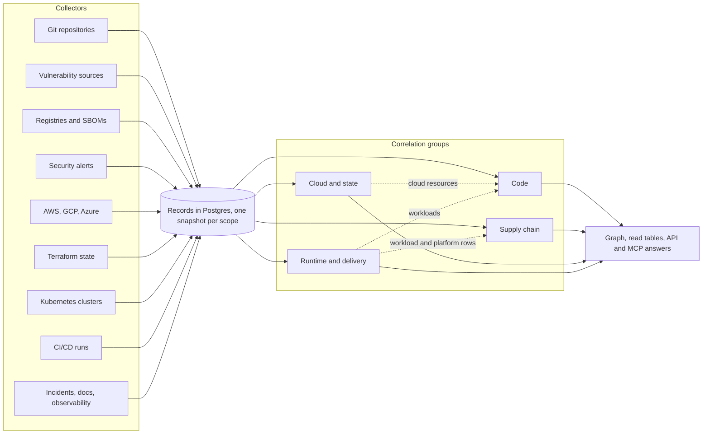
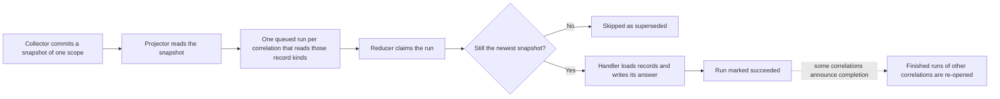

# Correlation Atlas

This atlas maps which collector feeds which reducer correlation, what starts a
correlation run, and what starts it again when a different source changes.

Read it before you change a collector's record kinds, a projector trigger, a
cross-scope dependency, or a re-open path. Read it also when a result looks
stale and you need to know what should have refreshed it.

## Basis and limits

- The atlas is a reading of the code at commit `7c2948825d` (2026-11-21). The
  scans ran at `da2c20ca5e`; no file the atlas names changed between the two.
- A statement marked **Observed** was seen in a read-only query against the QA
  environment. Each one carries its date, and the queries and counts are in
  [Correlation atlas observations](../evidence/correlation-atlas-observations-2026-11-21.md).
- A statement marked **None found** means a search did not find it. It is wrong
  if the path lives somewhere the search did not look. Each group page lists
  what was searched.
- Everything else is read from code and was not run.
- Paths are relative to `go/internal/` unless they start with `go/cmd/`,
  `docs/`, or a repository name.

## Pages

| Page | Read it when |
|---|---|
| [Collectors](collectors.md) | You need a collector's scope, snapshot model, or record kinds |
| [Re-open events](re-open-events.md) | You need the exact event that re-opens a run and the key it selects by |
| [Code and repository](code.md) | The change touches git snapshots, deltas, or code correlations |
| [Supply chain](supply-chain.md) | The change touches findings, image identity, SBOMs, or alerts |
| [Cloud and state](cloud.md) | The change touches cloud resources, access paths, or drift |
| [Runtime and delivery](runtime.md) | The change touches workloads, deployments, Kubernetes, or CI/CD |
| [Shared projections](shared-projections.md) | The change touches graph projections queued by another correlation |

## The whole picture

Collectors write records under a scope: one repository, one cluster, one
advisory window. Each new snapshot of a scope raises runs of the correlations
that read it. A run writes its answer to the graph, to a Postgres table, or back
as a record that another correlation reads.

A dotted line is one correlation reading another's output. Those are the places
a result can go stale, because the reader is not always told when the writer
changes.

## How a run starts, and how it starts again

Every correlation takes the same path for its first run.

The projector builds one run per scope snapshot in
`projector/runtime/scope_generation_intents.go`, and one per record when the
record's payload names a correlation (`projector/runtime/reducer_intent.go`).
Runs are rows in `fact_work_items`.

A run caused by a different source is the exception. Each way is a separate
mechanism.

| Way a run starts again | What it means | Who uses it |
|---|---|---|
| New snapshot of its own scope | The normal path | Every correlation |
| Completion announcement | A producer finishes and every run of its consumers at an active snapshot is re-opened, or flagged to replay if it is in flight. The announcement does not say which scope changed | Image identity and CI/CD re-open supply-chain impact. Five producers re-open value-flow refresh |
| Producer finish, keyed | A producer finishes and re-opens only the runs that name the same repository | Workload materialization re-opens service catalog. Deployment mapping re-opens deployable unit, workload, and service catalog |
| Producer-activation settle | A snapshot becomes active and re-opens runs that share image keys or resource ARNs with it. Off unless `ESHU_PRODUCER_ACTIVATION_CONSUMER_ENABLED` is set | Image identity, Kubernetes materialization, AWS drift |
| Maintenance re-open | After an ingest pass, a fixed list of six correlations is checked. Most re-open only when a fingerprint of their inputs changed | Deployable unit, workload, service catalog, Kubernetes materialization, image identity, AWS drift |
| Holder fan-out | A run that changed a finding re-opens the other scopes that hold a copy of it | Supply-chain impact |
| Parked wait | A run waits for a named thing and is woken when it finishes | Supply-chain impact, security alerts, advisory groups |
| Timed sweep | A periodic pass queues runs regardless of events | Config-against-state drift (every 5 minutes), search index. The AWS drift 24-hour audit is a condition of the maintenance re-open, not a timer of its own |

The cross-scope producer and consumer pairs are declared in one place,
`dependencyCatalog` in `reducer/crossscope/dependencies.go`. The maintenance list
is `crossScopeCorrelationReopenDomains` in
`storage/postgres/ingestion_reopen_correlation.go`. The full event list is in
[Re-open events](re-open-events.md).

## Results that only one side refreshes

The same shape appears in every group: an answer joins two sources, and only one
of them starts a run. A change on the other side arrives late or not at all.

| Answer | Side that does not refresh it | What happens instead | Basis |
|---|---|---|---|
| Finding score (EPSS, KEV) | A score change | Read: the score scope builds no manifest-anchored finding, so the documented refresh has no copy to compare. Observed 2026-11-21: findings showed the score that was live when they were last written. See [Supply chain](supply-chain.md#score-refresh) | Read and Observed |
| Finding workload and platform details | Workload identity or platform rows change | Not determined | None found |
| AWS runtime drift | Terraform config changes. Terraform state changes too, unless the producer-activation consumer is enabled | Waits for the maintenance re-open, which selects a run at the latest when its last audit is older than 24 hours | Read |
| Multi-cloud runtime drift | State or config changes | Nothing found | None found |
| Config-against-state drift | A config-only change in a repository | Nothing found | None found |
| Workload, deployable unit, platform, deployment mapping | A repository delta snapshot | These are raised only on a full snapshot | Read |
| Service catalog | Incident or documentation inputs change | Nothing found. Its re-open checks a fingerprint of resolved relationships only | None found |
| Package-to-source | A repository manifest change | It runs per registry scope. A git change re-runs nothing | None found |

The opposite also exists. Image identity and CI/CD completion re-open every
supply-chain impact run at an active snapshot, and flag the in-flight ones to
replay, with no filter on which scope changed.

## Counts

`reducer/contract/domain.go` names 89 domains, the code's word for a
correlation or a projection: 75 typed constants and 14 projection constants. The four group pages cover the 75 typed ones, one row
each, and each row says whether a path was found for it to start again when
another source changes. Most correlations read only their own source, so nothing
else can make them stale. The 14 projections, and 3 maintenance lease names, are on
the [Shared projections](shared-projections.md) page.

## Open questions

- Whether the manifest load order in supply-chain impact (own records first,
  other sources after) is intended.
- Whether results from the last full repository snapshot stay valid after a
  delta snapshot, for the correlations that a delta does not raise.
- Whether `documentation_materialization`, `cloud_asset_resolution`, and
  `incident_repository_correlation` have a producer the scans did not find.
- Whether the collectors that send a constant freshness value are meant to be
  skipped after their first snapshot. See
  [Collectors](collectors.md#unchanged-snapshots).

## Keeping this current

Update the affected page in the same PR when you change any of these:

- a builder call in `projector/runtime/scope_generation_intents.go`;
- `dependencyCatalog` in `reducer/crossscope/dependencies.go`;
- `crossScopeCorrelationReopenDomains` or another re-open path;
- the follow-up markers a git snapshot emits
  (`collector/repo/git/followup_facts.go`);
- a correlation's inputs from another scope.

Change the commit in "Basis and limits" only when you have re-read every page
against the new commit.
