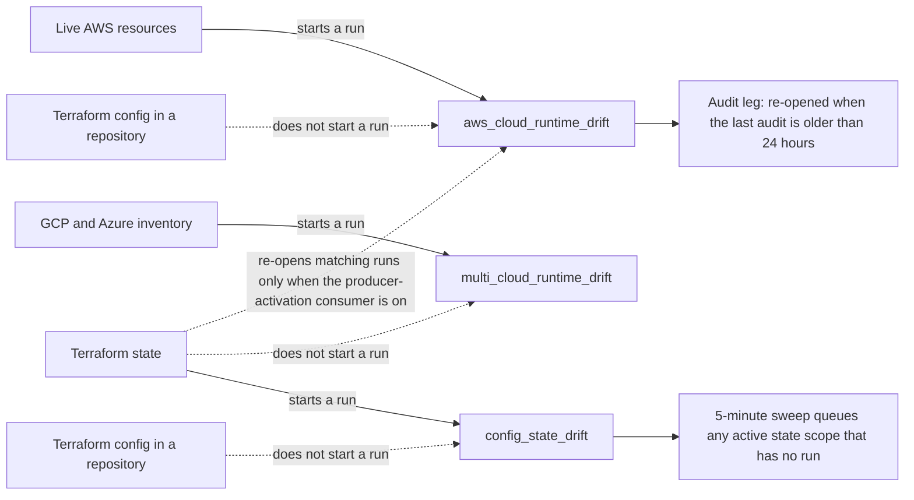

# Cloud And Infrastructure State

Part of the [Correlation Atlas](README.md). Read from code at `7c2948825d`.

Most of these correlations write resources, relationships, or posture for one
cloud source. Several also read rows from another scope, for example
`iam_can_perform_materialization` (sibling AWS scopes) and
`aws_cloud_image_materialization` (container images). Three compare two sources
outright: the drift checks.

## The three drift checks

| Drift check | What starts a run | What does not | Catch-up |
|---|---|---|---|
| `aws_cloud_runtime_drift` | A snapshot holding `aws_resource` | A Terraform config change. A Terraform state change, unless the producer-activation consumer is enabled and a resource ARN matches | The maintenance re-open after ingest selects a run when its fingerprint row is missing, the logic version moved, the `aws_resource` fingerprint differs, or the run was never audited or last audited more than 24 hours ago (`awsDriftReopenSelect` in `storage/postgres/backfill/aws_drift_reopen_sql.go`) |
| `multi_cloud_runtime_drift` | GCP or Azure inventory | A state or config change | None found |
| `config_state_drift` | A `state_snapshot:` scope becoming active (`storage/postgres/projector_queue_config_state_drift_trigger_hook.go`), the bootstrap index, and the catch-up sweep | A config-only change in a repository | The sweep (`projector/config_state_drift_catchup_sweeper.go`) runs every 5 minutes and queues an active state scope that has no run. It recovers a lost trigger. It does not detect a config change |

The producer-activation consumer is the path that lets a new Terraform state
snapshot re-open AWS drift runs whose resource ARNs match. It is off unless
`ESHU_PRODUCER_ACTIVATION_CONSUMER_ENABLED` is set
(`go/cmd/reducer/producer_activation_wiring.go`). Observed 2026-11-21: no
workload in the QA environment set it
([method](../evidence/correlation-atlas-observations-2026-11-21.md)).

One contradiction was read and not run. A comment in
`storage/postgres/drift_runtime_trigger.go` names a bootstrap re-run as the
recovery for a state that never changes, while the enqueue reads as "do nothing
when the run already exists".

## Handler shapes

| Shape | Count | What it does |
|---|---|---|
| Node writers | 11 | Write cloud resource nodes for one source |
| Edge writers | 12 | Write relationships and posture-linked edges for one source |
| Two-source drift | 3 | The three checks above |
| Postgres read models | 3 | Write a Postgres table. `cloud_asset_resolution` has no reader in the query or MCP code |
| Single purpose | 3 | One correlation each |
| Graph projection | 1 | Projects reducer-written records into the graph |

Several edge writers wait for nodes before they write, and retry without
spending an attempt. Most of those waits are for nodes in the same scope.
`secrets_iam_graph_projection` waits on endpoints in other scopes. The resource
writers for AWS, GCP, and Azure also defer while cloud admission retracts. The classes
are listed in `nonCountingReducerRetryFailureClasses`
(`storage/postgres/reducer_queue_readiness_sql.go`).

## Correlations in this group

| Correlation | Starts when | Starts again when another source changes | Code |
|---|---|---|---|
| `aws_cloud_image_materialization` | A new snapshot holding aws_resource | None found | `projector/cloud/aws/image/materialization_intents.go` |
| `aws_cloud_runtime_drift` | A new snapshot holding aws_resource | Maintenance re-open after ingest, when the fingerprint row is missing, the logic version moved, the `aws_resource` fingerprint differs, or the last audit is older than 24 hours. With the producer-activation consumer enabled (off by default), a new Terraform state snapshot also re-opens runs whose resource ARNs match (event E5) | `projector/cloud/aws/runtime/drift/reducer_intent.go` `storage/postgres/backfill/aws_drift_reopen_sql.go` `go/cmd/reducer/producer_activation_wiring.go` |
| `aws_relationship_materialization` | A new snapshot holding aws_relationship | None found. Same-scope node-readiness defer | `projector/cloud/aws/relationship/materialization_intents.go` `reducer/aws_relationship_instance_node_readiness.go` |
| `aws_resource_materialization` | A new snapshot holding aws_resource | None found. Its finish re-opens `code_value_flow_refresh`. Retried by the queue while cloud admission retracts | `projector/cloud/aws/resource/materialization_intents.go` `storage/postgres/value_flow_refresh_ack.go` |
| `azure_relationship_materialization` | A new snapshot holding azure_cloud_relationship | None found | `projector/cloud/azure/relationship_materialization_intents.go` |
| `azure_resource_materialization` | A new snapshot holding azure_cloud_resource | None found. Retried by the queue while cloud admission retracts | `projector/cloud/azure/resource_materialization_intents.go` |
| `cloud_asset_resolution` | No producer found. The handler is registered; nothing queues it | None found | `reducer/cloudasset/cloud_asset_resolution.go` |
| `cloud_inventory_admission` | A new snapshot holding aws_resource, gcp_cloud_resource, azure_cloud_resource | None found | `projector/cloud/inventory/reducer_intent.go` |
| `config_state_drift` | A `state_snapshot:` scope becoming active, the bootstrap index, and a 5-minute catch-up sweep that queues any active state scope with no run | None found for a config-only change in a repository. The acknowledgement hook returns early for scopes that are not state snapshots | `storage/postgres/projector_queue_config_state_drift_trigger_hook.go` `projector/config_state_drift_catchup_sweeper.go` `storage/postgres/drift_enqueue.go` |
| `crossplane_satisfied_by_materialization` | A new snapshot holding content_entity with entity_type K8sResource or CrossplaneXRD | Re-driven by a sweep the projector runs when it acknowledges a snapshot (`runCrossplaneRedriveHook`), and by a catch-up loop every 2 minutes | `projector/crossplane/satisfaction/satisfied_by_intents.go` `storage/postgres/projector_queue_ack.go` `go/cmd/projector/crossplane_redrive_catchup.go` |
| `ec2_block_device_kms_posture_materialization` | A new snapshot holding ec2_instance_posture | None found | `projector/cloud/aws/ec2/block_device_kms_posture_materialization_intents.go` |
| `ec2_instance_identity_materialization` | A new snapshot holding ec2_instance_posture | None found. Same-scope node-readiness class (`EC2InstanceIdentityNodesNotReadyFailureClass`, `storage/postgres/reducer_queue_readiness_sql.go`) | `projector/cloud/aws/ec2/instance_identity_materialization_intents.go` `storage/postgres/reducer_queue_readiness_sql.go` |
| `ec2_instance_node_materialization` | A new snapshot holding ec2_instance_posture | None found | `projector/cloud/aws/ec2/instance_node_materialization_intents.go` |
| `ec2_internet_exposure_materialization` | A new snapshot holding ec2_instance_posture | None found | `projector/cloud/aws/ec2/internet_exposure_materialization_intents.go` |
| `ec2_uses_profile_materialization` | A new snapshot holding ec2_instance_posture matching | None found | `projector/cloud/aws/ec2/uses_profile_materialization_intents.go` |
| `gcp_relationship_materialization` | A new snapshot holding gcp_cloud_relationship | None found. Same-scope node-readiness class | `projector/cloud/gcp/relationship_materialization_intents.go` `reducer/gcp_relationship_materialization.go` |
| `gcp_resource_materialization` | A new snapshot holding gcp_cloud_resource | None found. Retried by the queue while cloud admission retracts | `projector/cloud/gcp/resource_materialization_intents.go` |
| `iam_can_assume_materialization` | A new snapshot holding aws_iam_permission matching | None found | `projector/cloud/aws/iam/trust/materialization_intents.go` |
| `iam_can_perform_materialization` | A new snapshot holding `aws_iam_permission` or `aws_resource_policy_permission` | None found. Its own finish re-opens `code_value_flow_refresh`. It can wait, without spending an attempt, for sibling AWS scopes it reads | `projector/cloud/aws/iam/perform/materialization_intents.go` `storage/postgres/value_flow_refresh_ack.go` `reducer/crossscope/readiness_wait.go` |
| `iam_escalation_materialization` | A new snapshot holding aws_iam_permission matching | None found | `projector/cloud/aws/iam/escalation/materialization_intents.go` |
| `iam_instance_profile_role_materialization` | A new snapshot holding aws_resource matching | None found | `projector/cloud/aws/iam/instance/profile/materialization_intents.go` |
| `multi_cloud_runtime_drift` | A new snapshot holding `gcp_cloud_resource` or `azure_cloud_resource` | None found | `projector/cloud/runtime/drift/multi/reducer_intent.go` |
| `platform_infra_materialization` | A repository snapshot's follow-up marker for this correlation | None found | `collector/repo/git/followup_facts.go` |
| `rds_posture_materialization` | A new snapshot holding rds_instance_posture | None found | `projector/cloud/aws/rds/posture_materialization_intents.go` |
| `s3_external_principal_grant_materialization` | A new snapshot holding s3_external_principal_grant | None found | `projector/cloud/aws/s3/external_principal_grant_materialization_intents.go` |
| `s3_internet_exposure_materialization` | A new snapshot holding s3_bucket_posture | None found | `projector/cloud/aws/s3/internet_exposure_materialization_intents.go` |
| `s3_logs_to_materialization` | A new snapshot holding s3_bucket_posture matching | None found | `projector/cloud/aws/s3/logs_to_materialization_intents.go` |
| `secrets_iam_graph_projection` | A follow-up queued by the `secrets_iam_trust_chain` run in the same scope | Retries without spending an attempt while a Kubernetes workload or cloud resource endpoint in another scope is not yet committed | `storage/postgres/secrets_iam_graph_projection_followup.go` `reducer/secretsiam/secrets_iam_graph_projection_readiness.go` |
| `secrets_iam_trust_chain` | A new snapshot holding any secretsIAMSchemaVersions kind | None found | `projector/access/posture/trust_chain_intents.go` `facts/identity/iam.go` |
| `security_group_cidr_materialization` | A new snapshot holding aws_security_group_rule | None found | `projector/security/group_reachability_intents.go` |
| `security_group_reachability_materialization` | A new snapshot holding aws_security_group_rule | None found | `projector/security/group_reachability_intents.go` |
| `security_group_rule_materialization` | A new snapshot holding aws_security_group_rule | None found | `projector/security/group_reachability_intents.go` |
| `ssm_host_inventory_materialization` | A new snapshot holding `aws_ssm_host_application`, or `aws_ssm_host_platform` when the first is absent | None found | `projector/cloud/aws/ssm/host_inventory_materialization_intents.go` |

## Not found

- A producer for `cloud_asset_resolution`. Its handler is registered
  (`reducer/cloudasset/cloud_asset_resolution.go`), and nothing queues it. No
  cloud collector repository sets the payload field that would route a record
  to it.
- Whether cross-service AWS relationships span scopes in production. The join
  index is per snapshot and cross-scope endpoints are refused.
