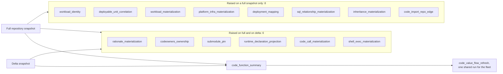

# Code And Repository

Part of the [Correlation Atlas](README.md). Read from code at `7c2948825d`
unless a line says otherwise.

One git snapshot raises many correlations at once. The split that matters is
between a full snapshot and a delta: a delta raises fewer of them.

## What a repository snapshot raises

The git collector (`collector/repo/git`) writes a follow-up marker record,
`shared_followup`, for each correlation it wants run. A full snapshot writes 14
of them, plus a separate `code_dataflow_scanned` marker when the data-flow scan
ran. A delta writes 6. The markers are built in
`collector/repo/git/followup_facts.go` and called from
`collector/repo/git/fact_builder.go`.

Function-summary, taint, and cross-function evidence records are emitted on
full and delta snapshots alike (`emitValueFlowFacts`, called from
`collector/repo/git/fact_builder.go` before the delta return). Only the
`code_dataflow_scanned` marker is full-only. Of the three, only
`code_function_summary` re-opens `code_value_flow_refresh`.

Whether results from the last full snapshot stay valid after a delta, for the
eight correlations a delta does not raise, was not determined.

## Deltas and their base

- A delta is cumulative. Changed paths are diffed from the newest activated full
  snapshot. Deleted paths are the union of that diff and a diff from the active
  commit (`cumulativeGitDelta` in
  `collector/repo/git/selection_cumulative_delta.go`).
- The projector refuses a delta whose baseline commit is not the active commit
  (`DecideDeltaBaseline` in `projector/delta_baseline.go`), and one whose base
  snapshot is missing (`storage/postgres/delta_union.go`,
  `storage/postgres/delta_union_base.go`).
- A correlation in another group that reads manifest rows through a refused
  delta gets a refusal, not rows. `supply_chain_impact` treats that as
  incomplete evidence: it marks the run partial and retracts nothing
  (`loadManifestDependencyEvidence` in
  `reducer/supplychain/core/evidence_load_helpers.go`).

## Rows other groups read from a git scope

Dependency rows from manifests and lockfiles are `content_entity` records with
`source_system = 'git'`. The read is in
`storage/postgres/manifest_dependency_read_sql.go`. Three correlations outside
this group read them: `package_source_correlation`,
`security_alert_reconciliation`, and `supply_chain_impact`.

## Value-flow refresh

`code_value_flow_refresh` is one shared run for the fleet. Five producers
re-open it when they finish: `workload_materialization`,
`workload_cloud_relationship_materialization`, `iam_can_perform_materialization`,
`aws_resource_materialization`, and `code_function_summary`. The list is in
`dependencyCatalog` (`reducer/crossscope/dependencies.go`).

## Correlations in this group

| Correlation | Starts when | Starts again when another source changes | Code |
|---|---|---|---|
| `code_call_materialization` | A repository snapshot's follow-up marker for this correlation | None found. Each run rewrites the queued `code_calls` rows. On a full snapshot it also rewrites `handles_route`, `runs_in`, and `invokes_cloud_action`; a delta leaves those three untouched. It is also one of the inputs the value-flow refresh waits on | `collector/repo/git/followup_facts.go` `storage/postgres/value_flow_refresh_ack.go` |
| `code_drifted` | A new snapshot holding content fingerprints changed | None found. (same-scope content change only) | `projector/runtime/stages.go` |
| `code_function_summary` | A new snapshot holding code_function_summary or code_dataflow_scanned | Announces completion to its consumers for code_value_flow_refresh | `projector/code/function/summary/reducer_intent.go` `storage/postgres/migrations/120_value_flow_refresh_code_function_summary_producer.sql` |
| `code_import_repo_edge` | A repository snapshot's follow-up marker for this correlation | Separate pass with skip set | `collector/repo/git/followup_facts.go` `storage/postgres/ingestion_reopen_code_import.go` |
| `code_interproc_evidence` | A new snapshot holding code_interproc_evidence or code_dataflow_scanned | None found | `projector/code/interproc/evidence/reducer_intent.go` |
| `code_taint_evidence` | A new snapshot holding code_taint_evidence or code_dataflow_scanned | None found | `projector/code/taint/evidence/reducer_intent.go` |
| `code_value_flow_refresh` | One shared run, seeded by migration 115 | Re-opened when any of five producers finishes: `workload_materialization`, `workload_cloud_relationship_materialization`, `iam_can_perform_materialization`, `aws_resource_materialization`, `code_function_summary`. Each producer announces only when its affected-repository gate passes | `reducer/crossscope/dependencies.go` `storage/postgres/migrations/115_value_flow_refresh_global_seed.sql` `storage/postgres/value_flow_refresh_ack.go` |
| `codeowners_ownership` | A repository snapshot's follow-up marker for this correlation | None found | `collector/repo/git/followup_facts.go` |
| `data_lineage` | NONE. No producer and no handler registration found; alias only | None found | `reducer/intent.go` |
| `documentation_materialization` | NO projector or payload producer found. Handler registered | None found. The handler checks intent.Domain | `reducer/registry.go` `reducer/documentation_edge_materialization.go` `projector/runtime/scope_generation_intents.go` |
| `eshu_search_document` | Periodic sweep of pending scopes | Timed sweep (sweep re-enqueues pending) | `projector/eshu_search_document_sweeper.go` |
| `inheritance_materialization` | A repository snapshot's follow-up marker for this correlation | None found. Each run rewrites `inheritance_edges` | `collector/repo/git/followup_facts.go` `reducer/inheritance/materialization.go` |
| `rationale_materialization` | A repository snapshot's follow-up marker for this correlation | None found. Each run rewrites `rationale_edges` | `collector/repo/git/followup_facts.go` `reducer/rationale_edge_materialization.go` |
| `runtime_declaration_projection` | A repository snapshot's follow-up marker for this correlation | None found | `collector/repo/git/followup_facts.go` |
| `search_vector_build` | NOT an intent domain. Sidecar sweep | Timed sweep (sweep). No cross-scope path | `reducer/searchvector/search_vector_build_runner.go` |
| `semantic_entity_materialization` | A `content_entity` record whose `entity_type` passes the admission rules in `BuildSemanticEntityReducerIntent` | None found | `projector/semantic/entity/intents.go` |
| `shell_exec_materialization` | A repository snapshot's follow-up marker for this correlation | None found. Each run rewrites `shell_exec` | `collector/repo/git/followup_facts.go` `reducer/code/shell/handler.go` |
| `sql_relationship_materialization` | A repository snapshot's follow-up marker for this correlation | None found. Each run rewrites `sql_relationships` | `collector/repo/git/followup_facts.go` `reducer/sqlrelationship/sql_relationship_materialization.go` |
| `submodule_pin` | A repository snapshot's follow-up marker for this correlation | None found. Each run rewrites `submodule_pin_edges` | `collector/repo/git/followup_facts.go` `reducer/submodule_pin_materialization.go` |

## Not found

- `documentation_materialization`: no production trigger. Its records carry no
  payload field that names the correlation. Searched: the projector builders,
  the git follow-up markers, and the Confluence collector repository.
- `data_lineage`: a reserved name with no handler.
- `search_vector_build`: a polling sweep, not a queued run.
- The record kinds `content`, `content_entity`, `shared_followup`, and the code
  data-flow kinds are absent from the generated record-kind registry
  (`facts/fact_kind_registry.generated.go`).
