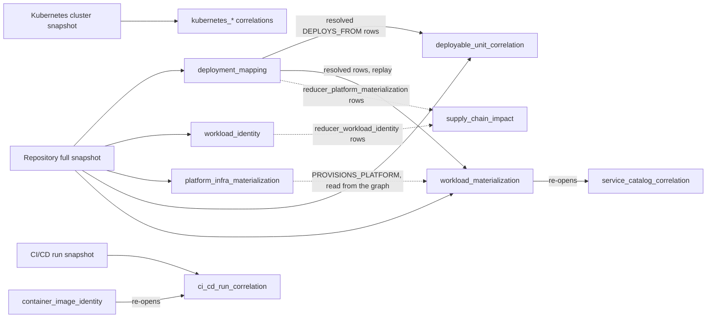

# Runtime, Delivery, And Ownership

Part of the [Correlation Atlas](README.md). Read from code at `7c2948825d`.

This group turns a repository into something that runs somewhere. Supply-chain
impact reads its output to say which workload and platform a finding affects.

## From repository to workload

All five repository correlations are queued from the same full snapshot, so
their order is the queue's, not a declared one.

| Row or edge | Written by | Re-run when |
|---|---|---|
| `reducer_workload_identity` | `workload_identity` (`reducer/workload_identity_writer.go`) | Its own full snapshot |
| `reducer_platform_materialization` | `deployment_mapping` (`reducer/platformfam/platform_materialization_writer.go`) | Its own full snapshot, and the deployment-mapping re-open after ingest |
| Resolved `DEPLOYS_FROM` rows | `deployment_mapping` (`reducer/crossrepo/cross_repo_resolution.go`) | Evidence re-discovered at ingest, and the same re-open |
| Admission decisions | `deployable_unit_correlation` | A wake when deployment mapping resolves rows, and the maintenance re-open when its fingerprint changed |
| Workload nodes and `RUNS_ON` | `workload_materialization` | Replay from the repository-dependency projection (fed by deployment mapping), the maintenance re-open, and the same wake |
| `PROVISIONS_PLATFORM` | `platform_infra_materialization` | Its own full snapshot |

Whether `workload_materialization` waits for `platform_infra_materialization` to
finish was not verified. Its platform lookup is a plain graph read.

## Fingerprint-gated re-opens

`deployable_unit_correlation`, `workload_materialization`, and
`service_catalog_correlation` re-open only when the recorded fingerprint is
missing, the logic version moved, or the input fingerprint differs. The
fingerprint covers the active resolved relationships that touch the candidate
repositories, of any relationship type
(`storage/postgres/backfill/reopen_fingerprint_sql.go`,
`reducer/contract/reopen_fingerprint.go`). `kubernetes_correlation_materialization`
is re-opened without a gate.

## Correlations in this group

| Correlation | Starts when | Starts again when another source changes | Code |
|---|---|---|---|
| `ci_cd_run_correlation` | A new snapshot holding `ci.run`, or `ci.artifact` when the first is absent | Re-opened when `container_image_identity` finishes. Its own finish re-opens `supply_chain_impact` | `projector/cicd/run/correlation/reducer_intent.go` `storage/postgres/reducer_queue_batch.go` `reducer/crossscope/dependencies.go` |
| `deployable_unit_correlation` | A repository snapshot's follow-up marker for this correlation | Re-opened when `deployment_mapping` resolves rows for its repository (event E6) and by the maintenance re-open, both only when its input fingerprint changed. Woken when the relationship snapshot it waited for becomes active (event E9) | `collector/repo/git/followup_facts.go` `storage/postgres/relationship_store_completion_wake.go` `reducer/crossrepo/own_gate.go` |
| `deployment_mapping` | A repository snapshot's follow-up marker for this correlation | Separate pass; also the producer of the resolution wake | `collector/repo/git/followup_facts.go` `reducer/crossrepo/cross_repo_resolution.go` `storage/postgres/ingestion_reopen_deployment_mapping.go` |
| `governance` | Never. A reserved name with no handler and no producer | None found | `reducer/contract/domain.go` `reducer/retirement/plan.go` |
| `incident_repository_correlation` | No producer found. The handler is registered; nothing queues it | None found | `reducer/incident/repository_correlation.go` |
| `incident_routing_materialization` | A new snapshot holding `incident.record` or any routing kind | None found | `projector/incident/routing/reducer_intent.go` `facts/incident/routing.go` |
| `kubernetes_correlation` | A new snapshot holding kubernetes_live.pod_template | None found. Same-scope class `KubernetesCorrelationNodesNotReadyFailureClass` | `projector/kubernetes/correlation_intents.go` `storage/postgres/reducer_queue_readiness_sql.go` |
| `kubernetes_correlation_materialization` | A new snapshot holding kubernetes_live.pod_template | Maintenance re-open after ingest, always. With the producer-activation consumer enabled, a new snapshot that shares image keys re-opens it (event E5) | `projector/kubernetes/workload_materialization_intents.go` `storage/postgres/ingestion_reopen_correlation.go` |
| `kubernetes_namespace_materialization` | A new snapshot holding kubernetes_live.namespace | None found | `projector/kubernetes/namespace_materialization_intents.go` |
| `kubernetes_workload_materialization` | A new snapshot holding kubernetes_live.pod_template | None found | `projector/kubernetes/workload_materialization_intents.go` |
| `observability_coverage_correlation` | A new snapshot holding an `aws_resource` of an observability resource type, or any `observability.*` kind except `observability.source_instance` | None found | `projector/observability/coverage/correlation_intents.go` |
| `observability_coverage_materialization` | A new snapshot holding aws_resource matching | None found | `projector/observability/coverage/materialization/materialization_intents.go` |
| `ownership` | Never. A reserved name with no handler and no producer | None found | `reducer/contract/domain.go` `reducer/retirement/plan.go` |
| `service_catalog_correlation` | A new snapshot holding any serviceCatalogSchemaVersions kind | Re-opened when a `workload_materialization` run for a repository it names finishes (event E4), when `deployment_mapping` resolves rows (event E6), and by the maintenance re-open when its input fingerprint changed | `projector/service/catalog/correlation_intents.go` `storage/postgres/backfill/reopen_fingerprint_sql.go` `storage/postgres/service_catalog_runtime_retrigger.go` |
| `workload_cloud_relationship_materialization` | A new snapshot holding aws_resource | Announces completion to its consumers for code_value_flow_refresh; no re-run of itself | `projector/workload/cloud/reducer_intent.go` `storage/postgres/value_flow_refresh_ack.go` |
| `workload_identity` | A repository snapshot's follow-up marker for this correlation | None found. (writer: `reducer/workload_identity_writer.go`) | `collector/repo/git/followup_facts.go` `reducer/workload_identity_writer.go` |
| `workload_materialization` | A repository snapshot's follow-up marker for this correlation | Same as `deployable_unit_correlation` (events E6, E7, E9), plus a replay for one repository when the repository-dependency projection completes (event E17). Its own finish re-opens `code_value_flow_refresh` and `service_catalog_correlation` | `collector/repo/git/followup_facts.go` `storage/postgres/backfill/reopen_fingerprint_sql.go` `reducer/workload_materialization_repo_phase.go` |

## Not found

- A path that re-runs `supply_chain_impact` when `reducer_workload_identity` or
  `reducer_platform_materialization` rows change. Searched: `dependencyCatalog`,
  the maintenance re-open list, the supply-chain fan-out files, and
  `projector/supply/chain/impact`.
- A producer for `incident_repository_correlation`. Its handler is registered
  (`reducer/incident/repository_correlation.go`), and nothing queues it. The
  PagerDuty and Jira collector repositories set no payload field that names it.
- A path that re-runs `service_catalog_correlation` when incident or
  documentation inputs change.
- A handler or producer for `ownership` or `governance`. Both are reserved
  names in `reducer/contract/domain.go`.
