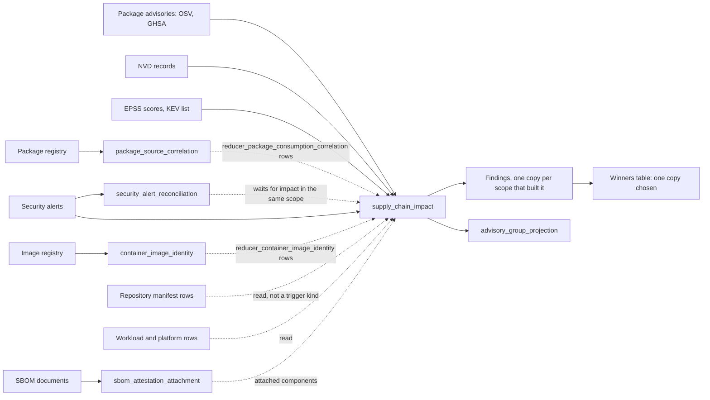

# Supply Chain

Part of the [Correlation Atlas](README.md). Read from code at `7c2948825d`
unless a line says Observed.

`supply_chain_impact` is the widest join in the system. It reads vulnerability
records, package and image records, repository manifest rows, and workload rows
from the runtime group. For the reader-facing explanation of statuses and
priority, see
Advisory Intelligence: How Correlation Works (advisory intelligence correlation flow).

## Who feeds what

A run writes every finding it builds under its own scope. Several scopes can
hold a copy of the same finding. The winners table
(`supply_chain_impact_canonical_winners`) picks one.

## What starts an impact run

`BuildSupplyChainImpactReducerIntent` in
`projector/supply/chain/impact/intents.go` queues one run per scope snapshot
that holds any of twelve record kinds: `vulnerability.cve`,
`vulnerability.affected_package`, `vulnerability.epss_score`,
`vulnerability.known_exploited`, `vulnerability.suppression`,
`security_alert.repository_alert`, `package_registry.package`, `sbom.component`,
and four `oci_registry.*` image kinds. A `go-reachability://` scope takes its own
branch. A snapshot that holds none of the twelve, which includes every git
snapshot, queues a marker run instead
(`projector/supply/chain/impact/manifest_trigger.go`). The marker run compares
the snapshot's dependency rows with the earlier ones. When nothing changed and
the earlier base is readable, it re-opens nothing.

## The order one run loads evidence

The load is `loadSupplyChainImpactEvidence` in
`reducer/supplychain/core/evidence_load.go`. Production wraps it in an
authorized loader (`reducer/supplychain/core/handler_authorized.go`), which
calls the same function for its static half, so the order below holds there
too. In that mode public advisories are added to the run's records before
step 2. The loader's storage side was not traced.

| Step | What loads | From |
|---|---|---|
| 1 | The run's own records | Its own scope and snapshot only |
| 2 | The repository list and manifest dependency rows, once | Any repository, but only for package names found in step 1's `vulnerability.affected_package` and `security_alert.repository_alert` records (`reducer/supplychain/core/manifest_dependency.go`) |
| 3 | Records from other scopes, until no new keys appear | Any scope that shares a vulnerability, package, product, image, or repository key (`loadActiveSupplyChainImpactFactsUntilStable`) |
| 4 | Scanner, image, and reachability evidence | Scopes reached in step 3 |

Step 3 stops at a round limit and an evidence budget. A run that stops there is
partial: it writes what it built and retracts nothing. The criteria expansion
bound (`reducer/supplychain/core/criteria_bound.go`, wired in
`reducer/defaults_additive_domains_supply_chain.go`) keeps a product name that
the run does not own from pulling in other vulnerabilities.

Step 2 happens before step 3, and nothing reads the manifest rows again
afterwards. So on a full pass, a scope whose own records name no package reads
no manifest rows and builds no finding anchored on a manifest row, even though
step 3 later loads package records from other scopes. A pass scoped to a
stamped set of vulnerabilities is the exception: it adds the package names of
its existing finding rows to the manifest read (`restrictManifestFilterToScope`
in `reducer/supplychain/core/scoped_pass.go`). Findings anchored through
`reducer_package_consumption_correlation` rows take a separate path.

## Score refresh

The design is in `reducer/supplychain/core/HOLDER_FANOUT.md`, "Enrichment
refresh". A changed EPSS or KEV answer makes a new snapshot of the score scope.
That scope's run rebuilds its own copies of the findings, the changed copy names
the vulnerability, and the holder fan-out re-opens every other scope that holds
a copy. The mechanism depends on the score scope holding copies.

Observed 2026-11-21, read-only, in the QA environment
([queries and counts](../evidence/correlation-atlas-observations-2026-11-21.md)):

- The 20 EPSS scopes and the KEV scope held no finding record in any snapshot.
  They held only `vulnerability.epss_score`, `vulnerability.known_exploited`, and
  `vulnerability.source_snapshot` records.
- Of 7,223 impact work items for vulnerability scopes, in any status, none
  carried an EPSS or KEV scope as its fan-out origin. A work item keeps only its
  latest origin, and 1,368 carried none, so this does not show what opened
  earlier runs.
- For 46 vulnerabilities whose EPSS value changed, 3,551 of 3,741 finding rows
  showed the current value and were written after the change. The other 190
  showed an older value or none and were written before it. No row showed an old value
  and was written after the change.

So in that sample a finding showed the score that was live when its row was
last written. The readings do not show what opened each owner run, and they
show no run opened by a score scope. Whether any
finding there is anchored through `reducer_package_consumption_correlation`
rows, where the score scope would hold a copy, was not checked.

## What re-opens an impact run

| Path | Starts from | Selects runs by |
|---|---|---|
| Holder fan-out (`fanOutHolders` in `reducer/supplychain/core/fanout.go`) | A run changed or retracted a finding | Other scopes that hold a finding with the same vulnerability id, advisory id, or advisory-group member |
| Score refresh | The score scope's own copy changed | Same as holder fan-out |
| Suppression change (`reducer/supplychain/core/suppression_fanout_wire.go`) | An operator suppression record changed | Vulnerability ids in the difference between adjacent suppression snapshots |
| Manifest change (`reducer/supplychain/core/manifest_trigger.go`) | A repository snapshot changed a dependency | Scopes whose advisories or alerts name the changed package. Scopes whose impact run is in flight are included. Falls back to scopes whose findings name the repository when the earlier base is missing, degraded, or pruned |
| Image identity (`storage/postgres/scope/completion/fanout.go`) | `container_image_identity` finished, unless it reported an unchanged set. A run that reports nothing counts as changed | Every impact run at an active snapshot. No scope filter |
| CI/CD run correlation | A `ci_cd_run_correlation` run finished | Every impact run at an active snapshot. No scope filter |
| SBOM attachment (`reducer/supplychain/core/attachment_wait.go`) | The attachment run for the same snapshot finished | The same scope and snapshot |
| Go reachability | A new `go-reachability://` snapshot | That repository's own run |

`supply_chain_impact` is absent from the maintenance re-open list on purpose.
The comment in `storage/postgres/ingestion_reopen_correlation.go` says CI/CD and
supply chain are left out of blanket replay.

## Correlations in this group

| Correlation | Starts when | Starts again when another source changes | Code |
|---|---|---|---|
| `advisory_group_projection` | Supply_chain_impact write touches advisory groups | Enqueue per touched group; winners_watermark wait | `reducer/supplychain/core/group_projection_enqueue.go` `reducer/advisory/group/handler.go` |
| `container_image_identity` | A new snapshot holding OCI, image-reference, CI artifact, content_entity, file, attestation kinds | Maintenance re-open after ingest when the fleet identity epoch changed. With the producer-activation consumer enabled, a new snapshot that shares image keys re-opens it (event E5). Its own finish re-opens `ci_cd_run_correlation` and `supply_chain_impact` | `projector/container/image/identity/intents.go` `storage/postgres/container_identity_reopen_gate.go` |
| `package_source_correlation` | A new snapshot holding package_registry.source_hint or package_registry.package | None found | `projector/package/source/reducer_intent.go` |
| `sbom_attestation_attachment` | A new snapshot holding sbom.document, attestation.statement, oci_registry.image_referrer | None found for the attachment run itself. A parked `supply_chain_impact` run in the same scope and snapshot is woken when the attachment run finishes (event E15) | `projector/sbom/attestation/attachment_intents.go` `reducer/supplychain/core/attachment_wait.go` |
| `security_alert_reconciliation` | A new snapshot holding `security_alert.repository_alert` or `package_registry.package` | None found. It waits, in the same scope, for `supply_chain_impact` to finish | `projector/security/alert_reconciliation_intents.go` `storage/postgres/reducer_queue_readiness_sql.go` |
| `supply_chain_impact` | A new snapshot holding vulnerability and supply-chain kinds; go-reachability scope; manifest marker fallback | Holder fan-out (cause-labelled); manifest marker; suppression diff; re-opened when these finish: identity and ci_cd; SBOM and impact waits; produces advisory group | `projector/supply/chain/impact/intents.go` `reducer/supplychain/core/fanout.go` `reducer/supplychain/core/manifest_trigger.go` |

## Not found

- A path that re-runs `package_source_correlation` when a repository manifest
  changes. It runs per registry scope.
- A path that re-runs `sbom_attestation_attachment` when another source changes.
- A path that re-runs `supply_chain_impact` when workload or platform rows
  change. See [Runtime and delivery](runtime.md#not-found).
