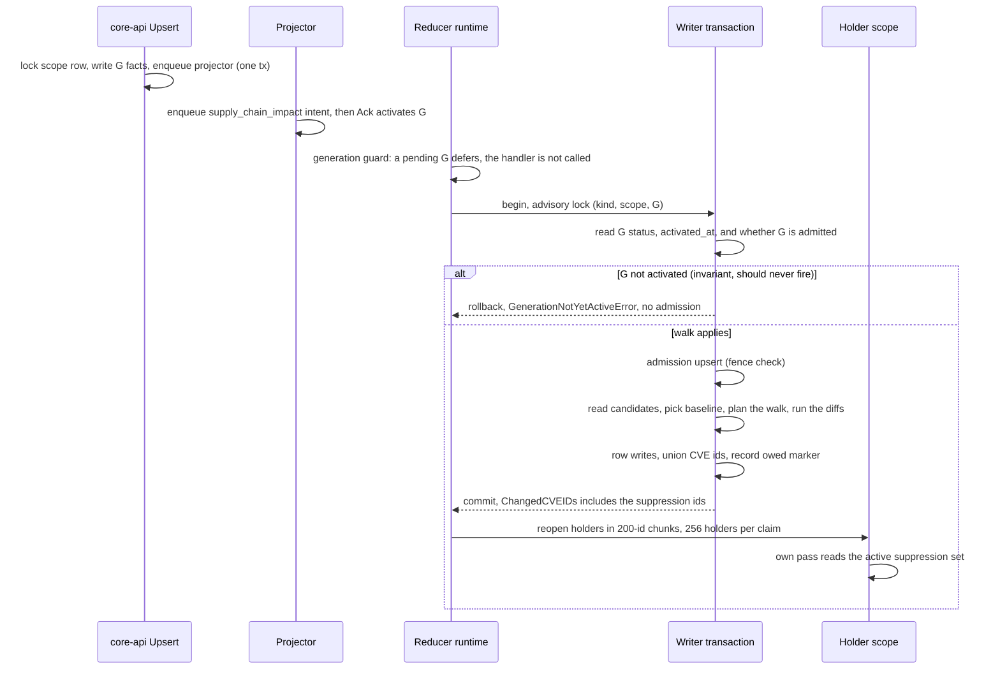
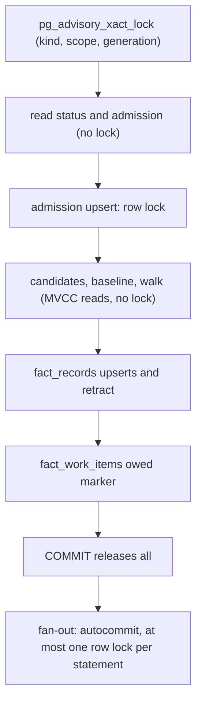

# Suppression Fan-Out For OS Findings Keyed By The Upstream CVE (#10019)

Status: Proposed, with the arbiter ruling of 2026-11-04 applied. Depends on #9914,
which is not merged. The pure decision functions are committed but not called; see
[What waits for #9914](#what-waits-for-9914).

## The short version

After #9914 an OS finding is keyed by the upstream CVE. A suppression scoped
`cve_id=CVE-X` then changes no row on the operator pass, so `ChangedCVEIDs` is
empty and no holder reopens. The suppression lands only when each holder next runs
on its own.

The fix: the writer diffs the operator generation's suppression facts against a
baseline and unions the CVE ids of the changed suppressions into the fan-out set.
The diff runs inline in the writer transaction, with no new index and no new lock
edge. Four rulings shape it:

1. **The baseline is the newest older admitted generation**, not the prior one, and
   "older" follows `(ingested_at, generation_id)`. See
   [The baseline](#the-baseline).
2. **No pass runs before its generation is active.** The reducer runtime defers it
   before any handler runs. The writer keeps a fail-closed check. See
   [Activation](#activation).
3. **The diff walks every adjacent activated pair** from the baseline to the current
   generation, up to a cap, so a change that cancels out in between still reopens
   its holders. See [The walk](#the-walk).
4. **Inline is accepted and the timing is partial.** Three conditions gate the
   wiring PR. See [Measurements](#measurements).

## Flow

```text
core-api Upsert -> full-set generation + facts -> projector Project
  -> enqueue supply_chain_impact intent -> Ack activates generation
  -> reducer claim -> Handle -> writer tx (diff here) -> commit
  -> fanOutHolders -> holders reopen -> holder pass reads the active set
  -> finding row with suppression_state -> query surface
```

Entry points: `SupplyChainImpactHandler.Handle` in `impact.go` runs the pass, and
`commitSupplyChainImpactRows` in `writer_retract.go` owns the transaction. The union
lands where `outcome.changedCVEs` is computed, before `RecordFanOutOwed`, so a
suppression-only change still sets the owed marker.



## The baseline

`supersedeInactiveReducerGenerationsCTE` terminalizes an unleased reducer item on a
generation older than the active one. So with generations activated A, B, C, where
B's item is still pending when C activates, B never runs. The runtime guard makes
this more common: an item on B claimed after C activated is acked superseded without
its handler running. Its change belongs to no pass:

| Pass | Plain prior baseline | Change A to B |
|---|---|---|
| C runs, B swept | diff(C, B) | lost |
| B runs late, after C activated | prior of B is now C, so diff(B, C) | lost |
| C runs, then B | diff(C, B) and diff(B, C) | lost |

Planted on the shim, with A holding CVE-A, B adding CVE-B and C adding CVE-C:

| Baseline for C | Chosen | Fan-out set |
|---|---|---|
| `priorGenerationSupplyChainImpactSQL` | B | CVE-C |
| Newest admitted older generation | A | CVE-B, CVE-C |

**Rule (binding).** `supply_chain_impact_write_admission` gets a row from every pass
that reaches the writer, including empty and partial ones, in the same transaction as
the writes. So an admission row means "a pass committed here". The baseline of a pass
on G is the newest generation older than G that was activated, ended `active` or
`superseded`, and has an admission row. No DDL is needed.

**Order.** "Older", "newest" and "adjacent" use the lifecycle order
`(ingested_at, generation_id)`, the order the supersede sweep
(`reducer_generation_filter_sql.go`), the freshness guard (`generation_freshness.go`)
and the projector's obsolete supersede decide by. `activated_at` is the Ack's own
clock. It is used only as the predicate "a reader could have seen this generation"
(`activated_at IS NOT NULL`). `selectSuppressionDiffBaseline` follows this, with a test
where B is older by ingest order and carries a later `activated_at` than C. Whether real
activation order can ever disagree with ingest order is NOT_CHECKED; the rule holds
either way.

**Why nothing falls through.** Take a change introduced by activated generation X,
and let P be the first pass to commit among generations at or after X. P's read
sees no committed admission at or after X, so its baseline is older than X and its
range includes X. The active generation's item always runs or dead-letters loudly,
so P exists. Concurrent passes on B and C hold different advisory keys and can both
choose A, which only widens the set. A late pass on a superseded generation must
still diff and not skip, or its admission would move the baseline past a change
nobody fanned out. With the runtime guard, that pass is reachable only when the
supersession lands between the guard and the writer's read; the row and its test stay.

**Fallbacks.** With no admitted generation retained, use the oldest retained
activated one: nothing retained was processed, so that span covers all that can
still be compared. Counted as `oldest_retained`. With nothing older, every
suppression is new (`none`).

**Rollout limits.** Edits admitted before the rollout stay on the holders' own cadence,
and existing admission rows mean no storm. Mixed versions add one window: a replica on
the old binary admits a generation without fanning out, and a new-binary pass then takes
that admission as its baseline; that edit stays on the holders' cadence too.

## Activation

The first design said a pass could run before the projector's Ack activates its
generation, and proposed a suppression-only deferral. The ruling removed it. The projector
enqueues the intent before Ack and the claim query has no activation predicate
(`reducer_queue_claim_query.go`), but the check lives above the claim:

| Layer | Where | Effect |
|---|---|---|
| Runtime guard | `Runtime.execute`, `internal/reducer/runtime.go:345-362` | Calls `GenerationCheck` before it looks up the handler; a stale generation returns superseded, an error returns before the handler |
| Production check | `internal/storage/postgres/generation_freshness.go:194-220` | A pending generation, before first activation or newer than the active one, returns `GenerationNotYetActiveError` |
| Queue | `reducercontract.GenerationActivationNotReadyFailureClass` | Retryable and non-counting: `attempt_count` freezes, no dead letter, until Ack |
| Wiring | `cmd/reducer/main.go` sets `DefaultHandlers.GenerationCheck` | The service executor wraps that runtime, so every claimed intent passes the guard |

The guard is domain-agnostic, so it covers the operator scope's pass and every #9695
fan-out cause (EPSS, KEV, advisory) alike. Activation only moves forward, so a pass
that passed the guard runs on a generation that was activated, and the check-then-act
gap cannot let a pre-activation pass through. Holders read the same
`active_generation_id` column the guard reads (`facts/impact/branches.go`), and Ack
sets it with the generation status.

**Proof status.** The existing real-queue proof is for `workload_materialization`
(`reducer_queue_pre_activation_live_test.go`): handler calls 0 before Ack, the row
retrying with a frozen `attempt_count`, then one run after Ack. For the
`supply_chain_impact` domain this is NOT reproduced live. The guard code is the same
function, but the domain-specific proof belongs to the wiring PR (see below).

**The writer's check.** The writer reads G's status and `activated_at` under the
advisory lock anyway, so it must do something when G is not activated. It fails closed:
it rolls back, writes no admission row, and returns the existing
`reducercontract.GenerationNotYetActiveError` (`suppressionDiffAction.failClosedError`),
counted as `deferred_unactivated`. This adds no deferral class and does not reuse the
#5709 producer-not-ready class, which means a consumer is waiting on a producer scope,
a different wait. It is an invariant check that should never fire in production; when it
does, the runtime guard was bypassed or is not wired. A generation that failed or was
superseded while pending and still reaches the writer is `skipped_never_activated`.

## The walk

A single endpoint diff loses a change that cancels out. X added in B and removed in C
leaves nothing between A and C, yet a holder that ran during B read X as suppressed
and keeps that state until its next pass. The direction is the bad one: a finding
hidden that should show. The mirror case (X removed in B and re-added unchanged in C)
leaves a finding showing that the operator suppressed. Holder passes during B are not
rare, since every EPSS, KEV or advisory wave reopens holders, and the trigger is the
coalesced burst the baseline rule exists for.

**Rule (binding).** The fan-out set of a pass on G with baseline Z is the union of
the diff of every adjacent pair in the lifecycle-ordered list of activated generations
from Z to G inclusive. Never-activated and failed generations are not in the list. The
inputs are immutable, so a retry repeats the same set. `planSuppressionWalk` builds the
statements and `walkSuppressionDiff` runs them through a read function and unions the
rows.

**Cap.** At most `K` pairs are walked one by one, newest first. Over the cap the pass
walks the newest `K` pairs and runs one endpoint diff across the older remainder, so a
pass issues at most `K+1` statements. A remainder of one pair is already an adjacent
pair and loses nothing. The result carries `WalkTruncated`, the count of activated
generations strictly inside the endpoint diff, which the wiring puts on the span, the
log line and a counter. It never falls back to the endpoint diff silently, and it never
fails the pass: a failing pass does not move the baseline, so each later pass would face
a longer walk. The `oldest_retained` fallback walks under the same cap. The residual:
net-zero changes inside the unwalked span stay on the holders' cadence.

**Statement shape.** One diff statement per pair (the statement below) beats one
`GROUP BY` statement over the whole chain, and its cost is linear in the pair count. The
single statement is exact (same 80 changed suppressions and 90 CVE ids as the pairs on
the 1,000-suppression chain) but has to sort every payload: 969 ms against 550 ms for one
pair, and 4,482 ms against 4,147 ms for eight. The pairs shape is the design; the rounds and loads are in
[the measurements note](10019-suppression-fanout-measurements.md).

| Pairs walked | 100,000 suppressions, p50 | 1,000 suppressions, p50 |
|---:|---:|---:|
| 1 | 550 ms | 3.3 ms |
| 2 | 1,134 ms | 4.3 ms |
| 4 | 2,044 ms | 8.0 ms |
| 8 | 4,147 ms | 14.1 ms |

Seven interleaved rounds, rotating first mover, at 1-minute load 39 to 59. No round was
quiet, and a 35-minute watch for load1 under 12 (lowest reading 18.3) found none, so the
cap `K` is NOT chosen by the data. The rule was the largest pair count whose
median stays under 500 ms at load1 below 12. On the earlier quiet-ish round (load 10) one pair
cost 321 ms, which would pick `K=1`; at load 39 and up it cost 550 ms and nothing qualifies.
`suppressionWalkMaxPairs` is provisional at 4. The cost scales with suppression rows and not
with the pair count alone, so the options for wiring are a fixed `K` (4 pairs is about 2 s
at load 45 on 100,000 rows and under 10 ms on 1,000), a row budget that shrinks `K` on a
large scope, or `K=1`. The wiring PR re-measures at the cap on a quiet host and fixes the
number. Worst case a pass issues `K+1` statements, since the endpoint diff reads two
generations as one pair does.

## The diff statement

```sql
SELECT COALESCE(cur.stable_fact_key, prior.stable_fact_key) AS stable_fact_key,
       cur.payload #>> '{scope,cve_id}' AS current_cve_id,
       prior.payload #>> '{scope,cve_id}' AS prior_cve_id
FROM (SELECT stable_fact_key, payload FROM fact_records
      WHERE fact_kind = 'vulnerability.suppression' AND is_tombstone = FALSE
        AND scope_id = $1 AND generation_id = $2) AS cur
FULL JOIN (SELECT stable_fact_key, payload FROM fact_records
      WHERE fact_kind = 'vulnerability.suppression' AND is_tombstone = FALSE
        AND scope_id = $1 AND generation_id = $3) AS prior USING (stable_fact_key)
WHERE cur.payload IS DISTINCT FROM prior.payload;
```

- The suppression store carries unchanged payload bytes forward, and JSONB equality
  ignores key order (checked on the shim), so an untouched suppression never shows.
- Both ids are kept, because a re-scope has to reach the old CVE's holders too.
- The literal kinds are why KEV and EPSS cannot join. On the shim, KEV and EPSS facts
  changed in the same scope and generations returned no rows. `decideSuppressionDiff`
  also skips any pass whose own facts hold no suppression, so those scopes never run
  the statement.

`changedSuppressionCVEIDs` turns the rows into the id list, trimmed like the decoder.
`suppressionAdjacent` matches with `EqualFold`, but the holder read
(`findSupplyChainImpactHoldersQuery`) compares exactly, so a lower-case id also yields
its upper form. Otherwise `cve-2026-1` would suppress a finding on the holder's own
pass yet reopen no holder.

## Measurements

Full tables and round loads: [the measurements note](10019-suppression-fanout-measurements.md).
**Inline is accepted.** The decision the threshold served was inline in the writer
transaction, or an index, another shape, or an earlier cut. The plan and buffers pass: a
Hash Full Join over two index accesses on `fact_records_scope_generation_idx` with no
sequential scan, taking `AccessShareLock` only. No tried shape beat it, since the digest
arm reads the same temp pages. The advisory key is per (scope, generation), so only a retry
of the same generation waits.

**The timing is partial.** One pair at 100,000 suppressions took 321 ms on the least loaded
earlier round and 550 ms at load 45 here. No round qualifies as a timing proof: the repo's
rule is load1 under 9 with a control canary, and the rounds ran at 10 to 59. Recorded as:
met on the least loaded round; no qualifying quiet-host proof yet.

**The 10 s bound is not this path's.** `supplyChainImpactFanOutReadTimeout`
(`supply_chain_impact_fanout.go:23-32`) is a `SET LOCAL` on the holder read, in the fan-out
store's own transaction. It does not apply to the writer transaction, and no statement
timeout covers the writer path today. This design does not lean on it.

**Conditions before the wiring PR opens, all required:**

1. **Re-measure on the built writer path** on a quiet host (load1 under 9, control canary),
   p50 and p95, with the walk at one pair and at the cap. Acceptance: p50 under 500 ms for
   one pair at 100,000 suppressions. If it misses there, the measured lever is a
   statement-local `work_mem` (193 ms at 64 MB, no spill); use it only then, and state the
   memory cost.
2. **An explicit statement bound** on each diff statement inside the writer transaction,
   scoped (`SET LOCAL` in a savepoint or reset after) so it does not leak onto the row writes
   that follow. It fails as the existing retryable fan-out class and is proved by a
   shortened-timeout test like the holder read's. `K` times the p95 per pair must sit under
   half of it.
3. **A plan-anchor test** on a seeded, analyzed fixture under both `plan_cache_mode`
   settings: an index access on `fact_records_scope_generation_idx` on both sides (an
   `Index Scan` or a `Bitmap Index Scan`; this fixture plans the latter) and no sequential
   scan. The generic plan is right today on an estimate of 1,011 rows against 100,000 actual,
   so a statistics change could flip it.
4. **No new statement for other scopes.** A scope whose facts hold no suppression issues
   none; prove it by statement count on a non-suppression scope.
5. **State the spill.** About 104 MB of temp files per pair at 4 MB `work_mem` (13,019
   pages, 12,771 on the walk fixture), freed when each statement ends, so the peak is one
   pair, and the total temp I/O is `K+1` times that.

## Cost bound

Holder reads are `ceil(changed ids / 200)`, and reopens are holders of those ids only.

| Case | Ids | Holder reads |
|---|---:|---:|
| Usual Upsert, one suppression | 1 (2 on a re-scope or lower-case id) | 1 |
| 1% of 100,000 changed | 1,028 | 6 |
| Same fixture without the diff, or a first generation of 100,000 | 54,234 | 272, at 256 holders per claim |

## Concurrency

**Shared state.** Fact rows of G and the baseline are immutable and read only. The writer
adds one read of its admission row before the upsert, and reads `scope_generations`. The
owed marker and holder rows get the same writes as today, more often.

**Lock order.** The diff adds no row lock and no new wait edge, because it reads
through MVCC. The order stays as it is today:



The advisory hold grows by the walk's time (see [Measurements](#measurements)); only a
retry of the same generation waits on that key. Scopes with no suppression facts keep
today's statement count. All statements run at Read Committed; every generation read was
committed before the pass started and never changes.

**Why inside the transaction.** Whether G is already admitted has to be read under
the advisory lock, and the union has to be known before the owed marker is written.
Moving the walk out would need a second lock step for a saving of a few seconds at most.

**Retry and delivery matrix**

| Event | State on arrival | Decision | Result |
|---|---|---|---|
| First pass, G active | Not admitted | `ran` | Fan-out set includes the diff |
| Crash before commit | Rolled back, not admitted | `ran` | Same rows, same baseline |
| Crash after commit, before fan-out | Admitted, owed, no remaining | `ran` (Recovery) | Diff repeats; ids join `RecoveryCVEIDs` because finding rows cannot rebuild them |
| Fan-out hit the holder cap | Admitted, `fanout_remaining` set | `skipped_duplicate` | Continuation drains; nothing recomputed |
| Duplicate delivery after success | Admitted, no marker | `skipped_duplicate` | Reopens nobody |
| Reopened later by another scope's fan-out | Admitted, stamped | `skipped_duplicate` | Stops at one hop |
| Pass claims before activation | `pending`, not activated | Runtime guard defers before the handler | Handler not called, no admission, `generation_activation_not_ready` |
| Writer reads G as not activated (invariant) | `pending`, not activated | `deferred_unactivated` | Rollback, no admission, `GenerationNotYetActiveError`; never fires |
| Generation failed or superseded while pending | Not activated | `skipped_never_activated` | Ignored as a baseline |
| Late pass, generation since superseded | Activated, not admitted | `ran` | Covers its own range |
| Fencing token lost | Admission rejected | No diff | Existing superseded path |
| Baseline moves between retry attempts | Older pass admitted meanwhile | `ran` | Narrower range; the older pass covers the rest |
| Chain longer than the cap | Admitted baseline far behind | `ran` | Newest `K` pairs plus one endpoint diff, `walk_truncated` > 0 |
| Holder pending or retrying | Reopen leaves it | n/a | It reads the active set when it runs |
| Holder claimed or running | Replay flag set | n/a | Reruns after an in-flight read |

The retry's baseline is deterministic except in the row that names the move, which is safe
because the older pass owes its own range. A one-hop stamp cannot cycle: holders hold no
suppression facts, and a generation's diff runs at most once outside recovery.

**One wiring hazard.** `fanOutHolders` leaves its id list empty on a one-hop pass, and
`owedRecorder` returns nil there. A one-hop first pass on an operator generation would
admit G without fanning out. It looks unreachable (the reopen query leaves a queued row
unstamped), but the operator scope can hold findings, so `enqueueMissingHolder` needs a
test, and wiring must let the diff's ids through regardless of the stamp.

## Failure modes

| Case | Behavior |
|---|---|
| Partial evidence pass | Diff runs anyway. It reads immutable facts and not the loaded evidence, so truncation does not touch it. Retract stays governed by `PartialEvidence` |
| Readiness deferral | Returns before the writer, so no admission and the baseline holds |
| Baseline row pruned | Fact rows cascade with the generation row, so the candidate list no longer holds it and the next older admitted one is chosen |
| Baseline pruned mid-pass | Reads as no prior rows, so everything counts as added. Over-fans, never loses (checked on the shim) |
| Tombstones | Filtered on both sides, so a tombstoned row reads as removed and names its old id; tombstoned on both sides gives no row (checked on the shim). The store has no delete path today |
| Scope with 100,000 suppressions | See [Measurements](#measurements) for the per-pair time and the temp spill |
| Diff read error or timeout | The whole walk fails with no partial set. Rollback, `RetryableFanOutError`, retried. A persistent one dead-letters loudly and does not fall back to fanning out nothing |
| Item dead-lettered | The baseline does not move, so a replay covers the range |
| Very large first set | Bounded by holder cap and continuation; the wall time of a full drain is NOT_CHECKED |

## Known limits

1. **A scope with no `cve_id`.** A suppression scoped only by package, PURL, repository,
   or subject digest has no id to fan out by, and an advisory-only scope reaches its
   record on the operator pass per the #9914 note. Those wait for the holder's own pass.
   `countSuppressionsWithoutCVEScope` feeds a counter so this is visible.
2. **Net-zero inside the unwalked span.** The walk closes net-zero changes up to the
   cap. Past it, a change that cancels out inside the endpoint diff stays on the holders'
   own cadence. `walk_truncated` makes the span visible.
3. **A generation with no suppression facts** names no trigger kind, so no intent runs.
   Harmless while Upsert is the only writer; a future delete path must enqueue.
4. **Expiry** is evaluated at read time and mints no generation, so it never fans out.

## Open dependency: #10060

#10060 reports that a fan-out continuation claimed after a newer generation activates is
marked superseded and never runs. That breaks the baseline proof: a pass on B that hit the
holder cap leaves its owed marker set, and if a newer operator generation C lands first, the
holders past the first 256 are never reopened, while B's admission row still marks B as
covered. One option, not decided: the baseline is the newest admitted generation whose owed
marker is cleared. The wiring PR must settle it with #10060. Separately, #9740 needs a `*`
sentinel when the walk reports `walk_truncated`.

## Telemetry

The 3 AM question: "an operator wrote a suppression; did the holders reopen, and if not,
why?" New signals, all with bounded labels; none registered yet, because nothing is
wired. No-Observability-Change: this commit adds no runtime path.

| Signal | Shape | Answers |
|---|---|---|
| `eshu_dp_supply_chain_impact_suppression_diff_total` | Counter; `outcome` is a `suppressionDiffAction` or `read_error`, `baseline` is a `suppressionBaseline` kind or `none` | Did the diff run, and from what baseline |
| `eshu_dp_supply_chain_impact_suppression_diff_duration_seconds` | Histogram | Is the walk getting slow |
| `walk_truncated`, `statements` on the result, span and log line | Count of unwalked generations; statements run | Did a long chain exceed the cap, and how much is only endpoint-diffed |
| Existing `eshu_dp_supply_chain_impact_fanout_total`, `cause=suppression` | Counter | Did holders actually reopen |
| `supply_chain_impact.suppression_diff` span | `diff_rows`, `changed_cve_ids`, `no_cve_scope_rows`, baseline kind, duration | One pass end to end, under the pass's trace |
| Sub-signals on the result | `suppression_diff_rows`, `_cve_ids`, `_no_cve_scope` | Queue-side view beside `fanout_*` |
| One structured log line per diff | `scope_id`, `generation_id`, baseline id and kind, counts, action, duration, no CVE ids beyond a capped sample | Which generation and what it named |

Reading them:

- `deferred_unactivated` at all: the runtime guard was bypassed or is not wired. It is an
  invariant check, so any count is a defect. A stuck Ack shows as the existing
  `generation_activation_not_ready` retry surge, not here.
- `walk_truncated` above zero: the admitted baseline sat more than the cap behind, so
  net-zero changes inside the unwalked span wait on the holders' cadence.
- `baseline=oldest_retained` or a repeated `none`: admission history is gone, so expect
  a wide fan-out.
- `ran` with `changed_cve_ids=0` and `no_cve_scope_rows>0`: the operator used a scope the
  fan-out cannot reach. The answer is limit 1.
- `ran` with ids and `fanout_total{cause=suppression}` flat: every holder was already
  queued or there are no holders, which the existing outcome labels split.

## Arbiter ruling (2026-11-04)

| # | Question | Ruling | Where |
|---|---|---|---|
| 1 | Baseline | Admitted baseline, ordered by `(ingested_at, generation_id)`; `activated_at` is only the visibility predicate | [The baseline](#the-baseline) |
| 2 | Activation | Not a race: the runtime guard defers a pending generation. No new issue and no wait. The writer fails closed with the existing error | [Activation](#activation) |
| 3 | Net-zero | Walk adjacent activated pairs, capped, degrading loudly | [The walk](#the-walk) |
| 4 | Criterion 1 | Wrong. It names the planted suppression's applied state | below |
| 5 | Threshold | Inline accepted; timing partial; three wiring conditions | [Measurements](#measurements) |

**Criterion 1.** `active` means no suppression matched and the finding is visible
(`evaluation.go`). The criterion should read: a fixture with an OS finding keyed by
CVE-X and an `accepted_risk` suppression scoped `cve_id=CVE-X` in an operator scope
reads `suppression_state` `accepted_risk` (hidden from the default view) after the
operator pass and the holder fan-out, where it read `active` before the fan-out, RED
first. Criteria 2 to 4 stand. The coordinator edits the issue, and its design sketch
names the admitted baseline and the adjacent-pair walk in place of "the prior
generation".

## Tests committed now

`suppression_diff_test.go` and `suppression_walk_test.go` hold the tests for the pure
functions in `suppression_diff.go` and `suppression_walk.go`. Nothing in production calls
them yet.

| Function | Covers |
|---|---|
| `changedSuppressionCVEIDs` | Added, removed, edited, re-scoped, no CVE, blank, Unicode whitespace, lower case, dedupe, order |
| `countSuppressionsWithoutCVEScope` | Limit 1's counter input |
| `unionSuppressionFanOutCVEIDs` | Unchanged set stays empty, suppression-only, overlap |
| `selectSuppressionDiffBaseline` | Plain chain, coalesced, late stale pass, never-activated, failed, no admission, first generation, ingest-order ties, activated_at and ingest order disagreeing |
| `planSuppressionWalk`, `walkSuppressionDiff` | Net-zero plants against a brute-force oracle (add then remove, remove then re-add, CVE-1 to CVE-2 to CVE-1), the cap and its truncation count, the oldest-retained fallback, read errors, distinct no-CVE counts, a 12-generation chain |
| `decideSuppressionDiff`, `failClosedError` | KEV, EPSS, advisory, no facts, first pass, superseded-but-activated, pending, never activated, duplicate, recovery, mixed kinds; the pending outcome returns the existing deferral |

## What waits for #9914

- Calling these functions from `commitSupplyChainImpactRows`, and the candidate and diff
  reads. The code does not need the new finding shape, but the behavior cannot be proved
  without it, and shipping it unproved would reopen holders that gain nothing.
- A positive proof: an OS finding keyed by `CVE-X` plus a `cve_id=CVE-X` suppression,
  applied after the operator pass and the holder fan-out, RED first, built on the
  `convergence` harness in `supply_chain_impact_fanout_convergence_live_test.go`. Graph or
  fact proof plus the read API state, on Neo4j as the graph backend.
- Negative and ambiguous proofs on the same harness: an unchanged set reopens nobody, KEV
  and EPSS do not join, and a suppression on a different CVE leaves the holder alone.
- Proofs on real Postgres, each a test: duplicate delivery, crash after commit, contention at
  a representative holder count, and the retry and delivery matrix above, one row per test.
  The ruling adds three:
  - **Pre-activation.** The #6686 walk with domain `supply_chain_impact` on the operator
    scope. Before Ack: handler calls 0, no admission row, no holder reopened, the row
    `retrying` with class `generation_activation_not_ready` and a frozen `attempt_count`.
    After the production Ack: exactly one run, and the fan-out set includes the
    suppression ids.
  - **Coalesced chain.** A, B, C activated and B's item superseded by the sweep; the pass
    on C fans out B's and C's ids. RED against the prior-generation baseline.
  - **Net-zero, both directions, on the convergence harness.** A holder that ran during B
    reads the right state after the pass on C. RED against the endpoint diff.
- The skewed `activated_at` selector test is committed. Inline wiring conditions: see [Measurements](#measurements).
- Telemetry registration, the coverage doc, `HOLDER_FANOUT.md`, the `ChangedCVEIDs` comment
  on `SupplyChainImpactWriteResult`, and the #9914 operator guidance.

**Rebase plan.** After #9914 merges, `git rebase origin/main`. No conflict is expected in the
fan-out files (at 9c99579a2a #9914 changes only `active_filter.go` and `impact.go` there).
Then rerun the focused tests, confirm via the merged `signalCVEIDs` that a `cve_id` scope reaches the holder read, write the positive proof RED, and wire.

## Not checked

- The real suppression count, holder cadence, and holder count in the QA environment.
- The pre-activation deferral live for the `supply_chain_impact` domain; the live proof is for
  `workload_materialization`.
- Whether real activation order can ever disagree with ingest order, and whether retention
  can prune an activated generation that sits between an admitted baseline and the active one.
- A full drain's wall time with the real fan-out store. The holder read was timed alone.
- Production `work_mem`, and a truly cold cache: the "cold" read was not OS-cold.
- Real generation layout on the heap, which the fixture only approximates.
