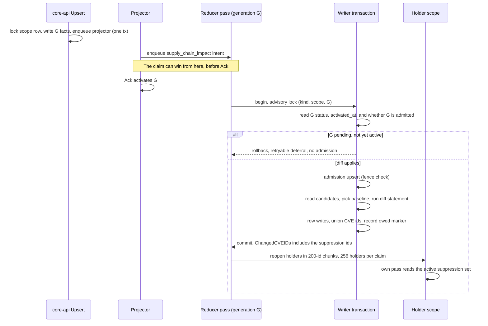
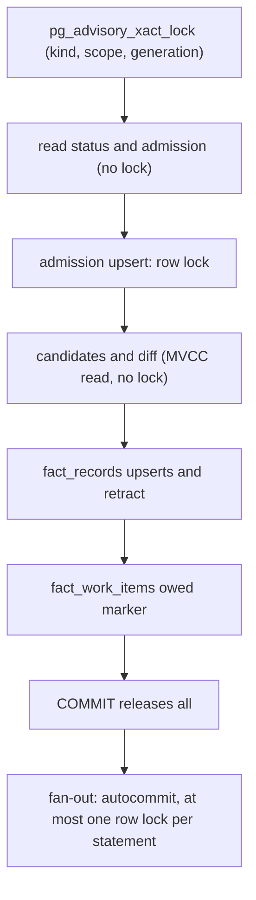

# Suppression Fan-Out For OS Findings Keyed By The Upstream CVE (#10019)

Status: Proposed. Depends on #9914, which is not merged. The pure decision
functions are committed but not called; see [What waits for #9914](#what-waits-for-9914).

## The short version

After #9914 an OS finding is keyed by the upstream CVE. A suppression scoped
`cve_id=CVE-X` then changes no row on the operator pass, so `ChangedCVEIDs` is
empty and no holder reopens. The suppression lands only when each holder next runs
on its own.

The fix: the writer diffs the operator generation's suppression facts against a
baseline generation and unions the CVE ids of the changed suppressions into the
fan-out set. The statement fits inline in the writer transaction with no new index
and no new lock edge (measured below).

This design departs from the sketch in the ruling in two places. Both need a
decision from the arbiter, because the sketch and the code disagree:

1. **The baseline is not the prior generation.** It is the newest older generation
   some pass admitted. The prior generation loses changes when generations coalesce
   (planted and measured below).
2. **The pass defers until its generation is active.** The reducer intent is
   enqueued before the projector's Ack activates the generation, and the claim has
   no activation predicate. A pass that wins that race fans out while holders can
   still only read the old suppression set. This comes from reading the source; it
   has not been reproduced live.

## Flow

```text
core-api Upsert -> full-set generation + facts -> projector Project
  -> enqueue supply_chain_impact intent -> Ack activates generation
  -> reducer claim -> Handle -> writer tx (diff here) -> commit
  -> fanOutHolders -> holders reopen -> holder pass reads the active set
  -> finding row with suppression_state -> query surface
```

Entry points: `SupplyChainImpactHandler.Handle` in `impact.go` runs the pass, and
`commitSupplyChainImpactRows` in `writer_retract.go` owns the transaction. The union
lands where `outcome.changedCVEs` is computed, before `RecordFanOutOwed`, so a
suppression-only change still sets the owed marker.



## Why the prior generation is the wrong baseline

`supersedeInactiveReducerGenerationsCTE` terminalizes an unleased reducer item on a
generation older than the active one. So with generations activated A, B, C, where
B's item is still pending when C activates, B never runs. Its change belongs to no
pass:

| Pass | Plain prior baseline | Change A to B |
|---|---|---|
| C runs, B swept | diff(C, B) | lost |
| B runs late, after C activated | prior of B is now C, so diff(B, C) | lost |
| C runs, then B | diff(C, B) and diff(B, C) | lost |

Planted on the shim, with A holding CVE-A, B adding CVE-B and C adding CVE-C:

| Baseline for C | Chosen | Fan-out set |
|---|---|---|
| `priorGenerationSupplyChainImpactSQL` | B | CVE-C |
| Newest admitted older generation | A | CVE-B, CVE-C |

**Rule.** `supply_chain_impact_write_admission` gets a row from every pass that
reaches the writer, including empty and partial ones, in the same transaction as
the writes. So an admission row means "a pass committed here". The baseline is the
newest older generation that is active or superseded, was activated, and has an
admission row. No DDL is needed.

**Why nothing falls through.** Take a change introduced by activated generation X,
and let P be the first pass to commit among generations at or after X. P's read
sees no committed admission at or after X, so its baseline is older than X and its
range includes X. The active generation's item always runs or dead-letters loudly,
so P exists. Concurrent passes on B and C hold different advisory keys and can both
choose A, which only widens the set. A late pass on a superseded generation must
still diff and not skip, or its admission would move the baseline past a change
nobody fanned out.

**Fallbacks.** With no admitted generation retained, use the oldest retained
activated one: nothing retained was processed, so that span covers all that can
still be compared. Counted as `oldest_retained`. With nothing older, every
suppression is new (`none`). Existing admission rows mean a rollout causes no storm;
edits from before the rollout stay on the holders' own cadence.

## The diff statement

```sql
SELECT COALESCE(cur.stable_fact_key, prior.stable_fact_key) AS stable_fact_key,
       cur.payload #>> '{scope,cve_id}' AS current_cve_id,
       prior.payload #>> '{scope,cve_id}' AS prior_cve_id
FROM (SELECT stable_fact_key, payload FROM fact_records
      WHERE fact_kind = 'vulnerability.suppression' AND is_tombstone = FALSE
        AND scope_id = $1 AND generation_id = $2) AS cur
FULL JOIN (SELECT stable_fact_key, payload FROM fact_records
      WHERE fact_kind = 'vulnerability.suppression' AND is_tombstone = FALSE
        AND scope_id = $1 AND generation_id = $3) AS prior USING (stable_fact_key)
WHERE cur.payload IS DISTINCT FROM prior.payload;
```

- The suppression store carries unchanged payload bytes forward, and JSONB equality
  ignores key order (checked on the shim), so an untouched suppression never shows.
- Both ids are kept, because a re-scope has to reach the old CVE's holders too.
- The literal kinds are why KEV and EPSS cannot join. On the shim, KEV and EPSS facts
  changed in the same scope and generations returned no rows. `decideSuppressionDiff`
  also skips any pass whose own facts hold no suppression, so those scopes never run
  the statement.

`changedSuppressionCVEIDs` turns the rows into the id list, trimmed like the decoder.
`suppressionAdjacent` matches with `EqualFold`, but the holder read
(`findSupplyChainImpactHoldersQuery`) compares exactly, so a lower-case id also yields
its upper form. Otherwise `cve-2026-1` would suppress a finding on the holder's own
pass yet reopen no holder.

## Measurements

Performance Evidence: private native PG18.6, stock settings (`work_mem` 4 MB,
`shared_buffers` 128 MB), full bootstrap schema (302 migrations). Six generations of
100,000 suppressions, plus 300,000 EPSS and 200,000 finding rows across 20 holders.
g6 against g5 changes 1,000 suppressions: 600 edited (50 moved CVE), 200 removed, 200
added. Seven interleaved runs per arm with a rotating first mover, because other
work was running on the host. Times are `EXPLAIN (ANALYZE, BUFFERS)` execution time,
median of seven. Rows from separate rounds are not comparable with each other, since
the load differed. Generic plans come from `PREPARE` and `EXPLAIN EXECUTE` under
`plan_cache_mode`.

| Round, 1-minute load | Arm | Median ms | Range ms |
|---|---|---:|---:|
| A, about 32 | custom plan | 483 | 425-801 |
| A, about 32 | generic plan | 518 | 476-806 |
| B, about 10 | generic, 4 MB `work_mem` | 321 | 317-350 |
| B, about 10 | generic, 64 MB `work_mem` | 193 | 185-196 |
| B, about 10 | generic, sha256 of payload text | 481 | 468-495 |
| C, about 17 | generic, 4 MB `work_mem` | 439 | 375-500 |
| D, about 49 | generic, 4 MB `work_mem` | 666 | 503-1257 |
| D, about 49 | generic, `jsonb_hash_extended` | 627 | 502-658 |

| Other read | Result |
|---|---|
| Diff plan | Hash Full Join over two index scans on `fact_records_scope_generation_idx`; no seq scan |
| Diff buffers | 50,172 pages for 200,000 rows read; 1,000 returned |
| Temp spill at 4 MB | 13,019 pages, about 104 MB; none at 64 MB |
| Candidate read, 6 generations | 0.16 ms median (range 0.13-0.21), tiny-table seq scans |
| No-baseline first pass, 100,000 rows | 33 ms median, 8,420 pages |
| Distinct CVE ids reaching the holder read | 1,028 with the diff, 54,234 without |
| One 200-id holder read, 20 holders | 95 ms, 34,200 pages |
| Unchanged set, g5 against g4 | 0 rows |
| Lock modes during the diff | `AccessShareLock` only (148 relation locks) |

**Against the threshold stated before the run** (under 500 ms p50 warm, no whole-table
seq scan, buffers within about twice the rows): buffers and plan pass. Time passes at
load 10, 17 and 32 with the custom plan, and misses at load 32 with the generic plan
(518 ms) and at load 49 (666 ms). That is a loaded shared host, and the margin to a
10 s read timeout is wide, so the verdict stands: run it inline.

**The fixture is pessimistic on one point.** g1 to g5 were inserted together and
interleave on the heap, so g5 costs 41,751 pages. g6 was inserted alone and costs
8,418. The store writes one generation per transaction, so a real diff should sit
nearer the g6 figure. That is an inference; it was not measured on a real history.

**Rejected shapes.** Comparing a digest gains nothing: `jsonb_hash_extended` wrote the
same temp pages and took about the same time, and adds a false-equal risk that drops a
change silently. sha256 is slower. Raising `work_mem` for this statement is the only
lever that moved the number, and it is not needed.

**The bigger cost is elsewhere.** Inserting g6's 99,800 rows took 6.9 s on this
cluster, because Upsert rewrites the full set per change. At 100,000 suppressions the
diff is a small part of an operator write. The real suppression count is NOT_CHECKED,
so this is a note and not a proposal.

## Cost bound

Holder reads are `ceil(changed ids / 200)`, and reopens are holders of those ids only.

| Case | Ids | Holder reads |
|---|---:|---:|
| Usual Upsert, one suppression | 1, or 2 on a re-scope or lower-case id | 1 |
| 1% of 100,000 changed | 1,028 | 6 |
| Without the diff, same fixture | 54,234 | 272 |
| First generation ever, 100,000 suppressions | 54,234 | 272, drained at 256 holders per claim |

## Concurrency

**Shared state**

| Resource | Owner | This change |
|---|---|---|
| `fact_records` rows of G and baseline | Immutable once written | Read only |
| `supply_chain_impact_write_admission` row | Writer | One new read of the row before the upsert |
| `scope_generations` rows | Projector, retention | Read only |
| `fact_work_items` owed marker, holder rows | Writer, fan-out | Same writes, more often |

**Lock order.** The diff adds no row lock and no new wait edge, because it reads
through MVCC. The order stays as it is today:



The advisory hold grows by the diff's time, about 0.2-0.7 s at 100,000 suppressions.
Only a retry of the same generation contends on that key. No suppression diff runs on
ordinary scopes, so they keep today's statement count. All statements run at Read
Committed; both generations were committed before the pass started and never change.

**Why inside the transaction.** Whether G is already admitted has to be read under
the advisory lock, and the union has to be known before the owed marker is written.
Moving the diff out would need a second lock step for a saving of under a second on
the largest case.

**Retry and delivery matrix**

| Event | State on arrival | Decision | Result |
|---|---|---|---|
| First pass, G active | Not admitted | `ran` | Fan-out set includes the diff |
| Crash before commit | Rolled back, not admitted | `ran` | Same rows, same baseline |
| Crash after commit, before fan-out | Admitted, owed, no remaining | `ran` (Recovery) | Diff repeats; ids join `RecoveryCVEIDs` because finding rows cannot rebuild them |
| Fan-out hit the holder cap | Admitted, `fanout_remaining` set | `skipped_duplicate` | Continuation drains; nothing recomputed |
| Duplicate delivery after success | Admitted, no marker | `skipped_duplicate` | Reopens nobody |
| Reopened later by another scope's fan-out | Admitted, stamped | `skipped_duplicate` | Stops at one hop |
| Pass claims before activation | `pending`, not activated | `deferred_unactivated` | Rollback, no admission, retried |
| Generation failed or superseded while pending | Not activated | `skipped_never_activated` | Its admission is ignored as a baseline |
| Late pass, generation since superseded | Activated, not admitted | `ran` | Covers its own range |
| Fencing token lost | Admission rejected | No diff | Existing superseded path |
| Baseline moves between retry attempts | Older pass admitted meanwhile | `ran` | Narrower range; the older pass covers the rest |
| Holder pending or retrying | Reopen leaves it | n/a | It reads the active set when it runs |
| Holder claimed or running | Replay flag set | n/a | Reruns after an in-flight read |

The retry's baseline is deterministic except in the row above that names the move, and
that move is safe because the older pass owes its own range. A one-hop stamp cannot
cycle here: holders hold no suppression facts, and a generation's diff runs at most
once outside recovery.

**One wiring hazard.** `fanOutHolders` leaves its id list empty on a one-hop pass, and
`owedRecorder` returns nil there. A one-hop first pass on an operator generation would
admit G without fanning out. The reopen query leaves a queued row unstamped, and the
projector enqueues the item before activation, so this path looks unreachable; but the
operator scope can hold findings, so `enqueueMissingHolder` deserves a test. Wiring
must let the diff's ids through regardless of the stamp, and needs a regression for it.

## Failure modes

| Case | Behavior |
|---|---|
| Partial evidence pass | Diff runs anyway. It reads immutable facts and not the loaded evidence, so truncation does not touch it. Retract stays governed by `PartialEvidence` |
| Readiness deferral | Returns before the writer, so no admission and the baseline holds |
| Baseline row pruned | Fact rows cascade with the generation row, so the candidate list no longer holds it and the next older admitted one is chosen |
| Baseline pruned mid-pass | Reads as no prior rows, so everything counts as added. Over-fans, never loses (checked on the shim) |
| Tombstones | Filtered on both sides, so a tombstoned row reads as removed and names its old id; tombstoned on both sides gives no row (checked on the shim). The store has no delete path today |
| Scope with 100,000 suppressions | Measured above: 0.2-0.7 s for the diff and a temp spill near 104 MB at 4 MB `work_mem` |
| Diff read error or timeout | Rollback, `RetryableFanOutError`, retried. A persistent one dead-letters loudly and does not fall back to fanning out nothing |
| Item dead-lettered | The baseline does not move, so a replay covers the range |
| Very large first set | Bounded by holder cap and continuation; the wall time of a full drain is NOT_CHECKED |

## Known limits

1. **A scope with no `cve_id`.** A suppression scoped only by package, PURL, repository,
   or subject digest has no id to fan out by, and an advisory-only scope reaches its
   record on the operator pass per the #9914 note. Those wait for the holder's own pass.
   `countSuppressionsWithoutCVEScope` feeds a counter so this is visible.
2. **Net-zero across coalesced generations.** X added in B and removed in C, where a
   holder ran its own pass during B: diff(C, A) is empty, and the holder keeps the
   suppressed state until its next pass. The direction is the bad one, a finding hidden
   that should show. It needs activate, hold pass, activate within one reducer poll.
   See decision 3.
3. **A generation with no suppression facts.** It names no trigger kind, so no intent
   runs. Harmless while Upsert is the only writer; a future delete path must enqueue.
4. **Expiry.** It is evaluated at read time and mints no generation, so it is not a diff
   trigger and does not fan out.

## Telemetry

The 3 AM question: "an operator wrote a suppression; did the holders reopen, and if not,
why?" New signals, all with bounded labels; none registered yet, because nothing is
wired. No-Observability-Change: this commit adds no runtime path.

| Signal | Shape | Answers |
|---|---|---|
| `eshu_dp_supply_chain_impact_suppression_diff_total` | Counter; `outcome` is a `suppressionDiffAction` or `read_error`, `baseline` is a `suppressionBaseline` kind or `none` | Did the diff run, and from what baseline |
| `eshu_dp_supply_chain_impact_suppression_diff_duration_seconds` | Histogram | Is the statement getting slow |
| Existing `eshu_dp_supply_chain_impact_fanout_total`, `cause=suppression` | Counter | Did holders actually reopen |
| `supply_chain_impact.suppression_diff` span | `diff_rows`, `changed_cve_ids`, `no_cve_scope_rows`, baseline kind, duration | One pass end to end, under the pass's trace |
| Sub-signals on the result | `suppression_diff_rows`, `suppression_diff_cve_ids`, `suppression_diff_no_cve_scope` | Queue-side view beside `fanout_*` |
| One structured log line per diff | `scope_id`, `generation_id`, baseline id and kind, counts, action, duration, no CVE ids beyond a capped sample | Which generation and what it named |

Reading them:

- `deferred_unactivated` climbing without a matching `ran`: the projector Ack is stuck.
- `baseline=oldest_retained` or a repeated `none`: admission history is gone, so expect
  a wide fan-out.
- `ran` with `changed_cve_ids=0` and `no_cve_scope_rows>0`: the operator used a scope the
  fan-out cannot reach. The answer is limit 1.
- `ran` with ids and `fanout_total{cause=suppression}` flat: every holder was already
  queued or there are no holders, which the existing outcome labels split.

## Decisions for the arbiter

1. **Baseline.** Replace "prior generation" in the ruling with the admitted baseline.
   Recommended, with the planted proof above. Accepting the sketch as written loses
   changes on any coalesced burst.
2. **Activation deferral.** Add the deferral for suppression passes, reusing the #5709
   class that freezes `attempt_count`. Recommended. The same race looks open for every
   #9695 fan-out cause (EPSS, KEV, advisory): the handler has no own-generation activation
   check. That is from source only, so it needs a live reproduction and its own issue
   before anyone calls it a defect.
3. **Net-zero (limit 2).** Either accept it and document it, or walk each adjacent
   activated pair from baseline to G and union their diffs. The walk closes it at the cost
   of one statement per coalesced generation, usually one and bounded by retention. I lean
   to the walk: it is the case that hides a finding, and bursts are when an operator is
   already paying several seconds per write.
4. **Acceptance wording.** The issue says the finding "reads `suppression_state` active".
   In `evaluation.go`, `active` means no suppression matched. The criterion should name the
   applied state, such as `accepted_risk`. The issue text should change.

## Tests committed now

`suppression_diff_test.go` holds table tests for the pure functions in
`suppression_diff.go`. RED against zero-value stubs was 38 of 40 failing; the 2 that
passed expect an empty result, which a stub returns. Nothing in production calls them yet.

| Function | Covers |
|---|---|
| `changedSuppressionCVEIDs` | Added, removed, edited, re-scoped, no CVE, blank, Unicode whitespace, lower case, dedupe, order |
| `countSuppressionsWithoutCVEScope` | Limit 1's counter input |
| `unionSuppressionFanOutCVEIDs` | Unchanged set stays empty, suppression-only, overlap |
| `selectSuppressionDiffBaseline` | Plain chain, coalesced, late stale pass, never-activated, failed, no admission, first generation, tie order |
| `decideSuppressionDiff` | KEV, EPSS, advisory, no facts, first pass, superseded-but-activated, pending, never activated, duplicate, recovery, mixed kinds |

## What waits for #9914

- Calling these functions from `commitSupplyChainImpactRows`, and the candidate and diff
  reads. The code does not need the new finding shape, but the behavior cannot be proved
  without it, and shipping it unproved would reopen holders that gain nothing.
- A positive proof: an OS finding keyed by `CVE-X` plus a `cve_id=CVE-X` suppression,
  applied after the operator pass and the holder fan-out, RED first, built on the
  `convergence` harness in `supply_chain_impact_fanout_convergence_live_test.go`. Graph or
  fact proof plus the read API state, on Neo4j as the graph backend.
- Negative and ambiguous proofs on the same harness: an unchanged set reopens nobody, KEV
  and EPSS do not join, and a suppression on a different CVE leaves the holder alone.
- A concurrency proof on real Postgres: duplicate delivery, crash after commit, the
  coalesced chain, a pass before activation, and contention at a representative holder count.
- Telemetry registration, the coverage doc, `HOLDER_FANOUT.md`, the `ChangedCVEIDs` comment
  on `SupplyChainImpactWriteResult`, and the operator guidance in the #9914 note.

**Rebase plan.** After #9914 merges: `git fetch origin`, then `git rebase origin/main` on
this branch. No conflict is expected: at 9c99579a2a #9914 changes `active_filter.go` and
`impact.go` among the fan-out files, and this branch adds only new files. Then rerun the
focused tests, read the merged `signalCVEIDs` to confirm a `cve_id` scope reaches the holder
read as designed, write the positive proof RED, and wire.

## Not checked

- The real suppression count, holder cadence, and holder count in the QA environment.
- The pre-activation race live; it comes from reading the claim query and `Runtime.Project`.
- A full drain's wall time with the real fan-out store. The holder read was timed alone.
- Production `work_mem`, and a truly cold cache: the "cold" read was not OS-cold.
- Real generation layout on the heap, which the fixture only approximates.
