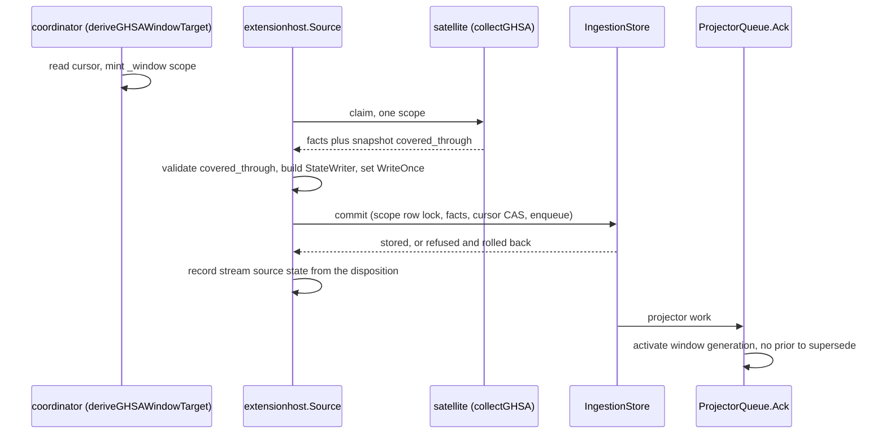

# Give GHSA one write-once scope per cursor window and let the newest copy of an advisory win (#10037)

Status: Accepted (arbiter Q3, 2026-11-06; see [Resolution](#resolution-arbiter-q3-2026-11-06)). This record approves no code, schema change, migration, or deployment. GHSA stays off by default and not activatable until [Activation criteria](#activation-criteria) all hold.

**Decision. Each GHSA advisory type gets a coordinator-planned cursor. Each claim
writes one `vuln-intel://ghsa/<type>/_window/<start>-<end>` scope that is
write-once, so no GHSA generation ever supersedes another and no incomplete
snapshot can replace anything. Retraction comes only from a newer copy carrying
`withdrawn_at`, never from absence. That needs a reducer rule that the newest copy
of an advisory wins; the missing rule is a defect in NVD rolling windows today.**

## Context

- A later stored window replaces the earlier one because core treats a generation
  as a full snapshot of its scope. Ack supersedes the prior active generation
  (`supersedeProjectorActiveGenerationQuery`). Readers join only the active one.
  78 non-test Go files carry the join `active_generation_id = fact.generation_id`.
- A measured run stored 10 records, then 6 disjoint ones, and the first generation
  was superseded. Withholding `trusted_deletion` only widens what
  `backfill.DecideSuccessor` refuses.
- NVD hit the same wall and shipped per-window scopes in #9971 (PR #9983):
  `vuln-intel://nvd/_window/<start>-<end>`, a cursor table, and a compare-and-advance
  inside the commit transaction. That proves the shape, on the in-tree collector
  path only. `cmd/collector-component-extension` wires no cursor writer, and the
  satellite's planner port says the cursor does not advance in any environment.
- GHSA lands only in the extracted satellite (design 9872), behind the extension
  host, which cannot advance a cursor today.
- Measured below: two active copies of one advisory break retraction. The rule in
  `retractionFromObservations` needs every observation retracted, and an older
  live copy counts as a live observation. This blocks any accumulate model and
  affects NVD rolling windows now.
- The per-claim limits stay as the arbiter ruled (`ruling-ghsa-sat.md`, decision 2):
  2 MiB output cap, 4 MiB host stdout default, `collector-sdk/v1alpha1` single call.

## Options

| Option | What it costs | Verdict |
| --- | --- | --- |
| (a) Per-type scope, cursor or delta generations, `withdrawn_at` retracts | A delta's facts are only visible if the 78 reader files union across generations, and retention would have to keep superseded generations. Core's `IsDelta` is git-only: it needs a `delta_generation` repository fact and an anchor commit, and sizes by file union. | Rejected. Rewrites every reader on the accuracy contract to reach what (b) gets with none |
| (b) Per-window scopes that never supersede each other | One scope per window. All copies of an advisory stay active, so the reducer and read models need a newest-copy rule. Readiness needs a rolling leg. The host needs a cursor seam. | **Chosen**, hardened to write-once. NVD precedent, zero changes to the ack path |
| (c) Per-type scope, accumulate-only generation | Each generation holds every advisory seen: about 213 MB a year for reviewed alone against a 4 MiB result (256 MiB even at 64 paged results). A host-side carry-forward copies a growing row set per tick. The satellite holds no prior state, and its cache refuses to read over 16 MiB. | Rejected on measured size |
| (d) Query-driven `affects=<package>` derived scopes | Full snapshot per package slot, so supersession is honest and absence could even attest. Needs a new derivation path, and it duplicates the OSV batch path, which already delivers GHSA ids for owned packages. Outside the accepted 9872 source table. | Rejected now. Revisit only if the newest-copy rule fails its proof |
| Tombstone older copies at commit, no reader change | Every reader would filter them through `is_tombstone`. But two windows committing out of order cannot see each other without serializing a stream, and it rewrites another generation's facts. | Rejected: [Serialization Is Not A Fix](../../../AGENTS.md#serialization-is-not-a-fix) |

## Decision

### 1. Scope model

Grammar, owned by core with the satellite's copy pinned by a shared golden file:

```text
vuln-intel://ghsa/<reviewed|malware>/_window/<start_unix_us>-<end_unix_us>
```

The configured target `vuln-intel://ghsa/<type>` stays as the **anchor**. It holds
the connection fields (`api_key_env`, `results_per_page`, `max_requests`), as the
NVD anchor does. The planner drops it from the plan whenever
`derive_ghsa_rolling_windows.enabled` is set, and core refuses a `ghsa` target
without that flag. A static GHSA claim becomes unreachable, so the hold is
enforced in code, not only in a README. At most one anchor per advisory type.

Planner, per type, per tick the anchor's `refresh_interval` makes due:

```text
start = cursor (unset: now - 30d, the NVD bootstrap lookback)
end   = min(start + 24h, now - 15m)
hold  when end <= start: mint nothing, drop the anchor anyway
```

Limits: `refresh_interval` is required on a rolling anchor, floor 1h, recommended
2h. That is 4,380 windows per type per year at 2h. The 15-minute settle absorbs
clock skew and index lag; the lag figure is a theory (see
[What stays unproven](#what-stays-unproven)). Direct GHSA is a recent-change feed,
not a mirror: an advisory last modified before the bootstrap point stays out until
it changes again, and the OSV path keeps covering owned packages.

### 2. Cursor and coverage

`vulnerability_ghsa_window_cursors` (`collector_instance_id`, `advisory_type`,
`cursor_unix_micro`, `updated_at`), primary key on the first two. The advance runs
through `collector.GenerationStateWriter` in the commit transaction with the NVD
compare-and-advance: only a strictly greater value moves the row.

The satellite states what it covered in a new optional snapshot field,
`covered_through` (RFC 3339), on `vulnerability.source_snapshot`:

| Walk ended | `complete` | `covered_through` | Cursor |
| --- | --- | --- | --- |
| Last page, no refused record | true | `min(window end, response Date)` | advances |
| Last page, record refused as too large | false, `ghsa_record_too_large` | same | advances; the refusal stays on the counter and the log |
| `ghsa_output_budget`, `ghsa_request_budget`, `ghsa_rate_limited` | false | `min(window end, updated_at of the last kept record)` | advances to the prefix |
| Prefix does not pass `start` | n/a | none | claim fails retryable with `ghsa_window_no_progress`, nothing commits |
| Cache replay (`cache_mode` is not `refresh`) | n/a | n/a | claim fails retryable, nothing commits (NVD precedent) |
| Any other fetch failure | n/a | n/a | no commit |

The prefix rule is sound because the walk runs `sort=updated&direction=asc`, the
`modified` range is inclusive at both ends, and pagination is a keyset on
`(updated_at, id)`, all measured. A record that shares the cut second is re-read by
the next window, which starts at `covered_through`. This also turns a burst into
progress instead of a wedge: the same window repeating its output-budget stop
forever is the failure a fixed window would have.

**Invariant.** Every instant in `[bootstrap, cursor)` lies inside a committed
window. A window starts at a cursor value read at plan time, which is at most the
current cursor, and advances to its own `covered_through`, so the union stays
unbroken under any commit order. A refused or rolled-back commit never runs the
writer, so the cursor cannot pass unstored facts. If the host cannot arm the writer
it fails the claim retryable and commits nothing, avoiding the #9971 F-2 wedge.



### 3. Incomplete successors and supersession

**An incomplete generation never supersedes a complete one, because no generation
of a GHSA window scope supersedes anything.** A window scope is write-once: the
first committed generation is final, and what an incomplete window left out is
fetched under the next scope. This closes three holes that a ratio guard leaves
open under at-least-once delivery:

- claim A commits a complete window, loses its lease before completion, and
  redelivery B gets rate limited: B would replace A with less, past a cursor that
  will not come back;
- A commits a prefix through `t1`, and B commits a shorter prefix through `t2`:
  the gap `(t2, t1]` would never be fetched again;
- a complete successor under half the prior's facts, because records moved to a
  later window, would be refused and read as a hold.

Enforcement: a new `WriteOnce` field on `scope.ScopeGeneration`, and a first arm in
`backfill.DecideSuccessor` that refuses when a prior generation is `pending` or
`active`, closed label `SuccessorGuardRuleWriteOnce`. A prior that only `failed`
does not count, so the generation can still be stored. The prior read happens
before the commit's scope lock today (`successorPriorForGuard`), so the arm rechecks
inside the commit transaction after the scope-row upsert. A write-once refusal is
benign: it records no hold and changes no source-state row.

A window whose projection fails terminally has advanced the cursor over facts that
never go active. Readiness reports it as `ghsa:window_projection_failed`, and
projector dead-letter replay is the repair.

### 4. Retraction

- **Only signal:** a newer copy with non-null `withdrawn_at`, which the envelope
  already turns into `status`. Measured: all 100 most recently updated withdrawn
  reviewed advisories have `updated_at` at or after `withdrawn_at`, and 99 within
  60 seconds, so a withdrawal enters the `modified` feed the cursor walks.
- **Never absence.** A window says nothing about records outside it, so a GHSA
  claim never attests `trusted_deletion`, and that stays true.
- **Un-withdrawal:** a later copy with null `withdrawn_at` is the newest copy, so
  the finding returns.
- **Hard delete without `withdrawn_at`:** no signal exists, since the endpoint's
  parameters offer none. The fact stays. This is an accepted limit.

**Newest-copy rule (lane 1).** For one payload `source` and `advisory_id`, the copy
with the greatest `modified_at` is the record, and an unparseable or empty
timestamp ranks oldest. A recency tie — equal instants, or both timestamps empty
or unparseable — breaks live-beats-retracted through the closed classifier
`advisoryRetractionCode`, and only a same-lifecycle tie breaks on the greater
`FactID` (#10401: a FactID order is hash-derived, so hiding a live vulnerability
on zero evidence would spend the expensive error). Older copies leave the group
whole: their `vulnerability.cve` and `affected_package` facts both go, so a package
GitHub removed from an advisory stops matching. The rule is a pure function of the
active facts, so commit order and concurrency cannot change it.

Keeping `source` in the key preserves the ruling on GHSA and OSV: a direct copy and
an OSV-carried copy stay two observations of logical source `ghsa`, one
`AdvisorySources` row, both evidence fact ids. A direct withdrawal with a live OSV
copy keeps the finding until OSV catches up, which is the safe direction.

Re-trigger: the window's generation runs `supply_chain_impact` like any advisory
generation, and the holder fan-out in `reducer/supplychain/core/fanout.go` (#9695)
reopens every scope holding a changed CVE. No new trigger is needed.

### 5. Migration 278 and public advisory registration

**Window scopes are never public-advisory registered, and the `ghsa` arm of
migration 278 should not merge.** Registration is static per scope and pins a
configuration hash, and the protected read caps at 256 authorities and 50,000
facts (`authorizedImpactAuthorityLimit`, `authorizedImpactAdvisoryFactLimit`), so
rolling scopes cannot fit. A registered per-type anchor is worse than useless: it
would never receive a generation, and `len(authorities) != expected` returns
`policy_unavailable` for **every** public advisory in the protected read (from
reading the loader, not run).

Without the arm, `reconcile_public_advisories_v1` refuses `ghsa` with its existing
`public advisory target source unsupported`, which is the desired behavior. The
scanner keeps OSV-carried GHSA ids through registered OSV scopes. What else changes
in the #9959 pair: `authorizedImpactExpectedKinds` loses `ghsa`, the validator's
scope pin moves to the anchor rule above, and `SourceForScopeID` widens per
[Fix list](#fix-list). Arbiter question 2 covers the case where the pair merged
first.

**Merged state, recorded 2026-11-06.** The #9959 pair merged as #10115 (`923a508659`, on `origin/main`) with no migration files and no `ghsa` expected-kinds arm. Green on `origin/main` at `442970def2`: `TestPublicAdvisoryReconcileFunctionDoesNotAdmitGHSA`, `TestAuthorizedImpactHasNoGHSAAuthority`, and `TestAuthorizedImpactKeepsOSVCarriedGHSAIDs`. Question 2's corrective path is unneeded.

### 6. Source state and readiness

- The recorder keys GHSA rows by **stream**, the anchor scope, not by window, and
  writes the bounds to the existing `window_start` and `window_end` columns. That is
  two rows per instance. Per-window rows would add 8,760 a year and crowd the status
  read, which is `ORDER BY updated_at DESC LIMIT 200`, and old rows would age to
  stale for no reason.
- Readiness (lane 3) adds a GHSA rolling leg modelled on
  `readinessNVDWindowScopesCTE`: expected rows come from the latest run's
  `requested_scope_set`, and a planned window is covered when its exact scope has an
  active snapshot with `covered_through` equal to the window end. `ghsa` joins
  `fetchConfirmedSources` under the advisory family.

### 7. Satellite cache and freshness

The cache key already holds the window bounds, so each window gets its own artifact
and retention cleanup bounds them. A replay never advances the cursor. `freshnessHint`
works unchanged per scope, and `covered_through` enters the digest as content.

### 8. Limits and growth

- Output: 2 MiB cap and 168h anchor validator unchanged; a minted window is at most
  24h. Normal reviewed day: 782,033 bytes, 37% of the cap, so a 2h window is about
  65 KB. Bursts cut to a prefix, for example 100 reviewed records in 8h 3m.
- Growth at 2h: 8,760 scopes a year across both types, about 213 MB of reviewed
  facts a year. No compaction in this delivery. File one when window scopes pass
  20,000 or when the key probe below passes 200 ms warm.
- Measured at five years of growth, 43,800 scopes and 1.1M facts, warm: reducer key
  probe of 500 advisories 53.9 ms against 26.0 ms in two scopes (+31% buffers); the
  catalog's unanchored spine 313.6 ms against 98.6 ms (11.8x buffers). The key probe
  is acceptable. The catalog is the read to watch, and lane 3 re-measures it.
- This narrows the accepted 9872 row, "15 to 30 min", to a 2h recommended cadence
  with a 1h floor. 30 minutes would mint 175,200 scopes in five years, for freshness
  that the OSV path already narrows on owned packages (arbiter question 1).

### 9. Malformed `Link` (P3-2)

**Fix it in the satellite; the arbiter's deferral no longer holds.** Today
`rel='next'` reads as the last page, which only mis-stated a flag. Under this design
it would set `covered_through` to the window end and the cursor would skip the rest
of the window forever. `ghsaNextLink` must return one of three results: next, last,
or malformed.

- Last requires every entry in a present `Link` header to parse under RFC 8288, with
  `rel` a token or a double-quoted string. A well-formed header with only `prev` or
  `first` is the real last page.
- Malformed covers single quotes, a missing `rel`, an empty value, or an unparseable
  entry. It fails retryable with closed reason `ghsa_link_malformed`, no facts.
- An absent `Link` header is last. A full page with no `Link` stays legal.

### Fix list

| Defect | Change | Files | Owner |
| --- | --- | --- | --- |
| `SourceForScopeID` misses `ghsa` | Done for the per-type scope on the #9959 and F1 branches, which conflict in `scope.go`. Widen to `ghsa/<type>/_window/<digits>-<digits>` and keep the rest refused. Add `vulnsource` helpers for window-to-stream | `go/internal/vulnsource/scope.go`, `scope_test.go`; `impact/readiness_source_scope_parser_test.go` (lane 3 table) | This lane, S3 |
| Readiness refuses a `ghsa` target | F1 commit `4f28d893f4`, unpushed, gated on lane 3. Then the rolling leg | `impact/readiness_postgres_query_targets.go`, a new `readiness_postgres_query_ghsa_window.go`, `readiness_source_age.go` | Lane 3, S5 |
| Refused commit recorded as fresh success | See below | `storage/postgres/successor_guard.go`, `collector/claimed_service.go`, `claimed_service_commit_observer.go`, `extensionhost/claim_outcome.go`, `vulnerabilityintelligence/checkpoint/recorder.go` | This lane, S2 |
| Older copy blocks retraction, load order picks severity | Newest-copy rule | `reducer/supplychain/core/provenance.go`, `provenance_selection.go`, `retraction.go`, plus `active_filter.go` to prove every copy loads | Lane 1, S1 |
| Read models read stale copies (`MAX(cvss_score)`, evidence rows) | Same rule in SQL, `DISTINCT ON` the source and advisory | `query/supply/chain/advisory/catalog_sql.go`, `evidence_sql.go` | Lane 3, S5 |
| Malformed `Link` | Section 9 | satellite `ghsa_client.go`, its tests | Satellite, S4 |

**Refused-commit fix.** Today the guard rolls back and `CommitScopeGeneration` returns
`nil`, so `ClaimedService` runs the committed observer and the recorder writes `fresh`
with the discarded window's count. The fix is source-neutral:

1. `collector.WithCommitDisposition(ctx)` carries a box that the store marks refused
   with the rule, like the `withNVDWindowFetchObservation` context box. The error
   return stays `nil`, so no collector starts failing claims.
2. `ClaimedService` skips `observeClaimedGenerationCommitted` and
   `recordClaimFactsEmitted` on a refusal, and calls a new optional
   `ClaimedGenerationRefusalObserver`.
3. `extensionhost.Source` forwards to a new `RecordClaimRefused`. The recorder writes
   `FreshnessPartial`, `TerminalPartial`, `last_error_class` of
   `destructive_successor_refused`, with no `last_success_at`, so `COALESCE` keeps the
   last real success and `result_count` stays what was stored. A `write_once` refusal
   writes nothing.

`cicdrun/ghactionsruntime` also advances its watermark from the committed observer,
so it stops advancing on a refusal too. S2 adds a row proving that.

## Consequences

Good: advisories accumulate with no change to ack or any reader's join; retraction
has one rule; an incomplete window costs progress, never truth; the newest-copy rule
and the refused-commit fix also repair NVD and every extension source.

Bad: one scope per window until compaction exists; a 2h cadence instead of 15 to 30
minutes; direct GHSA is absent from the protected scanner read; a terminal projection
failure needs replay because the cursor advances at commit.

Follow-ups, filed only when the trigger fires: (1) window compaction, on the section 8
thresholds; (2) stream-keyed source state for NVD, once status crowding is measured;
(3) paged results (`v1alpha3`), only if `ghsa_window_no_progress` fires on real data.

## Implementation plan

| Step | Repo and owner | Work | Depends on |
| --- | --- | --- | --- |
| S0 | Both, this goal | Merge the #9959 pair off by default, per the ruling, without the 278 arm if question 2 holds | Ruling |
| S1 | Core, lane 1 | Newest-copy rule and the GHSA and OSV proof handed over in #9209 | None, fixes NVD |
| S2 | Core, this lane | Refused-commit disposition | None |
| S3a | Core, this lane | `covered_through` contract, minor bump, factschema release | None |
| S3b | Core, this lane | Window grammar, planner with shared golden vectors, migration, cursor store, `deriveGHSAWindowTarget`, validator rules, `WriteOnce` arm | S3a |
| S3c | Core, this lane | Host seam: `ClaimCommitPolicy` returning `StateWriter` and `WriteOnce`, wired in `cmd/collector-component-extension`; stream keys in the recorder; telemetry | S2, S3b |
| S4 | Satellite | Pin factschema, resolve the window scope, `covered_through` with the `Date` clamp, prefix cut, malformed `Link`, release | S3a; merges after S3c is on `main` |
| S5 | Core, lane 3 | Readiness rolling leg, F1, `fetchConfirmedSources`, read-model newest copy | S1, S3b |
| S6 | Deploy and QA | Real tokened run in the QA environment. **QA-window state, recorded 2026-11-06:** unscheduled — no owner, no schedule, and no token exists (`rg` for `tokened run\|QA environment` and a `ghsa` token/schedule/owner across `docs/`, `go/`, `specs/`, `.agents/` finds only this plan row; #10037 carries no scheduling comment). S3a stays design-prep until S6 is scheduled and the factschema release (rc.18) is pinned | S1 to S5 |
| S7 | Both | Drop the "not activatable" note from the satellite README and core docs together | Activation criteria |

**Must land together or in this order:** S3a before S4, since the satellite pins the
contract. S3c before S4's release, or a window claim fails with `unknown_scope`. S7 is
a pair. Everything else stays off until an operator sets the flag, so each step is safe
alone, and no step serializes a stream. S1 ships on its own priority: it fixes NVD.

**Follow:** `deriveNVDWindowTarget`, `compareNVDWindowCursor`,
`readinessNVDWindowScopesCTE`, and the `ScopeQueryResolver` optional-seam pattern.
**Avoid:** planner math without golden vectors; scope ids or bounds on a label; any
fallback from a held window to the static anchor.

**Telemetry for 3 AM** (`telemetry-coverage` applies):

- `eshu_dp_ghsa_cursor_lag_seconds{advisory_type}` gauge. A growing value means stuck.
- `eshu_dp_ghsa_window_advance_total{advisory_type,outcome}`, closed outcomes
  `advanced`, `prefix`, `held`, `no_progress`.
- `eshu_dp_ingestion_successor_guard_decisions_total{rule="write_once"}`, new label.
- `eshu_dp_supply_chain_advisory_copies_shadowed_total{source}` from the reducer.
- The existing refusal log stage names scope, generation, and rule. The hold gauge and
  `successor_held_stale` stay for non-benign rules. Plan span attributes carry counts.

**Proofs and gates per step:**

| Step | Failing test first | Gates |
| --- | --- | --- |
| S1 | Older live plus newer withdrawn retracts; removed package stops matching; selection independent of load order; NVD `Rejected` case; the two #9209 cases; quarantined copy keeps today's never-retract rule | Focused core tests, `golden-corpus-gate-neo4j`, `ifa-determinism`, `go-race-complete` |
| S2 | Refused commit writes `partial` and no `last_success_at`; stored and unchanged cases unchanged; watermark holds | Focused, `telemetry-coverage` |
| S3a | Schema accepts it, unknown remains refused | `factschema-diff`, `payload-usage-manifest` |
| S3b | Live: two overlapping transactions advance to the max; the write-once recheck sees a racing commit under the scope-row lock; a rolled-back commit leaves the cursor, so the next plan keeps its start | Live DSN cells on the ledger, migration checksum and order tests, `scripts/verify-performance-evidence.sh` |
| S3c | Cannot arm means no commit; replay means no commit; `no_progress` means no commit; out-of-range `covered_through` refused | Focused, race, `telemetry-coverage` |
| S4 | Each row of the coverage table; a seeded `rel='next'`; the real-size generator from ruling 2.4; mutations on the prefix and the clamp | Satellite `make ci`, 91% coverage floor, mutation table |
| S5 | Fixture intent, reducer truth, and API agree; catalog before and after on the shim's shape | Live readiness cells, `EXPLAIN` evidence |

## Activation criteria

GHSA stays not activatable until each holds, with evidence in the S7 PR:

- [ ] S1 to S5 merged, and the satellite release pinned in `eshu-deploy`.
- [ ] One fixture advisory goes live, withdrawn, then un-withdrawn across three real
      windows, and the graph, finding, catalog, and evidence agree at each step.
- [ ] The 10-then-6 disjoint run leaves all 16 advisories active, none superseded.
- [ ] A forced output-budget stop commits a prefix, and the next window starts at the
      cut with no record lost.
- [ ] 72-hour tokened run in the QA environment for both types: cursor lag under `refresh_interval`
      plus 1h, no `no_progress`, request budget under the 2,500 per hour ceiling, and
      no secret in any surface.
- [ ] Malware volume measured over that run, replacing the sample below.
- [ ] Late records measured: none older than the cursor by more than the settle.
      Otherwise raise the settle.
- [ ] Catalog and key probe re-measured on the built binary against the QA environment's real
      `ingestion_scopes`, within section 8's thresholds.

## Acceptance criteria

Maps to the #10037 criteria:

- [x] A committed design doc decides scope granularity, the retraction rule, and what
      an incomplete successor may supersede (this record, sections 1, 3, 4).
- [ ] `rg -n 'SourceGHSA' go/internal/vulnsource/scope.go` matches, a window scope
      parses, and a real GHSA claim writes one stream source-state row (S2, S3).
- [ ] A refused commit reads `partial` with `last_success_at` unchanged (S2).
- [ ] `ghsaNextLink` returns malformed for `rel='next'`; the snapshot is not complete
      and no facts publish (S4).
- [ ] The GHSA and OSV same-advisory proof test passes in the reducer (S1).
- [ ] `rg -n 'not activatable' README.md` is empty in the satellite, with no such note
      in core docs (S7).

## Decisions for the arbiter

1. **Cadence.** Narrow the accepted 9872 row from 15 to 30 minutes to a 2h recommended
   cadence with a 1h floor. Options: (a) accept, the default here; (b) keep 30 minutes
   and accept 35,040 scopes a year, unmeasured past 43,800 total; (c) add daily
   buckets that refetch an open window, which multiplies writes about 48 times.
2. **Migration 278.** Options: (a) if the pair has not merged, drop the `ghsa` arm and
   its `authorizedImpactExpectedKinds` row, the default here; (b) if it merged, add a
   workflow validator refusal for a `ghsa` entry in `public_advisory_targets` and a
   later migration restoring the body without the arm; (c) keep the arm with no
   refusal, which leaves the `policy_unavailable` trap open.
3. **NVD priority.** The newest-copy defect is real for NVD with
   `derive_nvd_rolling_windows` on. Options: (a) file it for lane 1 now under #10037
   as S1, the default here; (b) also warn operators against enabling the flag until
   S1 lands. No deployment was checked for the flag.

### Resolution (arbiter Q3, 2026-11-06, per the lane-4 drive claim on #10037)

1. **Cadence: accepted** — 2h recommended, 1h floor (section 8); the 9872 GHSA row carries the `Amended by #10037` note.
2. **Migration 278: no corrective path** — merged #10115 carries no migration and no `ghsa` arm (see section 5).
3. **NVD priority: S1 under #10037** — newest-copy ships on its own priority; no deployment checked for the flag, so the operator caution stands unverified.

## What stays unproven

- API index lag. The 15-minute settle is a theory, checked by the activation criterion.
- Real read cost on a production `ingestion_scopes`; the shim holds only GHSA rows.
- Commit-path contention and lock waits under real load; S3b's live cells test the
  order, not the rate.
- First-touch read cost. The window layout's first run was 8.6 s and 15.0 s against
  64 ms and 206 ms, right after a 293 s load. I did not find the cause, so the warm
  figures are the only comparable ones.
- Whether reducer second-hop loading always pulls every copy (`active_filter.go`).
  Lane 1 proves it in S1.
- `reducer/retirement` and retention on long-lived window scopes, by reading only.

<details>
<summary>Evidence and measurements</summary>

Core line citations are at `a35f7077a6`.

**Reducer probe** (scratch `git archive`, removed; log and test in
`~/.cache/out-9958/ghsa-window-shim/`). `go test ./internal/reducer/supplychain/core/
-run TestWindowProbe -v`, exit 0:

```text
nvd observations: 2 retracted: false
retraction(older live, newer withdrawn) = false
retraction(newer withdrawn only) = true
older-first: severity=9.8 vector=OLD fixed="1.0.1" range=">=1.0.0,<1.0.1" sources=1 branches=2
newer-first: severity=5 vector=NEW fixed="1.0.2" range=">=1.0.0,<1.0.2" sources=1 branches=2
```

The load comes back in fact-id order (`facts_active_supply_chain_impact.go`), and fact
ids hash scope and generation (`factenvelope/adapter_generated.go:36-40`), so the
winner between copies is arbitrary. `fanout.go` reopens holders. No dedupe on
`stable_fact_key` exists in `reducer/supplychain/core`.

**Read-scale shim** (`postgres:16.15`, `shared_buffers=512MB`, container removed;
`run.sh`, `load.sql`, `probe.sql`, and outputs in the same directory). Same rows in
both layouts: 122,500 copies, 60,000 distinct advisories, 8.6 facts a copy. Window
layout: 2 types x 4,380 windows x 5 years. Runs 2 and 3 agree within 3%; run 3 shown.

| Query | 43,800 scopes | 2 scopes |
| --- | --- | --- |
| Key probe, 500 `advisory_id`, `branches.go` `anchored` shape | 53.9 ms, 14,246 buffers, 1,021 active pairs | 26.0 ms, 10,872 buffers, 2 pairs |
| Catalog spine, every active cve, group by advisory | 313.6 ms, 186,033 buffers | 98.6 ms, 15,791 buffers |
| Readiness, one exact scope | 0.065 ms | Not comparable: planner seq-scans half the table |

The first two shim runs were invalid and are not used: one hit the entrypoint's init
server, and one overflowed `r*43800` in int4 with the exit read after a pipe.

**GitHub** (unauthenticated, no token read, 5 GETs on 2026-11-04, plus the docs page):

- `is_withdrawn=true&sort=updated&direction=desc&per_page=100`: 100 rows;
  `updated_at - withdrawn_at` min 0 s, median 1 s, max 8,286,602 s; 100 at or above 0,
  99 within 60 s.
- `type=reviewed&modified=2026-10-28..2026-11-04`, page 1: 100 rows, `updated_at`
  monotonic, 0 before start, 0 after end, 2 withdrawn, spanning 13:12:34 to 21:15:16,
  at most 2 sharing a second.
- `type=malware`, same window, page 1: 100 rows, monotonic, 2026-10-28T02:22:49Z to
  2026-10-29T15:31:36Z, about 65 a day, 2,457 raw bytes a record. One page, not a week.
- A range starting at, and one ending at, the first record's exact second each return
  it: inclusive at both ends.
- `after` decodes to `cursor:v2:` plus `[updated_at, numeric id]`, so pagination is a
  keyset.
- Docs: `modified` "only show advisories that were updated or published on a date or
  date range"; `withdrawn_at` is a required nullable field; `affects` accepts at most
  1000 packages.

**Prior measurements:** 315 reviewed records, 2,698 facts, 4,089,185 bytes in 168h; 51
records and 782,033 bytes in one day (`review-ghsa-sat-r1.md`, P2-2). The 10-then-6 run
and the refused-commit row are in `dev-ghsa-collector-client.md`.

**Citations** (satellite at `b05f53a`, by symbol):

- Supersede: `projector_queue_sql.go:43-50`, `projector_queue_ack.go:111`. Guard:
  `backfill/successor_guard.go:74-94`; refusal `storage/postgres/successor_guard.go:439-456`,
  `return true, nil`.
- Readers: `facts/impact/branches.go:77-91`, `advisory/catalog_sql.go:96-105`.
- Reducer: `retraction.go:52-71`, `provenance_selection.go:164-178`.
- NVD: `vulnruntime/nvd_window_scope.go:21`, `nvd_window_planner.go:79`,
  `nvd_window_claim.go:256`, `vulnerability/nvd_window_cursor.go:40`; wired at
  `cmd/collector-vulnerability-intelligence/service.go:88`, absent from
  `cmd/collector-component-extension/service.go`.
- Limits: `extensionhost/process.go:20`, `extensionhost/pagination.go:35`.
- Registration: `public_advisory_claim.go:18-37`,
  `supply_chain_impact_authorized_advisory.go:21-22,50-56,82-84`, migration 278 lines
  162-182 on `drive/9959-ghsa-admission` at `a533803060`.
- Host: `extensionhost/claim_outcome.go:38-52,175-186`, `claimed_service.go:359-361`,
  `checkpoint/recorder.go:162`.
- Source state: `vulnerability/source_state.go:99,174`,
  `impact/readiness_source_age.go:50-53`.
- Satellite: `ghsaNextLink`, `collectGHSA`, `sourceCacheTargetDescriptor`,
  `freshnessHint`, `completeStatus`.

</details>
