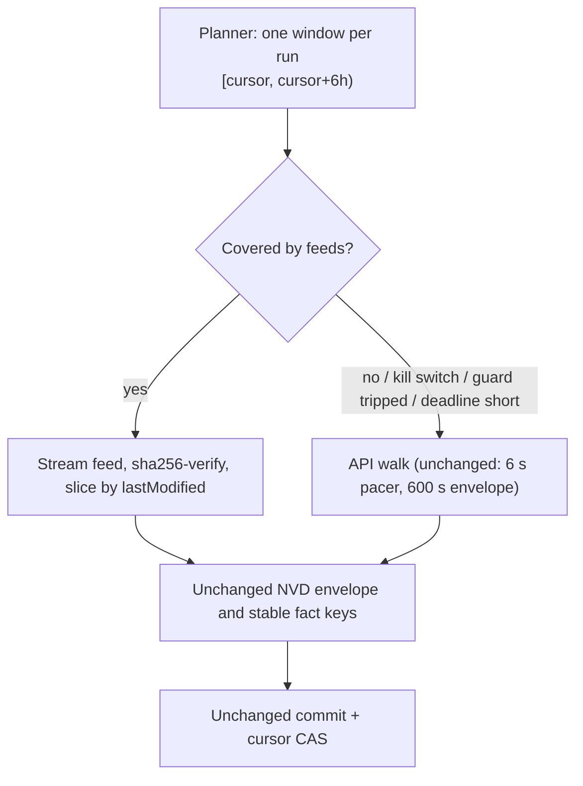

# Serve NVD windows from the 2.0 JSON feeds when the API cannot finish them (#10671)

Status: Accepted (arbiter ruling 2026-11-15, two passes:
[the ruling](../arbiter/10671-cvelist-mirror-ruling-2026-11-15.md)). This record
approves no code, migration, contract change, deployment, or QA enable. Each is
a follow-up below with its own proof.

**Decision. Do not build a CVE List v5 whole-corpus mirror; add the official NVD
2.0 JSON data feeds as a second transport inside the existing NVD window
claim.**

The satellite picks the transport per claim by coverage, not by a health guess:
when the planned window fits inside what the feeds contain, it serves the window
from the feeds; otherwise it runs the API exactly as today. The feed records are
NVD's own, so every NVD-only field translates unchanged and the fact contract
does not change. The CVE List stays what it is, an owned-CVE supplement.

This record answers the issue's four decisions and five acceptance criteria. The
issue asked for a CVE List mirror "or a chosen alternative"; the alternative
won.

## Context

Measured 2026-11-15; every figure and its sample are in the
[measurements note](../evidence/10671-nvd-feed-measurements.md).

- NVD windows fail on QA: the last success was 2026-11-13 17:10Z, and 14 window
  items are `failed_terminal`. The drain cursor is at 2026-10-17, **about 28 days**
  behind (28.3 days to the 05:00Z read), not the "11+ hours" the issue states (M1).
- The API fails in two ways: fast edge 503s (2 of 13 requests from the QA pod
  returned 503) and 3 to 13 s first bytes. A key, the pod's egress IP, and page depth
  are not the cause (M10). The satellite's per-claim 503s after 28 to 50 s stay
  unexplained and belong to collector#97.
- The feeds answer in 0.29 s, carry the full NVD record (34,675 of 34,675
  `cpeMatch` entries have `matchCriteriaId`; all seven `vulnStatus` values; all
  CVSS families), and matched the API on 20 of 20 sampled records (M2, M8).
- The CVE List cannot stand in. Its CPE applicability has no `matchCriteriaId`
  (0 of 13,405 entries), reproduced 0 of 72 NVD analyst CPE matches, and has no
  `vulnStatus` beyond REJECTED. Emitting `affected_product` from it needs a new
  contract field, a dedupe rule on finding identity, a migration CASE change,
  and cap raises; readiness fails closed above 200 targets against 627 upstream
  shards; a full shard overflows the 10,000-fact claim cap as a non-retryable
  terminal.
- Load matters. The winners dirty log holds 1.08M rows, about 58 hours old, and
  rows come from the reducer's finding upserts, not from raw facts (migration
  272), so rows per NVD fact is not measured. Today's inflow (1.0 to 1.8k rows a
  minute) is OSV/GHSA-keyed, not NVD (M6).

## Options

| Option | Cost | Verdict |
| --- | --- | --- |
| A. CVE List whole corpus as facts, delta tail, shard regeneration, or an allowlist (D1, D2, D2b, D3) | New contract field, migration CASE, cap raises, 627-shard readiness, rewrites severity on every owned finding (rank 5 beats 6) | Rejected |
| B. CVE List per-ID for owned CVEs (shipped) | Cannot cover NVD windows; 100 per claim at 1 per second | Kept as the supplement |
| C. Third-party NVD-shaped mirror | Different trust root, no license, unsigned commits, stalled 49 h at probe | Rejected |
| D. NVD 2.0 JSON feeds as a second transport | One small satellite change plus core telemetry; no contract change | **Chosen** |
| E. Keyed API tier or pacing change | No measured effect on the failure (M10) | Deferred |
| F. Wait for NVD to recover, accept stale | Rejected by the 2026-11-12 ruling; contradicts #9309 | Rejected |

## Decision

### 1. Coverage rule (per claim, UTC, half-open windows `[s, e)`)

Inputs: the Modified feed's span from its own records, `M0` = min and `M1` = max
`lastModified`, computed while streaming with sha256 checked against `.meta`; a
year-set manifest with each year's `.meta` time `D_y` and sha256; `R = max D_y`;
and `verified_at_Y`, the time the refresher last matched year file `Y` against
the upstream `.meta`. The seed validity horizon is per year:
`V_Y = min(verified_at_Y, R) - 24 h`. A year is stale when `V_Y < M0`.

A window is covered when `e <= M1` and (`s >= M0` or `e <= V_Y` for every year
`Y` the window reads). Served records are
the year-set records with `lastModified` in `[s, e)`, overlaid by Modified
records by CVE id (Modified wins). Otherwise the API runs. **No window claim
opens a year file.** The year-set records are read through the window tail
described under "Seed read through the window tail" below, not by scanning
`nvdcve-2.0-<year>.json.gz`; only the baseline lane reads year files.

**Selector order (healthy path stays free).** (1) One `.meta` GET (10 s). (2) If
`e` is at or after the `.meta` `lastModifiedDate`, the window cannot be covered
(`M1` precedes it): go straight to the API with no feed read. A caught-up system
therefore pays one small GET per claim, never the 7.35 MB stream. (3) Only for an
older window, stream the Modified feed to compute `M0` and `M1`. Any error in
steps 1 to 3 (a missing `.meta`, a timeout, a sha256 mismatch while only probing)
means "not covered": the API runs, a counter increments, and the claim never
fails on the selector's account. Feed errors fail a claim only after the feed
path was selected (see Errors).
- The horizon is `M1`, not the `.meta` write time (44 minutes ahead in one
  sample); `M1` is the latest instant observed in the feed, and a record stamped
  earlier but committed after generation is the same convergence case as the API
  path (section 2).
- Year files are rewritten only when a record changes, so dormant files carry
  old times. A strict `e <= D_y` per file would send every window after
  2026-10-21 to the API. Evidence for regenerate-on-change: the 12,818 Modified
  records (9 days, 0 violations, M4) and the arbiter's 32,939-record band test
  (17 paced API pages; method recorded in the ruling only, not re-run by the
  coordinator). This is empirical, not a NIST guarantee.
- **Accepted blind spot.** A dormant-year record changed after its file's `D_y`
  and before `M0` is visible to neither the guard (it reads Modified records
  only) nor the year file. Mitigation, owned by follow-up C: a periodic API
  cross-check of the dormant years. Until it exists, QA enable for windows older
  than `M0` carries this risk knowingly.
- **Guard.** For each Modified record with `lastModified <= V_Y`, where `Y` is
  the record's year, require `D_Y >= lastModified`. On a trip: class `nvd_feed_year_stale` (retryable,
  never terminal), mark the year set invalid, run the API, count the trip.
- A healthy, caught-up system never takes the feed path: `e` is after the
  `.meta` time, so the selector stops at step 2 and the API runs. No flag flips
  and nothing flaps.
- **Why two terms.** `R` alone let one year that regenerates daily vouch for a
  year the refresher stopped confirming, so each year also carries its own
  `verified_at_Y`. Neither term implies the other, and `min(a, b) - 24 h < M0`
  holds exactly when either `a - 24 h < M0` or `b - 24 h < M0`. The `verified_at_Y`
  term catches a stuck refresher (one year the refresher keeps failing). The `R`
  term catches a stalled upstream (NVD stops regenerating year files while the
  refresher keeps matching the frozen `.meta`, which keeps every `verified_at_Y`
  fresh). The 24 hours is regeneration lag, not clock-skew slack, and the guard
  has no clock of its own: a `verified_at_Y` ahead of real time is not caught
  here. The refresher-side skew check is tracked as
  eshu-hq/eshu-collector-vulnerability-intelligence#185. The guard never reads
  year `Y`'s own `D_y`, for the dormant-year reason above.
- A year not verified for about six days opens a hole (`V_Y < M0`, with `M0`
  about eight days back); the claim is sent away from the seed (a baseline chunk
  refuses retryable as `nvd_feed_year_stale`, a window goes to the API) until the
  refresher restamps the year. The six days is the refresher's budget: one
  successful pass every six days per year, against a daily default cadence. See
  ADR-0006 in the collector repository. Today the collector passes a zero seed
  horizon on the window path, so the `e <= V_Y` branch never fires there and the
  per-year guard applies to baseline chunks only. The ruled replacement is the
  tail reader below, which runs `V_Y`, stale precedence and the guard on the
  tail's year pins (collector #198).
- If the remaining claim deadline is under 150 s the selector chooses the API.
  The tail reader adds a second floor, described below.

**Seed read through the window tail (ruled 2026-11-16, not yet built).** Serving
the gap by scanning year files per claim costs 47 to 62 s a claim against a lease
shared by every page of a paged group, so a 6-page group cannot finish
([measurements M12](../evidence/10671-nvd-feed-measurements.md); ruling:
[10671-window-seed-scan-ruling-2026-11-16.md](../arbiter/10671-window-seed-scan-ruling-2026-11-16.md)).
The ruling keeps the seed as the source for the gap and changes how it is read:

- **The refresher builds a window tail.** At the end of a refresh pass, under its
  single-writer lock (ADR-0006), `collector refresh-nvd-seed` copies every record
  stamped at or after a low bound `L` into a gzip bucket per UTC day of its stamp
  (`L` is the start of the UTC day of the pass clock minus `--window-tail-days`,
  default 60, range 31 to 120). A self-contained tail manifest pins each year's
  digest, `last_modified`, `verified_at` and counts, so a claim that reads only
  the tail manifest sees one consistent seed generation. Built by collector issue
  [#204](https://github.com/eshu-hq/eshu-collector-vulnerability-intelligence/issues/204).
- **A window claim reads the one or two day buckets its window touches.** Selection
  is by stamp alone, verified against the tail manifest, and no claim opens a year
  file. Read by collector #198, rebased on #204.
- **Four seed classes route the claim.** `nvd_feed_before_seed` is new: `s < L`,
  the API runs, expected, no alarm, and there is no slow fallback to year files.
  The other three exist on the #198 branch and keep their meaning:
  `nvd_feed_covered_seed` (served from the seed, an ordinary outcome),
  `nvd_feed_beyond_seed` (the seed is fresh but `e` is past its horizon `V`, so
  the API runs, an ordinary outcome) and `nvd_feed_seed_unavailable` (the API
  runs, operational: alert on it). The ruling widens the last to cover a missing,
  unreadable or unknown-format tail manifest, a year not pinned, a year with an
  unreadable stamp count above zero, and a bucket that fails its digest while the
  tail generation is unchanged. `nvd_feed_year_stale` keeps its meaning. Core
  reads no selector class today; the four names are scope for
  [eshu#10716](https://github.com/eshu-hq/eshu/issues/10716).
- **Deadline floor.** After the probe and the tail manifest read, the claim needs
  at least 75 s plus bucket bytes divided by 4 MiB/s remaining, or it routes to the
  API as `nvd_feed_deadline_short`. The byte count comes from the manifest before
  any read, so the verdict is deterministic.
- **Enable preflight.** The deployed lease, `nvd_seed_dir`, seed volume free space
  and a QA canary are
  [eshu#10817](https://github.com/eshu-hq/eshu/issues/10817).

### 2. Unchanged by construction

One window per planner run from the single cursor; same scope grammar
`nvd/_window/<start>-<end>`; same `nvd_envelope` and stable fact keys; same
fencing on upsert; the cursor advances only through the commit-transaction CAS to
the committed window end or the prefix-commit boundary, never past `M1`, never by
hand. A record changed after feed generation is upserted again by the later window
that contains its new `lastModified`, the same convergence the API path has.

Boundaries and head. The feed path slices half-open `[s, e)`. The API treats
`lastModStartDate` and `lastModEndDate` as inclusive at both ends (the pinned
boundary test in the satellite says so), so a record at exactly `e` can appear
in both adjacent windows; stable keys make that upsert idempotent. R1 compares
the two slices after trimming the API result to `[s, e)`. The satellite's cursor
verdict clamps to `min(plannedEnd, head)`, where `head` is the response
`timestamp`. On the feed path `head` is stamped as `M1` (never the larger
header generation time), so the clamp can never pass `M1`, and a missing head
holds the cursor as it does today. The lag gauge keeps its name but gains a
`transport` label, because its head means "feed horizon" on that path.

### 3. Overflow

A covered window whose slice exceeds 10,000 facts or 2 MiB commits whole
`lastModified` groups as a prefix and advances the cursor to that boundary; the
remainder replans from there. Never a shed, never a terminal. A Modified-feed
day reaches 23.5k facts and the Oct 17 stuck window held 4,982 records, so the
rule is expected to run during catch-up (M5, M10).

If the first `lastModified` group alone exceeds 10,000 facts or 2 MiB (one
record reached 2,048 facts), the cursor cannot advance on the feed path. That
window routes to the API walk, which has its own retryable no-progress refusal
(`ErrNVDNoProgress`), and the selector counts it with class
`nvd_feed_group_oversize`. It never loops silently: the claim is retryable, the
cursor holds, and the counter pages. The existing 10-attempt cap is the
backstop that escalates a window that keeps failing, and during an API outage
this route is a dead end until the API answers or the record is handled by hand.

### 4. Field dispositions

Under the chosen source every NVD field is an identity translation; contract
class none.

| NVD field | Disposition | Proof |
| --- | --- | --- |
| `cpeMatch` (criteria, `matchCriteriaId`, bounds, negate) | identity | 34,675 of 34,675 carry the id (M2) |
| `vulnStatus` | identity | all seven states present (M2) |
| `cvssMetricV2/V30/V31/V40` with source and type | identity | families present (M2) |
| reference tags, `sourceIdentifier`, CWEs, descriptions | identity | 20 of 20 records deep-equal to the API (M8) |
| `affected_product.source` | not added | only a second emitter of that kind needs it |
| `source_snapshot` | add `transport`, feed time, sha256 as untyped keys | additive payload keys |

For the retained CVE List supplement: `cvssV2_0`, reference tags,
`rejectedReasons`, and `dateRejected` become additive untyped reads. SSVC,
`unaffected`, and `replaced_by` stay CVE List only.

### 5. Limits

| Limit | Value |
| --- | --- |
| Facts and bytes per claim | 10,000 and 2 MiB for window claims (unchanged). A baseline chunk is record-atomic, 16 MiB at most, and paged (ruled; [10728-baseline-pacing.md](10728-baseline-pacing.md) section 2) |
| Windows per planner run | 1 (at most 10,000 facts per 30 min, about 20k dirty rows an hour worst case) |
| Meta GET timeout | 10 s |
| Feed GET timeout | 120 s total, 100 KB/s stall floor |
| Decompressed size cap | fail closed above 1 GiB (largest year is 528 MiB) |
| Memory | streamed; target at most 256 MiB RSS, proved by R7 (not yet measured) |
| Lease and heartbeat | deployed 10 m and 30 s (code defaults 60 s and 20 s) |
| Attempts and retry | 10 and 60 s (unchanged) |
| Year-feed footprint | 237.6 MiB gzip for 25 files; decompressed 2.7 GiB (2,809 MiB), never held whole. Per-claim scan of all 25 files, measured (R7b, M12): 61.7 s and 47.4 s in two runs, so the window path does not scan them |
| Window tail (ruled, #204) | 60 days by default: 88,927 records in 61 day buckets, 549,909,230 raw and 67,664,342 gzip bytes, built in one 59.2 s pass; a 6 h window of the gap is served in 0.24 s p50 and 1.4 s worst (M12) |
| Seed-read deadline floor (ruled, #198) | 75 s plus bucket bytes divided by 4 MiB/s; the measured bucket read rate is 47 to 51 MB/s |

Errors once the feed path was selected: sha256 mismatch, gateway errors, and
timeouts are retryable; nothing on the feed path maps to the capacity terminal.
A missing or failing `.meta` is never a claim failure: the selector treats it as
"not covered", runs the API, increments a counter, and the alert on that counter
is how an operator learns the feed is gone.

### 6. Write budget (criterion 3)

Bounded by existing constants and one window per run; no new row class and no
corpus-wide fan-out. The gap facts are extrapolated, not measured, and shown as a
range: the Modified sample gives 10.1k facts a day (290k for 28 days); the
arbiter's 45,757 records over 25 days at the measured 7.07 facts a record give
about 13k a day (about 375k). The 116 windows take about 58 h at one per 30
minutes, bound by planner cadence, so 5.0k to 6.5k facts an hour.

Dirty rows come from the reducer's finding upserts, filtered by content digest,
and from the pointer trigger (migration 272), not from raw facts. The rows per
NVD fact is therefore unmeasured, and one CVE or affected-product change can
touch many findings, so one row per fact is a guess, not a ceiling. At one row
per fact catch-up would add about 5.0k to 6.5k rows an hour, 5 to 11 percent of
today's 1.0 to 1.8k a minute; real fan-out per CVE could be higher. A
disposable-database run of
one planted window, counting dirty rows per committed fact, is part of
follow-up A's proof; until it exists the trip line, not this estimate, is the
control.

### 7. Claims, queue, and cutover back (criterion 4)

No backfill wave, no new work-item class, no second instance, no concurrent
same-cursor windows. A feed attempt that outlives its lease is fenced by the
claim-row lock and the `fencing_token` filter. The satellite decides per claim;
the coordinator decides nothing new. The kill switch `nvd_feed_transport: off`
forces the API from the next claim. Cutover back is the coverage rule itself:
when the cursor catches up, every window fails coverage and the API resumes.

### 8. Rollout and the QA-enable gate

Build now; do not wait for NVD to recover. QA enable needs both the transport and
the year-set seed. Enable is governed: one window per run, and the kill switch
flips off if NVD-proxy dirty rows exceed 15,000 an hour in two consecutive hourly
samples, or the oldest dirty-log row exceeds 96 h; re-enable under 48 h. Record
six hourly samples after enabling. The #10706 bars stay soak bars. Then the
2026-11-12 soak bar applies unchanged.

Who flips it: an alert pages the operator, who sets `nvd_feed_transport: off`;
nothing flips automatically. "NVD-proxy dirty rows" means dirty-log rows written
after the enable whose `advisory_id` starts with `CVE-`; OSV also carries CVE
ids, so the proxy over-counts and trips early, which is the safe direction. The
96 h age trip is a page, not an automatic flip: the OSV/GHSA backlog is already
58 h old, so the operator compares against the pre-enable baseline before
acting.

## Failing-first plan (criterion 5)

Red before green: R1 feed and API slice equivalence on a half-open window (the API
result trimmed to `[s, e)`); R2 selector, R2b flap over a recovery-then-relapse
sequence, and R2c a caught-up cursor with the feed host down still commits via the
API with no feed read; R3 error classes, including a missing `.meta` meaning "not
covered"; R4 overflow prefix commit and replay with no duplicate keys, and R4b a
first group over the cap routes to the API with class `nvd_feed_group_oversize`;
R5 claim-plane golden trace through the extension host, asserting the stamped
head is `M1`, the cursor never passes it, and the negative head-minus-now skew does
not surface as a time-anomaly alert; R6 two attempts of one window
converge under fencing; R7 streaming benchmark with a 256 MiB RSS target, and R7b
a wall-clock and RSS test scanning the 2026 year file and the full 25-file set; R8 telemetry gate; R9
product-path representative prefers a scored row; R10 CVE List additive reads;
R11 `cvelist_shard.go` accounting (facts are records times 1 + refs); R12 dormant
year file accepted; R13 guard trips (fixture record dated after `M0`); R14 horizon uses `M1`; R15 stale-seed hole
routes to the API.

## Consequences

Good: NVD can drain without the API edge; no contract change; no new scope,
cursor table, or readiness leg; the API stays primary when healthy.

Bad: a new dependency on NVD's feed files and on an empirical regeneration
policy, guarded at run time; a roughly 238 MiB seed on the host volume; the QA
failure cause stays open.

Follow-ups, all filed under epic #9209:

- A. [collector#99](https://github.com/eshu-hq/eshu-collector-vulnerability-intelligence/issues/99):
  feed client, slicer, coverage selector, overflow rule, error classes (R1 to
  R4b, R7, R14).
- B. [eshu#10716](https://github.com/eshu-hq/eshu/issues/10716): kill switch,
  telemetry (transport label, feed-age gauge, guard and deadline counters),
  golden trace, wider cursor reader, NIST sunset watch (R5, R6, R8; watch
  file `docs/internal/evidence/nvd-2.0-feeds-sunset.watch`).
- C. [collector#100](https://github.com/eshu-hq/eshu-collector-vulnerability-intelligence/issues/100):
  year-feed seed through the baseline store, with the manifest, guard, and a
  dormant-year API cross-check (R7b, R12, R13, R15). Required before QA enable.
- D. [collector#101](https://github.com/eshu-hq/eshu-collector-vulnerability-intelligence/issues/101):
  CVE List supplement additive reads (R10).
- E. [eshu#10717](https://github.com/eshu-hq/eshu/issues/10717): product path
  picks a scored observation, not rank alone (R9). The reducer rank (`cve_list`
  5 above `nvd` 6) stays as is; the owner's CNA-first severity decision is
  recorded here, not pre-empted, and a change to it needs its own ruling.
- F. [eshu#10718](https://github.com/eshu-hq/eshu/issues/10718): `cvelist_shard.go`
  accounting (R11). The supersession notes on #9872 and #9961 are in this PR.
- G. Added by the 2026-11-16 seed-scan ruling (R7b is now measured, M12):
  [collector#204](https://github.com/eshu-hq/eshu-collector-vulnerability-intelligence/issues/204)
  builds the window tail and blocks collector #198, which reads it;
  [eshu#10817](https://github.com/eshu-hq/eshu/issues/10817) is the enable
  preflight and canary; the four seed classes are scope for eshu#10716 (B).

## Implementation plan

Satellite: new `nvd_feed_client.go`, the selector in the NVD window collect path,
`nvd_output_budget.go`, `source_state.go`. Core: vulnerability intelligence
config, extension-host cursor wiring, telemetry registry and the
telemetry-coverage doc. Follow the existing NVD envelope; avoid a second fact
path. At 3 AM an operator reads the `transport` label on window claim metrics,
`eshu_dp_vulnerability_nvd_feed_age_seconds`, the guard and deadline counters, and
the lag gauge (with its new `transport` label). Never log the key or the feed body.

## Acceptance criteria

- [x] An arbiter verdict names the architecture and source (the ruling).
- [x] Every NVD fact field has a disposition with proof (section 4).
- [x] A Postgres write budget with its measurement (section 6, M5 and M6).
- [x] Claim and queue behavior, pacing, lease safety, and the cutover-back rule
  (sections 5, 7, 8).
- [x] A failing-first regression plan before implementation (the plan above).
- [x] Follow-ups A to F filed and linked, each with an existing label.

No-Regression Evidence: this record changes no runtime behavior, wire contract,
or gate.

No-Observability-Change: the signals above are planned, not shipped.
