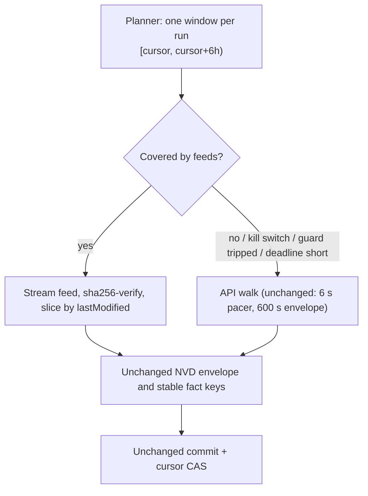

# Serve NVD windows from the 2.0 JSON feeds when the API cannot finish them (#10671)

Status: Accepted (arbiter ruling 2026-11-15, two passes:
[the ruling](../arbiter/10671-cvelist-mirror-ruling-2026-11-15.md)). This record
approves no code, migration, contract change, deployment, or QA enable. Each is
a follow-up below with its own proof.

**Decision.** Do not build a CVE List v5 whole-corpus mirror. Add the official
NVD 2.0 JSON data feeds as a second transport inside the existing NVD window
claim. The satellite picks the transport per claim by coverage, not by a health
guess: when the planned window fits inside what the feeds provably contain, it
serves the window from the feeds; otherwise it runs the API exactly as today.
The feed records are NVD's own, so every NVD-only field translates unchanged and
the fact contract does not change. The CVE List stays what it is, an owned-CVE
supplement.

This record answers the issue's four decisions and five acceptance criteria. The
issue asked for a CVE List mirror "or a chosen alternative"; the alternative
won.

## Context

Measured 2026-11-15; every figure and its sample are in the
[measurements note](../evidence/10671-nvd-feed-measurements.md).

- NVD windows fail on QA: the last success was 2026-11-13 17:10Z, and 14 window
  items are `failed_terminal`. The drain cursor is at 2026-10-17, **29 days**
  behind, not the "11+ hours" the issue states (M1).
- The API fails in two ways: fast edge 503s (about one request in five from the
  QA pod) and 3 to 13 s first bytes. A key, the pod's egress IP, and page depth
  are not the cause (M10). The satellite's per-claim 503s after 28 to 50 s stay
  unexplained and belong to collector#97.
- The feeds answer in 0.29 s, carry the full NVD record (34,675 of 34,675
  `cpeMatch` entries have `matchCriteriaId`; all seven `vulnStatus` values; all
  CVSS families), and matched the API on 20 of 20 sampled records (M2, M8).
- The CVE List cannot stand in. Its CPE applicability has no `matchCriteriaId`
  (0 of 13,405 entries), reproduced 0 of 72 NVD analyst CPE matches, and has no
  `vulnStatus` beyond REJECTED. Emitting `affected_product` from it needs a new
  contract field, a dedupe rule on finding identity, a migration CASE change,
  and cap raises; readiness fails closed above 200 targets against 627 upstream
  shards; a full shard overflows the 10,000-fact claim cap as a non-retryable
  terminal.
- Load matters. The winners dirty log holds 1.08M rows, about 58 hours old, and
  one fact upsert writes about one row. Today's inflow (1.0 to 1.8k rows a
  minute) is OSV/GHSA-keyed, not NVD (M6).

## Options

| Option | Cost | Verdict |
| --- | --- | --- |
| A. CVE List whole corpus as facts, delta tail, shard regeneration, or an allowlist (D1, D2, D2b, D3) | New contract field, migration CASE, cap raises, 627-shard readiness, rewrites severity on every owned finding (rank 5 beats 6) | Rejected |
| B. CVE List per-ID for owned CVEs (shipped) | Cannot cover NVD windows; 100 per claim at 1 per second | Kept as the supplement |
| C. Third-party NVD-shaped mirror | Different trust root, no license, unsigned commits, stalled 49 h at probe | Rejected |
| D. NVD 2.0 JSON feeds as a second transport | One small satellite change plus core telemetry; no contract change | **Chosen** |
| E. Keyed API tier or pacing change | No measured effect on the failure (M10) | Deferred |
| F. Wait for NVD to recover, accept stale | Rejected by the 2026-11-12 ruling; contradicts #9309 | Rejected |

## Decision

### 1. Coverage rule (per claim, UTC, half-open windows `[s, e)`)

Inputs: the Modified feed's span from its own records, `M0` = min and `M1` = max
`lastModified`, computed while streaming with sha256 checked against `.meta`; a
year-set manifest with each year's `.meta` time `D_y` and sha256; `R = max D_y`;
seed validity horizon `V = R - 24 h`.

A window is covered when `e <= M1` and (`s >= M0` or `e <= V`). Served records are
the year-set records with `lastModified` in `[s, e)`, overlaid by Modified
records by CVE id (Modified wins). Otherwise the API runs.

- The horizon is `M1`, not the `.meta` write time (44 minutes ahead in one
  sample); `M1` is the only instant proven included.
- Year files are rewritten only when a record changes, so dormant files carry
  old times. A strict `e <= D_y` per file would send every window after
  2026-10-21 to the API. Evidence for regenerate-on-change: 45,757 records over
  25 days, zero changed after their own file's write and before the latest
  daily run. This is empirical, not a NIST guarantee.
- **Guard.** For each Modified record with `lastModified <= V`, require
  `D_{year} >= lastModified`. On a trip: class `nvd_feed_year_stale` (retryable,
  never terminal), mark the year set invalid, run the API, count the trip.
- A healthy, caught-up system never takes the feed path: `e = now > M1`, so
  coverage fails and the API runs. No flag flips and nothing flaps.
- A seed older than about six days opens a hole (`V < M0`); the selector sends
  that window to the API. Re-seed to close it.
- If the remaining claim deadline is under 150 s the selector chooses the API.

### 2. Unchanged by construction

One window per planner run from the single cursor; same scope grammar
`nvd/_window/<start>-<end>`; same `nvd_envelope` and stable fact keys; same
fencing on upsert; the cursor advances only through the commit-transaction CAS to
the committed window end or the prefix-commit boundary, never past `M1`, never by
hand. A record changed after feed generation is upserted again by the later window
that contains its new `lastModified`, the same convergence the API path has.

### 3. Overflow

A covered window whose slice exceeds 10,000 facts or 2 MiB commits whole
`lastModified` groups as a prefix and advances the cursor to that boundary; the
remainder replans from there. Never a shed, never a terminal. A Modified-feed
day reaches 23.5k facts, so this rule runs in practice (M5).

### 4. Field dispositions

Under the chosen source every NVD field is an identity translation; contract
class none.

| NVD field | Disposition | Proof |
| --- | --- | --- |
| `cpeMatch` (criteria, `matchCriteriaId`, bounds, negate) | identity | 34,675 of 34,675 carry the id (M2) |
| `vulnStatus` | identity | all seven states present (M2) |
| `cvssMetricV2/V30/V31/V40` with source and type | identity | families present (M2) |
| reference tags, `sourceIdentifier`, CWEs, descriptions | identity | 20 of 20 records deep-equal to the API (M8) |
| `affected_product.source` | not added | only a second emitter of that kind needs it |
| `source_snapshot` | add `transport`, feed time, sha256 as untyped keys | additive payload keys |

For the retained CVE List supplement: `cvssV2_0`, reference tags,
`rejectedReasons`, and `dateRejected` become additive untyped reads. SSVC,
`unaffected`, and `replaced_by` stay CVE List only.

### 5. Limits

| Limit | Value |
| --- | --- |
| Facts and bytes per claim | 10,000 and 2 MiB (unchanged) |
| Windows per planner run | 1 (at most 10,000 facts per 30 min, about 20k dirty rows an hour worst case) |
| Meta GET timeout | 10 s |
| Feed GET timeout | 120 s total, 100 KB/s stall floor |
| Decompressed size cap | fail closed above 1 GiB (largest year is 528 MiB) |
| Memory | streamed, at most 256 MiB RSS in the benchmark |
| Lease and heartbeat | deployed 10 m and 30 s (code defaults 60 s and 20 s) |
| Attempts and retry | 10 and 60 s (unchanged) |
| Year-feed footprint | 237.6 MiB gzip for 25 files; decompressed 2.8 GiB, never held whole |

Errors: sha256 mismatch, gateway errors, and timeouts are retryable; a missing
Modified `.meta` is non-retryable with its own class and pages; nothing on the
feed path maps to the capacity terminal.

### 6. Write budget (criterion 3)

Bounded by existing constants and one window per run; no new row class and no
corpus-wide fan-out. The 29-day gap is about 290k facts (10.1k a day, Modified
sample); the 116 windows take about 58 h at one per 30 minutes, bound by planner
cadence. At one dirty row per fact that adds about 4.6k rows an hour, 4 to 8
percent of today's inflow. The upsert path was measured earlier: 334 rows in 39
to 74 ms, 14.3 ms in `EXPLAIN (ANALYZE, BUFFERS)` on `fact_records_pkey`.

### 7. Claims, queue, and cutover back (criterion 4)

No backfill wave, no new work-item class, no second instance, no concurrent
same-cursor windows. A feed attempt that outlives its lease is fenced by the
claim-row lock and the `fencing_token` filter. The satellite decides per claim;
the coordinator decides nothing new. The kill switch `nvd_feed_transport: off`
forces the API from the next claim. Cutover back is the coverage rule itself:
when the cursor catches up, every window fails coverage and the API resumes.

### 8. Rollout and the QA-enable gate

Build now; do not wait for NVD to recover. QA enable needs both the transport and
the year-set seed. Enable is governed: one window per run, and the kill switch
flips off if NVD-proxy dirty rows exceed 15,000 an hour in two consecutive hourly
samples, or the oldest dirty-log row exceeds 96 h; re-enable under 48 h. Record
six hourly samples after enabling. The #10706 bars stay soak bars. Then the
2026-11-12 soak bar applies unchanged.

## Failing-first plan (criterion 5)

Red before green: R1 feed and API slice equivalence on a half-open window; R2
selector (and R2b flap over a recovery-then-relapse sequence); R3 error classes;
R4 overflow prefix commit and replay with no duplicate keys; R5 claim-plane
golden trace through the extension host; R6 two attempts of one window converge
under fencing; R7 streaming benchmark under 256 MiB; R8 telemetry gate; R9
product-path representative prefers a scored row; R10 CVE List additive reads;
R11 `cvelist_shard.go` accounting (facts are records times 1 + refs); R12 dormant
year file accepted; R13 guard trips; R14 horizon uses `M1`; R15 stale-seed hole
routes to the API.

## Consequences

Good: NVD can drain without the API edge; no contract change; no new scope,
cursor table, or readiness leg; the API stays primary when healthy.

Bad: a new dependency on NVD's feed files and on an empirical regeneration
policy, guarded at run time; a roughly 238 MiB seed on the host volume; the QA
failure cause stays open.

Follow-ups (numbers filled in when filed):

- A. Collector: feed client, slicer, coverage selector, overflow rule, error
  classes (R1 to R4, R7, R14).
- B. Core: kill switch, telemetry (transport label, feed-age gauge, guard and
  deadline counters), golden trace, wider cursor reader, NIST sunset watch (R5,
  R6, R8).
- C. Year-feed seed through the baseline store, with the manifest and guard (R12,
  R13, R15). Required before QA enable.
- D. CVE List supplement: additive reads (R10).
- E. Product path picks a scored observation, not rank alone (R9).
- F. Record corrections: `cvelist_shard.go` accounting (R11) and supersession
  notes on #9872 and #9961.

## Implementation plan

Satellite: new `nvd_feed_client.go`, the selector in the NVD window collect path,
`nvd_output_budget.go`, `source_state.go`. Core: vulnerability intelligence
config, extension-host cursor wiring, telemetry registry and the
telemetry-coverage doc. Follow the existing NVD envelope; avoid a second fact
path. At 3 AM an operator reads the `transport` label on window claim metrics,
`eshu_dp_vulnerability_nvd_feed_age_seconds`, the guard and deadline counters, and
the unchanged lag gauge. Never log the key or the feed body.

## Acceptance criteria

- [x] An arbiter verdict names the architecture and source (the ruling).
- [x] Every NVD fact field has a disposition with proof (section 4).
- [x] A Postgres write budget with its measurement (section 6, M5 and M6).
- [x] Claim and queue behavior, pacing, lease safety, and the cutover-back rule
  (sections 5, 7, 8).
- [x] A failing-first regression plan before implementation (the plan above).
- [ ] Follow-ups A to F filed and linked, each with an existing label.

No-Regression Evidence: this record changes no runtime behavior, wire contract,
or gate.

No-Observability-Change: the signals above are planned, not shipped.
