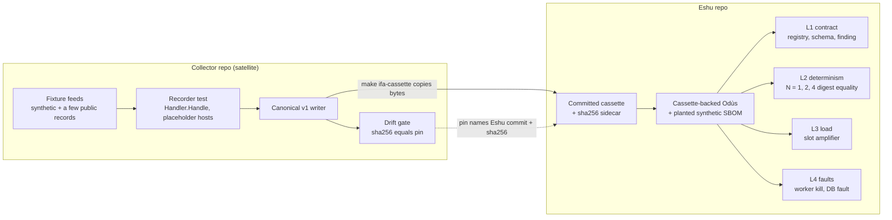

# Record the vulnerability collector's real output as an Ifá Odù (#10734)

Status: Proposed (2026-11-15). This record approves no code, spec, gate, or
contract change. Each change is a build step below with a failing-first test,
and four need an owner decision first (see Open questions).

**Decision.** The collector repo records its own output with a test-side
recorder that writes an Eshu v1 cassette. Eshu commits that cassette as data and
loads it into a small family of Odùs that share one recording. The Odùs differ
only in which recorded scopes they select and which synthetic SBOM components
they plant. The two repos are tied by a pinned Eshu commit plus the cassette's
sha256, not by a module dependency. The first spike also found a real seam bug
(F1 below); land it failing-first.

## What the spike showed

I ran the real provider against local fake feeds, mapped the output through the
real host mapping, then through the real registry validator and reducer. The two
scratch tests are deleted; nothing from the spike is committed.

- **S1. Eshu accepts the collector's real payloads.** NVD (`vulnerability.cve`,
  `.affected_product`, `.reference`, `.source_snapshot`), KEV (`.known_exploited`,
  snapshot) and EPSS (`.epss_score`, snapshot) facts all sit in
  `facts.FactKindRegistry()` with a payload schema.
  `conformance.ValidatePayloadSchemas` over `fixturepack.SchemaFor` returned no
  error for all four recorded scopes.
- **S2. The NVD product path fires on real output.** A synthetic SBOM component
  whose `cpe` equals a recorded `criteria`, plus an attachment and an image
  identity, made `core.BuildSupplyChainImpactFindings` return one finding:
  `affected_derived`, confidence `derived_product`, CVSS 9.8 CRITICAL with the
  vector, KEV true (tier `kev`), EPSS 0.71 / 0.98, priority bucket `critical`.
- **S3. The two honest negatives hold.** A component on a `*` version-range
  criteria produced no finding. A Rejected record with a matching CPE produced a
  finding that carries an advisory retraction.
- **S4. F1, a real seam bug.** The collector copies NVD's `lastModified` into
  the cve payload's `modified_at` verbatim (`2026-11-08T07:00:00.000`, no zone).
  The reducer's `newestCopyInstant` parses RFC 3339 only, so it ranks such a
  copy as having no recency. With a live copy in an earlier window and a Rejected
  copy in a later window, the finding was **not** retracted, in either load
  order. The same facts with `Z` appended were retracted. The published schema
  types `modified_at` as `string|null` with no format, so nothing catches this
  today. NOT_CHECKED: a live NVD response. The format comes from the collector's
  own fixture helper, which documents it as NVD's stamp.
- **S5. Recordings are not byte-stable yet.** The httptest port leaks into every
  `source_ref.uri` and into the snapshot's `coverage_descriptor`
  (`endpoint_candidates`, `executed_endpoint`).
- **S6. `odu:vuln-pack` reaches no finding.** `core.BuildSupplyChainImpactFindings`
  and `ifa.DiscoveredEvidence` both returned 0 over its facts (scratch run).

## Answers to the six questions

**Q1. Does `odu:vuln-pack` reach a finding, and by which path?** No path.
It carries twelve schema-valid samples (`fixturepack.ValidPayload` plus one
suppression shape), no SBOM component, no attachment and no image identity.
The NVD product path needs exact `cpe` == `criteria` (case-insensitive,
trimmed) plus `reducer_sbom_attestation_attachment` and
`reducer_container_image_identity`; the package path needs a purl and consumption
evidence. It has neither (S6). Its samples also differ from real output: the cve
sample is a minimal OSV-style record with RFC 3339 `Z` stamps, while a real NVD
cve fact carries `source: nvd`, `status`, zone-less stamps, descriptions, `cwes`,
`cvss_metrics` and anchors. That is how F1 stayed hidden: the sample timestamps
parse and the real ones do not.

**Q2. Does the collector validate against the factschema, and does Eshu accept
its payloads?** Not at runtime, and yes. The collector pins
`eshu-sdk/factschema` in `go.mod`, but its one production import is
`nvd_coverage_descriptor.go`, which builds the typed `vulnerabilityv1` struct for
the snapshot's coverage descriptor. `ValidateSchemaVersion` is a version-string
gate that mirrors the core admission hook; it has no production caller, only
`parity_test.go` and the test cassette loader. Payload shape is checked against
the published schemas in tests only, and no test runs that check over NVD facts:
`TestEmittedPayloadsSatisfyPublishedSchemas` drives `Handler.Handle` with a fake
provider that returns EPSS facts, and `TestOSVPayloadsSatisfyPinnedCVESchema`
covers the OSV cve shapes. On the Eshu side S1 shows the registry and schemas
accept the real NVD, KEV and EPSS payloads. NOT_CHECKED on the Eshu side: OSV,
GHSA, CVE List, go-module and govulncheck output (outside this issue).

**Q3. How are Ifá cassettes recorded, refreshed, loaded?** A v1 `cassette.File`
holds scopes; each scope carries `scope_id`, `source_system`, `scope_kind`,
`collector_kind`, `partition_key`, `metadata`, `generation_id`, `observed_at`,
`trigger_kind`, and facts with `fact_kind`, `stable_fact_key`, `schema_version`,
`payload`, `source_confidence`, `source_uri`, `source_record_id`. A fact may
also carry `fencing_token`; it defaults to 1 and the recorder omits it.
In-tree collectors record with `recorder.Run` over a live `collector.Source`
(`-mode=record`); `replay.Canonicalize` writes the bytes (see "Cassette
contract"); the label-gated `refresh-cassettes.yml` re-records and opens a PR
whose diff is the canonical diff. `cassette.NewSource` replays one scope per
`Next`, stamping `CassetteReplay` fact ids through `cassette.DeriveFactID`.
`schema.ValidateCassetteBytes` checks every `testdata/cassettes/*/*.json`
offline (`TestCommittedCassettesValid`). Today a family Odù is a compiled Go
literal registered in `catalog_seed.go` with a committed cassette beside it, and
a lockstep test requires the two to be equal (`uses_service_account` is a
documented exception). The in-tree producer moved to its satellite (eshu#9999),
so no `cmd/collector-vulnerability-intelligence` is left for
`refresh-cassettes.yml` to run, and `recorder` is an internal package of the
Eshu module. The satellite needs its own writer.

**Q4. Where does each piece live?** Recorder: the collector repo, as in-package
tests (its provider seams `nvdFeedTransport`, `nvdFeedBaseURL`, `nvdAdmission`
and the `nvdFeedRig` fixtures are unexported test code, and a production binary
should not grow a recording mode). Committed cassette: Eshu `testdata/cassettes`.
Drift gate: "Drift gate decision" below.

**Q5. What do the ledgers require?** "Gate and spec footprint" below.

**Q6. How does #10729 become a slot?** "Slot for #10729" below.

## Architecture

Mermaid syntax is not render-checked (NOT_CHECKED).

### Cassette contract

One cassette, five scopes, all produced by running `Handler.Handle` over the
collector's own HTTP clients against local servers:

| Scope | Content (synthetic ids in the 9xxxx range) |
| --- | --- |
| NVD window 1 | A exact-CPE Analyzed with CVSS v3.1 and CWE; B `*` version range; C Rejected with exact CPE; D vector-only metrics; E label-only metrics (D, E shapes verified in step 3) |
| NVD window 2 | A modified again later, now Rejected (newest copy) |
| NVD window X | one old CVE, recorded under a window-style scope as a stand-in for the baseline copy |
| KEV | one entry for A, plus its snapshot |
| EPSS | one score for A, plus its snapshot |

A few real public NVD records join window 1 (operator capture of public data,
attribution kept); see Open questions for the source.

Recorder rules, each pinned by a test:

- **Fixed hosts.** Route placeholder hosts (`*.example.test`) to the local
  servers with an `http.RoundTripper`, so no port reaches `source_ref.uri` or
  the snapshot (S5). The NVD window and feed clients, KEV and EPSS all take
  `Provider.HTTPClient`, so one transport covers them.
- **Fixed clock.** Provider `Now`, claim ids and instance id are constants.
- **Scope fields mirror the host.** NVD window `scope_id` is the shared-golden
  `vuln-intel://nvd/_window/<startµs>-<endµs>`; `source_system` and
  `collector_kind` are `vulnerability_intelligence`; `scope_kind` is
  `scope.KindVulnerabilityIntelligence` (also `vulnerability_intelligence`). The
  triple is contract, not decoration: the public-advisory commit boundary
  (`CommitClaimedPublicAdvisoryGeneration`; no non-test caller found) refuses any
  other `scope_kind`, `collector_kind` or `source_system`. The hand-authored demo
  cassette says `vulnerability`. `partition_key` is the scheduler's fairness key;
  `metadata` is `component_id` and `instance_id`; `trigger_kind` is `snapshot`.
- **Canonical bytes.** Same rules as `replay.Canonicalize` with
  `DefaultCanonicalOptions`: `json.Encoder` with HTML escaping off and a
  two-space indent plus one trailing newline; object keys sorted; `scopes` sorted
  by `scope_id`, `facts` by `stable_fact_key` (ties on canonical bytes);
  `observed_at` becomes `2000-01-01T00:00:00Z`; `generation_id` becomes
  `canonical-generation-` plus the first 16 hex of sha256(`scope_id`)
  (`replay.DerivedGenerationID`); `payload` subtrees stay verbatim; numbers keep
  their literal text.
- **Eshu proves the writer.** `Canonicalize(committed) == committed` in Eshu is
  the check that the collector's reimplementation matches. A tiny shared vector
  (one scope, two facts, a trailing-zero number, HTML characters) with a pinned
  digest in both trees follows the repo's shared-golden convention.
- **Known limit.** Cassette replay stamps `CassetteReplay` fact ids, while the
  host stamps `CollectorExtensionFact` ids. The Odù proves the payload and
  stable-key contract, not production fact ids.

## Drift gate decision

Goal: a change to the collector's output fails a gate in both repos, with no
cross-repo build dependency and no Eshu import of the collector.

| Option | Verdict |
| --- | --- |
| **D1. Pinned Eshu commit plus cassette sha256 in the collector; collector regenerates and compares; Eshu keeps a sidecar digest.** | **Chosen.** |
| D2. Shared-golden digest constants in both trees (as `TestNVDWindowScopeSharedGolden` and `TestNVDPlannerSharedGoldenVectorsPinnedDigest` do). | Fits small tables. Nothing proves the two pins are equal, so a one-sided change stays green. Kept for the writer vector only. |
| D3. Publish the cassette in the SDK `fixturepack`. | Wrong owner (the SDK holds contracts, not one collector's output) and two releases per change. |
| D4. CI in either repo builds the other. | Breaks the stated constraint and adds a cross-repo toolchain to every run. |
| D5. A bot opens the Eshu PR from collector CI. | Needs cross-repo write credentials and is asynchronous. Revisit as a convenience later. |
| D6. Vendored copy of the bytes in the collector. | Hermetic readable diff, but a second copy that can drift; it needs D1's network check anyway. |

How D1 works:

- Collector pin file `eshu-cassette-pin.json`, kept in the collector
  repository's own test data (it is not a file of this tree):
  `eshu_repo`, `eshu_commit`, `cassette_path`, `sha256`.
- **Blocking, hermetic.** `TestIfaCassetteMatchesEshuPin` regenerates the bytes
  and fails on a digest mismatch. It sits in `go test ./...`, which the test lane
  runs on any `testdata/**` or `*.json` change (per the collector's `ci.yml`
  filters and `Makefile`; `go-ci / ci-complete` is the required check). The failure
  text says to run `make ifa-cassette ESHU_REPO=../eshu`, where `git diff` shows
  the canonical line diff, then land the Eshu PR, then bump the pin.
- **Network, separate caller job `ifa-pin`.** `scripts/verify-ifa-pin.sh` fetches
  the file at the pinned commit from `raw.githubusercontent.com`, checks its
  sha256 against the pin, and checks the commit is on Eshu `main`. A weekly run
  repeats the digest check against Eshu `main` to catch Eshu-side edits. It
  fetches content at an immutable commit; it builds nothing. It sits outside
  `ci-complete`, so blocking status needs a ruleset change (Open questions).
- **Eshu side (blocking, hermetic).** The sidecar `<cassette>.sha256` holds the
  digest; a test fails on a hand edit unless the sidecar changes in the same
  diff. `ifa-contract-layer` triggers gain the cassette path. `TestCommittedCassettesValid`
  and the registry and schema checks already cover the rest.
- Order of a deliberate change: collector PR (RED pin) → Eshu PR with the new
  cassette (Ifá gates run on it) → collector pin bump to the merged commit.

Fallback if the host-mapping pin proves costly: record the satellite's
`sdk.Result` JSON and let an Eshu-side tool apply the real host mapping. It puts
mapping in Eshu's hands but adds a second committed format, so it is not the
default.

## Odùs

Names use the `odu:vuln-collector-*` prefix. Each selects scopes from the one
cassette and plants a synthetic SBOM component (kinds `sbom.component`,
`reducer_sbom_attestation_attachment`, `reducer_container_image_identity`; values
invented). Expected outcomes come from the spike; the contract test asserts them
explicitly, and the live layers compare against the pure builder's output.

| Odù | Scopes | Planted CPE | Expected |
| --- | --- | --- | --- |
| `…-nvd` | W1, KEV, EPSS | exact A | one finding: S2 values; the `cwes` field survives on the cve fact |
| `…-nvd-wildcard-range` | W1 | product 1.2 vs B's `*` range | zero findings |
| `…-nvd-rejected` | W1 | exact C | finding with advisory retraction (`advisory_retracted`) |
| `…-nvd-newest-copy` | W1, W2 | exact A | retraction. **Red until F1 is fixed** |
| `…-nvd-no-baseline` | W1 | exact X | zero findings; with window X selected, one finding |

The `no-baseline` twin is the stand-in for the #10728 baseline copy. The
#10728 arbiter ruling file is not on origin/main (no file under
`docs/internal/arbiter/`, no open PR), so the baseline scope grammar is not
fixed. Re-record window X when it lands; the drift gate will flag it. CWE reaches
the reducer finding nowhere: the advisory-evidence read model in
`query/supply/chain/advisory` joins it at read time, so the contract layer
asserts the payload and the live slot asserts the readback (route name
NOT_CHECKED).

### Realization

The catalog is a static, in-memory list, and family Odùs are compiled
literals kept in lockstep with their cassettes. A compiled copy of real output would
defeat the purpose, so I recommend cassette-backed catalog entries: an entry
names a cassette, a scope selection, and compiled planted facts, and resolves
against a repo root. `ifa coverage` already has a `-repo-root` flag, documented
as unused today. A missing or empty cassette fails closed (the existing
workload-dependency loader says why: an empty Odù makes every assertion vacuous).
New code goes in a new package, `go/internal/ifa/satelliteodu`, because
`familyodu` is already past the 40-file cap (45 non-test files) and
`go/internal/ifa/direct_family_cassette.go`, the per-family cassette registry, is
past 500 lines behind a documented `nolint:filelength`. The alternative,
compiled literals plus lockstep, is more code and two copies.

## Gate and spec footprint

- **Coverage manifest.** Re-point the six baseline rows the collector emits
  (`cve`, `affected_product`, `reference`, `source_snapshot`, `known_exploited`,
  `epss_score`) from `odu:vuln-pack` to `odu:vuln-collector-nvd`; `vuln-pack`
  keeps the other six. `replaycoverage.LoadManifest` rejects a duplicate
  `(surface, scenario_type)` pair, so one row per surface and type. Add
  `delta_tombstone` (rejected) and `ordering` (newest copy) rows only when green,
  per the seed-only-green rule. NOT_CHECKED: whether `RunCoverage` accepts
  non-baseline types for `fact_kind:*` surfaces; test it in step 5.
- **`ifa-contract-layer`.** Its registry triggers name no cassette directory, and
  the shared `ifa:` filter group lists family cassette directories one by one,
  not `testdata/cassettes/vulnerabilityintelligence/**`, so a cassette-only change
  would skip the gate. Its command runs `./internal/ifa`,
  `./internal/ifa/materializededges`, `./cmd/ifa` and `./internal/reducer/...`, so
  tests in the new package would not run under it. Add the cassette path to the
  registry triggers and the `ifa:` group together (a past mismatch stalled
  `required-gates-complete`; whether a test enforces it is NOT_CHECKED), add the
  package to the command in the registry and in `static-contract-gates.yml`, and
  regenerate `docs/public/reference/ci-gates.md` with
  `scripts/generate-ci-gates-doc.sh`.
- **Edge matrices untouched.** The family is not in
  `reducer.MaterializedEdgeFamilies()` or `DirectMaterializedEdgeFamilies()`, so
  no `materialized_edges:` rows, family-registry shell rows or trigger stems.
- **Live layers need a new comparator.** `scripts/verify-ifa-determinism.sh` and
  the fault script digest the graph with `ifa graph-dump`. This Odù produces
  Postgres findings, so a graph digest would be empty and vacuously equal. Add
  `ifa finding-dump` (canonical, order-independent, no volatile ids, same
  discipline as `graphdump.Canonicalize`) and `ifa assert-findings`, and reject an
  empty dump for any Odù whose expectation is non-empty.
- **Fault scope.** `specs/replay-depth-requirements.v1.yaml` already exempts
  `collector:vulnerability_intelligence` for `fault` as satellite-owned (#9999);
  that stays true. The Eshu fault cells cover commit and reduce faults (worker
  kill, DB fault, replay), not feed errors.
- **Replay ledgers.** `TestCommittedCassettesValid` picks the file up (glob
  `*/*.json`). The replay-coverage `collector:vulnerability_intelligence` row stays
  on the demo cassette. Depth requirements are advisory.
- **Live-test ledger.** Touched only if step 12 adds a real-Postgres Go test:
  regenerate with `python3 scripts/generate-live-postgres-readiness.py`.
- **Caps.** 500 lines per file in both repos (the collector counts tests);
  `go/internal/ifa` has 26 non-test files; `dirgate` waivers go in a commit
  trailer, never a file.

## Slot for #10729

`ifa drive` commits through `concurrentreplay.Driver` and `postgres.IngestionStore`,
not the claim-plane `ClaimedService`, so it cannot show the cursor write or the
claimed commit #10729 needs. The plan:

1. A claimed drive mode: wrap each cassette scope in a work item, feed the host a
   runner that returns the recorded `sdk.Result`, and commit through
   `ClaimedService` with the real cursor `StateWriter`. NOT_CHECKED: whether the
   extension host has an injectable runner seam; step 12 starts with that spike.
2. Bind it to the scale taxonomy: `small/single_repo_multidomain` for the recorded
   window; `medium/representative_20_50` (operator-gated) through a family-native
   generator, because `AmplifyAtSlot` refuses generic rewrites and supports only
   `FamilyGCP`. A `FamilyVulnerability` generator clones recorded record shapes
   with disjoint `cve_id`, CPE and `match_criteria_id` values and matching SBOM
   components, recomputing stable keys with `facts.StableID`.
3. Probes after drain: `supply_chain_impact_winners_dirty_log` rows per committed
   fact, the `vulnerability_nvd_window_cursors` read-back, and the finding dump.
   Pin the ratio as a cost-style budget instead of editing the accepted
   scale-lab corpus metrics.
4. The real-feed window stays operator-gated: run the recorder in a live mode
   once against the public feed (public data, attribution kept), then drive that
   cassette through the same slot. Wall clock, RSS and the `.meta` sha256 check
   come from the recorder and drive logs.

## Build plan (test first)

`[C]` is the collector repo, `[E]` is Eshu. Each step lands RED, then GREEN.

1. **[C] Byte-stable recording.** `TestIfaRecorderBytesAreStable` (record twice,
   `-count=2 -shuffle=on`; RED on ports), `TestIfaRecorderUsesPlaceholderHosts`,
   `TestIfaRecorderRejectsLoopbackHostInOutput`.
2. **[C] Canonical writer.** `TestIfaWriterMatchesSharedVector` (pinned digest),
   `TestIfaWriterSortsScopesAndFacts`, `TestIfaWriterDerivesGenerationFromScope`,
   `TestIfaWriterCollapsesObservedAt`, `TestIfaWriterKeepsNumberLiterals`.
3. **[C] Recording corpus.** `TestIfaRecordingScopeFieldsMatchHostTable`,
   `TestIfaRecordingCoversExpectedKinds`, `TestIfaRecordingFixtureShapes` (D and E
   tiers), `TestIfaRecordingCarriesNoSecretsOrPrivateHosts`; scope ids for KEV and
   EPSS come from the collector's target config, not literals (NOT_CHECKED:
   production values).
4. **[E] Cassette landing.** Generate with `make ifa-cassette`, commit.
   `TestVulnCollectorCassetteLoads`, `…IsCanonical`, `…DigestSidecarMatches`,
   `…StableKeysMatchFactsStableID`, `…HostMappingPin` (rebuilds `sdk` facts, runs
   `factenvelope.InternalFromSDKFact`, asserts the only deltas are fact id
   namespace, fencing and `observed_at`).
5. **[E] Cassette-backed entries.** `TestCatalogResolvesCassetteBackedOdus`,
   `…FailsClosedWhenCassetteMissing`, `…WhenCassetteEmpty`,
   `TestRunCoverageHonorsRepoRoot`, `TestCoverageRepointsCollectorKinds`,
   `TestCassettePathsAreContractLayerTriggers`.
6. **[E] Odù expectations.** `TestVulnCollectorOduProductPathFinding`,
   `…WildcardRangeYieldsNoFinding`, `…RejectedCarriesRetraction`,
   `…NoBaselineYieldsNoFinding`, `…SeverityTiers`, `…KEVAndEPSSAttach`,
   `…CWEOnCVEPayload`, `…NewestCopyRetracts` (RED: documents F1).
7. **Fix F1 (owner decides where).** Reducer: `TestNewestCopyInstantAcceptsNVDStamp`,
   `TestNewestCopyRetractsOnNewerRejectedNVDCopy`. Or collector:
   `TestNVDCVEEnvelopeModifiedAtIsRFC3339UTC` plus a shared golden. Either way
   step 6's red test turns green.
8. **[C] Drift gate.** `TestIfaCassetteMatchesEshuPin`,
   `scripts/test-verify-ifa-pin.sh` (seeded RED and GREEN cases on `file://`
   fixtures), `ifa-pin` job, `make ifa-cassette`, `actionlint`.
9. **[E] Specs and gates.** Manifest rows, `ifa-contract-layer` triggers, filters,
   regenerated `ci-gates.md`, docs. Existing lockstep and dirgate tests run here.
10. **[E] Hermetic determinism.** `TestVulnCollectorFindingsAreOrderIndependent`
    (K shuffles) and `…PartitionIndependent` (N = 1, 2, 4 chunkings), digest
    equality via the pure builder. Runs under `ifa-contract-layer`.
11. **[E] Live comparator and cells.** `ifa finding-dump`, `ifa assert-findings`;
    `TestFindingDumpRejectsEmptyForNonEmptyExpectation` (vacuity),
    `TestFindingDumpIsOrderIndependent`; determinism and fault cells.
12. **[E] Slot and #10729.** Claimed-drive spike, `FamilyVulnerability` generator
    (`TestGenerateMultiScopeScopesAreDisjoint`, `…StableKeysMatchFactsStableID`),
    dirty-log and cursor probes, evidence note under `docs/internal/evidence/`.
13. **[E] #10733 link.** Lockstep test that each walkthrough step names a
    cataloged Odù (`TestWalkthroughStepsNameAnOdu`), once that doc lands.

PR order: C-1 (steps 1 to 3), E-1 (4 to 6, 9, 10), C-2 (step 8 with the pin set
to E-1's merge commit), then F1, E-3 (11), E-4 (12), E-5 (13). The collector's
restructure (collector#104) moves tests with their packages; keep recorder names
behavioral so the move is mechanical.

## Open questions and NOT_CHECKED

1. **F1 owner.** Reducer tolerance (accept NVD's zone-less stamp as UTC in
   `newestCopyInstant`) or collector normalization (a value change on a public
   field already on QA). I lean toward the collector emitting RFC 3339 UTC, since
   the SDK's own sample payload does, with the reducer left strict. Arbiter call.
2. **Cassette-backed catalog entries** extend a platform primitive. Accept, or
   keep compiled literals plus lockstep?
3. **Directory.** Existing `vulnerabilityintelligence/` (this design) or the
   issue's `vulnerabilityintel/`; two directories for one collector is confusing.
4. **Real public records.** Source and attribution without live access.
5. **`ifa-pin` as a required check** needs a ruleset change by the owner.
6. **Claimed-drive seam, non-baseline coverage types, production KEV and EPSS
   scope ids, advisory-evidence route name, D/E tier record shapes, live NVD
   stamp format, Mermaid rendering:** all NOT_CHECKED above.
7. **Demo cassette.** Re-record `supply-chain-demo.json` for this collector with
   the same recorder (its `scope_kind` is `vulnerability`)? Out of scope here.
