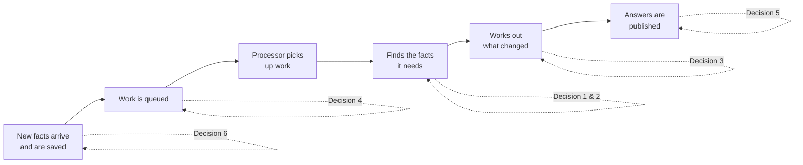

# How the system will keep up as data grows: six decisions (#10861)

Status: **Proposed** (not yet final). An independent reviewer ruled on these
decisions on 2026-11-18 — three were accepted, three were sent back and have
been rewritten below. No number in this document becomes a committed target
until it has been measured. Until the status changes to Accepted, this
document approves no build work, no data changes, and no release.

Refs #10861. Part of #10860 (Phase 0, step 1). Growth target set by the
owner on 2026-11-17: handle **ten times** the data of one organization.

## The problem in one page

Eshu collects facts about software (code, cloud accounts, security
findings) and continuously turns them into answers. The part that does
that turning — call it **the processor** — is falling behind:

| What we see today | Measured (2026-11-18) |
| --- | --- |
| Work waiting to be processed | ~8,700 items, the oldest waiting 30 days |
| Speed of finishing work | ~250 items per hour |
| Time for a change to become visible in answers | Typically 1–3 days for the biggest sources |
| Data stored | 83 million facts, about 1.1 TB total |

At ten times the data, "falling behind" becomes "never catches up" unless
*how* the processor works changes. Adding bigger machines alone does not
fix it: measurements show most time is spent **finding** the right work and
**re-doing** work that did not change, not on the useful work itself.

## How processing flows today, and where each decision applies

## The six decisions at a glance

| # | Decision, in plain words | Reviewer verdict | Target status |
| --- | --- | --- | --- |
| 1 | Prepare "lookup labels" when saving, so finding facts is fast | Accepted | New speed rule measured (see below) |
| 2 | The central system prepares those labels, at saving time | Accepted | Cost limit not yet measured |
| 3 | Only re-process what changed; check everything once a day | Rewritten | Not yet measured |
| 4 | Work that must wait sits aside and starts the moment its input arrives | Accepted | Target confirmed against measurements |
| 5 | Relationship questions go to the map-like store; lists and counts go to tables | Rewritten | Not yet measured |
| 6 | Split the giant fact store into fixed slices so cleanup stays cheap | Rewritten | Not yet measured |

---

## Decision 1: Make finding facts fast

**Today:** each time the processor needs facts, it searches through fact
content. Searching is where most of the database's time goes.

**Decision:** when a fact is saved, also save small lookup labels for it
(like an index card). The processor reads the labels instead of searching
the full content. One part of the system already works this way, and its
search time **halved** (from about 6.5 seconds to about 2.9 seconds for
20,000 facts).

| Item | Detail |
| --- | --- |
| Rule | Any lookup that runs more than once per second must use labels, not content search |
| Target (measured 2026-11-18) | Picking up work must not get slower as the queue grows: the second half of a queue must be handed out at most 10% slower than the first half. In our test copy it was actually faster (0.79×). An earlier idea — "every lookup under a tenth of a second" — was dropped: real lookups today take 0.3–3.3 seconds, so that target was not credible |
| How we will know it works | Before-and-after timings on a realistic copy, proving the same facts come back |
| When we would abandon it | If preparing labels costs more time than the searches they replace |
| Tracked in | #10875, which will rank lookups by their share of total database time |

## Decision 2: The central system prepares the labels, at saving time

**Why central:** the programs that collect facts are moving into their own
repositories and will not have database access. If each collector prepared
its own labels, every rule change would mean re-collecting everything.

| Item | Detail |
| --- | --- |
| Rule | A label is worked out from one fact alone, by the central system, in the same step that saves the fact. Every set of labels must be rebuildable if rules change |
| Target (not yet measured) | Preparing labels adds no more than 10% to saving time |
| Known gap | One of the three existing label sets cannot yet be rebuilt; #10875 must close that or stop presenting it as complete |
| When we would abandon it | If a label needs more than one fact to work out — then it is processing work, not a label |

## Decision 3: Only re-process what changed

**Today:** five kinds of work use 95% of processing time, and each one
re-examines a whole repository — or everything — even when only a small
part changed.

| Kind of work | Share of processing time |
| --- | --- |
| Supply-chain impact | 51% |
| Cloud drift checks | 22% |
| Workload summaries | 8% |
| Container image identity | 8% |
| Search documents | 6% |

**Decision:** work processes only the changes, with one full check per day
as a safety net so a missed change is eventually corrected.

| Item | Detail |
| --- | --- |
| Rule | Change-only processing is required when a kind of work averages over 5 seconds per run, **or** uses at least 5% of total processing time, **or** reads beyond the areas that changed. Work restarts only when its input actually changed |
| Safety net | One full check per day per kind of work, inside a stated time budget. If the daily check has to correct results two days in a row, that is treated as a defect and the owner is alerted |
| Exceptions | A kind of work that cannot say what changed may keep full runs only under a written cost ceiling (seconds per run, runs per day, review date) recorded before work starts. No ceiling, no exception |
| Tracked in | #10878 |

## Decision 4: Waiting work starts the moment its input arrives

**Today:** about a third of all runs stop because their input has not
arrived yet, wait for a timer, and try again. Those waits can even be
counted as failures.

**Decision:** work that is not ready is set aside with a note of what it is
waiting for. The moment that input is saved, the waiting work starts. A
slow safety check remains in case a start is ever missed.

| Item | Detail |
| --- | --- |
| Targets (confirmed against the 2026-11-18 measurements) | Fewer than 5% of runs put back to wait (32% today; the worst areas retry 58% and 99% of the time); a missed start is caught within 10 minutes |
| How we will know it works | Same results no matter which arrives first — the work or its input — proven with many workers competing on a realistic queue: no lost starts, no double starts, and saving does not get slower |
| Guardrail | This changes how the queue is stored, so #10876 must spell out that change explicitly; "% put back" must be read together with freshness (below), so the number cannot be gamed by holding work longer |
| Tracked in | #10876, #10877 |

## Decision 5: Match each question to the right store

Eshu answers questions from two kinds of store: a **map-like store** that
is good at following connections ("what depends on this, and what depends
on that?") and **tables** that are good at lists, counts, and filters.

**Decision:** a result goes into the map-like store only when a question
genuinely follows connections whose length is not known in advance.
Everything else goes into a table built for its questions. Some areas
legitimately need both — that is allowed when it is declared.

| Of 162 kinds of questions | Count |
| --- | --- |
| Need the map-like store | 34 |
| Need both | 13 |
| Not yet classified | 6 (to be classified first) |
| Tables are enough | The rest (~109) |

| Item | Detail |
| --- | --- |
| Rule | Every kind of question declares which store (or stores) answers it; an automatic check fails if a question quietly uses a store it did not declare |
| Guardrail | Nothing becomes "map-store only" until we have timed rebuilding that store from scratch at full size (9,000+ areas) — today that has only been measured on 67 |
| Tracked in | #10880, #10883 |

## Decision 6: Split the giant fact store into fixed slices

**Today:** all facts sit in one store of about 417 GB with 152 indexes.
Removing old data means deleting row by row from that one giant store, so
cleanup gets more expensive as the store grows.

**Decision:** split the fact store into a fixed number of slices, assigned
by a simple, even rule based on which area (repository, cloud account, …)
a fact belongs to. This matches how our search index already works.
The work queue is **not** split by this decision.

| Item | Detail |
| --- | --- |
| Order of work | First move reading off the fact store (Decisions 1–2), then split it |
| Target (not yet measured) | Removing one retired snapshot — delete plus cleanup back to steady state — costs in proportion to that snapshot, not to the whole store; to be proven side by side on the same data |
| Honest limits | Slicing does not split one huge area: security-findings data alone was 6,363 of 8,628 queued items, and its share of a slice must be measured and recorded. The rule that identifies a duplicate fact must include its area, with proof that duplicate handling does not change |
| Tracked in | #10881 (splitting), #10882 (slowing intake from a source the processor is behind on) |

## What this document does not decide

- The Phase 1 fixes — they are needed under every option above.
- Buying a message-queue product or a second database — measurements do
  not support either.
- Any change to indexes that serve customer-facing reads.

## Where things stand (acceptance checklist for #10861)

| Requirement | Status |
| --- | --- |
| Growth target set (ten times one organization) | Done, 2026-11-17 |
| Independent ruling on each decision | Done, 2026-11-18 — see the [ruling](../arbiter/10861-reducer-execution-model-ruling-2026-11-18.md); rewritten decisions above use its replacement text |
| Targets checked against the measured baseline (#10862) | Done, 2026-11-18 — Decision 1's target replaced, Decision 4's confirmed, the rest honestly marked "not yet measured" and assigned to their follow-up items |
| Proof and "abandon if" condition per decision | Recorded above |
| Earlier performance review marked replaced | Done — pointer at the top of Part E of [the July 2026 review](../architecture-review-2026-07-performance-scale.md#part-e--performance-ha-failure-modes-scale) |
| Later work items cite the decision they depend on | Done — #10875–#10883 all cite #10861 and their decision |

This record respects earlier decisions on data ownership, on keeping the
database as the queue, and on collectors having no database access.
Technical evidence behind the numbers above: the #10862 baseline
(`docs/internal/evidence/10862-qa-reducer-baseline-2026-11-18.md`) and
`evidence-5088-relationship-reference-keys.md`.
