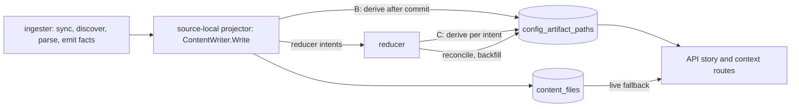

# Derive repository config artifacts when content is written (#7126)

Status: Proposed (2026-10-10). This record chooses a design and a proof order.
It does not approve the schema change, the migration number, or any rollout.
Each of those follows the proof gates in section 9 and the arbiter forks in
section 10. Refs #7126.

**Decision: compute the `config_paths` rows of each repository once, when the
content writer commits that repository's content, and store them in Postgres.
The story and context routes then read the rows for all related repositories
with one indexed statement, and run the query-time extractor only for a
repository whose stored rows are missing or stale.**

This is option D of the arbiter ruling of 2026-10-10 11:15 EDT. That ruling
rejected option C (a parse cache keyed by `content_hash`), option E and
option F. PR1, PR1b and PR2 stay. They make the live fallback and the derive
cheaper. They do not reach the 1 s route budget alone.

## 1. Context

On ops-qa, one repository story (R1) spends 6.63-6.95 s in the
`deployment_artifacts` stage on four calls. The route takes 6.92-7.97 s. The
stage recomputes, on every request, the config artifacts of every related
repository from file content in `content_files`.

| Fact | Value | Source |
|---|---|---|
| Postgres reader statements per R1 story | 8,255-8,258 (R2: 34) | issue comment 6097810983 |
| API CPU per R1 story | 6.70-6.88 CPU-s at a 1 CPU limit | issue comment 6098498452 |
| Neo4j related-repository UNION and other graph reads | 0.010 s warm, 0.143 s first call, at most 2% of the stage | issue comment 6097810983 |
| `config_paths` rows in the R1 body | 2,986 rows from 141 source repositories | issue comment 6097810983 |
| Hydrated files of the 141 repositories | 4,632 files, 52.2 MB. 45 repositories at the 50-file cap | issue comment 6098312440 |
| Parse share of CPU on the local bench | 76-79%, mostly HCL regexes | issue comment 6098969523 |

The stage is CPU-bound in the API process. The cost is per related repository:
one file list, up to 50 content reads, and one parse. The related-repository
count N is at least 141. The trace prefix suggests about 300, but that figure
is an extrapolation. Section 1 of the
[evidence appendix](7126-ingest-time-config-artifacts-evidence.md) has the
detail and the limits of each measurement.

The output is a pure function of one repository's stored files. The proof is
in section 3.3 of this record. So the work can move to the moment the files
change, and the read can become one statement for the whole related set.

### What PR1, PR1b and PR2 already change

PR3 keeps these changes and does not redo them. None of them is merged on
2026-10-10.

| PR | Branch | Change on the read path | Measured effect |
|---|---|---|---|
| PR1 | `fix/7126-needed-content-hydration` | Reads content only for files an extractor reads, asks `NonBlankRepoFilePaths` for the rest, adds read stats to the stage log, adds the `deployment_artifacts_read_degraded` reason | laptop bench CPU -6.8% / -9.1% (overlapping ranges) |
| PR1b | `perf/7126-hcl-required-literal-gate` (stacked on PR1) | Skips an HCL regex scan when a file lacks the scan's required literal | 25x-34x on plain files. Whole-set saving is a projection (5.1x-5.4x less regex work) |
| PR2 | `perf/7126-batched-content-read` (in progress) | One batched content read per repository | laptop bench -20% CPU (arm D) |

The arbiter estimate for PR1 plus PR2 on ops-qa is 2.5-4.5 s for the stage.
That is a theory until it is measured after the roll.

## 2. Options

| Option | Cost | Verdict |
|---|---|---|
| A. Ingester parse stage emits the rows as facts | A new fact kind and contract. The parser sees only changed files in a delta generation, but the 50-candidate window and the kustomize walk need the whole stored file set. An extractor change needs a re-parse of every repository. | Rejected. The input differs from what the query reads. |
| B. Content-writer derive in the source-local projector (recommended) | Adds one bounded read and one parse to each repository content Write. Needs a fence for writers that do not derive. | Chosen. Same input as the query path, no added lag, a proven pattern (#6793). |
| C. New reducer domain per repository generation | A new intent, queue domain and lease contract. Freshness lags the reducer backlog, and the read side still needs a write-time stale mark. | Not chosen for the write path. The reducer runs reconcile and backfill. |
| Post-content-index step (a separate worker after projection) | A new runtime stage with its own trigger, the same lag as C, and no owner today. | Rejected. |

Option B follows `infra_resource_entities` (#6793). That read model is derived
inside `ContentWriter.Write` (`deriveInfraInventory`). It has a backfill
marker, a rolling-upgrade fence and a reducer drift reconcile. On its fixture
the derive took 15-20% of the content stage of a full generation and 13-28 ms
for a 50-path delta (`docs/internal/evidence/6793-infra-read-model.md`).

## 3. Decision

### 3.1 Where extraction runs

1. `ContentWriter.Write` derives the rows of the written repository as its
   last step, after every content statement commits. `ingester`, `projector`
   and `bootstrap-index` all write content through this method, so all three
   derive.
2. The derive is a whole-repository derive. It lists the stored files with the
   same `ORDER BY relative_path LIMIT 5000` read, selects the same first 50
   candidates, reads content the PR1 way, and runs the same extractors. It
   reads from the primary, so it has no replay fence.
3. The per-repository function moves out of `go/internal/query` into a neutral
   package (proposal: `go/internal/content/configartifacts`). The live path
   and the derive call the same function. `storage/postgres` must not import a
   query handler package for this.
4. The reducer owns repair: the drift reconcile, the backfill, and the
   re-derive after an extractor version change.

### 3.2 What is stored

Tables (the migration number is chosen at build time. 169 is the newest on
`origin/main`, and no open PR adds a migration on 2026-10-10):

| Table | Key | Columns |
|---|---|---|
| `config_artifact_repo_state` | `repo_id` | `repo_name`, `extractor_version`, `scope_id`, `generation_id` (advisory), `files_listed`, `candidate_count`, `candidates_read`, `list_truncated`, `row_count`, `derived_at` |
| `config_artifact_paths` | `(repo_id, path, relative_path, evidence_kind)` | none |
| `config_artifact_dirty_repos` | `repo_id` | `mark_seq`, `marked_at`, `reason` |
| `config_artifact_backfill_markers`, `config_artifact_reconcile_cursor` | name | as in migration 109 |

- A state row with `row_count = 0` means "derived, no artifacts". A missing
  state row means "not derived". The reader must not confuse the two.
- `source_repo` is not stored per row. It equals `repo_name` of the state row,
  because the extractor writes the repository name it was given.
- Row identity is the four-tuple. The loader already deduplicates on
  `path|source_repo|relative_path|evidence_kind`, and `source_repo` is
  constant inside one repository, so the key loses no row.
- Size: R1 shows 2,986 rows for 141 repositories, about 21 rows each. For the
  815 repositories ops-qa lists, a similar mix gives roughly 17,000 rows. That
  is an extrapolation.
- The read path needs the two primary keys only. No other index is proposed
  until the S2 shim shows a need.

Retention: the rows mirror latest-wins `content_files`, not a generation. Each
code path that deletes `content_files` rows must keep the mirror in step:
`Write` tombstones and the full-snapshot reap run before the derive, so the
derive covers them. Generation retention marks each affected repository dirty
in its own transaction, in ascending `repo_id` lock order. A repository
purge deletes its state and rows in the purge transaction.

### 3.3 Accuracy

The stored rows for a repository must equal what the live loader returns for
that repository from the same `content_files` state.

- **Same function.** Both paths call one function. The equality proof then
  reduces to the same input, which section 9 proves with a differential.
- **Same input.** Both read `content_files`. The derive reads it after the
  Write commits. Both therefore keep today's latest-wins semantics, including
  content written before the activating Ack (#7760). Changing to
  active-generation content is a non-goal.
- **Pure input.** `BuildRepositoryConfigArtifacts(repoName, files)` reads no
  clock, environment or network. Kustomize, compose and HCL drop any value
  that contains `://`, and HCL also drops `git::` and `tfr:///` values. None of
  them fetches anything. Kustomize resolves references only inside the
  hydrated file index of the same repository. No cross-repository input
  exists.
- **Blank, binary and oversized files.** The derive sees exactly the rows the
  live path sees, and the shared code drops a blank file
  (`strings.TrimSpace`) in both. The derive holds at most 50 files in memory.
- **Extractor version.** A constant `extractor_version` lives next to the
  extractors. A guard test pins a digest of the extractor output over the
  fixture corpus. A changed digest without a version bump fails the test. The
  guard needs a seeded RED/GREEN pair.
- **Repository name.** The derive uses the name the projector writes to the
  `Repository` node in the same generation. If the Write carries no name, it
  keeps the state row's name. If neither exists, it marks the repository dirty
  and the reconcile derives with the graph name. The reader compares the state
  name with the graph `related.name` and falls back on a mismatch.
- **Fallback.** A repository whose state is missing, dirty, from another
  extractor version, or under another name is served by the live extractor
  for that repository only. Each one adds to
  `eshu_dp_config_artifact_reads_total{source="live",reason=...}`. Nothing is
  dropped, so a fallback cannot hide a wrong result.
- **Order.** The final sort keys are `path`, `source_repo`, `relative_path`.
  Ties between rows that differ only in `evidence_kind` have no defined
  order: `sort.Slice` is not stable, so their order depends on input order.
  PR3a adds `evidence_kind` as the last key in both paths, so the order is
  total and body bytes can be compared. Its proof must count the ties it
  reorders.

The 50-candidate cap stays exactly as it is in PR3: the first 5,000 listed
rows by `relative_path`, then the first 50 config candidates. The 5,000-row
list of a related repository has no sentinel today, so a repository with more
files is cut without a label. Dropping or labeling either cap changes the
answer. That is fork F3 for the arbiter. The state row records
`candidate_count`, `candidates_read` and `list_truncated`, so the size of that
change can be counted before anyone decides.

The anchor repository stays on the live path. Its file list comes from the
semantic overview stage, and compose and GitHub Actions files arrive already
read. Those files do not count against the 50-candidate cap there, so the
anchor answer can differ from a stored related-repository answer (fork F4).

### 3.4 Freshness and re-trigger

- **Content change.** Every `ContentWriter.Write` re-derives the repository
  after it commits. The query side reads the state per request. No API cache
  exists, so nothing needs a notice.
- **Write in flight.** Before its first content statement, an aware Write
  upserts the dirty mark and increments `mark_seq`. The derive reads
  `mark_seq` under the repository lock at its start, and at commit deletes the
  mark only if `mark_seq` is unchanged. A Write that fails after its content
  commits leaves the mark, so readers fall back until a retry or the
  reconcile derives.
- **Writers that do not derive.** An older binary or manual SQL writes
  `content_files` from a session without the writer setting. A row trigger
  marks the repository dirty in that statement, as migration 109 does for
  `content_entities` (fork F2).
- **Extractor version change.** Readers treat a different version as stale.
  A derive never replaces a state row of a newer version: an older binary
  marks the repository dirty instead. The reconcile re-derives stale versions
  first.
- **Backfill.** The reducer walks all repositories with a cursor, in pages,
  K workers (default 4, environment-tunable), one repository per transaction.
  It writes the marker when every repository has a current state row.
- **Failures.** A derive that fails increments `failure_count` and records
  `last_error_class` on the state row, keeps the dirty mark, and is retried
  with backoff. After 5 failures the walker skips the repository until its
  next content Write and reports it in `/admin/status`. Reads stay on the live
  path for it. This is the dead-letter equivalent (fork F5).

### 3.5 Concurrency

- **Conflict domain.** One repository. Each derive transaction takes one
  transaction-scoped advisory lock in a config-artifact namespace, then
  deletes the rows, inserts the new rows, upserts the state, and clears the
  mark, in that order, in one transaction.
- **Lock order.** Only retention takes more than one repository lock, and it
  takes them in ascending `repo_id` order. The derive takes no content row
  lock.
- **Two writers for one repository.** The projector claim stops two
  generations of one scope from running at once. Two scopes can still map one
  `repo_id` (migration 169). Each derive reads the committed state under the
  lock, and each Write's derive starts after its own content commit, so the
  last derive sees the last commit. The `mark_seq` rule covers the failure
  case.
- **Worker counts.** The derive runs on the projector worker that owns the
  generation, with no new limit. The reconcile and backfill use K workers
  across repositories. No path drops to one worker or a batch of one.

### 3.6 Rollout

1. PR3a merges: no behavior change.
2. PR3b deploys: the migration creates empty tables, writers derive, the
   reducer backfills. `ESHU_CONFIG_ARTIFACT_READ_MODE` stays `live`.
3. ops-qa runs `shadow`: each request computes both answers, compares them per
   repository, logs a mismatch, and serves the live answer.
4. Cutover to `stored` when all of these hold:
   - The backfill marker exists.
   - The dirty set is empty outside active Writes.
   - Shadow mode shows zero mismatches over the #7098 read sweep, R1 and R2.
   - An offline differential of every repository is `0/0`.
   - The projector no-regression bar of S1 in section 9 holds.
5. Rollback: set the mode to `live` and roll the API. No data change is
   needed. The tables stay, and writers keep them current.

### 3.7 Telemetry

| Signal | Name | Answers |
|---|---|---|
| Counter | `eshu_dp_config_artifact_reads_total{source,reason}` | how many related repositories were served stored or live, and why |
| Counter | `eshu_dp_config_artifact_shadow_compare_total{outcome}` | `match`, `mismatch`, `stored_missing` |
| Counter, histogram | `eshu_dp_config_artifact_derives_total{trigger,outcome}`, `eshu_dp_config_artifact_derive_duration_seconds{trigger}` | write, backfill and reconcile derives, errors, panics recovered |
| Counter | `eshu_dp_config_artifact_reconcile_total{outcome}` | `match`, `suspect`, `repaired`, `fenced`, `error` |
| Gauge | `eshu_dp_config_artifact_dirty_repos`, `eshu_dp_config_artifact_stale_version_repos` | how far the read model is behind |
| Span | one `config_artifacts.load` span per request. One derive span per Write | replaces up to about 49,600 per-statement spans of an R1 story |
| Log | stage line `deployment_artifacts` gains `read_mode`, `stored_repository_count`, `live_repository_count`, `live_reasons`, `stored_row_count` | one line gives N and the fallback share |
| Log | `config_artifacts.shadow.mismatch`, `config_artifacts.reconcile.drift`, content-writer stage `derive_config_artifacts` | repository id, row counts on each side, candidate counts |
| Status | `/admin/status` field `config_artifacts`: `not_installed`, `backfilling`, `fenced`, `ready` | whether stored reads are trusted |

No metric carries a repository id label. At 3 AM a slow story shows as a high
`source="live"` share. Its `reason` label names the cause.

## 4. Non-goals

- No change to the 50-candidate or 5,000-file caps in PR3 (fork F3).
- No change to the controller, runtime, workflow or CloudFormation loaders.
  They read only the anchor repository.
- No API response shape change, except the tie order in section 3.3.
- No cache in the API process, and no `content_hash` parse cache (option C).
- No change to the Neo4j UNION, to other stages, or to NornicDB.
- No fact kind, collector or parser change.
- The live extractor stays. It serves the anchor and every fallback.

## 5. Consequences

Good:

1. The related-repository part of the stage costs one statement for the whole
   set, so it no longer grows with N.
2. The live path stays the reference, so a stale or missing row costs latency,
   not accuracy.
3. The cap census in the state rows gives the arbiter numbers for F3.

Bad:

1. Every repository content Write does extra work. Section 9 sets a stop bar.
2. A second copy of derived truth exists, with a fence, a reconcile and a
   backfill to operate.
3. Generation retention gains one more mirror to keep in step.

Follow-up issues to file when PR3c merges:

1. The cap decision of F3.
2. The cold-route stages outside PR3 (section 7).

## 6. Implementation plan

Affected paths:

- `go/internal/query/repositoryartifacts/` (source of the move, live fallback)
- new `go/internal/content/configartifacts/` (extractors, per-repository
  derive, `extractor_version`, version-pin guard)
- `go/internal/storage/postgres/content_writer*.go`, a new
  `storage/postgres/configartifacts/` package for the table SQL (pattern:
  `storage/postgres/infra/inventory`), `migrations/NNN_config_artifacts.sql`
- `go/internal/storage/postgres/generation_retention*.go` (dirty marks)
- `go/cmd/reducer/` (reconcile and backfill wiring)
- `go/internal/query/querycontract/ports.go` (a read-model port),
  `repository/handler.go`, `repository/context.go`,
  `service/deployment_evidence.go` callers stay unchanged above the loader
- `go/internal/telemetry/instruments.go`, the telemetry coverage doc, the env
  registry entry for `ESHU_CONFIG_ARTIFACT_READ_MODE`

Patterns to follow:

- Migration 109 and `infra/inventory` for the derive, fence, marker and
  reconcile.
- Lock-only mark upserts (`ON CONFLICT DO UPDATE ... WHERE false`) where only
  a lock is wanted.
- `PREPARE`/`EXECUTE` with `plan_cache_mode=force_generic_plan` in the
  read-plan test.

Patterns to avoid:

- A derive that reads `content_files` before the Write commits.
- A per-file derive. The cap window depends on the whole file list.
- A dirty mark taken per row inside concurrent content batches. It would
  serialize the batches on one row lock.
- Any silent drop of a repository.

## 7. Acceptance on ops-qa after the roll

Measure the same R1 and R2 with the same method as the 2026-10-10 probes:
serial story requests, `/metrics` deltas, stage log lines, cAdvisor CPU deltas.

| Measure | Before | Target in `stored` mode |
|---|---|---|
| `deployment_artifacts` stage, warm calls | 6.63-6.75 s | at most 0.25 s |
| Route time, warm calls | 6.92-7.04 s | at most 1.0 s |
| API CPU per R1 story | 6.70-6.88 CPU-s | at most 0.7 CPU-s (theory) |
| Postgres reader statements per R1 story | 8,255-8,258 | at most 60, and the stage count does not grow with N |
| `config_paths` | 2,986 rows, 141 source repositories | the same multiset in `live` and `stored` on the same storage state. Other body fields byte-equal |

Remaining contributors in the stage, as a budget (theory until measured):

| Contributor | Expected | Basis |
|---|---|---|
| Neo4j UNION and the other graph reads | 0.010 s warm, 0.143 s first call | issue comment 6097810983 |
| Stored-row read, 3 round trips | at most 0.02 s | 0.82 ms per statement observed. S2 shim |
| `ListRepoFiles` of related repositories | 0 (gone) | the 2026-10-10 trace prefix held 128 lists, 0.242 s in sum |
| Anchor live work | at most 0.05 s | R2 whole stage 0.004 s. R1 anchor has 1 file |
| Merge, dedup, sort of about 3,000 rows | at most 0.02 s | not measured |
| Live fallback | 0 at steady state | each fallback repository costs its old share |

If the corpus changed between the baseline and the roll, re-baseline the body
in `live` mode first. The first call of R1 had 1.016 s outside this stage
(`target_documentation` 0.498 s cold). The cold route stays above 1 s unless
those stages change, which is outside PR3.

## 8. PR breakdown and sequencing

| PR | Content | Depends on | Proof |
|---|---|---|---|
| PR3a | Move the per-repository function and extractors to the neutral package. Add `extractor_version` and the digest guard. Make the sort total | PR1, PR1b and PR2 merged (each touches the files PR3a moves) | existing tests and the PR1 generated-tree differential pass unchanged. Seeded RED/GREEN for the guard. Tie count |
| PR3b | Migration, derive in `ContentWriter.Write`, dirty mark, fence trigger, retention marks, reducer reconcile and backfill, telemetry | PR3a | S1, S3 first. Live Postgres tests. Interleaving tests. Projector no-regression |
| PR3c | Read-model port, read mode flag, per-repository fallback, shadow compare, stage log fields, docs | PR3b | S2 first. Handler tests for each fallback reason. Live read-plan test. Ops-qa shadow then acceptance |

PR3b can split into PR3b-1 (schema, derive, fence) and PR3b-2 (reconcile,
backfill) if it exceeds review size. Sibling overlap: PR1 changes the loader,
the hydration file, `querycontract/ports.go` and the stage file. PR1b changes
the HCL files. PR2 is expected to change the content reader and the
hydration file. PR3a moves all of them, so it starts only after all three
merge. This ADR touches only `docs/internal/design/`.

## 9. Proof before build (prove the theory first)

Run each shim before the PR that depends on it. Record commands and numbers
in the PR evidence note.

1. **S1 derive cost.** Run the per-repository function with PR1, PR1b and PR2
   applied through the real `ContentWriter.Write` on local PostgreSQL 18, on
   the golden corpus and on R1-shaped synthetic data. Stop if the derive adds
   more than 10% to the content stage p95 of a full generation, or more than
   2 s for the worst repository. Then reopen F1.
2. **S2 read plan.** Seed 300 repositories and 6,000 rows. `EXPLAIN ANALYZE`
   the one read statement as a generic plan. Pass: primary-key access only,
   execution at most 5 ms.
3. **S3 fence cost.** Time a `content_files` upsert batch with and without the
   row trigger (shape of `content_writer_infra_fence_bench_live_test.go`).
   Stop if the trigger adds more than 5%. Then reopen F2.
4. **S4 equality.** For every golden-corpus repository, compare live rows with
   derived rows: symmetric difference `0/0`. On ops-qa this is the shadow mode
   plus an offline differential under its own authorization.
5. **S5 name binding.** Compare the projector's repository name with the graph
   `Repository.name` for every repository, read-only. Pass: 0 mismatches.
6. **S6 cap census.** Count repositories with more than 50 candidates and
   more than 5,000 files, read-only, as input for F3.

## 10. Decisions for the arbiter

| Fork | Options | Recommendation | Evidence that would flip it |
|---|---|---|---|
| F1 Where the derive runs | B content writer. C reducer domain. A ingester parse | B | S1 over its stop bar, or a projector p95 regression on the golden gate |
| F2 Fence for writers that do not derive | pre-write mark plus a row trigger for unaware sessions. Pre-write mark plus a rollout rule only | trigger | S3 over 5% of upsert time |
| F3 Cap semantics | keep both caps exactly. Drop the 50 cap at derive time. Keep caps and add a truncation label | keep in PR3, decide later with the S6 census | an arbiter ruling that silent truncation is a wrong answer now |
| F4 Anchor repository | keep live. Serve stored | keep live | a proof that the anchor and related candidate windows are equal |
| F5 Backfill and re-derive vehicle | reducer walker with cursor and state failure counts. Reducer queue intents with leases and dead letters. API-process backfill as in #6793 | reducer walker | an operator need for queue dead-letter tooling, or a walker below the needed rate |
| F6 Package home | neutral `content/configartifacts`. Storage imports the query package | neutral | a dependency cycle that the move cannot avoid |
| F7 Equality and order | multiset equality plus a total sort in PR3a. Multiset equality only | total sort | a client that depends on today's tie order |
| F8 Fallback policy | per repository, counted. Whole request live. Refuse with a limitation | per repository | none known: the other two either cost latency for every repository or change the answer |

Evidence and measurements

See [the evidence appendix](7126-ingest-time-config-artifacts-evidence.md).
It holds the measurement table with sources and limits, the source facts
that make the extractor a pure function of one repository, and the theory
versus evidence list.

