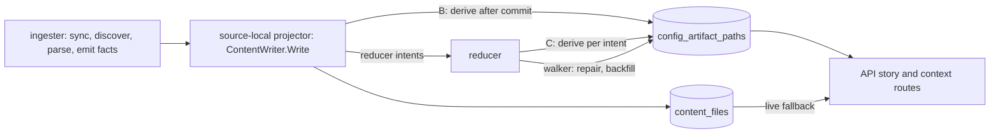

# Derive repository config artifacts when content is written (#7126)

Status: Accepted with changes (arbiter ruling 2026-10-10). Shims S0-S6 have
not run. This record does not approve the schema, the migration number or any
rollout. Each of those waits for the shims in section 8. Refs #7126.

**Decision: compute the `config_paths` rows of each repository once, after the
content writer commits that repository's content, and store them in Postgres
without the repository name. The story and context routes read the rows of
all related repositories with one indexed statement, apply the graph name at
read time, and run the query-time extractor only for a repository whose
stored rows are missing, dirty or stale.**

The derive is best-effort. A derive failure never fails the content Write. A
stale or missing row costs latency, never accuracy, because the live extractor
answers for that repository. The derive protocol, the fence and the
interleavings are in the
[protocol companion](7126-ingest-time-config-artifacts-protocol.md). The
measurements are in the
[evidence appendix](7126-ingest-time-config-artifacts-evidence.md).

## 1. Context

On ops-qa, one repository story (R1) spends 6.63-6.95 s in the
`deployment_artifacts` stage on four calls. The route takes 6.92-7.97 s. The
stage recomputes, on every request, the config artifacts of every related
repository from file content in `content_files`.

| Fact | Value | Source |
|---|---|---|
| Postgres reader statements per R1 story | 8,255-8,258 (R2: 34) | issue comment 6097810983 |
| API CPU per R1 story | 6.70-6.88 CPU-s at a 1 CPU limit | issue comment 6098498452 |
| Neo4j related-repository UNION and other graph reads | 0.010 s warm, 0.143 s first call, at most 2% of the stage | issue comment 6097810983 |
| `config_paths` rows in the R1 body | 2,986 rows from 141 source repositories | issue comment 6097810983 |
| Hydrated files of the 141 repositories | 4,632 files, 52.2 MB. 45 repositories at the 50-file cap | issue comment 6098312440 |
| Parse share of CPU on the local bench | 76-79%, mostly HCL regexes | issue comment 6098969523 |

The stage is CPU-bound in the API process. The cost is per related repository:
one file list, up to 50 content reads, and one parse. N is at least 141. The
trace prefix suggests about 300, but that figure is an extrapolation.

The output is a pure function of one repository's stored files and its name.
The name enters only through two read-side steps (section 3.3). So the work
can move to the moment the files change, and the read can become one
statement for the whole related set.

### What PR1, PR1b and PR2 already change

PR3 keeps these changes and does not redo them. None of them is merged on
2026-10-10.

| PR | Branch | Change on the read path | Measured effect |
|---|---|---|---|
| PR1 | `fix/7126-needed-content-hydration` | Reads content only for files an extractor reads, asks `NonBlankRepoFilePaths` for the rest, adds read stats to the stage log, adds the `deployment_artifacts_read_degraded` reason | laptop bench CPU -6.8% / -9.1% (overlapping ranges) |
| PR1b | `perf/7126-hcl-required-literal-gate` (stacked on PR1) | Skips an HCL regex scan when a file lacks the scan's required literal | 25x-34x on plain files. The whole-set saving is a projection (5.1x-5.4x less regex work) |
| PR2 | `perf/7126-batched-content-read` (sibling of PR1b on PR1, in progress) | A batched, chunked content read per repository | laptop bench -20% CPU (arm D) |

An earlier estimate put PR1 plus PR2 at 2.5-4.5 s for the stage on ops-qa.
That is a theory until it is measured after the roll.

## 2. Options

| Option | Cost | Verdict |
|---|---|---|
| A. Ingester parse stage emits the rows as facts | A new fact kind and contract. A delta generation sees only changed files, but the 50-candidate window and the kustomize walk need the whole stored file set. An extractor change needs a re-parse of every repository. | Rejected. The input differs from what the query reads. |
| B. Content-writer derive in the source-local projector | One bounded list, read and parse per repository content Write. Needs a fence for writers that do not derive. | Accepted with changes. Same input as the query path, no added lag. |
| C. New reducer domain per repository generation | A new intent, queue domain and lease contract. Freshness lags the reducer backlog. | Not chosen for the write path. The reducer walker repairs and backfills. |
| A separate worker after projection | A new runtime stage, the same lag as C, no owner today. | Rejected. |

Option B follows `infra_resource_entities` (#6793) for the place, the
backfill marker, the fence and the reducer reconcile. It departs from #6793
in two places, for reasons given in section 3.1 and in the protocol companion:
the derive cannot fail the Write, and the parse runs outside the lock.

## 3. Decision

### 3.1 Where extraction runs, and failure semantics

1. `ContentWriter.Write` derives the written repository as its last step,
   after every content statement commits. `ingester`, `projector` and
   `bootstrap-index` all write content through this method, so all three
   derive. The derive reads the primary, so it has no replay fence.
2. The derive is a whole-repository derive. It lists, selects the first 50
   candidates and reads content exactly as the live path does, with the same
   SQL (section 3.3, "Same SQL").
3. List, read and parse run with no lock and no open transaction. A short
   write transaction then takes the repository advisory lock and commits only
   if the dirty mark it saw at the start is unchanged. Open issue R-1 in the
   protocol companion shows a lost update in this mark protocol and proposes
   a content-version fence instead. It needs a re-ruling.
4. A derive error never fails the Write. The derive recovers a panic and runs
   under a deadline (environment-tunable, default 10 s). On any failure it
   counts the outcome, records `failure_count` and `last_error_class` on the
   state row, leaves the dirty mark, logs at ERROR with the repository id, and
   returns nil.
5. The reducer owns repair. Its walker runs the same derive protocol for
   reconcile, backfill and extractor version changes.

This departs from #6793. `deriveInfraInventory` fails the Write, which is
right for a SQL-only copy. The config derive runs Go regexes and `yaml.v3`
over arbitrary content. A deterministic parse bug or a pathological file would
make the projector retry the generation until it dead-letters. That would
lose graph and content truth to protect a read model. The content rows are
already committed when the derive starts, so a failed derive cannot roll them
back.

### 3.2 What is stored

Three tables hold the read model: a state row per repository, the name-free
rows, and the dirty marks. A backfill marker and a walker cursor follow
migration 109. The protocol companion has the columns. In summary:

- A state row with a current `extractor_version` and `row_count = 0` means
  "derived, no artifacts". A missing state row, or one with no successful
  derive, means "not derived". The reader must not confuse the two.
- Rows carry the raw path, before any name step, and a `name_scoped` flag.
  Row identity is `(repo_id, raw path, relative_path, evidence_kind)`. If a
  key exceeds the btree entry limit, the key becomes a digest column. The
  shim S2 decides this.
- The state row records `candidate_count`, `candidates_read`, `files_listed`
  and `list_truncated` for every derive.
- Size: R1 shows about 21 rows per repository. For the 815 repositories
  ops-qa lists, that gives roughly 17,000 rows. This is an extrapolation.

Retention: the rows mirror latest-wins `content_files`, not a generation.
`Write` tombstones and the full-snapshot reap run before the derive, so the
derive covers them. Generation retention deletes `content_files` rows from the
reducer, whose sessions do not carry the writer setting. The fence trigger
marks those repositories dirty, so retention needs no new code path. If S3
shows the trigger costs more than 5% of the prune phase, retention writes
explicit marks in its own transaction in ascending `repo_id` order instead.

### 3.3 Accuracy

The stored answer for a repository must equal the live answer for that
repository from the same `content_files` state. PR3 is parity-first: the live
path is the oracle, so PR3 changes no extraction semantics.

- **Same function.** The live path and the derive call one per-repository
  function in a neutral package.
- **Same SQL.** The list, single read, non-blank check and batched read of
  `content_files` each have one SQL constant and one row mapper. The live
  reader and the derive both import them. A copy would drift in `ORDER BY`,
  the `artifact_type` mapping or the blank predicate, and break S4 silently.
- **Pure input.** The extractors read no clock, environment or network. They
  drop remote references without reading them. Kustomize resolves references
  only inside the same repository's file index. No cross-repository input
  exists.
- **Name at read time.** The derive stores rows without the name. At read
  time the API sets `source_repo` to the graph `related.name` and applies
  `normalizeRepoScopedPath` with that name to the `name_scoped` rows only.
  Those are the HCL and compose rows built through `appendConfigArtifactRow`.
  Kustomize and Ansible rows never pass through it. The shim S0 proves the
  equality. A renamed repository therefore needs no re-derive.
- **Caps.** Both caps stay exactly: the first 5,000 files by `relative_path`,
  then the first 50 config candidates. The related-repository list has no
  sentinel, so a larger repository is cut without a label. That is an
  accuracy defect of the live path, not of PR3. It is filed separately with
  the S6 census as a follow-up. Changing the caps inside PR3 would destroy the
  oracle.
- **Anchor.** The anchor repository stays live. Its list is read with
  limit+1 and a truncated flag, and its pre-read compose and GitHub Actions
  files do not count toward the 50-candidate cap. Its window therefore
  differs from a related-repository window.
- **Order.** PR3a adds `evidence_kind` as the fourth sort key in both paths
  and counts the ties it reorders. `sort.Slice` is not stable, so today's tie
  order depends on input order.
- **Extractor version.** A constant `extractor_version` sits next to the
  extractors. A guard test pins a digest of extractor output over the fixture
  corpus and fails on a changed digest without a bump. The guard needs a
  seeded RED/GREEN pair.
- **Access.** The stored read takes the access-filtered set of related
  repository ids as its parameter. It never reads all related rows before the
  grant filter (#5167 W3 P0). PR3c plants an out-of-grant related repository
  with stored rows and asserts that it is absent from the body.
- **Fallback.** A repository whose state is missing, dirty or from another
  extractor version is served live for that repository only, and counted.
  Nothing is dropped, so a fallback cannot hide a wrong result.

### 3.4 Rollout

1. PR3a merges: no behavior change except the tie order.
2. PR3b deploys: the migration creates empty tables, writers derive, the
   walker backfills. `ESHU_CONFIG_ARTIFACT_READ_MODE` stays `live`.
3. ops-qa runs `shadow`: each request computes both answers, compares them per
   repository, logs a mismatch, and serves the live answer.
4. Cut over to `stored` when all of these hold:
   - The backfill marker exists.
   - The dirty set is empty outside active Writes.
   - Shadow mode shows zero mismatches over the #7098 read sweep, R1 and R2.
   - An offline differential of every repository is `0/0`.
   - S1's projector bar holds.
5. Rollback: set the mode to `live` and roll the API. No data change is
   needed.

An `extractor_version` bump makes every stored row stale at once. Every
related repository then falls back live until the walker re-derives it. The
window is about (S1 per-repository derive time) x 815 / K. Each version bump
states this number in its PR. A bump is a performance event, not a silent one.

### 3.5 Telemetry

| Signal | Name | Answers |
|---|---|---|
| Counter | `eshu_dp_config_artifact_reads_total{source,reason}` | related repositories served stored or live, and why (`missing`, `dirty`, `version`, `failed`, `mode_live`) |
| Counter | `eshu_dp_config_artifact_shadow_compare_total{outcome}` | `match`, `mismatch`, `stored_missing` |
| Counter, histogram | `eshu_dp_config_artifact_derives_total{trigger,outcome}`, `eshu_dp_config_artifact_derive_duration_seconds{trigger}` | write, backfill and repair derives. `ok`, `superseded`, `error`, `panic`, `timeout` |
| Counter | `eshu_dp_config_artifact_reconcile_total{outcome}` | `match`, `suspect`, `repaired`, `fenced`, `error`, `skipped` |
| Gauge | `eshu_dp_config_artifact_dirty_repos`, `eshu_dp_config_artifact_stale_version_repos` | how far the read model is behind |
| Span | one `config_artifacts.load` span per request. One derive span per Write | replaces up to about 49,600 per-statement spans of an R1 story |
| Log | `config_artifacts.derive.failed` at ERROR, `config_artifacts.shadow.mismatch`, `config_artifacts.reconcile.drift`, content-writer stage `derive_config_artifacts` | repository id, outcome, row and candidate counts |
| Status | `/admin/status` field `config_artifacts`: `not_installed`, `backfilling`, `fenced`, `ready`, plus skipped repositories | whether stored reads are trusted |

The stage log line `deployment_artifacts` lacks N and statement counts today.
PR3c adds `read_mode`, `related_repository_count`, `stored_repository_count`,
`live_repository_count`, `live_reasons` and `stored_row_count`. No metric
carries a repository id label. At 3 AM a slow story shows as a high
`source="live"` share, and its `reason` label names the cause.

## 4. Non-goals

- No change to the 50-candidate or 5,000-file caps in PR3.
- No change to the controller, runtime, workflow or CloudFormation loaders.
  They read only the anchor repository.
- No API response shape change, except the tie order in section 3.3.
- No cache in the API process, and no `content_hash` parse cache.
- No change to the Neo4j UNION, to other stages, or to NornicDB.
- No fact kind, collector or parser change.
- The live extractor stays. It serves the anchor and every fallback.

## 5. Consequences

Good:

1. The related-repository part of the stage costs one statement for the whole
   set, so it no longer grows with N.
2. The live path stays the reference, so a stale or missing row costs latency,
   not accuracy.
3. A rename needs no re-derive, because rows are name-free.
4. The state rows count the cap effect, which sizes the cap follow-up.

Bad:

1. Every repository content Write does extra work. S1 sets the stop bar.
2. A second copy of derived truth exists, with a fence, a walker and a
   backfill to operate.
3. An extractor version bump sends every related repository to the live path
   until the walker catches up.

Follow-ups, filed as separate issues:

1. The silent truncation of the related-repository list and the
   50-candidate cap, with the S6 census.
2. The cold-route stages outside PR3 (section 6).

## 6. Acceptance on ops-qa after the roll

Measure the same R1 and R2 with the same method as the 2026-10-10 probes:
serial story requests, `/metrics` deltas, stage log lines, cAdvisor CPU deltas.

| Measure | Before | Target in `stored` mode |
|---|---|---|
| `deployment_artifacts` stage, warm calls | 6.63-6.75 s | at most 0.25 s |
| Route time, warm calls | 6.92-7.04 s | at most 1.0 s |
| API CPU per R1 story | 6.70-6.88 CPU-s | at most 0.7 CPU-s (theory) |
| Postgres reader statements per R1 story | 8,255-8,258 | at most 60, and the stage count does not grow with N |
| `config_paths` | 2,986 rows, 141 source repositories | the same multiset in `live` and `stored` on the same storage state. Other body fields byte-equal |

Remaining contributors in the stage, as a budget (theory until measured):

| Contributor | Expected | Basis |
|---|---|---|
| Neo4j UNION and the other graph reads | 0.010 s warm, 0.143 s first call | issue comment 6097810983 |
| Stored-row read, 3 round trips | at most 0.02 s | 0.82 ms per statement observed. S2 shim |
| `ListRepoFiles` of related repositories | 0 (gone) | the 2026-10-10 trace prefix held 128 lists, 0.242 s in sum |
| Anchor live work | at most 0.05 s | R2 whole stage 0.004 s. R1 anchor has 1 file |
| Name step, merge, dedup, sort of about 3,000 rows | at most 0.02 s | not measured |
| Live fallback | 0 at steady state | each fallback repository costs its old share |

If the corpus changed between the baseline and the roll, re-baseline the body
in `live` mode first. The first call of R1 had 1.016 s outside this stage
(`target_documentation` 0.498 s cold). The cold route stays above 1 s unless
those stages change, which is outside PR3.

## 7. PR breakdown and sequencing

| PR | Content | Starts | Proof |
|---|---|---|---|
| S0 test, version guard | The S0 name-free equality test and the `extractor_version` digest guard, as new files | now | S0 passes. Seeded RED/GREEN for the guard |
| PR3b-1 | Migration, tables, mark and trigger, state row, walker skeleton, read-model port | now, after S2 and S3. The mark protocol waits for the re-ruling on R-1 | S2, S3. Live Postgres tests. Interleaving tests, including the R-1 sequence |
| PR3a | Move the per-repository function and extractors to the neutral package. Shared `content_files` SQL. Total sort | after PR1, PR1b and PR2 merge | existing tests and the PR1 differential pass unchanged. Tie count |
| PR3b-2 | Derive call in `ContentWriter.Write`, projector wiring, walker derive, telemetry | after PR3a | S1, then S4 |
| PR3c | Read mode flag, name step, per-repository fallback, shadow compare, stage log fields, access test, docs | after PR3b-2 | handler tests per fallback reason. Out-of-grant test. Ops-qa shadow then acceptance |

PR3a waits because PR1 edits the loader, hydration, kustomize, HCL and
Ansible files, PR1b edits the HCL files and adds `prefilter/`, and PR2 edits
the hydration and stats files and adds a batched read. PR1b and PR2 are
siblings on PR1, so a move before they merge would rebase across renames of
files all three edit. Re-check open PRs for migration numbers at build time.
169 was the newest on `origin/main` on 2026-10-10.

## 8. Proof before build

Run the shims in this order. Record commands and numbers in the PR evidence
note. Details are in section 6 of the protocol companion.

| Shim | Where | Pass | On fail |
|---|---|---|---|
| S0 name-free rows | local Go test | 0 differing rows between the named build and the name-free build plus the name step, for 3 or more names | store the name in the state row and run S5 |
| S2 read plan | local PostgreSQL 18 | primary-key index scans only, execution at most 5 ms, generic plan | change the key or the statement |
| S3 fence cost | local PostgreSQL 18 | fenced session at most 5% on the 500-row upsert. Prune at most 5% of the prune phase | explicit marks in retention. Reopen F2 |
| S6 cap census | ops-qa, read-only | counts recorded for the follow-up issue | none: input only |
| S1 derive cost | local, PR1, PR1b and PR2 stacked | at most 10% of content-stage p95. At most 2 s for the worst repository | reopen F1 |
| S4 equality | PR3b gate | symmetric difference `0/0` for every golden-corpus repository | do not merge PR3b-2 |

S5 (name binding, read-only) is optional after S0 passes.

## 9. Arbiter ruling of 2026-10-10

The ruling binds. This table maps each fork to its section here.

| Fork | Ruling | Where |
|---|---|---|
| F1 place of the derive | B, with the derive never failing the Write, a deadline, panic recovery, and parse outside the lock | 3.1, companion 3 |
| F2 fence | row trigger that bumps `mark_seq` once per unaware transaction per repository, from a global sequence. New setting `eshu.config_artifact_writer` | 3.2, companion 2 |
| F3 caps | keep both caps, parity-first, file the defect separately with S6 | 3.3, 5 |
| F4 anchor | stays live | 3.3 |
| F5 repair vehicle | reducer walker, same protocol, K workers by `repo_id`, skip after 5 failures | 3.1, companion 4 |
| F6 package home | neutral package, plus one shared SQL constant and row mapper per `content_files` statement | 3.3, companion 5 |
| F7 order | `evidence_kind` as the fourth key in both paths in PR3a | 3.3 |
| F8 fallback | per repository and counted. The stored read takes the access-filtered set | 3.3 |
| G1 name binding | rows stored name-free, name applied at read | 3.3, companion 1 |
| G2, G3, G6 | Write failure semantics, lost update, lock during parse | companion 3 |
| G7 version bump | a sized fallback window | 3.4 |
| G8 key width | S2 seeds long paths. Digest key or `row_too_wide` | 3.2, companion 1 |
| G9 stage log | the new fields land in PR3c | 3.5 |
| R-1 (found after the ruling) | open: a lost update between a Write and the walker | companion 7 |

Evidence and measurements

See [the evidence appendix](7126-ingest-time-config-artifacts-evidence.md).
It holds the measurement table with sources and limits, the source facts by
symbol, and the split between evidence and theory.

