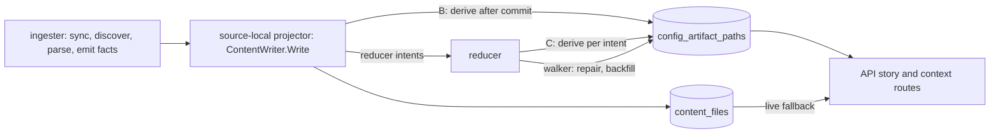

# Derive repository config artifacts when content is written (#7126)

Status: Accepted with changes (arbiter ruling and re-rulings 1, 2 and 3,
2026-10-10).
Shims S0 and S2 ran locally and pass. S1, S3, S4 and S6 have not run. This
record does not approve the schema, the migration number or any rollout.
Each of those waits for the shims in section 8. Refs #7126.

**Decision: compute the `config_paths` rows of each repository once, after the
content writer commits that repository's content, and store them in Postgres
without the repository name. The story and context routes read the rows of
all related repositories with one indexed statement, apply the graph name at
read time, and run the query-time extractor only for a repository whose
stored rows are missing or stale.**

The derive is best-effort. A derive failure never fails the content Write. A
stale or missing row costs latency, never accuracy, because the live extractor
answers for that repository. The derive protocol, the fence and the
interleavings are in the
[protocol companion](7126-ingest-time-config-artifacts-protocol.md). The
measurements are in the
[evidence appendix](7126-ingest-time-config-artifacts-evidence.md).

## 1. Context

On ops-qa, one repository story (R1) spends 6.63-6.95 s in the
`deployment_artifacts` stage on four calls. The route takes 6.92-7.97 s. The
stage recomputes, on every request, the config artifacts of every related
repository from file content in `content_files`.

| Fact | Value | Source |
|---|---|---|
| Postgres reader statements per R1 story | 8,255-8,258 (R2: 34) | issue comment 6097810983 |
| API CPU per R1 story | 6.70-6.88 CPU-s at a 1 CPU limit | issue comment 6098498452 |
| Neo4j related-repository UNION and other graph reads | 0.010 s warm, 0.143 s first call, at most 2% of the stage | issue comment 6097810983 |
| `config_paths` rows in the R1 body | 2,986 rows from 141 source repositories | issue comment 6097810983 |
| Hydrated files of the 141 repositories | 4,632 files, 52.2 MB. 45 repositories at the 50-file cap | issue comment 6098312440 |
| Parse share of CPU on the local bench | 76-79%, mostly HCL regexes | issue comment 6098969523 |

The stage is CPU-bound in the API process. The cost is per related repository:
one file list, up to 50 content reads, and one parse. N is at least 141. The
trace prefix suggests about 300, but that figure is an extrapolation.

The output is a pure function of one repository's stored files and its name.
The name enters only through two read-side steps (section 3.3). So the work
can move to the moment the files change, and the read can become one
statement for the whole related set.

### What PR1, PR1b and PR2 already change

PR3 keeps these changes and does not redo them. On 2026-10-10 all three are
local branches with clean or pending reviews. None is merged, and none is
published as a PR.

| PR | Branch | Change on the read path | Measured effect |
|---|---|---|---|
| PR1 | `fix/7126-needed-content-hydration` | Reads content only for files an extractor reads, asks `NonBlankRepoFilePaths` for the rest, adds read stats to the stage log, adds the `deployment_artifacts_read_degraded` reason | laptop bench CPU -6.8% / -9.1% (overlapping ranges) |
| PR1b | `perf/7126-hcl-required-literal-gate` (stacked on PR1) | Skips an HCL regex scan when a file lacks the scan's required literal | 25x-34x on plain files. The whole-set saving is a projection (5.1x-5.4x less regex work) |
| PR2 | `perf/7126-batched-content-read` (sibling of PR1b on PR1, in progress) | A batched, chunked content read per repository | laptop bench -20% CPU (arm D) |

The measured effects come from the PR1 and PR1b review verdicts and the CPU
bench. Those are local kit notes, not in the repository.

An earlier estimate put PR1 plus PR2 at 2.5-4.5 s for the stage on ops-qa.
That is a theory until it is measured after the roll.

## 2. Options

| Option | Cost | Verdict |
|---|---|---|
| A. Ingester parse stage emits the rows as facts | A new fact kind and contract. A delta generation sees only changed files, but the 50-candidate window and the kustomize walk need the whole stored file set. An extractor change needs a re-parse of every repository. | Rejected. The input differs from what the query reads. |
| B. Content-writer derive in the source-local projector | One bounded list, read and parse per repository content Write. Needs a content-version fence, because retention and manual SQL change `content_files` without a derive. | Accepted with changes. Same input as the query path, no added lag. |
| C. New reducer domain per repository generation | A new intent, queue domain and lease contract. Freshness lags the reducer backlog. | Not chosen for the write path. The reducer walker repairs and backfills. |
| A separate worker after projection | A new runtime stage, the same lag as C, no owner today. | Rejected. |

Option B follows `infra_resource_entities` (#6793) for the place, the
backfill marker and the reducer reconcile. It departs from #6793 in three
places, for reasons given in section 3.1 and in the protocol companion: the
derive cannot fail the Write, the parse runs outside the lock, and the fence
is a content version that every session bumps, not a dirty mark set only by
sessions that do not derive.

## 3. Decision

### 3.1 Where extraction runs, and failure semantics

1. `ContentWriter.Write` derives the written repository as its last step,
   after every content statement commits. `ingester`, `projector` and
   `bootstrap-index` all write content through this method, so all three
   derive. The derive reads the primary, so it has no replay fence.
2. The derive is a whole-repository derive. It lists, selects the first 50
   candidates and reads content exactly as the live path does, with the same
   SQL (section 3.3, "Same SQL").
3. A trigger on `content_files` bumps a per-repository content version
   once per transaction, for every session. The bump commits with the
   content. The derive reads the version `v0` before it lists the files.
4. List, read and parse run with no lock and no open transaction. A short
   write transaction then takes the repository advisory lock and writes only
   if the version or the extractor version advances. Otherwise the derive is
   superseded. Readers trust the rows only when the stored version equals the
   current version.
5. A derive error never fails the Write. The derive recovers a panic and runs
   under a deadline (default 10 s, **Proposed** name
   `ESHU_CONFIG_ARTIFACT_DERIVE_TIMEOUT`). On any failure it counts the
   outcome, records `failure_count` and `last_error_class` on the state row,
   logs at ERROR with the repository id, and returns nil. If the content
   moved, the stored version stays behind, so readers fall back.
6. The reducer owns repair. Its walker runs the same derive protocol for
   reconcile, backfill and extractor version changes.
7. A startup check guards the UTF8 invariant (re-ruling 3). Each deriving
   binary and the API run `SHOW server_encoding` once. On a value other than
   `UTF8` they skip every derive with outcome `encoding_unsupported` and
   report the read model as `not_installed`. The Write proceeds, and reads
   stay live.

This departs from #6793. `deriveInfraInventory` fails the Write, which is
right for a SQL-only copy. The config derive runs Go regexes and `yaml.v3`
over arbitrary content. A deterministic parse bug or a pathological file would
make the projector retry the generation until it dead-letters. That would
lose graph and content truth to protect a read model. The content rows are
already committed when the derive starts, so a failed derive cannot roll them
back.

### 3.2 What is stored

Three tables hold the read model: a content version per repository, a state
row per repository, and the name-free rows. A backfill marker and a walker
cursor follow migration 109. The protocol companion has the columns. In
summary:

- A state row with a current `extractor_version` and `row_count = 0` means
  "derived, no artifacts". A missing state row, or one with no successful
  derive, means "not derived". The reader must not confuse the two.
- Rows store the path of the build with no name (`raw_path`) verbatim, and
  a `name_scoped` flag set at the construction site. The flag is a function
  of `evidence_kind`: S0 found 16 kinds, 10 scoped and 6 unscoped, none in
  both. A guard test reads both call-site families from source and pins one
  value per kind.
- Row key (G8). S2 showed that a key of four TEXT columns fails with SQLSTATE
  54000 when a path reaches 2,610 incompressible bytes. A compressible path of
  100,000 bytes still passes. Re-ruling 2: key on `(repo_id, row_digest)`,
  where `row_digest` is a stored generated SHA-256 column over the
  length-prefixed path, relative path and evidence kind, defined once in the
  schema. The four columns stay as data. A `row_too_wide` fallback and a
  length precheck are rejected. `convert_to` is STABLE, so PostgreSQL 18.6
  rejects it in a generated column. Re-ruling 3 adopted an IMMUTABLE wrapper,
  `config_artifact_utf8`, which is true per database because
  `server_encoding` cannot change. The protocol companion (section 1) has the
  definition and the rejected alternatives.
- The migration sets `autovacuum_vacuum_scale_factor` at most 0.02 on the
  rows table (re-ruling 2), because S2 measured +40% on the read after a
  rewrite with no vacuum.
- The state row records the `content_version` the derive read, the
  `extractor_version`, and `candidate_count`, `candidates_read`,
  `files_listed` and `list_truncated` for every derive.
- The dirty set is a join of state and versions, not a
  table.
- Size: R1 shows about 21 rows per repository. For the 815 repositories
  ops-qa listed on 2026-10-10, that gives roughly 17,000 rows. This is an
  extrapolation. The count 815 comes from the local kit note
  `7126-story-span-probe-20261010.md`, which is not in the repository.

Retention: the rows mirror latest-wins `content_files`, not a generation.
`Write` tombstones and the full-snapshot reap run before the derive, so the
derive covers them. Generation retention deletes `content_files` rows, which
fires the trigger, so retention needs no new code path. S3 chooses the shape
of the DELETE trigger. If neither shape meets the prune bar, retention bumps
the versions explicitly.

### 3.3 Accuracy

The stored answer for a repository must equal the live answer for that
repository from the same `content_files` state. PR3 is parity-first: the live
path is the oracle, so PR3 changes no extraction semantics.

- **Same function.** The live path and the derive call one per-repository
  function in a neutral package.
- **Same SQL.** The list, single read, non-blank check and batched read of
  `content_files` each have one SQL constant and one row mapper. The live
  reader and the derive both import them. A copy would drift in `ORDER BY`,
  the `artifact_type` mapping or the blank predicate, and break S4 silently.
- **Pure input.** The extractors read no clock, environment or network. They
  drop remote references without reading them. Kustomize resolves references
  only inside the same repository's file index. No cross-repository input
  exists.
- **Name at read time.** The derive stores rows without the name. At read
  time the API sets `source_repo` to the graph `related.name` and strips the
  name prefix from the `name_scoped` rows only. Those are the HCL and compose
  rows built through `appendConfigArtifactRow`. Kustomize and Ansible rows
  never pass through it. S0 passed on 684,948 row observations with 0
  differing rows. A renamed repository therefore needs no re-derive.
- **Strip only.** `normalizeRepoScopedPath` cleans the path and then strips
  the prefix. The clean (`CleanRepositoryRelativePath`) is not idempotent
  when the cleaned result has leading or trailing whitespace: a second clean
  changed 8,943 of 200,000 random strings (0 over the S0 corpus). PR3a splits
  the function into a clean step and a strip step. The derive stores the
  cleaned path, and the read step only strips. The read step must not clean
  again.
- **One merge, one dedup.** The live loader keeps one dedup map across the
  anchor and all related sources. The stored path does the same: the rows of
  every repository (anchor live, stored, live fallback) merge in source
  order, then one dedup on `(path, source_repo, relative_path,
  evidence_kind)` and one sort. Two related repositories that share a graph
  name, or an anchor that also appears in the related list, then collapse
  exactly as they do live. The two loader-level merge cases are outside
  S0's scope. S4 and the PR3c tests cover both.
- **Caps.** Both caps stay exactly: the first 5,000 files by `relative_path`,
  then the first 50 config candidates. The related-repository list has no
  sentinel, so a larger repository is cut without a label. That is an
  accuracy defect of the live path, not of PR3. It is to be filed as a
  separate issue with the S6 census. Changing the caps inside PR3 would
  destroy the oracle.
- **Anchor.** The anchor repository stays live. Its list is read with
  limit+1 and a truncated flag, and its pre-read compose and GitHub Actions
  files do not count toward the 50-candidate cap. Its window therefore
  differs from a related-repository window.
- **Order.** PR3a adds `evidence_kind` as the fourth sort key in both paths
  and counts the ties it reorders. `sort.Slice` is not stable, so today's tie
  order depends on input order.
- **Extractor version.** A constant `extractor_version` sits next to the
  extractors. A guard test pins a digest of extractor output over the fixture
  corpus and fails on a changed digest without a bump. The guard needs a
  seeded RED/GREEN pair.
- **Access.** The stored read takes the access-filtered set of related
  repository ids as its parameter. It never reads all related rows before the
  grant filter (#5167 W3 P0). PR3c plants an out-of-grant related repository
  with stored rows and asserts that it is absent from the body.
- **Fallback.** A repository with no state, no version row, an old content
  version, an old extractor version, or no successful derive is served live
  for that repository only, and counted. The reader uses an inner join (the
  join type is **Proposed**), so a missing version row means a live fallback
  with reason `missing`.
  Nothing is dropped, so a fallback cannot hide a wrong result.

### 3.4 Rollout

1. PR3a merges: no behavior change except the tie order.
2. PR3b deploys: the migration creates the tables and seeds one version row
   per repository, writers derive, and the walker backfills. The read mode
   stays `live`. **Proposed** variable name: `ESHU_CONFIG_ARTIFACT_READ_MODE`,
   with the values `live`, `shadow` and `stored`.
3. ops-qa runs `shadow`: each request computes both answers, compares them per
   repository, logs a mismatch, and serves the live answer.
4. Cut over to `stored` when all of these hold (**Proposed** gates):
   - The backfill marker exists.
   - The dirty join is empty outside active Writes.
   - Shadow mode shows zero mismatches over the #7098 read sweep, R1 and R2.
   - An offline differential of every repository is `0/0`.
   - S1's projector bar holds.
5. Rollback: set the mode to `live` and roll the API. No data change is
   needed.

An `extractor_version` bump makes every stored row stale at once. Every
related repository then falls back live until the walker re-derives it. The
window is about (S1 per-repository derive time) x 815 / K. Each version bump
states this number in its PR. A bump is a performance event, not a silent one.

### 3.5 Telemetry

All names in this section are **Proposed**, except what a ruling named: the
G9 stage log fields, and from re-ruling 3 the log `postgres.server_encoding`,
the derive outcome `encoding_unsupported` and the `not_installed` status with
a reason.

| Signal | Name | Answers |
|---|---|---|
| Counter | `eshu_dp_config_artifact_reads_total{source,reason}` | related repositories served stored or live, and why (`missing`, `stale_version`, `stale_extractor`, `failed`, `mode_live`) |
| Counter | `eshu_dp_config_artifact_shadow_compare_total{outcome}` | `match`, `mismatch`, `stored_missing` |
| Counter, histogram | `eshu_dp_config_artifact_derives_total{trigger,outcome}`, `eshu_dp_config_artifact_derive_duration_seconds{trigger}` | write, backfill and repair derives. `ok`, `superseded`, `error`, `panic`, `timeout`, `encoding_unsupported` |
| Counter | `eshu_dp_config_artifact_reconcile_total{outcome}` | `match`, `repaired`, `superseded`, `error`, `skipped` |
| Gauge | `eshu_dp_config_artifact_stale_repos{reason}` | how far the read model is behind, from the dirty join |
| Span | one `config_artifacts.load` span per request. One derive span per Write | replaces up to about 49,600 per-statement spans of an R1 story |
| Log | `postgres.server_encoding` at INFO (ERROR when not UTF8, re-ruling 3), `config_artifacts.derive.failed` at ERROR, `config_artifacts.shadow.mismatch`, `config_artifacts.reconcile.drift`, content-writer stage `derive_config_artifacts` | repository id, outcome, row and candidate counts |
| Status | `/admin/status` field `config_artifacts`: `not_installed` (with a reason, such as a non-UTF8 database), `backfilling`, `ready`, plus stale and skipped repository counts | whether stored reads are trusted |

The stage log line `deployment_artifacts` lacks N and statement counts today.
PR3c adds `read_mode`, `related_repository_count`, `stored_repository_count`,
`live_repository_count`, `live_reasons` and `stored_row_count`. No metric
carries a repository id label. At 3 AM a slow story shows as a high
`source="live"` share, and its `reason` label names the cause.

## 4. Non-goals

- No change to the 50-candidate or 5,000-file caps in PR3.
- No change to the controller, runtime, workflow or CloudFormation loaders.
  They read only the anchor repository.
- No API response shape change, except the tie order in section 3.3.
- No cache in the API process, and no `content_hash` parse cache.
- No change to the Neo4j UNION, to other stages, or to NornicDB.
- No fact kind, collector or parser change.
- The live extractor stays. It serves the anchor and every fallback.

## 5. Consequences

Good:

1. The related-repository part of the stage costs one statement for the whole
   set, so it no longer grows with N.
2. The live path stays the reference, so a stale or missing row costs latency,
   not accuracy.
3. A rename needs no re-derive, because rows are name-free.
4. The state rows count the cap effect, which sizes the cap follow-up.

Bad:

1. Every repository content Write does extra work. S1 sets the stop bar.
2. A second copy of derived truth exists, with a fence, a walker and a
   backfill to operate.
3. An extractor version bump sends every related repository to the live path
   until the walker catches up.
4. A repository whose derive always fails or times out adds up to 10 s to
   each of its content Writes, because every Write derives. The walker skips
   it after 5 failures until its next Write or an extractor change
   (protocol companion, section 4). Its reads stay live while its rows are
   stale.

Follow-ups, to be filed as separate issues by the coordinator:

1. The silent truncation of the related-repository list and the
   50-candidate cap, with the S6 census.
2. The cold-route stages outside PR3 (section 6).

## 6. Acceptance on ops-qa after the roll

Measure the same R1 and R2 with the same method as the 2026-10-10 probes:
serial story requests, `/metrics` deltas, stage log lines, cAdvisor CPU deltas.

| Measure | Before | Target in `stored` mode (theory until measured on the roll) |
|---|---|---|
| `deployment_artifacts` stage, warm calls | 6.63-6.75 s | at most 0.25 s |
| Route time, warm calls | 6.92-7.04 s | at most 1.0 s |
| API CPU per R1 story | 6.70-6.88 CPU-s | at most 0.7 CPU-s |
| Postgres reader statements per R1 story | 8,255-8,258 | at most 60, and the stage count does not grow with N |
| `config_paths` | 2,986 rows, 141 source repositories | the same multiset in `live` and `stored` on the same storage state. Other body fields byte-equal |

The statement target comes from R2: its whole story used 34 reader
statements. R1 adds the stored read and the anchor's bounded reads to that
shape. This is an estimate, not a measurement.

Remaining contributors in the stage, as a budget (theory until measured):

| Contributor | Expected | Basis |
|---|---|---|
| Neo4j UNION and the other graph reads | 0.010 s warm, 0.143 s first call | issue comment 6097810983 |
| Stored-row read, 3 round trips | at most 0.02 s | 0.82 ms per statement observed. S2 shim |
| `ListRepoFiles` of related repositories | 0 (gone) | 128 lists, 0.242 s in sum in the 2026-10-10 trace prefix (local kit note `7126-story-span-probe-20261010.md`, not in the repository) |
| Anchor live work | at most 0.05 s | R2 whole stage 0.004 s. R1 anchor has 1 file |
| Name step, merge, dedup, sort of about 3,000 rows | at most 0.02 s | not measured |
| Live fallback | 0 at steady state | each fallback repository costs its old share |

If the corpus changed between the baseline and the roll, re-baseline the body
in `live` mode first. The first call of R1 had 1.016 s outside this stage
(`target_documentation` 0.498 s cold, from the same local kit note). The cold
route stays above 1 s unless
those stages change, which is outside PR3.

## 7. PR breakdown and sequencing

| PR | Content | Starts | Proof |
|---|---|---|---|
| S0 test, version guard | The S0 name-free equality test (exists on the local branch `proof/7126-pr3-shims`, `953f68712e`) and the `extractor_version` digest guard, as new files | now | S0 passes (done locally). Seeded RED/GREEN for the guard |
| PR3b-1 | Migration, version table and trigger, state and row tables, walker skeleton, read-model port | now. The trigger only after S3 arms 1-6 pass | S2, S3. Live Postgres tests. Interleaving tests for the R-1, two-scope and prune sequences, and the arm 7 cases (1a, 1b, 2, 3). A schema test that recomputes every seeded digest in SQL. **Proposed**: a test that no Go statement deletes version rows outside a documented retirement path. The startup encoding check |
| PR3a | Move the per-repository function and extractors to the neutral package. Shared `content_files` SQL. Total sort. Split `normalizeRepoScopedPath` into clean and strip | after PR1, PR1b and PR2 merge | Existing tests and the PR1 differential pass unchanged. Tie count. The S0 tests run against the strip step |
| PR3b-2 | Derive call in `ContentWriter.Write`, projector wiring, walker derive, telemetry. Register the timeout and walker variables in `go/internal/envregistry/entries.go`, regenerate the env registry page, and update the telemetry reference and `telemetry-coverage.md` | after PR3a | S1, then S4. `verify-env-registry-doc.sh` and `verify-docs-cli-env-refs.sh` |
| PR3c | Read mode flag and its env registry entry, name step, one merge and dedup, per-repository fallback, shadow compare, stage log fields, access test, docs | after PR3b-2 | Handler tests per fallback reason. Out-of-grant test. Two related repositories with one graph name. Anchor repeated in the related list. Ops-qa shadow then acceptance |

PR3a waits because PR1 edits the loader, hydration, kustomize, HCL and
Ansible files, PR1b edits the HCL files and adds `prefilter/`, and PR2 edits
the hydration and stats files and adds a batched read. PR1b and PR2 are
siblings on PR1, so a move before they merge would rebase across renames of
files all three edit. Re-check open PRs for migration numbers at build time.
169 was the newest on `origin/main` on 2026-10-10.

## 8. Proof before build

Run the shims in this order. Record commands and numbers in the PR evidence
note. Details are in section 6 of the protocol companion.

| Shim | Where | Pass | On fail |
|---|---|---|---|
| S0 name-free rows | local Go test | 0 differing rows between the named build and the name-free build plus the name step, for 3 or more names | store the name in the state row and run S5. **Ran: PASS**. The two loader-level merge cases are not part of S0. They are in S4 and PR3c |
| S2 read plan | local PostgreSQL 18 | The reader's three-table join for 300 ids and the dirty join over 815 repositories. Each runs in at most 5 ms with a generic plan. No scan of a table that grows with `content_files` | change the key or the statement. **Ran: PASS** with the four-column key: reader join 2.44 ms, dirty join 0.18 ms. With the digest key only the paths read was measured (2.14 ms). The digest-key reader join is not measured. See the evidence appendix, section 4 |
| S3 fence cost | local PostgreSQL 18 | Six arms (companion 6). Full Write, delta Write and a 50,000-row insert at most +5%. Prune at most 5% of the prune phase. Two concurrent Writes at most +10%, 0 deadlocks in 20 rounds. One version-row rewrite per repository per content transaction, never per Write (a delta Write with few tombstones has two). A delta Write expects ceil((tombstones + reaped paths) / 500) delete transactions plus its upsert batches. Arm 1 includes the generated `row_digest` insert. Arm 7 is a separate correctness test in PR3b-1 | other DELETE shape, then explicit bumps in retention. Do not build the trigger |
| S6 cap census | ops-qa, read-only | counts recorded for the follow-up issue | none: input only |
| S1 derive cost | local, PR1, PR1b and PR2 stacked | at most 10% of content-stage p95. At most 2 s for the worst repository | reopen F1 |
| S4 equality | PR3b gate | Symmetric difference `0/0` for every golden-corpus repository. Two loader-level merge cases too: two related repositories with one graph name, and the anchor repeated in the related list | do not merge PR3b-2 |

S5 (name binding, read-only) stays optional, because S0 passed.

The S2 bar first read "primary-key index scans only, no hash". The planner
does not meet that wording: it seq-scans the 9-page versions table into a
hash join. The plan that forces every primary key is slower (2.9-3.2 ms
against 2.44 ms). The versions table grows with repositories, not with files.
Re-ruling 2 set the bar to "execution at most 5 ms at 300 ids and no scan of
a table that grows with file count", and accepted the hash join.

## 9. Arbiter rulings of 2026-10-10

The ruling and re-rulings 1, 2 and 3 bind. The re-ruling replaced the first
fence. Re-ruling 2 decided the trigger lock order, the arm 6 count, the row
key and the S2 bar. Re-ruling 3 adopted the IMMUTABLE wrapper and the UTF8
startup check, stated the trigger timing again, and reduced arm 7 case 3 to a
convergence check. This table maps each item to its section here.

| Fork | Ruling | Where |
|---|---|---|
| F1 place of the derive | B, with the derive never failing the Write, a deadline, panic recovery, and parse outside the lock. The re-ruling replaced the conditional mark delete with an advance-only write | 3.1, companion 3 |
| F2 fence (re-ruled) | a content version bumped by a `content_files` trigger for every session, once per transaction per repository. No mark table, no pre-write mark, no session setting | 3.1, 3.2, companion 2 |
| F3 caps | keep both caps, parity-first, file the defect separately with S6 | 3.3, 5 |
| F4 anchor | stays live | 3.3 |
| F5 repair vehicle | reducer walker, same protocol, K workers by `repo_id`, skip after 5 failures | 3.1, companion 4 |
| F6 package home | neutral package, plus one shared SQL constant and row mapper per `content_files` statement | 3.3, companion 5 |
| F7 order | `evidence_kind` as the fourth key in both paths in PR3a | 3.3 |
| F8 fallback | per repository and counted. The stored read takes the access-filtered set | 3.3 |
| G1 name binding (re-ruled, closed by S0 in re-ruling 2) | Rows stored name-free with the cleaned path. A strip-only read step on `name_scoped` rows. One merge across all sources, then dedup on the four-tuple and the four-key sort | 3.3, companion 4 |
| G2, G6 | Write failure semantics, lock during parse | companion 3 |
| G7 version bump | a sized fallback window | 3.4 |
| G8 key width (re-rulings 2 and 3) | Stored generated digest key through the IMMUTABLE wrapper `config_artifact_utf8`. `row_too_wide` and a length precheck rejected. A UTF8 startup check | 3.1, 3.2, companion 1 |
| Trigger lock order and arm 7 (re-rulings 2 and 3) | `ORDER BY r.repo_id` accepted. No cross-table cycle through a version row for a prune against a Write, under either DELETE shape. S3 cost alone picks the shape, with `OLD TABLE` as the tie-breaker. Arm 7 has three cases, case 3 a convergence check. Case 1 split into 1a and 1b (**Proposed**) | companion 2 and 6 |
| Arm 6 count and S2 bar (re-ruling 2) | one rewrite per content transaction. At most 5 ms and no scan that grows with file count | 8, companion 6 |
| G9 stage log | the new fields land in PR3c | 3.5 |
| R-1 and G3 (lost update) | decided: the version fence replaces the mark protocol | companion 7 |

Evidence and measurements

See [the evidence appendix](7126-ingest-time-config-artifacts-evidence.md).
It holds the measurement table with sources and limits, the source facts by
symbol, and the split between evidence and theory.

