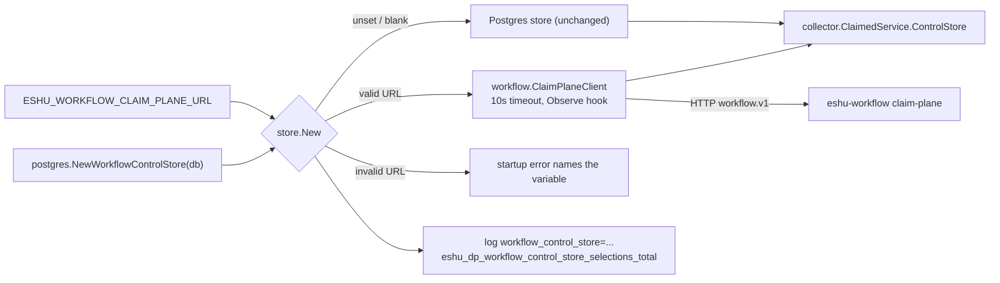

# Collector claim-store selection: wiring the claim plane (`#8875`, P1)

Status: implemented on branch `drive/8875-p1-collector-wiring`. This is Phase B
step 8 (P1) of the `#8875` real-scope flip ruling. It gives the satellite claim
plane its first production consumer. It moves no authority: every collector
keeps the core Postgres store until an operator sets one variable.

## Problem

`workflow.NewClaimPlaneClient` implements `workflow.ControlStore` over the
`workflow.v1` HTTP protocol, but its only non-test caller was the parity
harness (`go/internal/workflow/parity/fixtures.go`). Every claim-aware collector
built its claim store with `postgres.NewWorkflowControlStore(database)`
directly, at 12 call sites plus the collector entrypoint generator template.
If the satellite planned work for a real instance, no collector could claim it.

## Decision

One shared constructor, `store.New` in the new package
`go/internal/collector/claim/store`, selects the claim store at startup from
`ESHU_WORKFLOW_CLAIM_PLANE_URL`:

| Variable state | Store | Notes |
| --- | --- | --- |
| unset or blank | the Postgres store the caller passed in, returned unchanged | every existing deployment is byte-for-byte unchanged |
| valid `http`/`https` URL | `workflow.ClaimPlaneClient` with a bounded HTTP client | no fallback to Postgres, ever |
| invalid URL | startup error naming the variable | credentials in the URL are rejected and never echoed |

The package sits on the collector side because `REMOVAL_PREP.md` §2 keeps the
narrow claim interface (`collector.ClaimControlStore`) in-tree behind the
client: collectors keep calling the interface and the wiring swaps the store.
The Postgres store is injected, so `claim/store` does not import
`storage/postgres`. `workflow` stays free of `telemetry`: the client gains an
optional `Observe` hook, and `claim/store` binds that hook to the telemetry
instruments.

## URL validation

- Scheme must be `http` or `https`; host must be non-empty.
- User info (`user:pass@`) is rejected. The error message redacts it.
- Query strings and fragments are rejected. The path must be empty or `/`,
  because the client appends `/workflow.v1/<Operation>` to the base.
- A blank value (empty or whitespace only) means unset. Helm and Compose often
  render an empty string for an absent value.

## Authentication

The claim-plane server (`eshu-workflow` `v0.1.1`, `cmd/claim-plane/main.go`)
has no HTTP authentication. It checks only the `Workflow-Protocol-Version`
header. The `workflow-claim-plane-auth` Secret is the claim plane's own
Postgres credential (`--database-url`), not an HTTP credential. The client
therefore sends no credential, and the URL must not carry one. The trust
boundary is the cluster network (an in-cluster Service such as
`http://eshu-workflow-claim-plane:8080`). Adding HTTP auth is a satellite
change and a later client option. It is not in P1.

## Outage behavior

The client fails closed. It never falls back to Postgres.

- The HTTP client has a 10 s timeout. That is half the default 20 s heartbeat
  interval and one sixth of the default 60 s lease TTL. A timed-out heartbeat
  still leaves the lease alive for the next tick.
- There is no client-side retry. `ClaimNext` is not idempotent, and the
  in-tree Postgres store does not retry either, so the existing runner
  semantics hold: a `ClaimNextEligible` error ends `ClaimedService.Run`, the
  process exits, and the orchestrator restarts it with its own backoff. That
  is the same path a core Postgres outage takes today.
- Heartbeat failures follow the existing lease semantics. The lease expires,
  the claim plane's reaper reclaims the item, and a fenced-away epoch maps to
  `workflow.ErrClaimRejected`, which the runner already handles.
- Pacing consults keep failing open (`claimed_service_grant.go`), as with the
  Postgres store.

## Collectors that cannot use the claim plane yet

`collector-vulnerability-intelligence` and `collector-component-extension`
read `workflow_runs.requested_scope_set` (and, for vulnerability intelligence,
the public-advisory claim lookup) from core Postgres. In claim-plane mode
those rows live in the satellite database. The claim plane has no route for
them. Reading core would return the wrong answer, so these two collectors
refuse to start when the variable is set, with an error that names the
variable and the reason.

## Out of scope: the commit fence (P2)

The ingestion commit path still heartbeats the claim inside the core commit
transaction (`go/internal/storage/postgres/ingestion.go`). A collector holding
a satellite claim has no core claim row, so with P1 alone every commit fails
with `verify active workflow claim before ingestion commit`. That failure is
loud and fail-closed: the generation dead-letters and the claim fails
retryable on the satellite, then terminal at the attempt budget. No stale
writer can commit. The parallel lane `lane-p2-pin-fence` wires
`ValidateAndPinClaimForCommit` into that path. P1 does not touch it. Setting
the variable on a real instance needs both P1 and P2 (ruling Phase C).

## Telemetry

- Startup log `event_name=collector.workflow_control_store.selected` with
  `workflow_control_store` (`postgres` or `claim_plane`) and, for the claim
  plane, `claim_plane_endpoint` (scheme and host only).
- `eshu_dp_workflow_control_store_selections_total{backend}`: incremented once
  at startup. It shows which store each pod runs.
- `eshu_dp_workflow_claim_plane_requests_total{operation,outcome}` and
  `eshu_dp_workflow_claim_plane_request_duration_seconds{operation,outcome}`:
  emitted at the client's single `post` chokepoint. `operation` is the closed
  set of protocol operations. `outcome` is the closed set `ok`, `rejected`,
  `not_found`, `paced`, `invalid`, `server_error`, `timeout`,
  `transport_error`, `decode_error`.

## Performance and concurrency

Unset variable: no new work on any path. The constructor returns the caller's
store. Claim-plane mode: one HTTP round trip per claim operation instead of
one SQL round trip. The per-operation cost is the satellite's to bound, under
the ruling's section 6 demand bar (Phase C). The client is safe for concurrent
use: `http.Client` is concurrency-safe, the client holds no mutable state, and
the observer hook only records metrics. No lock, transaction, or lease
semantics change on the in-tree side.

## Evidence

No-Regression Evidence: with `ESHU_WORKFLOW_CLAIM_PLANE_URL` unset, every
collector's claim path is unchanged. `store.New` returns the injected
`*postgres.WorkflowControlStore` pointer itself (`TestNewUnsetKeepsInjectedPostgresStore`
asserts pointer identity), and it runs once at startup, never per claim. No
SQL, lock order, lease, or queue behavior changes. Client-side cost of the new
`Observe` chokepoint, measured on the shared dev host (Go 1.26.10
linux/arm64, `httptest` loopback stub, `-benchtime 10000x -count 5
-benchmem`):

| Benchmark | Base `93d191b7f8` | This branch |
| --- | --- | --- |
| `BenchmarkClaimPlaneClientClaimNext` (no observer) | 55.5-75.0 us/op, median 66.7; 239 allocs/op | 64.3-83.8 us/op, median 75.2; 239 allocs/op |
| `BenchmarkClaimPlaneHeartbeat/unobserved` | n/a | 31.1-38.1 us/op, median 33.0; 100 allocs/op, ~9.7 KB/op |
| `BenchmarkClaimPlaneHeartbeat/observed` (real OTEL instruments) | n/a | 31.8-36.5 us/op, median 33.9; 105 allocs/op, ~10.0 KB/op |

The no-observer path keeps the same allocation count; its ns/op ranges overlap
on this noisy shared host. Binding the metrics adds 5 allocations (about
200 B) per request and no measurable latency next to one loopback HTTP round
trip. Input shape: one request per iteration, server work near zero. Terminal
queue/row counts: none; the benchmarks touch no store. Real server-side latency
is the ruling's Phase C bar (`p99` from the claim plane's own histogram,
P3), not this stub.

Observability Evidence: `TestNewEmitsSelectionLogAndMetricsAndInstrumentsRequests`
asserts the `collector.workflow_control_store.selected` log fields, the
`eshu_dp_workflow_control_store_selections_total{backend_kind=claim_plane}`
increment, and the
`eshu_dp_workflow_claim_plane_requests_total{operation=HeartbeatClaim,outcome=ok}`
increment. `TestClaimPlaneClientObserveReportsOutcomePerProtocolResult`, the
timeout case, and the transport case cover every `outcome` path except
`request_error`, which needs an unmarshalable body or a malformed base URL
that `store.New` already rejects. `TestClaimPlaneInstrumentsRegisterAndEmit`
pins registration and the histogram bounds.
