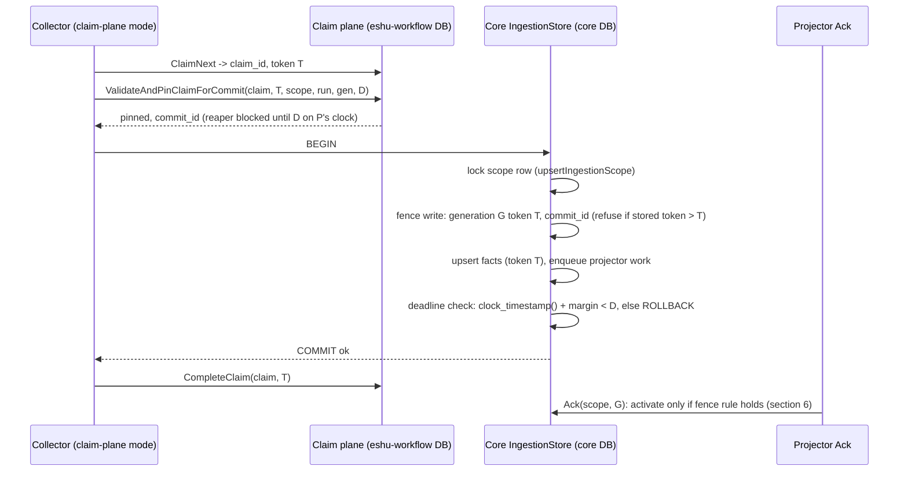

# Claim-plane commit fence (P2 of the #8875 flip ruling)

Status: DECIDED. The fork in section 6 was settled by the arbiter ruling of
2026-11-02 (option (a), storage S2, two PRs); the implementation follows
section 6.1. Refs #9376, #8875.

## 1. Problem

The in-tree fence is one transaction. `CommitClaimedScopeGeneration`
(`go/internal/storage/postgres/ingestion.go`) runs `HeartbeatClaim` through
`NewWorkflowControlStore(tx)` on the same transaction as fact persistence.
The claim row stays locked until `COMMIT`, so a reaper cannot reclaim the
item while the commit is in flight, and a writer whose claim was already
reaped fails the heartbeat and writes nothing.

A collector that claims from the extracted claim plane (`eshu-workflow`,
its own database) has no core claim row. `HeartbeatClaim(tx)` would fail
every commit (outage). Skipping it removes the fence: a reaped-and-reclaimed
writer could commit facts after it lost the claim.

## 2. Facts the design rests on (read at `origin/main` `93d191b7f8`)

| Fact | Source |
| --- | --- |
| Fencing tokens are per work item, not per scope or global: claim sets `current_fencing_token = item.current_fencing_token + 1`. | `workflow_control_fair_claim_sql.go:141`, `workflow_control_quota_sql.go:147`; satellite tokens also start at 1 per item (ruling R2). |
| A work item names one `(scope_id, source_run_id, generation_id)`; the satellite pin matches all three plus `claim_id` and the live token, under `FOR UPDATE OF item, claim`. | `eshu-workflow` `store/pacing_quota_pin.go` `pinClaimQuery` (`af3311e`). |
| The pin stores `commit_id = "commit-<claim>-<token>"` (stable across replays) and `commit_pinned_until = GREATEST(old, deadline)`. The reaper must not expire a claim whose pin still covers the reap clock. The caller chooses the deadline. | same file; `004_commit_pin.sql` header. |
| A pin miss is `stale_fence` (claim exists, not live at that token) or `not_found`. | `classifyPinMiss`. |
| Facts carry the claim token (`FencingToken: item.CurrentFencingToken`) and the fact upsert keeps the highest token per `fact_id` (`fact_records.fencing_token <= EXCLUDED.fencing_token`). | `collector/pagerduty/source.go:235` and peers; `facts.go:330`, `facts_cross_batch_fencing_proof_test.go`. |
| The generation upsert only rewrites a `pending` generation; an `active`/terminal one returns `errGenerationAlreadyFinalized` and the commit is skipped. | `ingestion_queries.go:122-149,235`; `ingestion.go` finalized-skip branch. |
| Activation happens later, in projector Ack (`activateProjectorGenerationQuery`), per `(scope_id, generation_id)`, once (`activated_at = COALESCE(activated_at, $1)`). | `projector_queue_sql.go:62-76`. |
| `scope_generations` has no fencing column today; `fact_records` does. | migrations; `ingestion_queries.go:31`. |
| No production binary reads from the claim plane yet (P1, `ESHU_WORKFLOW_CLAIM_PLANE_URL`, is not on main). | `rg CLAIM_PLANE_URL go/` = 0 hits. |
| `ClaimMutation` has no `ScopeID`/`SourceRunID`/`GenerationID`; the pin needs `source_run_id`. Only terraform-state sets `ResolvedSourceRunID`. | `go/internal/workflow/store.go:28-70`. |

## 3. Sequence (proposed plane path)

Stale-writer interleaving the fence must refuse:

## 4. Lock acquisition and transaction boundaries

- Core transaction (unchanged order, one new step): scope row
  (`ingestion_scopes`, via the upsert) then generation row then facts then
  projector enqueue. The fence write touches the generation's fence row
  after the scope row lock, so every writer of `G` is already serialized on
  the scope row; the fence adds no new lock order and no new wait cycle.
- No cross-database transaction. The pin is a separate HTTP call that runs
  before `BEGIN`. Core holds no lock while waiting on the plane.
- The plane's `FOR UPDATE OF item, claim` is in its own database; it cannot
  wait on a core lock.
- `CompleteClaim` runs after the core `COMMIT`, as today.

## 5. Failure, replay, and timeout cases

| Case | Outcome |
| --- | --- |
| Pin returns `stale_fence`/`not_found` | No core transaction. Commit returns a terminal stale-fence error; the stale-writer counter increments. |
| Pin times out (ambiguous) | Retry the pin with identical arguments: the plane returns the same `commit_id` (COALESCE). No core write happened yet. |
| Core commit times out after `COMMIT` was sent (ambiguous) | Replay the whole commit with the same token: the fence row equals `T` (not greater), the generation is still `pending` or already `active` (finalized skip). Facts upsert is idempotent per `fact_id` at equal token. |
| Deadline passes before `COMMIT` | `ROLLBACK`; stale-writer counter (`reason=deadline`). The collector may re-pin (extends `D` only while the claim is still live at `T`). |
| Writer reaped, item reclaimed at `N+1`, `N+1` committed first | Fence row `N+1 > N` refuses `N`. |
| `CompleteClaim` fails after core commit | Same as today: lease expires, item is reclaimed at `N+1`, and the recommit is either a finalized skip or a higher-token upsert. |
| In-tree path (no plane configured) | Byte-for-byte today's path: `HeartbeatClaim(tx)`, no pin, no fence row. |

Rollback of the feature: unset the plane configuration; the in-tree path
needs no fence row. If the fence is a new table or new nullable columns, the
migration is forward-only and inert when unused (owner no-downgrade policy).

Consumer notification: the commit already enqueues projector work in the
same transaction (`ProjectorQueue.Enqueue`); the fence adds no new consumer.

## 6. The fork and its ruling

The phrase "never activate a generation below the highest activated
fencing token" (EXTRACTION_PREP §6, the former PLANE_DECLARATION §4 row 7,
satellite `004_commit_pin.sql`) reads as a per-scope high-water. Tokens are
per work item and restart at 1 for every generation, so a per-scope rule
would refuse legitimate generations. Terraform-state can also commit one
resolved generation from two work items (the item id embeds the run id), so
even a per-generation token is not comparable across items. Activation
happens once per generation (`activated_at` COALESCE), so an activation-time
rule reduces to a commit-time fence.

The candidates were (a) a commit-time fence with a bounded residual window,
(b) reopening an activated generation on a higher-token commit, and (c) a
claim-plane read at projector Ack. The arbiter adopted (a) with storage S2
and rejected (b) (it breaks activation-once assumptions and orphans the
per-batch side tables) and (c) (a cross-service read on the Ack hot path that
is still racy). The residual window (a stale commit landing inside the
margin after its deadline) produces the same shape as today's accepted
finalized-replay semantics, and the margin bounds it.

### 6.1 Ruled design

- Restated rule: a plane-claimed commit of G under claim (item I, token T)
  is durable only if the plane pinned (I, T) before BEGIN, the stored fence
  for (G, I) is below T or equal to T under the same claim id, and the
  latest pin deadline exceeds the commit time by the margin when COMMIT is
  sent. Nothing runs at Ack.
- Storage: `generation_commit_fences (generation_id FK, work_item_id,
  scope_id, claim_id, fencing_token, commit_id, committed_at, PK
  (generation_id, work_item_id))`, migration 270, written only on the plane
  path. Retention deletes only superseded generations, so the FK cascade is
  safe.
- Order on the plane path: pin (deadline now + lease, three identical
  retries, never a fallback to `HeartbeatClaim(tx)`), re-pin keeper every
  lease/3 (a stale re-pin cancels the commit context), BEGIN, skip the
  in-tx heartbeat, shared advisory lock, scope upsert, generation upsert,
  fence upsert, facts, state, enqueue, then the Go-clock deadline check
  (5 s margin; never SQL `now()`), COMMIT.
- The planned item identity (`ScopeID`, `SourceRunID`, `GenerationID`) rides
  on `workflow.ClaimMutation`; the fence row uses the committed generation.
- The unchanged-generation re-projection takes the pin and deadline fence
  without a fence row. Derived scanner claims fail closed on the plane path.
- Margin rule: `margin >= 2 * (skew_bound + commit_p99)` and
  `margin < lease - lease/3`; skew and commit p99 are measured on the
  test cluster before the real-scope flip.

## 7. Proof

Recorded in `go/internal/storage/postgres/evidence-9376-claim-plane-commit-fence.md`:
the EXPLAIN and pgbench theory proof, the red/green stale-writer
regression, the race and lock-order tests, the parity scenario against the
real satellite, the migration rehearsal, and the telemetry.
