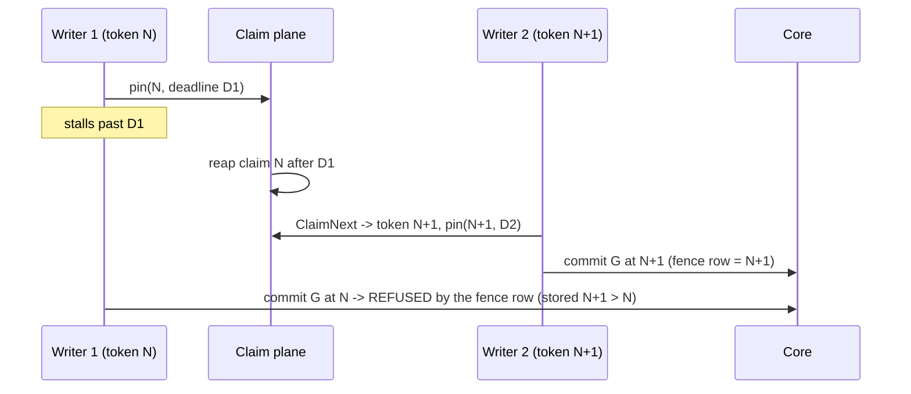

# Claim-plane commit fence (P2 of the #8875 flip ruling)

Status: DECIDED. The fork in section 6 was settled by the arbiter ruling of
2026-11-02 (option (a), storage S2, two PRs); the implementation follows
section 6.1. Refs #9376, #8875.

## 1. Problem

The in-tree fence is one transaction. `CommitClaimedScopeGeneration`
(`go/internal/storage/postgres/ingestion.go`) runs `HeartbeatClaim` through
`NewWorkflowControlStore(tx)` on the same transaction as fact persistence.
The claim row stays locked until `COMMIT`, so a reaper cannot reclaim the
item while the commit is in flight, and a writer whose claim was already
reaped fails the heartbeat and writes nothing.

A collector that claims from the extracted claim plane (`eshu-workflow`,
its own database) has no core claim row. `HeartbeatClaim(tx)` would fail
every commit (outage). Skipping it removes the fence: a reaped-and-reclaimed
writer could commit facts after it lost the claim.

## 2. Facts the design rests on (read at `origin/main` `93d191b7f8`)

| Fact | Source |
| --- | --- |
| Fencing tokens are per work item, not per scope or global: claim sets `current_fencing_token = item.current_fencing_token + 1`. | `workflow_control_fair_claim_sql.go:141`, `workflow_control_quota_sql.go:147`; satellite tokens also start at 1 per item (ruling R2). |
| A work item names one `(scope_id, source_run_id, generation_id)`; the satellite pin matches all three plus `claim_id` and the live token, under `FOR UPDATE OF item, claim`. | `eshu-workflow` `store/pacing_quota_pin.go` `pinClaimQuery` (`af3311e`). |
| The pin stores `commit_id = "commit-<claim>-<token>"` (stable across replays) and `commit_pinned_until = GREATEST(old, deadline)`. The reaper must not expire a claim whose pin still covers the reap clock. The caller chooses the deadline. | same file; `004_commit_pin.sql` header. |
| A pin miss is `stale_fence` (claim exists, not live at that token) or `not_found`. | `classifyPinMiss`. |
| Facts carry the claim token (`FencingToken: item.CurrentFencingToken`) and the fact upsert keeps the highest token per `fact_id` (`fact_records.fencing_token <= EXCLUDED.fencing_token`). | `collector/pagerduty/source.go:235` and peers; `facts.go:330`, `facts_cross_batch_fencing_proof_test.go`. |
| The generation upsert only rewrites a `pending` generation; an `active`/terminal one returns `errGenerationAlreadyFinalized` and the commit is skipped. | `ingestion_queries.go:122-149,235`; `ingestion.go` finalized-skip branch. |
| Activation happens later, in projector Ack (`activateProjectorGenerationQuery`), per `(scope_id, generation_id)`, once (`activated_at = COALESCE(activated_at, $1)`). | `projector_queue_sql.go:62-76`. |
| `scope_generations` has no fencing column today; `fact_records` does. | migrations; `ingestion_queries.go:31`. |
| No production binary reads from the claim plane yet (P1, `ESHU_WORKFLOW_CLAIM_PLANE_URL`, is not on main). | `rg CLAIM_PLANE_URL go/` = 0 hits. |
| `ClaimMutation` has no `ScopeID`/`SourceRunID`/`GenerationID`; the pin needs `source_run_id`. Only terraform-state sets `ResolvedSourceRunID`. | [`go/internal/workflow/store.go` L28-L70](https://github.com/eshu-hq/eshu/blob/93d191b7f8d99bb6b259845da7154179988b10b5/go/internal/workflow/store.go#L28-L70) at `93d191b7f8`; P2 adds the three fields. |

## 3. Sequence (ruled plane path)

The store runs inside the collector process. Every clock read below is the
store's Go clock (`IngestionStore.Now`); SQL `now()` and `clock_timestamp()`
are never part of the fence (D5, D6).

```mermaid
sequenceDiagram
    participant C as Collector (claim-plane mode)
    participant P as Claim plane (eshu-workflow DB)
    participant I as IngestionStore (core DB)
    participant Q as Projector Ack
    C->>P: ClaimNext -> claim_id, token T
    C->>I: CommitClaimedScopeGeneration(mutation with planned identity)
    I->>P: pin(claim, T, planned scope/run/gen, D0 = now + lease), before BEGIN
    P-->>I: pinned, commit_id (reaper blocked until D on P's clock)
    loop every lease/3 until COMMIT returns
        I->>P: re-pin (D = now + lease); stale cancels the commit context
    end
    I->>I: BEGIN, shared advisory lock, scope row lock, generation upsert
    I->>I: fence upsert (G, I): refuse if stored token > T, or = T under another claim
    I->>I: facts (token T), state, enqueue projector work
    I->>I: deadline check, Go clock: latest D - now >= margin, else ROLLBACK
    I->>I: COMMIT, then stop the re-pin keeper
    I-->>C: committed
    C->>P: CompleteClaim(claim, T)
    Q->>I: Ack(scope, G): activates as today; no fence check runs at Ack
```

Stale-writer interleaving the fence must refuse:



Had writer 1 reached `COMMIT` before writer 2 committed, its own deadline
check (latest `D1` minus now below the margin) would have rolled it back.

## 4. Lock acquisition and transaction boundaries

- Core transaction (unchanged order, one new step): scope row
  (`ingestion_scopes`, via the upsert) then generation row then facts then
  projector enqueue. The fence write touches the generation's fence row
  after the scope row lock, so every writer of `G` is already serialized on
  the scope row; the fence adds no new lock order and no new wait cycle.
- No cross-database transaction. The pin is a separate HTTP call that runs
  before `BEGIN`. Core holds no lock while waiting on the plane.
- The plane's `FOR UPDATE OF item, claim` is in its own database; it cannot
  wait on a core lock.
- `CompleteClaim` runs after the core `COMMIT`, as today.

## 5. Failure, replay, and timeout cases

| Case | Outcome |
| --- | --- |
| Pin returns `stale_fence`/`not_found` | No core transaction, stream drained. Terminal error; counter `reason=stale_fence` or `not_found`. |
| Pin hangs or times out (ambiguous) | Each attempt is bounded by `DefaultClaimFencePinAttemptTimeout` (10 s, capped at lease/3). Three identical attempts (the plane returns the same `commit_id` and only raises the deadline), then a retryable `pin_unavailable` error with no core transaction. The P1 wiring also gives the claim-plane client a 10 s `http.Client` timeout (`RequestTimeout`, PR #9856); whichever fires first ends the attempt. Never a fallback to `HeartbeatClaim(tx)`. |
| Re-pin returns `stale_fence`/`not_found` mid-transaction | The keeper cancels the commit context; the statement in flight fails, the transaction rolls back, and the error is the terminal refusal. |
| Re-pin hangs or times out mid-transaction | Bounded like the pin; the commit continues and the deadline check decides. Stopping the keeper cancels a re-pin in flight, so a stalled plane never holds a decided commit open. |
| Deadline check fails before `COMMIT` | `ROLLBACK`, retryable error, counter `reason=deadline`, log with the slack. |
| Core `COMMIT` sent, response lost (ambiguous) | The collector classifies `commit_failure` as retryable and the item is reclaimed at `T+1` (D7). The recommit is a higher-token fence accept over the pending generation or a finalized skip. A same-claim retry at `T`, if a caller ever adds one, is accepted by the equal-token branch and is idempotent per fact. |
| Writer reaped, item reclaimed at `N+1`, `N+1` committed first | Fence row `N+1 > N` refuses `N` (terminal, `reason=fence_token`). |
| Equal token under another claim | Refused, terminal, `reason=fence_claim_mismatch`, logged at ERROR: the plane's `UNIQUE (work_item_id, fencing_token)` makes it an integrity alarm. |
| `CompleteClaim` fails after core commit | Same as today: lease expires, item is reclaimed at `N+1`, and the recommit is either a finalized skip or a higher-token upsert. |
| A re-pin refusal lands after `COMMIT` returned | Ignored: the store stops the keeper when `COMMIT` returns and runs the catalog merge and relationship backfill on the context the commit started from. |
| Margin at or above `lease - lease/3` | `beginClaimFence` refuses before pinning (D6), with a configuration error naming both values. |
| In-tree path (no plane configured) | Byte-for-byte today's path: `HeartbeatClaim(tx)`, no pin, no fence row, no `ingestion.commit.claim_fence` span. |

Rollback of the feature: unset the plane configuration; the in-tree path
needs no fence row. If the fence is a new table or new nullable columns, the
migration is forward-only and inert when unused (owner no-downgrade policy).

Consumer notification: the commit already enqueues projector work in the
same transaction (`ProjectorQueue.Enqueue`); the fence adds no new consumer.

## 6. The fork and its ruling

The phrase "never activate a generation below the highest activated
fencing token" (EXTRACTION_PREP §6, the former PLANE_DECLARATION §4 row 7,
satellite `004_commit_pin.sql`) reads as a per-scope high-water. Tokens are
per work item and restart at 1 for every generation, so a per-scope rule
would refuse legitimate generations. Terraform-state can also commit one
resolved generation from two work items (the item id embeds the run id), so
even a per-generation token is not comparable across items. Activation
happens once per generation (`activated_at` COALESCE), so an activation-time
rule reduces to a commit-time fence.

The candidates were (a) a commit-time fence with a bounded residual window,
(b) reopening an activated generation on a higher-token commit, and (c) a
claim-plane read at projector Ack. The arbiter adopted (a) with storage S2
and rejected (b) (it breaks activation-once assumptions and orphans the
per-batch side tables) and (c) (a cross-service read on the Ack hot path that
is still racy). The residual window (a stale commit landing inside the
margin after its deadline) produces the same shape as today's accepted
finalized-replay semantics, and the margin bounds it.

### 6.1 Ruled design

- Restated rule: a plane-claimed commit of G under claim (item I, token T)
  is durable only if the plane pinned (I, T) before BEGIN, the stored fence
  for (G, I) is below T or equal to T under the same claim id, and the
  latest pin deadline exceeds the commit time by the margin when COMMIT is
  sent. Nothing runs at Ack.
- Storage: `generation_commit_fences (generation_id FK, work_item_id,
  scope_id, claim_id, fencing_token, commit_id, committed_at, PK
  (generation_id, work_item_id))`, migration 270, written only on the plane
  path. Retention deletes only superseded generations, so the FK cascade is
  safe.
- Order on the plane path: pin (deadline now + lease, three identical
  attempts each bounded by the attempt timeout, never a fallback to
  `HeartbeatClaim(tx)`), re-pin keeper every lease/3 (a stale re-pin cancels
  the commit context; the keeper stops when COMMIT returns), BEGIN, skip the
  in-tx heartbeat, shared advisory lock, scope upsert, generation upsert,
  fence upsert, facts, state, enqueue, then the Go-clock deadline check
  (5 s margin; never SQL `now()`), COMMIT.
- The planned item identity (`ScopeID`, `SourceRunID`, `GenerationID`) rides
  on `workflow.ClaimMutation`; the fence row uses the committed generation.
- The unchanged-generation re-projection takes the pin and deadline fence
  without a fence row. Derived scanner claims fail closed on the plane path.
- Margin rule: `margin >= 2 * (skew_bound + commit_p99)` and
  `margin < lease - lease/3`; skew and commit p99 are measured on the
  test cluster before the real-scope flip. The store enforces the second
  inequality when a plane commit begins.
- Terraform-state: two runs whose attempts resolve *different* snapshots
  commit different generations, so their fence rows have different keys and
  never compare. For those attempts only the pin and the deadline check
  protect the commit (ruling F3, F7). Two runs that resolve the *same*
  snapshot get one fence row per work item, and neither refuses the other.
- Telemetry: D9 named `fence_mode` as `in_tree|plane`. The in-tree path
  emits no fence span at all, so the only value emitted is `fence_mode=plane`
  on `ingestion.commit.claim_fence`.
- Wiring (P1, merged as #9856; the pairing lands here): `ClaimPlane` is
  set per `IngestionStore`. A store with `ClaimPlane` set pins every
  claimed commit, so an in-tree collector that shared a store with a
  flipped collector would have its claims refused as `not_found` by the
  plane; each collector gets its own store, matching its own
  `ControlStore`. `store.New` returns the selected claim-plane client as
  `Selection.Pinner` (nil for Postgres), and every claim-aware collector
  that calls it sets `ClaimPlane` from it (the generated entrypoint
  template and each hand-written `buildClaimedService`). The pairing is
  enforced at start: `collector.ClaimedService` refuses a claim-plane
  control store whose committer does not report `ClaimPlaneFenced()` (a
  `ClaimPlane` with a `Pinner`), and a fenced committer paired with the
  core Postgres control store. At commit, a `ClaimPlane` with no `Pinner`
  still fails closed (D8). Core-only collectors (component extension,
  vulnerability intelligence) cannot select the plane at all.

## 6.2 Runbook: confirm the 5 s margin on the test cluster (read-only, before Phase C)

The margin must satisfy `margin >= 2 * (skew_bound + commit_p99)` and
`margin < lease - lease/3` (40 s at the 60 s lease). Measure both inputs on
the test cluster for the collector kind that will flip first. Every step
reads: `kubectl get`, `kubectl logs`, and `kubectl port-forward` stream data
and create or change no cluster object. Record the raw samples and the
verdict on #8875. The commands need GNU `date` and `jq` on the drive host
(`gdate` on macOS).

1. Clock skew. The skew that matters is collector versus satellite. The
   satellite image is distroless static (no shell, no `date`), so
   `kubectl exec <satellite> -- date` fails. A container reads its node's
   clock, so measure node clocks. Map each pod to its node first:

   ```bash
   kubectl -n eshu get pods -l '<collector-selector>' \
     -o custom-columns=POD:.metadata.name,NODE:.spec.nodeName --no-headers
   kubectl -n eshu get pods -l '<satellite-selector>' \
     -o custom-columns=POD:.metadata.name,NODE:.spec.nodeName --no-headers
   ```

   Then take one of these, best first. Each gives a per-node offset against
   one reference clock; `skew_bound = max|offset_collector| +
   max|offset_satellite| + max(rtt)`, which is conservative because the
   collector-satellite skew is at most the sum.

   - A. node-exporter, if Prometheus scrapes it. The reference is the
     Prometheus server clock, and the scrape delay is folded into the value
     (conservative), so `rtt` is 0 here. Read the value for each node's
     `instance`:

     ```promql
     max_over_time((abs(node_time_seconds - timestamp(node_time_seconds)))[24h:1m])
     ```

     If the timex collector is on, `max_over_time((abs(node_timex_offset_seconds))[24h:1m])`
     is NTP's own offset estimate for the same node; record both.
   - B. The HTTP `Date` header of the satellite's admin listener and of the
     collector's HTTP port (a Go server stamps it from the process clock; a
     404 still carries it). The reference is the drive host clock. Run
     `kubectl -n eshu port-forward pod/<pod> 18282:<pod-http-port>` in one
     terminal and take 20 bracketed samples in another:

     ```bash
     for i in $(seq 20); do
       a=$(date +%s.%N)
       d=$(curl -sI http://127.0.0.1:18282/healthz | tr -d '\r' \
         | awk -F': ' 'tolower($1) == "date" {print $2}')
       c=$(date +%s.%N)
       awk -v a="$a" -v c="$c" -v d="$(date -d "$d" +%s)" \
         'BEGIN {printf "offset=%.3f rtt=%.3f\n", d - (a + c) / 2, c - a}'
     done
     ```

     The header has 1 s resolution and truncates, so the true offset lies in
     `[offset, offset + 1 s]`: add 1 s to each pod's `max|offset|`. If the
     verdict fails only because of those two 1 s terms, use A or C before
     raising the margin.
   - C. A pod with `date` on the same node. List the node's pods with
     `kubectl get pods -A --field-selector spec.nodeName=<node> -o name`,
     pick one whose image has `date`, and bracket it against the shared
     Postgres server, which is then the reference:

     ```bash
     a=$(kubectl -n <ns> exec <pod-on-node> -- date +%s.%N)
     b=$(kubectl -n eshu exec eshu-postgresql-0 -c postgresql -- \
       psql -U eshu -d postgres -Atc 'select extract(epoch from clock_timestamp())')
     c=$(kubectl -n <ns> exec <pod-on-node> -- date +%s.%N)
     # offset = (a + c) / 2 - b, rtt = c - a
     ```

2. Commit p99. Eshu's JSON logger writes the message under `message`, not
   `msg`. `kubectl logs deploy/X` reads one pod, so loop over every pod of
   the flipped collector. `jq -R 'fromjson?'` skips non-JSON lines, and the
   `awk` takes the ceiling rank, so one sample is its own p99 and zero
   samples is an error, not an empty answer:

   ```bash
   for p in $(kubectl -n eshu get pods -l '<collector-selector>' -o name); do
     kubectl -n eshu logs "$p" --since=24h
   done \
     | jq -rR 'fromjson? | select(.message == "ingestion commit stage completed"
                and .stage == "commit_transaction") | .duration_seconds' \
     | sort -n \
     | awk '{v[NR] = $1} END {if (NR == 0) {print "no samples"; exit 1};
            i = int((NR * 99 + 99) / 100); print "p99=" v[i], "n=" NR}'
   ```

   `kubectl logs` keeps only what the node still holds for the current
   container. Add `--previous` for a pod that restarted, and record `n`: a
   p99 from a handful of commits is a weak bound.

3. Verdict. If `2 * (skew_bound + commit_p99) <= 5 s`, the margin stands.
   If not, raise `DefaultClaimFenceMargin` in a follow-up PR before
   Phase C (it is a constant on purpose, not a runtime knob), keeping it
   below `lease - lease/3`. After the flip,
   `eshu_dp_ingestion_commit_pin_slack_seconds` is the live check: healthy
   samples sit between 40 s and 60 s, and any `deadline` rejection means
   the margin or the plane needs attention.

The commands were dry-run on the drive host without cluster access: the log
pipeline on synthetic JSON (0, 1, 5, 100, and 201 samples, a non-JSON line,
and a `msg`-keyed decoy), the `Date` loop against a local `eshu-workflow`
`v0.1.1` admin listener, and both PromQL expressions with `promtool check
rules`. The `kubectl` lines are unrun.

## 7. Proof

Recorded in `go/internal/storage/postgres/evidence-9376-claim-plane-commit-fence.md`:
the EXPLAIN and pgbench theory proof, the red/green stale-writer
regression, the race and lock-order tests, the parity scenario against the
real satellite, the migration rehearsal, and the telemetry.
