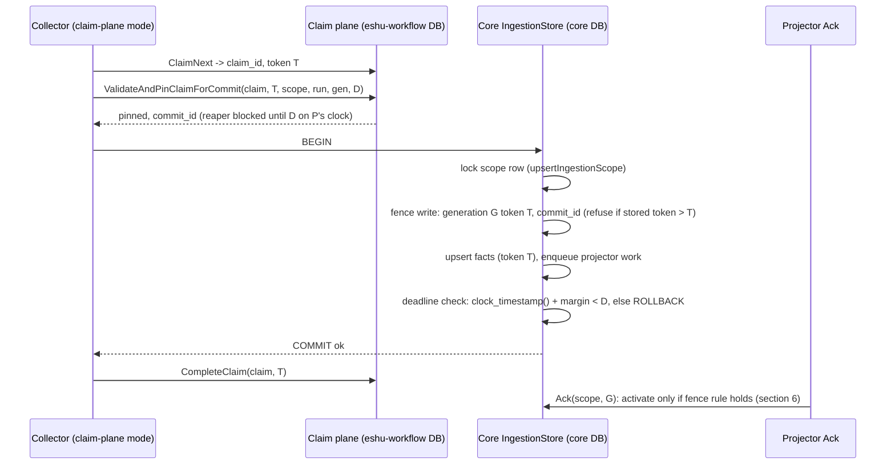

# Claim-plane commit fence (P2 of the #8875 flip ruling)

Status: DRAFT design note, blocked on one design fork (section 6). No code
lands until the fork is decided. Refs #9376, #8875.

## 1. Problem

The in-tree fence is one transaction. `CommitClaimedScopeGeneration`
(`go/internal/storage/postgres/ingestion.go`) runs `HeartbeatClaim` through
`NewWorkflowControlStore(tx)` on the same transaction as fact persistence.
The claim row stays locked until `COMMIT`, so a reaper cannot reclaim the
item while the commit is in flight, and a writer whose claim was already
reaped fails the heartbeat and writes nothing.

A collector that claims from the extracted claim plane (`eshu-workflow`,
its own database) has no core claim row. `HeartbeatClaim(tx)` would fail
every commit (outage). Skipping it removes the fence: a reaped-and-reclaimed
writer could commit facts after it lost the claim.

## 2. Facts the design rests on (read at `origin/main` `93d191b7f8`)

| Fact | Source |
| --- | --- |
| Fencing tokens are per work item, not per scope or global: claim sets `current_fencing_token = item.current_fencing_token + 1`. | `workflow_control_fair_claim_sql.go:141`, `workflow_control_quota_sql.go:147`; satellite tokens also start at 1 per item (ruling R2). |
| A work item names one `(scope_id, source_run_id, generation_id)`; the satellite pin matches all three plus `claim_id` and the live token, under `FOR UPDATE OF item, claim`. | `eshu-workflow` `store/pacing_quota_pin.go` `pinClaimQuery` (`af3311e`). |
| The pin stores `commit_id = "commit-<claim>-<token>"` (stable across replays) and `commit_pinned_until = GREATEST(old, deadline)`. The reaper must not expire a claim whose pin still covers the reap clock. The caller chooses the deadline. | same file; `004_commit_pin.sql` header. |
| A pin miss is `stale_fence` (claim exists, not live at that token) or `not_found`. | `classifyPinMiss`. |
| Facts carry the claim token (`FencingToken: item.CurrentFencingToken`) and the fact upsert keeps the highest token per `fact_id` (`fact_records.fencing_token <= EXCLUDED.fencing_token`). | `collector/pagerduty/source.go:235` and peers; `facts.go:330`, `facts_cross_batch_fencing_proof_test.go`. |
| The generation upsert only rewrites a `pending` generation; an `active`/terminal one returns `errGenerationAlreadyFinalized` and the commit is skipped. | `ingestion_queries.go:122-149,235`; `ingestion.go` finalized-skip branch. |
| Activation happens later, in projector Ack (`activateProjectorGenerationQuery`), per `(scope_id, generation_id)`, once (`activated_at = COALESCE(activated_at, $1)`). | `projector_queue_sql.go:62-76`. |
| `scope_generations` has no fencing column today; `fact_records` does. | migrations; `ingestion_queries.go:31`. |
| No production binary reads from the claim plane yet (P1, `ESHU_WORKFLOW_CLAIM_PLANE_URL`, is not on main). | `rg CLAIM_PLANE_URL go/` = 0 hits. |
| `ClaimMutation` has no `ScopeID`/`SourceRunID`/`GenerationID`; the pin needs `source_run_id`. Only terraform-state sets `ResolvedSourceRunID`. | `go/internal/workflow/store.go:28-70`. |

## 3. Sequence (proposed plane path)

Stale-writer interleaving the fence must refuse:

## 4. Lock acquisition and transaction boundaries

- Core transaction (unchanged order, one new step): scope row
  (`ingestion_scopes`, via the upsert) then generation row then facts then
  projector enqueue. The fence write touches the generation's fence row
  after the scope row lock, so every writer of `G` is already serialized on
  the scope row; the fence adds no new lock order and no new wait cycle.
- No cross-database transaction. The pin is a separate HTTP call that runs
  before `BEGIN`. Core holds no lock while waiting on the plane.
- The plane's `FOR UPDATE OF item, claim` is in its own database; it cannot
  wait on a core lock.
- `CompleteClaim` runs after the core `COMMIT`, as today.

## 5. Failure, replay, and timeout cases

| Case | Outcome |
| --- | --- |
| Pin returns `stale_fence`/`not_found` | No core transaction. Commit returns a terminal stale-fence error; the stale-writer counter increments. |
| Pin times out (ambiguous) | Retry the pin with identical arguments: the plane returns the same `commit_id` (COALESCE). No core write happened yet. |
| Core commit times out after `COMMIT` was sent (ambiguous) | Replay the whole commit with the same token: the fence row equals `T` (not greater), the generation is still `pending` or already `active` (finalized skip). Facts upsert is idempotent per `fact_id` at equal token. |
| Deadline passes before `COMMIT` | `ROLLBACK`; stale-writer counter (`reason=deadline`). The collector may re-pin (extends `D` only while the claim is still live at `T`). |
| Writer reaped, item reclaimed at `N+1`, `N+1` committed first | Fence row `N+1 > N` refuses `N`. |
| `CompleteClaim` fails after core commit | Same as today: lease expires, item is reclaimed at `N+1`, and the recommit is either a finalized skip or a higher-token upsert. |
| In-tree path (no plane configured) | Byte-for-byte today's path: `HeartbeatClaim(tx)`, no pin, no fence row. |

Rollback of the feature: unset the plane configuration; the in-tree path
needs no fence row. If the fence is a new table or new nullable columns, the
migration is forward-only and inert when unused (owner no-downgrade policy).

Consumer notification: the commit already enqueues projector work in the
same transaction (`ProjectorQueue.Enqueue`); the fence adds no new consumer.

## 6. OPEN FORK: what "never activate a generation below the highest activated fencing token" means here

The phrase (EXTRACTION_PREP §6, PLANE_DECLARATION §4 row 7, satellite
`004_commit_pin.sql` header) reads as a per-scope high-water. The code says
tokens are per work item, and each generation of a scope is a different work
item whose tokens restart at 1. A per-scope high-water would refuse every new
generation whose item token is lower than an older generation's (for example
an old generation activated at token 3 after two reclaims, then a new
generation at token 1). So the literal rule is wrong as a per-scope rule.

Per generation, activation happens once (`activated_at` COALESCE), so an
"activated high-water" per generation reduces to the commit-time fence.

The residual hazard a commit-time fence alone does not close: writer `N`
commits `G` inside the skew/commit-latency window after `D` while `N+1`
already holds the claim but has not committed. The projector can activate
`G` from `N`'s facts, and `N+1`'s commit then hits the finalized skip, so
the stale facts become the truth. Candidate rules:

- (a) Deadline fence plus per-generation monotonic fence row only; accept the
  residual window, bounded by a margin larger than clock skew plus the commit
  time (both measured).
- (b) (a) plus: a higher-token commit of an already-activated generation is
  allowed for plane-claimed generations (re-opens `G`, purges facts with
  `fencing_token < T`, re-enqueues projection). Changes finalized-skip
  semantics on the plane path only.
- (c) (a) plus: projector Ack refuses to activate `G` until the plane
  confirms the committing claim completed at that token (cross-service read
  in the activation path).

Storage of the fence, independent of (a)-(c):

- (S1) new nullable columns on `scope_generations` (`claim_id`,
  `claim_fencing_token`, `commit_id`): metadata-only `ADD COLUMN`, but it
  changes a hot, large table and the shared generation upsert.
- (S2) new side table `generation_commit_fences (generation_id PK, scope_id,
  claim_id, fencing_token, commit_id, committed_at)` written only on the
  plane path: in-tree statements are untouched by construction.

## 7. Proof plan (after the fork is decided)

- Theory: `EXPLAIN (ANALYZE, BUFFERS)` of the fence upsert and of the Ack
  statement on a disposable database seeded at representative
  `scope_generations` size; cost per commit must stay one PK probe.
- Red-first: stale writer reaped and reclaimed at a higher token cannot
  commit; replay at equal token is idempotent; ambiguous timeout replay;
  concurrent writers race (`-race`, real Postgres); in-tree path unchanged.
- Telemetry: span around pin + fence, counter for stale-writer rejections by
  bounded reason, structured log with scope, generation, claim, and tokens.
