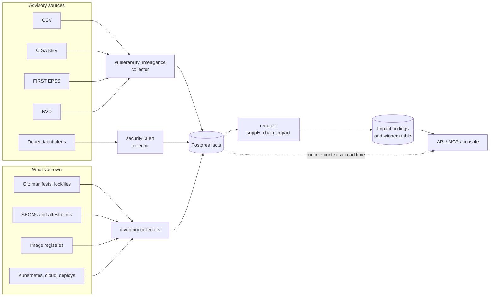
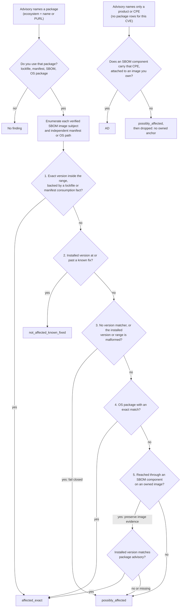

# Advisory Intelligence: How Correlation Works

This page is for SecOps and DevSecOps engineers. It explains how Eshu turns a
published vulnerability into a finding on code and infrastructure you own, in
what order that happens, and how to read the result.

Every behavior is marked:

- **Today**: on `main` now.
- **Planned (item N)**: an item in
  [Advisory Intelligence Phases](advisory-intelligence-phases.md), tracked by
  epic #9209.

Do not read a planned behavior as shipped.

## The short version

1. **Collect.** Advisory sources say a vulnerability affects some packages or
   products at some versions.
2. **Inventory.** Separate collectors say which packages, at which versions,
   your repositories, images, and workloads actually use.
3. **Correlate.** The reducer joins the two. It matches the package identity,
   compares the version, and follows the path from package to repository to
   image to workload to deployment.
4. **Decide status.** Each match gets an impact status (am I affected?).
5. **Decide priority.** Each match gets a separate priority (how urgent?).
   Priority never changes the status.
6. **Suppress.** VEX statements and operator suppressions can hide a finding.
   They never delete its evidence.
7. **Read.** You read findings through the API, MCP, or console. Each response
   carries a readiness state, which tells you whether a zero means "safe" or
   "not enough data".

## 1. The pipeline end to end



- **Today.** OSV, KEV, EPSS, and NVD clients exist. In the shared QA
  environment only OSV (npm only) and KEV are configured. Dependabot alerts
  arrive through the security-alert collector.
- **Planned (Phase 4).** The CVE List, the GHSA database, ENISA EUVD, and
  Exploit-DB join the advisory sources.

Findings live in Postgres, not the graph. The graph is read only at query time:
a finding's image digest is followed to the Kubernetes workloads that run it,
through `RUNS_IMAGE`.

## 2. In what order things happen

```mermaid
sequenceDiagram
  autonumber
  participant Src as Advisory source
  participant Col as Collector
  participant PG as Postgres facts
  participant Prj as Projector
  participant Red as Reducer (supply_chain_impact)
  participant Win as Winners table
  participant You as API / MCP / console
  Src->>Col: advisory records (on the scan schedule)
  Col->>PG: commit one generation of facts for one scope
  PG->>Prj: generation holds a trigger fact (advisory, KEV, EPSS, suppression, alert, package registry, SBOM, OCI)
  Prj->>Red: enqueue one impact intent for that scope
  Red->>PG: load the scope's facts
  Red->>PG: pull matching evidence from other scopes (up to 8 rounds)
  Red->>Red: group by CVE and package; enumerate verified SBOM image subjects
  Red->>Red: classify each subject and independent evidence path; score priority, apply suppressions
  Red->>PG: write impact findings for that scope
  Win->>PG: every 30 s by default, keep one winning row per finding
  You->>Win: read findings
  You->>PG: join runtime context (workloads, deployments)
```

Notes on the order:

- **Scope.** One collector run writes one generation for one scope, for
  example one OSV query batch or the whole KEV catalog. A newer generation
  replaces the older one, so records missing from it stop counting.
- **Cross-scope expansion.** The reducer starts from the scope's own facts. It
  repeatedly pulls in package, lockfile, SBOM, image, and workload evidence
  from other scopes that share a join key, for up to 8 rounds and 100,000
  facts. If it hits either cap, it writes what it found and marks the evidence
  partial, rather than deleting older findings.
- **Same finding, several runs.** Several scopes can write a copy of the same
  finding. The winners table keeps one per canonical key, preferring the
  highest priority score.

## 3. How a match becomes an impact status



| Status | Meaning | Default `precise` view? |
| --- | --- | --- |
| `affected_exact` | Package identity and installed version match the advisory exactly. | yes |
| `not_affected_known_fixed` | The installed version is at or past a source-reported fix. | yes |
| `affected_derived` | Product/CPE impact follows from an owned SBOM-to-image join without a package-version match. | no |
| `possibly_affected` | Advisory evidence exists, but package identity or version precision is incomplete. | no |
| `unknown_impact` | Reserved in the API and MCP enums. The reducer does not emit it today. | no |

The API and MCP default to `profile=precise`. That view returns only
`affected_exact` and `not_affected_known_fixed` findings that have an observed
version and a supported matcher. Pass `profile=comprehensive` to also see
SBOM package paths with partial version evidence, CPE-derived, range-only, and missing-version findings. A SecOps
query that uses the default does not show image-only exposure.

The reducer applies these precedence steps within each subject's classifier.
It enumerates every valid SBOM component-to-attachment-to-image path before
classification, so a decision for one image does not hide another image or
installed version. Unassociated manifest and OS evidence follows its separate
path. The CPE branch runs only when a CVE has no package rows.

Rules that hold today:

- A finding needs an owned anchor: a repository, an image digest, or an OS
  package from an image. An advisory alone never publishes.
- Version comparison is per ecosystem: npm, PyPI, Go, Maven, NuGet, Cargo,
  Composer, RubyGems, Hex, Swift, Pub, and RPM, dpkg, and APK for OS packages.
  An unsupported ecosystem fails closed.
- **Resolved rule (item 1.13).** An SBOM attachment supplies package and
  image evidence but cannot override the package version matcher. Exact
  in-range versions are `affected_exact`; a known fix stays
  `not_affected_known_fixed`; missing, malformed, conflicting, or
  outside-range versions stay `possibly_affected`. The image path and its
  evidence remain visible. Product/CPE-only matches keep their separate
  `affected_derived` rule.

## 4. When sources disagree

Several sources often describe the same CVE. Eshu does not pick one record
wholesale. It picks per field, by source rank:

| Package type | Rank order (first wins) |
| --- | --- |
| Language packages | GHSA, GLAD, OSV family (OSV, PYSEC, GO, RUSTSEC), OSV-malicious, NVD |
| OS packages | The matching OS vendor, GLAD, GHSA, OSV family, NVD |

- Severity comes from the best-ranked source that has a score.
- The fixed version comes from the best-ranked source that has one.
- The vulnerable range comes from the best-ranked source that has one.
- The three fields can come from different sources. The finding's
  `provenance` block names which source supplied each field, and keeps the
  alternatives and any disagreement.

Withdrawn records are skipped for selection but stay listed.

- **Today.** Records group by the CVE id, or by the advisory id when there is
  no CVE.
- **Planned (items 3.1-3.3).** Records group by advisory groups built from
  aliases, so a GHSA, its CVE, and a late alias count as one finding.

## 5. How urgent is it

Priority is a 0-100 triage score. It explains urgency and never proves impact:
a high score never turns missing evidence into `affected_exact`.

| Input | Effect today |
| --- | --- |
| CVSS | critical +60, high +35, medium +10, low +3 |
| Owned repository | +10 when the finding has a repository |
| Advisory age (updated minus published) | 30 days or fewer +5, 180 days or fewer +3, older +1 |
| CISA KEV listing | +30 |
| EPSS probability | at least 0.5: +20; at least 0.1: +12; any: +4 |
| EPSS percentile | at least 0.95: +20; at least 0.8: +10 |
| Reachability | reachable code (govulncheck, JS/TS parser, or SCIP JS/TS) +20, proven not called -20, govulncheck missing evidence -5 |
| Deployment | workload, service, or environment evidence +20; an image reached through an SBOM +15, plus +25 runtime reachable |
| Dependency | runtime +8, dev -35, direct +8, transitive +3 |
| Version evidence | exact +15, range only -5, missing -10 |
| Fix | fix available +5; installed version already fixed -75 |
| Missing evidence | -5 |

The sum is clamped to 0-100. A `not_affected_known_fixed` finding is capped at
20. Buckets: `critical` at 95 or more, `high` at 60, `medium` at 30, `low`
above 0, otherwise `informational`.

The shared QA environment shows why these inputs matter. Today most OSV
findings have no CVSS, and no finding has KEV or EPSS, so priority rests almost
entirely on structure (repository, deployment, reachability). Items 1.1, 1.2,
1.12, and 2.1 fix that.

- **Planned (item 4.5).** Exploited tiers first: KEV or SSVC "active", then a
  public exploit, then EPSS probability. EPSS is never multiplied by CVSS.

## 6. Hidden findings: VEX and suppressions

A suppression hides a finding from the default view. It never deletes the
finding or its evidence. Precedence is fixed:

1. An active operator or VEX suppression whose scope matches. The newest one
   wins.
2. Provider dismissal (for example a dismissed Dependabot alert).
3. An expired suppression, kept visible so the history stays.
4. A scope mismatch, kept visible so you can see why it did not apply.
5. Otherwise the finding is active.

- **Default view.** `not_affected`, `accepted_risk`, `false_positive`, and
  `ignored` are hidden unless you pass `include_suppressed=true`.
- **Always visible.** `provider_dismissed`, `expired`, and `scope_mismatch`
  stay visible.
- **Today.** Suppressions match ids as strings.
- **Planned (item 3.4).** A VEX statement naming a GHSA will also cover the
  same vulnerability keyed by its CVE.

## 7. Can I trust a zero?

Each findings response carries `readiness.readiness_state`:

| State | What it tells you |
| --- | --- |
| `ready_with_findings` | Findings exist for this scope. |
| `ready_zero_findings` | Advisory sources and owned evidence were present, and nothing matched. |
| `not_configured` | No advisory source is configured for this scope. A zero means nothing. |
| `target_incomplete` | No advisory facts exist for the scope yet, and a source is pending, stale, rate-limited, failed, or partial. With advisory facts present, an incomplete source shows only in `source_states[]` and the freshness value. |
| `evidence_incomplete` | Owned evidence is missing, for example no lockfile, SBOM, or image. |
| `unsupported` | The ecosystem or target type has no matcher. |
| `ambiguous_scope`, `readiness_unavailable` | The question cannot be answered as asked. |

Treat a zero as "safe" only with `ready_zero_findings`. Two limits apply today:

- Readiness does not check whether the reducer finished.
- In the shared QA environment it reported `freshness: unknown` while both
  sources were fresh.

**Planned (item 1.8).** Readiness covers every source and reports freshness
correctly.

## 8. What happens when something changes

| Event | Today | Planned |
| --- | --- | --- |
| New advisory for a package you use | The next OSV derivation pass queries it. Derivation rotates through owned packages 100 queries at a time and defaults to npm only. | All ecosystems and a higher limit (item 0.1-0.2). |
| You change a lockfile | The git collector records new evidence, but git facts do not trigger the impact reducer. Findings update only when a scope with a trigger fact for that package runs again, usually its OSV scope on the next derivation pass. | Measured convergence time (item 1.2). |
| KEV adds a CVE | Expected from the code, not yet observed: the KEV scope's run writes re-scored copies of matching findings, and the winner keeps the higher score. QA has no overlap to show it. | Fixture-tested refresh model (item 2.3). |
| EPSS rescores daily | Only with EPSS targets configured, which none are in QA. | Derived EPSS targets (item 2.1). |
| An advisory is withdrawn | Excluded from field selection but still listed. A fully withdrawn group can still emit a finding. | Retraction with a reason (item 1.5). |
| NVD rejects a CVE | Invisible to the reducer. | Retraction, plus `replaced_by` (item 1.5). |
| A CVE alias arrives later | Creates a second finding. | One re-key per group change (item 3.3). |
| A partial fetch succeeds | Absent records retract. | Refused unless the fetch was complete (item 1.4). |

## 9. Questions SecOps asks, and where to look

| Question | Where |
| --- | --- |
| Am I affected by CVE-X? | MCP `list_supply_chain_impact_findings` with `cve_id`, or `GET /api/v0/supply-chain/impact/findings?cve_id=` |
| Which repositories, images, and workloads? | The same call. Each finding carries `repository_id`, `subject_digest`, `workload_ids`, and `deployment_ids`. |
| Why is this finding here? | MCP `explain_supply_chain_impact`, or `GET /api/v0/supply-chain/impact/explain`: evidence path, match reason, and provenance |
| How urgent, and why? | The finding's `priority_score`, `priority_bucket`, and `priority_contributions` |
| What do the sources say, before impact? | MCP `list_advisory_evidence`, or `GET /api/v0/supply-chain/advisories/evidence` |
| How many, by severity or status? | MCP `get_supply_chain_impact_inventory` |
| What can I fix by upgrading? | The finding's `remediation` block: first patched version, and whether the manifest range allows it |
| Record a VEX or risk acceptance | `POST /api/v0/supply-chain/impact/suppressions` |
| Is the data fresh? | `readiness` on the findings response; MCP `list_collectors` for collector health |

No-Regression Evidence: this page explains current and planned behavior. It
changes no runtime behavior, wire contract, or gate.

No-Observability-Change: this page adds no metric, span, log key, or status
field.
