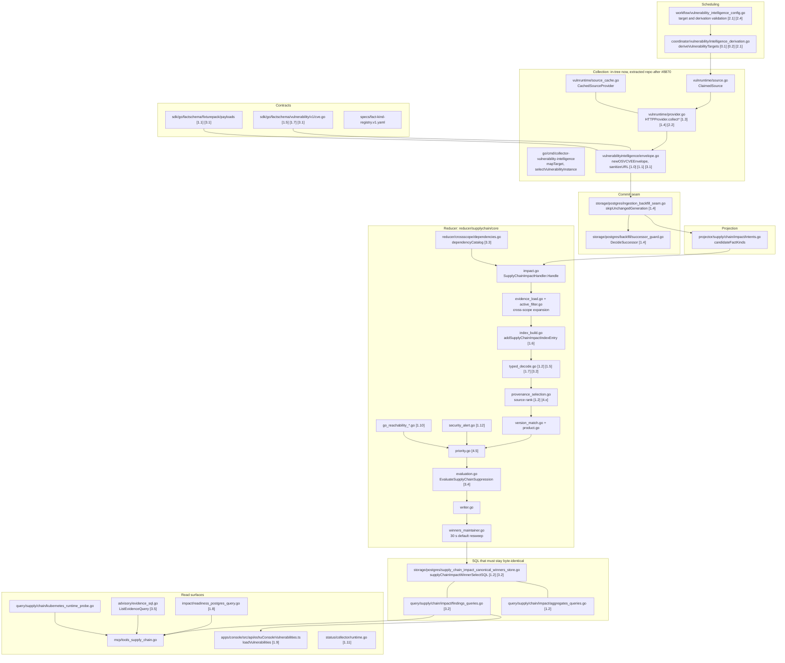
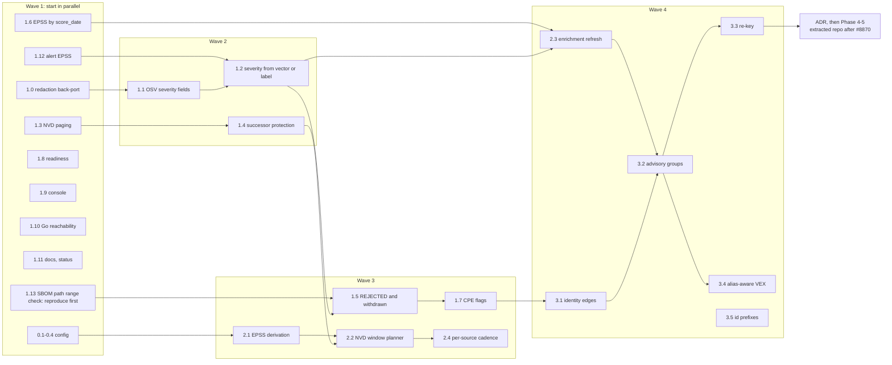

# Advisory Intelligence: Engineering Flow

This page is for the engineers and agents who will build epic #9209. It maps
the advisory pipeline onto real packages and symbols, shows where each work
item in [Advisory Intelligence Phases](advisory-intelligence-phases.md) lands,
and groups the items into waves so that parallel work never edits the same
files.

For the operator view of the same pipeline, read
[How Correlation Works](advisory-intelligence-correlation-flow.md).

Paths are relative to `go/internal/` unless they start with `go/cmd/`, `sdk/`,
`specs/`, or `apps/`.

## 1. Component map

Labels in brackets are phase item ids.

## 2. Write path, step by step

| Step | Symbol | Contract it must keep |
| --- | --- | --- |
| 1. Plan targets | `deriveVulnerabilityTargets` | Bounded targets: at most 100 queries or CVE ids per target, `DerivedTargetLimit` per pass (default 100, ceiling 5,000). Ecosystems default to npm. |
| 2. Claim | `ClaimedSource` | The scope id must be configured or derivable, and the fencing token is copied onto every fact. |
| 3. Fetch | `HTTPProvider` | The client never auto-paginates NVD. Paging belongs in the provider loop, which reads one page today and pages fully after item 1.3. |
| 4. Normalize | `newOSVCVEEnvelope` and siblings | Report only what the source says (`source_confidence=reported`). Never infer impact. URLs pass `sanitizeURL`. |
| 5. Commit | `skipUnchangedGeneration`, `DecideSuccessor` | One generation per scope. Absent records retract. The guard is idle without a `FreshnessHint`. |
| 6. Trigger | `candidateFactKinds` | One `supply_chain_impact` intent per scope generation that holds a trigger kind. Git file facts are not triggers. |
| 7. Load | `SupplyChainImpactHandler.Handle` | At most 8 expansion rounds and 100,000 envelopes. Hitting a cap marks the evidence partial: upsert only, no retraction. |
| 8. Decide | `buildSupplyChainImpactFindingsWithQuarantine` | Group by CVE, then package. The product path runs only when no package rows exist. An owned anchor is required. |
| 9. Write | `writer.go` | Replace-set per (scope, generation) under an advisory lock plus a fencing check. |
| 10. Dedup | `SupplyChainImpactWinnersMaintainer.RunOnce` | Full resweep every 30 s by default (`defaultSupplyChainImpactWinnersInterval`). One winner per `canonical_key`, chosen by `priority_score DESC`. |

## 3. Read path

| Surface | Symbol | Notes |
| --- | --- | --- |
| Findings list | `findings_queries.go` | The canonical key and finding id must stay byte-identical to the winners store. |
| Aggregates | `aggregates_queries.go` | `severity_bucket` comes from `cvss_score` in SQL. It must match the winners `CASE`. |
| Readiness | `readiness_postgres_query.go` | Reads fact counts and `vulnerability_source_states`. NVD, KEV, and EPSS are matched by literal scope ids. |
| Runtime context | `kubernetes_runtime_probe.go` | Follows `RUNS_IMAGE` from an image digest to Kubernetes workloads at read time, at most 200 results (`KubernetesRuntimeProbeMaxResults`). |
| Advisory evidence | `ListEvidenceQuery` | Source-only view. It expands aliases one hop, for the CVE, GHSA, and OSV prefixes only. |
| Console | `loadVulnerabilities` | 100 rows per status, no paging. |

## 4. Shared-file zones

Two items in the same zone must not be in flight at the same time. Land them
in the listed order, or have one engineer own the whole zone.

| Zone | Files | Items, in landing order | Why they conflict |
| --- | --- | --- | --- |
| A. OSV envelope | `vulnerabilityintelligence/envelope.go`, plus its extracted-repo twin | 1.0, 1.1, 3.1 | Same payload map and the same shared golden. |
| B. Provider loop | `vulnruntime/provider.go`, plus its twin | 1.3, 1.4 (attestation), 2.2 | Paging, the completeness attestation, and the cursor all live in the same fetch loop. |
| C. Commit seam | `ingestion_backfill_seam.go`, `backfill/successor_guard.go` | 1.4 | Shared by every collector. Needs a concurrency proof. |
| D. Parity SQL | winners store, `findings_queries.go`, `aggregates_queries.go` | 1.2, then 2.3 (only if it chooses read-time enrichment), then 3.2 | The byte-parity rule. One change at a time, each with a parity test. If 2.3 keeps per-scope copies, it does not enter this zone. |
| E. Reducer decode | `typed_decode.go`, `provenance_selection.go`, `index.go` | 1.13, 1.2, 1.5, 1.7, 3.2 | Same decode functions, the same selection loop, and the same classification path. |
| F. Contract | `sdk/go/factschema/vulnerability/v1/cve.go` (1.5, 3.1, the 1.2 marker), `affected_product.go` (1.7), the registry | 1.5, 1.7, 3.1 | Each one is a minor version bump. Combine them or serialize them. |
| G. Derivation and planning | `intelligence_derivation.go`, `vulnerability_intelligence_config.go`, `workflow/owned_package_manager_aliases.go`, `storage/postgres/owned_package_targets.go`, the coordinator scheduler | 2.1, 2.2, 2.4 | Same planner and validators. Item 2.2 is also in zone B, after 1.4. The `package_manager` alias table (gradle to maven) feeds both the reader SQL and the derivation mapping; edit it in one place. |
| H. Alert path | `core/security_alert.go` | 1.12, then the alert half of 1.2 | Both edit the alert-to-finding mapping. |

Items with a zone of their own:

- `index_build.go`: 1.6.
- `readiness_postgres_query.go`: 1.8.
- The console: 1.9.
- `go_reachability_*.go`: 1.10.
- `status/collector/runtime.go`: 1.11.
- Deployment configuration: 0.1-0.4.

## 5. Waves for assigning work

Notes for whoever assigns the work:

- **Wave 1 is safe to fan out.** Every item there has a zone of its own,
  except 1.0, 1.3, 1.12, and 1.13. Each of those is the first item in its
  zone (A, B, H, and E).
- **Paired items need two PRs.** Items 1.1, 1.3, 1.4, 2.2, and 3.1 each need
  an in-tree PR plus an extracted-repository PR in the same wave.
  - Item 1.0 is in-tree only: the extracted repository already has the
    fragment fix (its PR #2).
  - Per plan §4.7, the extracted-repository PR is opened and cross-linked
    before the in-tree PR merges, and the in-tree PR is not merge-ready until
    the extracted PR is green.
- **Contract bumps (zone F) go to one owner.** Merge 1.5, 1.7, and 3.1 into
  one minor version if they land close together. That saves the downstream
  decode-lock and factschema-diff churn.
- **Item 2.3 starts with a fixture test of today's behavior.** No design work
  until that fixture shows what the per-scope copies actually do.
- **Theory first.** Items 2.3, 3.2, and 5.1 need a measured proof before any
  executor is dispatched (prove-the-theory-first in `AGENTS.md`).
- **Core rule.** The first core PR in zone E rewords the "behavior-preserving"
  rule in `reducer/supplychain/core/AGENTS.md` (plan §4.8).

## 6. Proof every item carries

- A failing regression first, for a defect.
- For a contract change: `eshu-contract-rigor`, a factschema-diff, and the
  payload-usage manifest.
- For a fact-emission or read-shape change: the golden corpus, meaning the
  B-7 cassette and snapshot (`eshu-golden-corpus-rigor`).
- For any SQL change in zone D: an `EXPLAIN ANALYZE` on representative data,
  plus the parity test.
- For a runtime change: the operator signal named in the phases table, and the
  QA check measured after deploy.

No-Regression Evidence: this page maps planned work onto existing code. It
changes no runtime behavior, wire contract, or gate.

No-Observability-Change: this page adds no metric, span, log key, or status
field.
