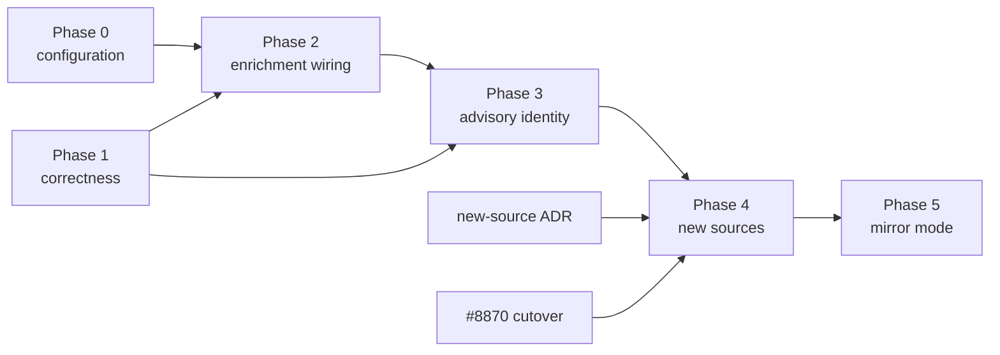

# Advisory Intelligence Phases

Work items for the
[Advisory Intelligence Correlation Plan](advisory-intelligence-correlation-plan.md).
Each row below becomes one child issue of the advisory-intelligence epic
(#9209).

Columns:

- **Repo.** "pair" means an in-tree PR plus an extracted-repository port in
  the same wave (plan §4.7).
- **Proof.** What a PR must show before review. Every defect fix starts from a
  failing regression.
- **QA check.** What to measure in the shared QA environment after deploy, or
  "not observable" with the reason.
- **Signal, docs.** The operator signal and the docs the item adds or updates.

"Theory first" marks items under the prove-the-theory-first rule.

Phases 0 and 1 can start together. The core items in Phase 1 do not wait on
the collector ports.

## Phase 0: Configure what exists

This phase changes deployment configuration only.

| Item | Change | Proof | QA check |
| --- | --- | --- | --- |
| 0.1 | Set `derive_from_owned_packages.ecosystems` to every supported ecosystem, and `derive_from_installed_evidence.ecosystems` for OS packages. | Config validates at coordinator start. | `vulnerability_source_states` has osv rows per ecosystem. Findings appear outside npm. |
| 0.2 | Raise `target_limit` from 100. Base the value on the measured owned package@version count. | Coordinator plan time and claim rate, measured before and after. | The derived set covers owned packages within one rotation. |
| 0.3 | Provision an NVD API key for Phase 2. | Secret present. | Not observable until item 2.2. |
| 0.4 | Find why the new security-alert instance has 0 observations. | Diagnosis with evidence (`eshu-diagnostic-rigor`). | Dependabot observations resume. |

## Phase 1: Correctness

| Item | Change | Repo | Proof | QA check | Signal, docs |
| --- | --- | --- | --- | --- | --- |
| 1.0 | Back-port the fragment redaction (extracted PR #2) to the in-tree `sanitizeURL`. | in-tree only | Shared hostile-input fixture. | Not observable (redaction). | none |
| 1.1 | Fill `cvss_vector` from OSV `severity[]` and `severity_label` from `database_specific.severity` (D1). Normalize labels, for example `MODERATE` to medium. | pair | Fixture first, payload-usage manifest, B-7 cassette and snapshot, shared golden. | Label present on all 726 OSV CVE facts. | Collector README |
| 1.2 | Severity from a vector or a label (D2), on both the advisory and the alert path. | eshu | See the details below. | Winners with `none` but a label or vector: 506 to 0. | Reducer README, http-api vulnerability-impact doc |
| 1.3 | Page NVD fully in the provider loop, not the client (the scoped rule), and report `complete` honestly (D3). Keep the 6 s pacing with a request budget per claim. Add the NVD per-source mirror case deferred on #8870. | pair | Fixture with `totalResults` greater than the page size, in both trees. | Not observable until item 2.2. | Page-count metric label; collector README |
| 1.4 | Successor protection for vulnerability scopes (D4). See the details below. | pair + core storage | Seeded RED/GREEN and a concurrency proof. | An induced partial fetch in a QA drill is refused, and the operator signal fires. | Existing guard metrics, a new held-stale gauge, runbook entry |
| 1.5 | REJECTED and withdrawn retract the finding (D5). Add a status field (minor contract version). The finding carries a reason and `replaced_by`. | eshu + contract | `eshu-contract-rigor`, factschema-diff. Seed: REJECTED with `replacedBy`. | Not observable until NVD or CVE List data flows. | Contract docs |
| 1.6 | Latest EPSS by `score_date`, keeping `model_version` (D6). | eshu | Two-day fixture loaded out of order. | Not observable until item 2.1. | none |
| 1.7 | Decode the CPE `negate` and `operator` flags (D7). Facts carry no node id, so this allows only a conservative downgrade. Full AND semantics needs node ids in the contract. | eshu + contract | NVD NOT configuration fixture. | Not observable (no NVD in QA). | Contract docs |
| 1.8 | Readiness covers every source-state scope, and findings freshness is accurate (D8). | eshu | API test. | Findings readiness shows `fresh` with both sources. | http-api doc |
| 1.9 | Console source column, pagination, CVE id shown with its GHSA alias, KEV and EPSS badges (D9). | eshu | Vitest. | All 268 `affected_exact` rows reachable. Source visible. | Console docs |
| 1.10 | Go reachability key (D10): reproduce first, then fix. | eshu | RED fixture: a `GO-` record carrying a CVE alias. | Not observable (no Go derivation yet). | none |
| 1.11 | Doc and status wording (D11, D12). | eshu | Docs build, status test. | `list_collectors` detail is correct. | Source-coverage doc |
| 1.12 | Carry alert EPSS onto findings (D13). GitHub's fields are named `percentage` and `percentile`. A sample showed values such as 0.00361 and 0.29658, which look like a fraction rather than a percent. Confirm the scale against FIRST for the same CVE before mapping onto `EPSSProbability`. | eshu | Fixture of an alert with `epss`, with the scale asserted. | EPSS set on alert-derived findings (84 of 92 alerts carry it). | http-api doc |
| 1.13 | Suspected defect D14: an SBOM component path returns `affected_derived` without checking that the version is inside the affected range. In the `index.go` classification it follows the exact, known-fixed, fail-closed, and OS-exact exits. Reproduce first, and settle whether the missing-version case is intended. | eshu | RED fixture: an SBOM-reached package whose version is outside the range and not at or past a known fix. | Count of SBOM-path findings whose version falls outside the range. | Reducer README |

### Item 1.2 details

- **Where the bucket comes from.** The bucket is computed in SQL from
  `cvss_score` in two places that must stay byte-identical:
  `supplyChainImpactWinnerSelectSQL` and the aggregates queries. Both change
  together, with a parity test.
- **One calculator, in the reducer.** Item 1.1 emits no score, so only the
  reducer needs a CVSS v3.1 and v4.0 calculator, in `core` or a core-owned
  helper package. A label-only record maps to a bucket through a label
  table.
- **Derived values are marked.** A derived score carries a provenance marker
  (for example `severity_score_source: derived_from_vector`), so it is never
  shown as source-reported. This adds a payload field, which is a minor
  contract version.
- **Re-trigger.** Stored findings change only when each scope's
  `supply_chain_impact` runs again. OSV scopes regenerate through the
  derivation rotation. Measure the time to converge, and document an operator
  replay for scopes that do not rotate.
- **Dependency.** The QA target (506 to 0) needs item 1.1 deployed and the OSV
  scopes regenerated. Stored OSV facts carry neither `cvss_vector` nor
  `severity_label` today.

### Item 1.4 details

- **Content-digest hint.** `FreshnessHint` is a content digest of the
  normalized envelopes, never a timestamp. It follows the PagerDuty pattern:
  an unchanged input gives the same hint, and drift changes it.
- **How the guard behaves today.** `DecideSuccessor` refuses an empty
  successor over a non-empty prior, and a full successor under half the prior.
  A refusal rolls back and returns success to the claim, and it skips the
  generation-state writer.
- **Legitimate shrinks.** The provider sets `TrustedDeletion`, the same escape
  PagerDuty uses with `AllowEmptySuccessor`, when every request in the claim
  succeeded and nothing was truncated:
  - every OSV query returned without an error or a page token;
  - every NVD page up to `totalResults` arrived;
  - the KEV catalog parsed with its declared count.

  A fully successful fetch therefore passes any shrink, including 3 records
  to 1. The guard is a backstop for provider bugs that report success on a
  partial fetch.
- **Cursor semantics.** On a refusal or a duplicate skip, the cursor from
  item 2.2 does not advance. Repeated holds widen the NVD window toward the
  120-day admission cap (`nvdMaxModifiedWindow`). The planner must split the
  window or alert before it reaches the cap. That is written down and tested.
- **Operator signal.** Reuse `eshu_dp_ingestion_successor_guard_decisions_total`
  and the `destructive_successor_refused` skipped-refresh reason, which
  already count refusals. Add only a gauge of scopes held stale by repeated
  refusals.
- **Proof.** Seeded RED/GREEN:
  - an unchanged input skips;
  - drift commits;
  - 3 records to 1 on a fully successful fetch passes;
  - an under-half successor from a fetch with an error or truncation is
    refused and does not set the attestation;
  - an empty successor without the attestation is refused.

  Add a concurrency proof on the commit path (`concurrency-deadlock-rigor`).

## Phase 2: Enrichment wiring

| Item | Change | Repo | Proof | QA check | Signal, docs |
| --- | --- | --- | --- | --- | --- |
| 2.1 | The coordinator derives EPSS targets (at most 100 CVEs each) from the CVEs on active findings, using the existing per-CVE client. | eshu | Derivation fixture. Budget for the 447 finding CVEs in QA today. | EPSS on at least 95% of CVE-keyed findings. | Derived-target metric; config reference |
| 2.2 | NVD rolling `lastMod` window planner. The cursor is committed atomically with the generation (`GenerationStateWriter`). | pair | Window continuity across restart, refusal, and skip; no gaps or overlaps. | NVD source state fresh, with records ingested. | Cursor-lag gauge; collector README |
| 2.3 | Enrichment refresh (plan §4.3). | eshu | Fixture test of today's behavior first, including a seeded KEV CVE on an owned package. Then the theory proof. | KEV-flagged findings equal findings whose CVE or alias is in KEV. This passes trivially until QA has overlap, so the seeded fixture is the real proof. | Decision record |
| 2.4 | Per-source cadence (plan §4.5). | eshu | Planner fixture. | Each source's freshness matches its cadence. | Readiness doc |

The interim alias join for GHSA-only findings that was planned here is
dropped. The 46 GHSA-keyed advisories in QA have no CVE alias in any stored
fact, and the reducer contract has no alias field until item 3.1.

## Phase 3: Advisory identity

| Item | Change | Repo | Proof | QA check | Signal, docs |
| --- | --- | --- | --- | --- | --- |
| 3.1 | Raw identity edges and status on `vulnerability.cve` (plan §4.2, step 1). Minor contract version. | pair + contract | `eshu-contract-rigor`, factschema-diff, shared golden. | Edges present on OSV facts. | Contract docs |
| 3.2 | Reducer-owned advisory groups with caps, quarantine, and allow and deny lists. Findings keyed by group in both SQL sites, with a parity test. | eshu | Seeds: 30 records aliasing one CVE; a DSA bundling 20 CVEs. Theory first on group computation cost. | Group count and quarantine count. | Quarantine metric, group-size histogram |
| 3.3 | Re-key on group merge or split. Suppressions carried across. `dependencyCatalog` edge and readiness floor. | eshu | Seeds: a late CVE alias; an alias removal. One finding per group after each. | Not observable until aliases change live. | Re-key counter |
| 3.4 | Alias-aware VEX and suppression matching. | eshu | Seed: VEX names the GHSA id, the finding is keyed by CVE. | Suppression counts unchanged after the cutover to group keys. | Suppression doc |
| 3.5 | Evidence-route id prefixes generalized to `PYSEC`, `GO`, `RUSTSEC`, `MAL`, and `EUVD`. | eshu | API test. | Evidence lookup by a `PYSEC` id works. | http-api doc |
| 3.6 | Decide on graph projection of advisory groups, reducer-owned. | eshu | Arbiter ruling with `cypher-query-rigor` measurements. | n/a | Decision record |

## Phase 4: New sources

Gate: an ADR, then the extracted repository only, after the #8870 cutover. The
ADR settles:

- which sources fit the existing 11 `vulnerability.*` kinds and which need
  new kinds or `source` values;
- the cache and mirror lifecycle, reconciled with #603;
- per-source rate and budget contracts.

Core-side work for these sources (contracts, reducer rank, readiness) starts
once the ADR lands.

| Item | Source | Class | Proof | QA check |
| --- | --- | --- | --- | --- |
| 4.1 | CVE List v5, per CVE for owned CVEs | C, D (some B) | Fixtures for CNA and ADP metrics, SSVC, REJECTED, and `replacedBy`. | Severity from the CNA on CVEs that NVD defers. |
| 4.2 | GHSA database | A, C | REST `updated` cursor fixture. Reviewed and malware records. Owner decides on unreviewed records. | GHSA source state fresh. |
| 4.3 | ENISA EUVD | C, D | Alias merge fixture, `epss` percent conversion, EU KEV as its own exploited source. | EU KEV flags appear. |
| 4.4 | Exploit-DB | C | New kind `vulnerability.exploit_reference` (EDB id, CVE codes, verified). License sign-off first. | Exploit references on matching findings. |
| 4.5 | Priority for SSVC, exploit references, and each KEV source | C | Priority fixtures. Exploited tiers come first, then EPSS probability. Never multiply EPSS by CVSS. | Priority order on QA findings matches the tiers. |

Each new source also needs:

- an envelope with a source-namespaced key;
- a source enum entry and validation;
- an entry in the reducer source-rank table;
- an entry in the readiness source map;
- registry and schema overrides;
- a source snapshot that carries its license;
- an operator signal for its freshness.

## Phase 5: Mirror mode

Gate: the same as Phase 4, plus the measurement in item 5.1.

| Item | Change | Proof | QA check |
| --- | --- | --- | --- |
| 5.1 | Shard-scoped generations (plan §4.4). | Theory first. Measure facts per shard, reducer cost per dirty shard, a replayed full day of deltas, and whether a per-shard intent hits the bounded evidence load or `supplyChainImpactTruncation`. | Not observable (a measurement on representative data, not a deploy). |
| 5.2 | CVE List baseline (midnight zip with sha256 and cutoff) plus the `deltaLog.json` tail. | Cursor continuity; baseline checksum. | Mirror record count matches the baseline, and cursor lag is within the cadence. |
| 5.3 | OSV bulk per ecosystem with the license filter. | NC-ND ecosystems excluded by default. | Per-ecosystem record counts match `modified_id.csv`, with no NC-ND records. |
| 5.4 | Catalog read surfaces (browse, search, feeds). | Owner decides the product scope. | Defined with the scope decision. |

No-Regression Evidence: this file lists planned work. It changes no runtime
behavior, wire contract, or gate.

No-Observability-Change: this file adds no metric, span, log key, or status
field. The signals named above are planned, not shipped.
