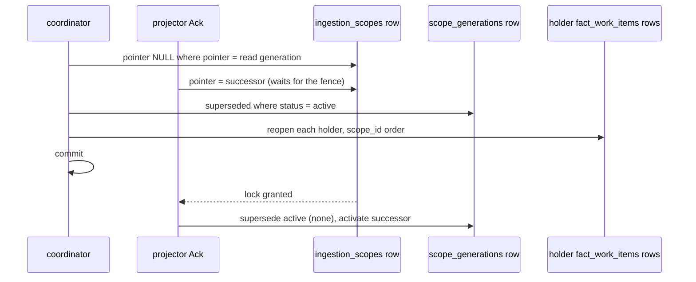

# #10055: Commit-Skew Fence For Go Evidence

Go evidence is keyed by the commit it measured, not by the remote's health. The coordinator
retracts a go-reachability generation when the repository left that commit more than two
rotation periods ago and no successor landed, and reopens the scopes holding findings for
that repository in the same transaction. The binding ruling and its Amendments 1 and 2 are
recorded on issue #10055.

## What changed at runtime

- The extension host stamps `scope_generations.source_commit_sha` on a derived generation
  from the target it delivered. Every other scope stays unstamped.
- `pageQuery` returns the go-reachability scope's active generation and commit, and, only for
  a skewed row, `evidence_left_at`: the newest `superseded_at` among the repository's own
  generations at that commit.
- `reachability.StaleEvidence` applies the rule to the page, using the page's slot count. It
  reads and writes nothing.
- `gomodules.Store.FenceStaleGoEvidence` writes the verdict before the plan is admitted.
- `postgres.ReopenSupplyChainImpactHolderInTransaction` runs the existing holder reopen on the
  fence's transaction. `gomodules` receives it as a function, because no `storage/postgres`
  subpackage imports the root package.

## Conflict domain

One derived `ingestion_scopes` row, one `scope_generations` row, and the
`fact_work_items` rows of that repository's holders. Each fence is its own transaction with a
2s `lock_timeout` and a 10s `statement_timeout`, and a pass stops at its first error.

**Lock order.** `ingestion_scopes`, then `scope_generations`, then `fact_work_items`.
`projector_queue_ack.go`, "Lock order (#7389)": "Every blocking path takes the scope row
first". The fence never takes a holder's scope row, a repository scope row, or any row of the
successor's work, so it shares no cycle with Ack, Fail, or the ingestion commit. Against the
retirement fence's `LOCK TABLE fact_work_items`, the fence waits at its reopen, times out, and
rolls back; retirement never waits on it.

**What the reopen does today.** A Go verdict reaches a finding only after #10095 and #10077 merge: `factimpact.Kinds`
holds no Go kind, and `supplyChainImpactFactKinds` covers the intent's own generation only, so no pass reads Go evidence
across scopes. The live chain test read `package_manifest` with the Go facts active. The reopen therefore changes no verdict
today, and is required once #10095 lands, because only a holder's re-derive can drop its copy. Ruling Amendment 3 records this
and moves the verdict assertions and the verdict form of the drop-the-reopen mutant to #10095. The reopen's witness here is the
holder item's state and stamp: `TestGoFenceReopensAHolderAndItsReducerPassRunsLive` and
`TestFenceReopensExactlyTheHoldersOfItsRepositoryLive`.

**Retries.** A failed fence, including a failed reopen, rolls back whole and fails the pass with
no run, so the next reconcile re-reads the page. A lock timeout costs one pass, not a rotation.

**Serialization.** None added: fences on different scopes do not contend, and one busy scope
holds no other scope's locks.

## Performance

Performance Evidence: measured with `EXPLAIN (ANALYZE, BUFFERS)` on PostgreSQL 18 at `9a87da2429`, on
the C2 probe data: 3,000 repository scopes, 100,000 other scopes, 1.84M facts, one 256-candidate page
holding 61 repositories with evidence, 20 of them skewed, one with 50 superseded generations and the
others 24. Both queries were derived from source. Compare inside this run only: the 68 ms and 97-98 ms
in `10027-go-modules-derivation.md` are other runs on PostgreSQL 16.

| Page query | Warm runs | Buffers |
| --- | --- | --- |
| Before this change | 47.7 ms, 47.8 ms | 9,980 |
| After, no skewed candidates | 51.4 ms, 48.9 ms | 11,036 |
| After, 20 skewed candidates | 55.6 ms, 50.5 ms, 50.8 ms | 11,135 |

- The two joins add 1.1 to 3.7 ms and 1,056 buffers to a page.
- The skew subquery ran 20 loops for 20 skewed candidates and did not execute on the no-skew page. It read
  99 buffers in all. Against the slowest no-skew run, the slowest skewed run costs 0.33 ms per candidate,
  under the ruling's 5 ms fallback bar. It plans on `scope_generations_scope_latest_lookup_idx`.
- No sequential scan of `fact_records` or `scope_generations` appears in either output.
- One page cold took 637.7 ms, with the database just restarted.
- Fence statements on the same data: detach 0.129 ms, supersede 0.457 ms, holder read 3.787 ms for 30
  holders among about 20,000 findings. That schema subset omits the dirty-capture trigger, so its write is
  not in those figures.

Post-rebase plan-shape confirmation (non-comparable totals, plan shape only): after the
rebase onto post-purge `origin/main`, the exact shipped statements were re-probed with
`EXPLAIN (ANALYZE, BUFFERS)` on PostgreSQL 18.6 against a scratch database holding all
318 current migrations and a smaller seed (61 scopes, 1,061 generations, 15,200 facts;
20 of 20 page candidates skewed, 50 superseded generations at the evidence commit,
1,000 holder findings among 10,000 noise findings). The holder probe runs one Bitmap
Index Scan on `fact_records_supply_chain_impact_repository_lookup_idx` (0.52 ms, 52
buffers). The in-page skew subquery runs 20 loops for the 20 skewed candidates on
`scope_generations_scope_idx` (88 buffers, ~0.014 ms per candidate, far under the
ruling's 5 ms fallback bar). The full page runs 0.84 ms with 421 buffers. No sequential
scan of `fact_records` or `scope_generations` appears in any output. Probe SQL and
output: `/home/ubuntu/.cache/out-10055/probe-fence-seed.sql`,
`/home/ubuntu/.cache/out-10055/probe-fence-explain.sql`,
`/home/ubuntu/.cache/out-10055/probe-fence-explain.out`.

## Signals

Observability Evidence: the fence reports on these signals.

- Counter `eshu_dp_workflow_coordinator_activation_derived_scopes_fenced_total` with
  `collector_kind`, `ecosystem`, and `reason="stale_evidence"`, counting retractions only.
- `fenced_stale_evidence`, `fence_holders_reopened`, `fence_candidates_skipped_no_commit`, and
  `fence_history_pruned` on the planned log line.
- `eshu_dp_postgres_query_duration_seconds{store="go_module_repositories"}` for the read
  and the fence.
- A failed fence surfaces as a coordinator reconcile error.

At 3 AM: `fenced_total` is not normal rotation. It means repositories moved and their
successors did not land for two rotations, so look for dead-lettered claims and hosted readiness
failures. A rising `fence_candidates_skipped_no_commit` means generations from before the stamp.
A rising `fence_history_pruned` means the rotation has outgrown retention, or history was lost.
Reconcile errors naming `fence stale go evidence` with a lock timeout mean a scope or holder was
busy, and the next pass retries.
