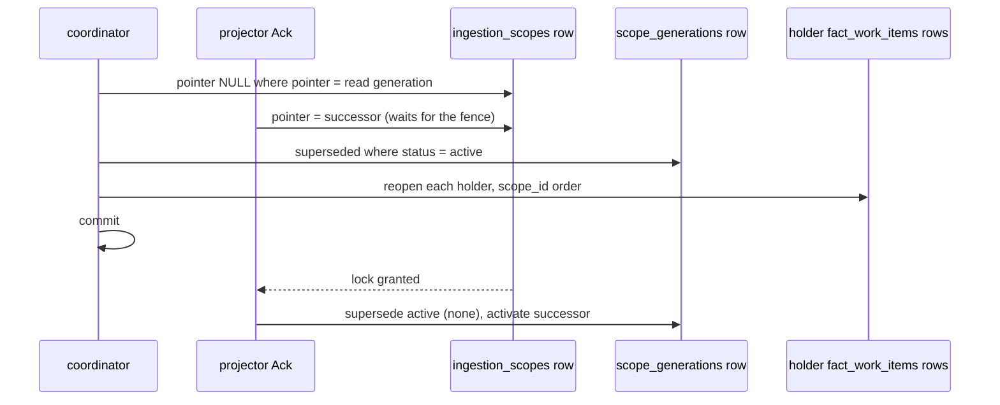

# #10055: Commit-Skew Fence For Go Evidence

Go evidence is keyed by the commit it measured, not by the remote's health. The coordinator
retracts a go-reachability generation when the repository left that commit more than two
rotation periods ago and no successor landed, and reopens the scopes holding findings for
that repository in the same transaction. The binding ruling and its Amendments 1 and 2 are
recorded on issue #10055.

## What changed at runtime

- The extension host stamps `scope_generations.source_commit_sha` on a derived generation
  from the target it delivered. Every other scope stays unstamped.
- `pageQuery` returns the go-reachability scope's active generation and commit, and, only for
  a skewed row, `evidence_left_at`: the newest `superseded_at` among the repository's own
  generations at that commit.
- `reachability.StaleEvidence` applies the rule to the page, using the page's slot count. It
  reads and writes nothing.
- `gomodules.Store.FenceStaleGoEvidence` writes the verdict before the plan is admitted.
- `postgres.ReopenSupplyChainImpactHolderInTransaction` runs the existing holder reopen on the
  fence's transaction. `gomodules` receives it as a function, because no `storage/postgres`
  subpackage imports the root package.

## Conflict domain

One derived `ingestion_scopes` row, one `scope_generations` row, and the
`fact_work_items` rows of that repository's holders. Each fence is its own transaction with a
2s `lock_timeout` and a 10s `statement_timeout`, and a pass stops at its first error.

**Lock order.** `ingestion_scopes`, then `scope_generations`, then `fact_work_items`.
`projector_queue_ack.go`, "Lock order (#7389)": "Every blocking path takes the scope row
first". The fence never takes a holder's scope row, a repository scope row, or any row of the
successor's work, so it shares no cycle with Ack, Fail, or the ingestion commit. Against the
retirement fence's `LOCK TABLE fact_work_items`, the fence waits at its reopen, times out, and
rolls back; retirement never waits on it.

**Retries.** A failed fence, including a failed reopen, rolls back whole and fails the pass with
no run, so the next reconcile re-reads the page. A lock timeout costs one pass, not a rotation.

**Serialization.** None added: fences on different scopes do not contend, and one busy scope
holds no other scope's locks.

## Performance

Performance Evidence: the page query gains two left joins, each a primary-key probe per
candidate, and a subquery guarded by a CASE so it runs once per skewed candidate only. It reads
one range of `scope_generations_scope_idx`, bounded by retention. No index is added. The fence
writes only on a true verdict, at most one page per pass.

NOT_CHECKED: `EXPLAIN (ANALYZE, BUFFERS)` of the amended query, required before this lands, on
the C2 probe data with one repository of 50 superseded generations and 20 skewed candidates on
one page. The ruling's bars: subplan loops equal the skewed count, no sequential scan of
`fact_records` or `scope_generations`, the zero-skew page near the 97-98 ms in
`10027-go-modules-derivation.md`, and at most 5 ms per skewed candidate. Replace this paragraph
with the measured figures.

## Signals

Observability Evidence: the fence reports on these signals.

- Counter `eshu_dp_workflow_coordinator_activation_derived_scopes_fenced_total` with
  `collector_kind`, `ecosystem`, and `reason="stale_evidence"`, counting retractions only.
- `fenced_stale_evidence`, `fence_holders_reopened`, `fence_candidates_skipped_no_commit`, and
  `fence_history_pruned` on the planned log line.
- `eshu_dp_postgres_query_duration_seconds{store="go_module_repositories"}` for the read
  and the fence.
- A failed fence surfaces as a coordinator reconcile error.

At 3 AM: `fenced_total` is not normal rotation. It means repositories moved and their
successors did not land for two rotations, so look for dead-lettered claims and hosted readiness
failures. A rising `fence_candidates_skipped_no_commit` means generations from before the stamp.
A rising `fence_history_pruned` means the rotation has outgrown retention, or history was lost.
Reconcile errors naming `fence stale go evidence` with a lock timeout mean a scope or holder was
busy, and the next pass retries.
