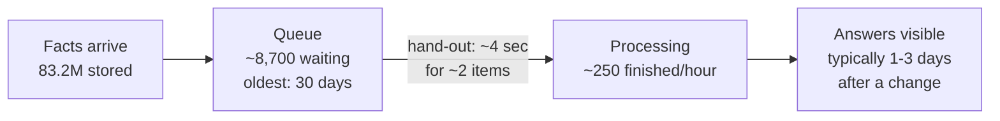

# How far behind is processing today? Baseline measurements (#10862)

Measured 2026-11-18. Refs #10862. Part of #10860 (Phase 0, step 2).

## Summary for decision-makers

We measured the live test environment (read-only — nothing was changed)
to answer three questions: *How much data is there? How far behind is
processing? What would "ten times bigger" require?*

| Question | Answer |
| --- | --- |
| How much data? | 9,751 areas (repositories and cloud accounts); 83.2 million facts; about 1.1 TB stored |
| How far behind? | ~8,700 work items waiting; the oldest has waited 30 days |
| How fast is work finishing? | About 250 items per hour |
| How stale are answers? | For the two biggest sources, a change typically becomes visible after 1–3 days |
| Where does the time go? | Handing work out takes ~4 seconds and returns only ~2 items — about half the cost of doing an average item of work |
| Is the backlog caused by queue size alone? | No. In a clean-room replay of the same queue, handing out work stayed fast and flat. The live slowness comes from everything competing at once, not from queue depth |

**What "ten times bigger" requires** (owner's target: ten times one
organization, not a hosted service):

| Measure | Today | At 10× |
| --- | --- | --- |
| Areas | 9,751 | ~97,500 |
| Facts | 83.2 million | ~832 million |
| Storage | 1.1 TB | Must grow much slower than data (later phases) |
| Backlog | ~8,700 waiting | Must drain, not accumulate |
| Freshness (proposed target) | Worst big source: ~3 days | 95% within 24 hours, typical within 4 hours |
| Handing out work (proposed target) | ~4 seconds for ~2 items | Must not get slower as the queue grows |

The two proposed targets need formal acceptance in #10861. Section 10
checks each of the six #10861 decision targets against these
measurements: one was replaced, one confirmed, four could not be checked
by a read-only measurement and are honestly listed as not checked.

All numbers below are measured, with sample sizes and method. Anything
not measured is listed under "Not checked", never assumed. No private
identifiers appear: every figure is a total, a size, or a timing.

## How this was measured

Read-only measurements against the QA environment on 2026-11-18,
about 01:40–02:10 UTC, plus the system's own performance counters, plus
a replay of the same-shaped queue on a throwaway database. Nothing in
the test environment was written to or changed; the throwaway database
was destroyed after the run.

Benchmark Evidence: QA reducer baseline captured 2026-11-18 via read-only
SELECTs on the QA environment (9,751 scopes, 83.2M live facts, 8,671-8,713 reducer rows
waiting, oldest 29.8d), Prometheus claim/execution histograms, and the
`TestReducerQueue10862ReplayShapeAndDrain` replay (8,713 rows drained,
claim p50 0.011s p95 0.013s on disposable hardware, flatness 0.79x);
absolute QA-vs-disposable times are published side by side and NOT equated
(different hardware, per performance-rigor).

Observability Evidence: no runtime code changed; reducer claim/execution
telemetry was read, not added (`eshu_dp_queue_claim_duration_seconds`,
`eshu_dp_reducer_handler_duration_seconds`, `eshu_dp_reducer_batch_claim_size`).

## 1. How much data there is

| What | Measured |
| --- | --- |
| Areas (repositories, cloud accounts, …) | 9,751 |
| Live facts | 83,197,436 |
| Total fact rows including deleted markers | 83,782,850 |
| Whole database | 1,095 GB |
| The fact store alone | 417 GB |
| The work queue store | 1,697 MB |
| Indexes on the fact store | 152 |
| Database software | Postgres 18.3 |

A day earlier the readings were 9,391 areas and 83.7M facts. The dataset
keeps growing.

## 2. What is running

- One processing service with 8 workers.
- One main database (8–12 CPUs, 2 TB disk) plus a read-only copy that is
  almost idle (0.04 cores used vs 9.56 on the main one at measurement
  time) — the load is concentrated, not spread.
- The map-like answer store holds 7.3 GB (was 4.9 GB).
- About 20 collector services, one copy each.

## 3. Health of the fact store

Routine cleanup keeps up (last run the evening before). The cost driver
is width: 152 indexes on one store. Splitting it 64 ways at the current
shape would mean roughly 9,700 indexes to maintain — which is why the
#10861 plan reduces reading from this store before splitting it.

## 4. Handing out work vs doing the work

| Handing work out | Measured |
| --- | --- |
| Hand-out requests | 6,819 |
| Items handed out | 14,486 (about 2 per request) |
| Typical hand-out time | 2.5–5 seconds; 95% within 5–10 seconds |

| Doing the work | Measured |
| --- | --- |
| Work items run | 14,469 |
| Average run | 7.4 seconds |
| Heaviest kind of work | Cloud drift checks: 35 seconds average |

In plain terms: **asking for work costs about half as much as doing an
average item of work, and returns only about two items.** That ratio —
not raw computing power — is the first thing Phase 1 attacks.

## 5. Where database time goes

Three kinds of database request together account for about 5.6 million
seconds of cumulative database time, each called millions of times at
0.26–1.1 seconds apiece. The requests that hand out work average
2.8–3.3 seconds — confirming the hand-out cost above from a second,
independent source. (Cumulative counters since an unknown reset date;
averages are comparable, totals are not tied to a window.)

## 6. How fast the backlog drains

| Period | Items finished | Rate |
| --- | --- | --- |
| Last hour | 253 | ~250/hour |
| Last 24 hours | 5,993 | ~250/hour |

An earlier reading suggested ~1,800/hour; it does not reproduce on this
day. How fast new work *arrives* was not measured (see "Not checked") —
so we cannot yet say whether 250/hour is ahead of or behind arrivals,
only that ~8,700 items are waiting.

## 7. What is waiting, by kind of work

Two snapshots minutes apart (the queue is live; totals drifted
8,671 → 8,713 between them):

| Kind of work | Waiting | Of which retrying | Note |
| --- | --- | --- | --- |
| Supply-chain impact | 5,890 | 46 | Only 739 have ever finished — effectively starved |
| Security advisory grouping | 1,707 | 982 (58%) | A burst of vulnerability data |
| Workload summaries | 302 | 54 | |
| Deployment mapping | 216 | 0 | |
| Deployable-unit matching | 157 | 156 (99%) | Almost everything retries |
| All other kinds combined | ~440 | 0 | |
| **Total waiting** | **8,713** | **1,238** | Oldest item: 30 days. In progress: 7–8. Given up on: ~150 |

## 8. How stale answers are, by source

Time from a fact being saved to its result being readable, for work
finished in the last 7 days ("typical" = half are faster; "95%" = almost
all are faster than this):

| Source | Items counted | Typical | 95% within |
| --- | --- | --- | --- |
| Vulnerability intelligence | 34,380 | 35.8 hours | 2.6 days |
| Code (git) | 16,419 | 2.5 hours | 2.9 days |
| Internal re-processing | 1,394 | 45.8 hours | 8.4 days |
| AWS cloud | 535 | 6 minutes | 1.2 hours |
| Google cloud | 68 | Minutes | 6 minutes |
| Package registries | 50 | 12 minutes | 10 hours |
| Smaller sources (34 or fewer items) | 1–34 each | — | Too few to judge |

## 9. The ten-times target, anchored on today

See the table in the summary. Two proposed limits come out of this
baseline: freshness of 95% within 24 hours (typical within 4 hours) per
source, and hand-out cost that stays flat as the queue grows. Both need
acceptance in #10861 before they bind anyone.

## 10. The six #10861 targets, checked against these measurements

| # | Proposed target | Verdict from the measurements |
| --- | --- | --- |
| 1 | 95% of lookups under a tenth of a second | **Replaced.** Real lookups take 0.3–3.3 seconds today. New rule: handing out the second half of a queue may be at most 10% slower than the first half (replay measured it faster: 0.79×) |
| 2 | Saved lookup labels add at most 10% to saving time | **Not checked** — measuring saving cost requires writing data, out of scope for a read-only baseline. Assigned to #10875 |
| 3 | Full re-check at most once a day per kind of work | **Not checked** — no baseline for correction rates yet. Assigned to #10878 |
| 4 | Under 5% of runs put back to wait; missed starts caught within 10 minutes | **Confirmed as the target.** Today about 32% are put back; worst areas retry 58% and 99% of the time. The exact recount on this dataset is still owed (#10876/#10877) |
| 5 | Every kind of question declares its answering store | **Not re-measured** — the 162-question classification in #10861 stands |
| 6 | Removing old data costs in proportion to the data removed | **Not checked** — needs the side-by-side test in #10881. The 417 GB / 152-index shape above is its input |

## 11. The clean-room replay

We rebuilt the same-shaped queue (8,713 items, same mix, same 30-day-old
tail) on a throwaway database and drained it through the shipped
hand-out code (`TestReducerQueue10862ReplayShapeAndDrain`).

| Measure | Clean-room replay | Live test environment | Comparable? |
| --- | --- | --- | --- |
| Queue size and mix | 8,713, exact | 8,671–8,713 | Yes — same shape, checked automatically |
| Typical hand-out time | 0.011 seconds | 2.5–5 seconds | **No** — different hardware, empty vs loaded database |
| Items per second | 84.7 (hand-out only) | ~0.07 (including doing the work) | **No** — different boundaries |
| Does hand-out slow as the queue drains? | No — second half was faster (0.79×) | Not checked live | The rule (at most 1.10×) is enforced by the replay test |

**The finding that matters:** on a quiet machine, hand-out cost does
**not** grow with queue size. So the live 4-second hand-outs are caused
by everything competing at once — not by the backlog's depth. Phase 1
(#10864) builds on exactly this.

How to re-run: `cd go && ESHU_POSTGRES_DSN=<disposable> go test
./internal/storage/postgres/ -run TestReducerQueue10862ReplayShapeAndDrain
-v -timeout 20m` (about 103 seconds; an independent re-run reproduced
the result). The group hand-out path is not yet covered by the replay —
listed under "Not checked".

## 12. Where this baseline is registered

This file is the registered baseline the automated performance-evidence
check reads (the two marked paragraphs under "How this was measured").
A different contract meant for fixed test corpora was deliberately not
used: a live environment is not a fixed corpus, and dressing it up as
one would look precise while being a guess.

## Not checked

How fast new work arrives (vs the ~250/hour drain); the saving-cost
target (Decision 2); daily re-check correction rates (Decision 3); the
exact put-back recount and 10-minute catch proof (Decision 4);
re-classification of the 162 question kinds (Decision 5); the old-data
removal experiment (Decision 6); group hand-out coverage in the replay;
read-copy lag; freshness right after a deployment.
