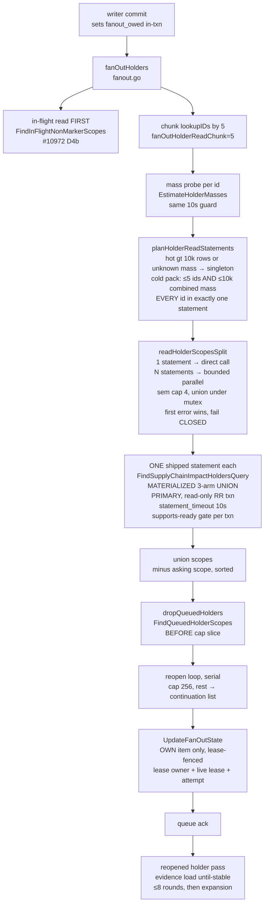
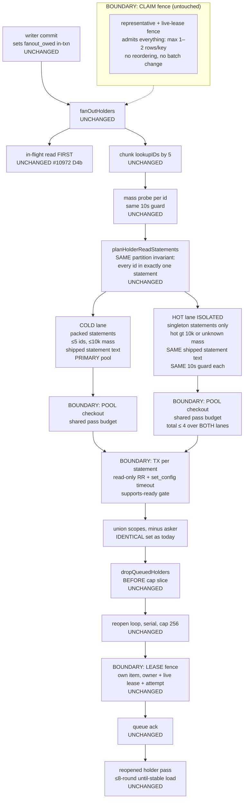

# #11520 H2 hot-id holder-read isolation: current vs proposed pass diagram

Date: 2026-11-26.

Refs #11520. The [clearance cohort](11520-clearance-cohort-2026-11-26.md)
names the cheapest shim (EXPLAIN ANALYZE BUFFERS plus a bounded
isolated-vs-shipped replay); the guard proof caps the worst holder id under
10s and the saturation shim caps handler service time.

## Summary

A hot singleton burning toward the 10s guard head-of-line-blocks the pass's
cold packs under one shared semaphore of 4. H2 routes hot singletons down an
isolated lane under the same total bound, with identical statement text,
guards, fences, and admitted set — scheduling decoupling, not a cheaper plan.

Binding constraints (from #11520 Q3): no timeout raise, no worker/batch cuts,
no batch-size-1, 10s guard stays, claim/key fences and admitted set untouched
(every id in exactly one statement), parallelism bound 4 unchanged.

## (a) CURRENT hot-id pass

Source bodies: the MATERIALIZED 3-arm holder query (10s guard), the
plan/chunk/fence helpers in `go/internal/reducer/supplychain/core/`
(10k-row hot-mass threshold, bound 4, chunk 5, cap 256, 8-round
until-stable loop).

Pool/fence facts: each holder statement checks out a pooled connection for
one read-only transaction (timeout scoped, readiness check, query,
ROLLBACK). One slow hot singleton holds its connection plus snapshot to the
10s guard; the saturation shim read the primary at 96% of request.

## (b) PROPOSED isolated pass (H2)

Same admitted set, same statement text, same guards. The ONLY routing change:
hot singleton statements run in an isolated lane with its own labeled
boundaries, so a hot statement burning toward the guard cannot head-of-line
the cold packs of the same pass. Statement count, statement text, guard,
fences, cap, and downstream load are identical.

What "isolated" means: hot singletons already run as separate statements
today; H2 adds lane separation under the SAME total bound of 4, so cold
packs complete while a hot statement burns its guard. It adds no
connections, raises no guard, reorders no claims, and widens no caps.

## (c) Exact starvation/concurrency risks and the cheapest-shim measurements

### Risks (each names the mechanism, not a vibe)

1. Hot pins a slot: a hot singleton near the guard holds a pooled
   connection, snapshot, and sem slot while cold statements wait. H2 must
   decouple scheduling WITHOUT exceeding 4 total per pass.
2. Retry amplification: any statement error fails the whole pass CLOSED and
   retries everything. An isolated hot failure must still fail the pass,
   never commit a partial union.
3. Error masking: only the first error is recorded. Isolation must keep
   per-lane read kinds/counters so the operator sees which lane failed.
4. Probe cost: the mass probe is one guarded statement per chunk. H2 adds
   scheduling, never probe statements.
5. Saturation ceiling: the primary sits at ~96% of request. H2 claims NO
   write-path relief; measure read-phase only.
6. Member-arm overestimate is safe-direction (splits MORE, never less). H2
   must preserve that direction for unmeasured ids.
7. Order invariants: in-flight read BEFORE row reads, prefilter BEFORE cap
   slice, reopen AFTER union, lease-fenced state update. H2 moves none.
8. Claim fence untouched: the DROP precedent (#10972 Box-2) forbids
   smuggling claim reordering into a read-isolation change.

### Cheapest-shim measurements (prove-theory-first, in order)

1. EXPLAIN ANALYZE BUFFERS at production shape: worst holder id, both
   plans, read-only replica. Bars: medians ≤ 5.0s, no run ≥ 10s, else STOP.
2. Bounded replay of ONE hot-id pass, isolated-vs-shipped, with findings
   identity (union == single == fact oracle). Bar: PROCEED only at phase
   ratio ≥ 2.0, else STOP with no implementation.
3. Contention cut only if (1)+(2) pass: ≥ 10min vuln-filtered pass sample
   (hot/cold p95 vs today, conn wait, zero timeouts), no knob moves.

Out of scope: worker bumps, file-fold index (#11093), criteria-expansion
bound (#11087), intake throttling, tier extension.
