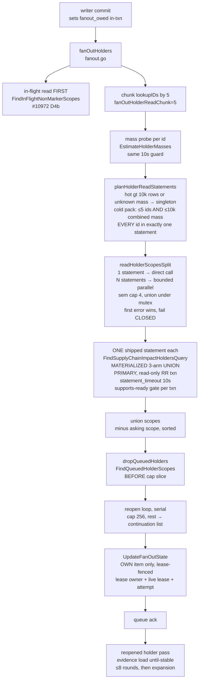
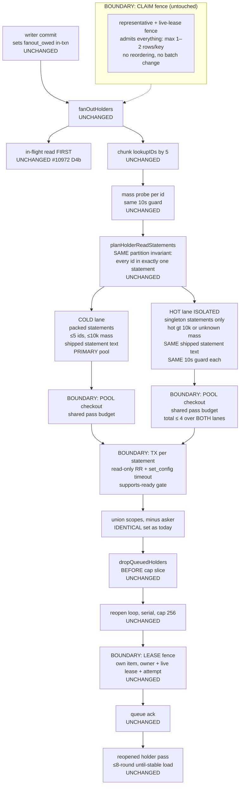

# #11520 H2 hot-id holder-read isolation: current vs proposed pass diagram

Date: 2026-11-26. Lane: `drive/h2-holder-isolation-shim` (diagram only, Task 0).
Base: `origin/main 333579c405`. No production code touched by this note.

Refs #11520 (candidate H2: hot-id holder-read isolation). Context: the
[clearance cohort](11520-clearance-cohort-2026-11-26.md) names H2's cheapest
shim as EXPLAIN ANALYZE BUFFERS at production shape plus a bounded replay of
one hot-id pass isolated-vs-shipped with findings identity; the
[holder-read-phase shim](11430-holder-read-phase-shim.md) proved the single
shipped statement ~4x the 16 key-range statements (ratios 4.09/3.93, bar 2.0);
the [single-statement note](11430-single-statement-holder-reads.md) proved the
QA guard on the worst holder id (`CVE-2025-27789`, 101,377 cve-arm rows:
generic-plan median 848ms, custom-plan 721ms, no run >= 10s); the
[saturation shim](11430-saturation-shim.md) convicted handler service time
(sci p50 39.4s) under `GRAPH_WRITE_MAX_IN_FLIGHT=6` with 8 workers.

Binding constraints (from #11520 Q3, unchanged by H2): no timeout raise, no
worker/batch cuts, no batch-size-1, the 10s per-statement guard stays, claim
and key fences plus the admitted set are untouched (every id lands in exactly
one statement), parallelism bound 4 unchanged.

## (a) CURRENT hot-id pass

Source bodies: `go/internal/storage/postgres/supply_chain_impact_fanout.go`
(MATERIALIZED 3-arm holder query, 10s guard),
`go/internal/reducer/supplychain/core/fanout_split.go` (10k-row hot-mass
threshold, parallelism bound 4), `fanout_collect.go` (chunk loop, in-flight
first), `fanout.go` (chunk 5, cap 256), `evidence_until_stable.go` (8-round
loop); the 8-round cap itself is `maxSupplyChainImpactActiveEvidenceLoads`
in `handler_helpers.go`.

Pool/fence facts on the current path: every holder statement checks out its
own pooled connection and runs `readScopeIDsIn`: BEGIN, `SET TRANSACTION
READ ONLY` (supports reads use the key-range snapshot form), `set_config`
statement timeout scoped to the transaction, readiness check, the holder
query, ROLLBACK. One slow hot singleton therefore holds one primary
connection plus its snapshot up to the 10s guard; with 4 parallel
statements per pass and 8 vuln workers, up to ~32 concurrent holder-read
transactions plus mass probes share the primary, which the saturation shim
read at 96% of request (7.7 of 8 cores).

## (b) PROPOSED isolated pass (H2)

Same admitted set, same statement text, same guards. The ONLY routing change:
hot singleton statements run in an isolated lane with its own labeled
boundaries, so a hot statement burning toward the guard cannot head-of-line
the cold packs of the same pass. Statement count, statement text, guard,
fences, cap, and downstream load are identical.

What "isolated" means and does NOT mean: hot singletons already run as
separate statements today (`fanout_split.go`: hot id runs the shipped single
holder statement once, #11430). H2 adds lane separation between those hot
singletons and the cold packs — separate checkout/scheduling lane under the
SAME total bound of 4 per pass — so cold packs complete even while a hot
statement burns its guard. It does not add connections, raise the guard,
reorder claims, widen the 256 cap, or move the reopen before the union.

## (c) Exact starvation/concurrency risks and the cheapest-shim measurements

### Risks (each names the mechanism, not a vibe)

1. Hot pins a slot: a hot singleton near the 10s guard holds its pooled
   connection, snapshot, and one of the 4 sem slots while cold statements of
   the same pass wait on `sem`. Cold latency is coupled to hot latency
   within a pass. H2 must decouple scheduling WITHOUT exceeding 4 total per
   pass (no extra lanes that sum above 4).
2. Retry amplification: any statement error fails the whole pass CLOSED
   (`firstErr`, union discarded) and the pass retries — re-running the cold
   statements too. An isolated hot failure must still fail the pass, never
   commit a partial union (stale-copy risk: an unreopened holder keeps a
   stale winners copy until something reruns it).
3. Error masking: only the first error is recorded; concurrent losers are
   dropped. Isolation must not hide which lane failed (keep per-lane read
   kinds/counters so the 3 AM operator sees hot vs cold).
4. Probe cost doubles down: the mass probe is itself a guarded statement per
   chunk before the split. H2 adds scheduling, never extra probe statements.
5. Saturation ceiling: the primary sits at ~96% of request and holder reads
   are I/O-read dominated (72% of exec per the production EXPLAIN behind
   #10564). H2 claims NO write-path relief: `GRAPH_WRITE_MAX_IN_FLIGHT=6`
   and the reopen loop are untouched; measure read-phase only.
6. Member-arm overestimate is safe-direction: member counts above
   `HolderMassProbeFillToCapRows` saturate to the cap, and unknown-mass ids
   run alone — both split MORE, never less. H2 must preserve that direction
   (never pack an unmeasured id to "save" a statement).
7. Order invariants: in-flight read BEFORE row reads (#10972 D4b),
   prefilter BEFORE cap slice, reopen AFTER union, state update lease-fenced
   on the pass's own item. H2 moves none of these.
8. Claim fence untouched: the representative/live-lease fence admits
   everything today (max 1–2 rows/key); the DROP precedent (+16–17% CPU,
   +22–24% buffers for zero reorder, #10972 Box-2) forbids smuggling claim
   reordering into a "read isolation" change.

### Cheapest-shim measurements (prove-theory-first, in order)

1. EXPLAIN ANALYZE BUFFERS at production shape (from #11520 Q3): worst
   holder id, generic AND custom plans, 10s timeout in-file, read-only
   replica. Bars (from the #11430 guard proof): per-plan medians ≤ 5.0s, no
   run ≥ 10s. Abort: any run ≥ guard or a plan that skips the advisory /
   member GIN arms → STOP.
2. Bounded replay of ONE hot-id pass, isolated-vs-shipped, with findings
   identity (from #11520 Q3): same admitted set both arms; assert
   union-equals-single holder identity plus shipped-vs-fact-oracle equality
   (precedent: `TestHolderKeyRangeReadMatchesShippedLive`,
   `TestSupplyChainImpactSupportsHolderFamilyEqualsTheFactOracleLive`).
   Bar (from the phase-shim gate): PROCEED only at ratio ≥ 2.0 on phase
   medians (5 timed runs each, 1 warmup discarded). Abort: any identity
   mismatch → STOP, no implementation.
3. Contention cut only if (1)+(2) pass: ≥ 10min vuln-filtered pass sample
   with abort bars (hot statement p95, cold-pack p95 vs today, pooled-conn
   wait, zero timeouts). No worker, batch, or guard knob moves during the
   sample.

Out of scope for H2: worker bumps (ruled out until the holder shape is
fixed, #11520 Q3-6), the shared file-fold index (#11093, re-profile gate
first), the transitive criteria-expansion bound (#11087, correctness risk),
intake throttling (shifts backlog upstream), tier extension (0% baseline
yield).
