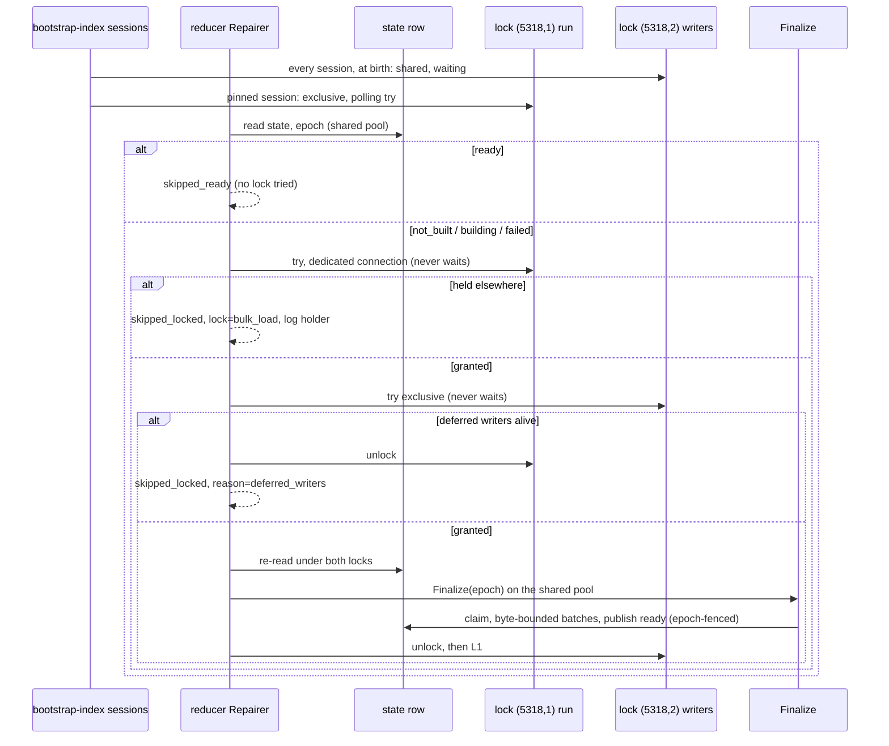

# #8833 part 2b: the reducer's secret-lines repair

Part of #8807. The design is ruling-3 (arb-8833b) on #8833. Migration 234
(part 2a) replaces the hardcoded-secret derivation function and moves
`content_file_secret_lines_state` to `not_built` with a new epoch. Before this
change, only bootstrap-index ever finalized the side table. Without a
steady-state finalizer, every deployment would stay on the legacy scan after
234 until an operator reran bootstrap-index. This part adds that finalizer and
lands first. While the state is `ready` it is inert, and it already heals a
`failed` bootstrap state.

Ruling-4 (arb-8833c) changed the lock protocol after review found two defects in
the first version: a bootstrap-index whose pinned lock session died while its
other connections kept writing let the reducer publish `ready` over underived
rows, and on `ESHU_POSTGRES_MAX_OPEN_CONNS=1` the Repairer pinned the only pool
connection and wedged the reducer. This note describes the corrected protocol.

Every figure below was produced on this branch, against PostgreSQL 18.6 in a
scratch container on a shared 16 vCPU arm64 host.

## Design

- **Conflict domain.** There are two: the singleton state row, and the side
  table's primary key `(repo_id, relative_path, line_number)`. Repository is
  the partition inside `Finalize`, which keeps its 4 workers. Exclusivity
  between finalizers comes from the session advisory lock `(5318,1)`.
  Exclusivity between a finalizer and a writer that skips derivation comes from
  `(5318,2)`.
- **Why two locks.** `(5318,1)` lives on one pinned session. That session can
  die (an `idle_session_timeout`, a failover, `pg_terminate_backend`) while the
  other bootstrap-index connections keep writing deferred rows, because each
  carries `DeferredSessionSQL` from its own connect hook. A Repairer that
  checked only `(5318,1)` found it free, finalized, and published `ready`; the
  bootstrap's later writes then landed underived rows under a `ready` state
  (parity missing 120 of the reviewer's repro). `(5318,2)` is held shared by
  every deferred-writer session from birth, so the Repairer, which needs it
  exclusive, yields while any writer lives.
- **Birth fence.** Shared `(5318,2)` alone is not enough: when the idle timeout
  kills the pool's sessions as well as the pinned one, no writer is alive when
  the Repairer ticks, it publishes for the content that exists, and the pool
  then reconnects and writes under `ready`. So the hook, after taking `(5318,2)`,
  checks `pg_locks` for the run's own pinned backend holding `(5318,1)` and
  refuses to be born when it does not (`secret_lines.deferred_session_refused`).
  The write fails and the run exits non-zero. A session is therefore alive only
  while its run's lock session is, or was born before that lock and still holds
  `(5318,2)`.
- **Why lock before claim.** `claimSQL` matches `epoch = $1 AND state <>
  'ready'`, so it also claims a `building` row. Two finalizers on one epoch
  both claim and then collide on the side table key.
- **Ordering.** The Repairer reads the state, tries both locks, re-reads under
  them, and finalizes. A migration or bootstrap that bumps the epoch during the
  rebuild fences `publishReady`, so the poll reports `superseded` and the next
  poll takes the new epoch. If bootstrap-index's own Finalize claims nothing,
  it re-reads the state: a newer epoch is `superseded` (exit 0), the same epoch
  is `secret_lines.finalize_lost_epoch` (exit non-zero).
- **Deadlock.** Two graphs matter. In the database, the Repairer only ever
  tries `(5318,1)` and `(5318,2)`, never takes `(5318,0)`, and a hook's wait for
  `(5318,2)` is against a Repairer that holds nothing else and waits on nothing,
  so no cycle exists. In the Go pool, the lock pins a connection for the whole
  rebuild while `Finalize` needs the pool, so a shared pool of one deadlocks
  (`Tick = failed, context deadline exceeded` in the review repro). The lock
  therefore comes from a dedicated one-connection pool
  (`SetMaxOpenConns(1)`, `SetMaxIdleConns(0)`), which removes that edge. The
  cost is one connection per reducer: the reducer opens up
  to `ESHU_POSTGRES_MAX_OPEN_CONNS` + 1. The lock pool opens it for the startup
  ping, for each poll that finds the state not ready (the try, which may skip),
  and for a whole rebuild.
- **Session liveness.** The pinned session sends `SELECT 1` every 30 s, because
  `idle_session_timeout` ends a session that waits for a client query. A failed
  ping logs ERROR `secret_lines.bulk_load_lock_lost` once. A session whose try,
  unlock, or wait is uncertain is discarded with `driver.ErrBadConn`, so a
  held lock is never handed back to a pool.
- **Retry scope.** A batch is idempotent: it replaces exactly its files' rows.
  A failed poll backs off: 2x the poll interval, then 4x, up to 1 h. The next
  poll claims a `failed` state again. A poll cut short by shutdown is
  `outcome=cancelled` with a Warn, not a failure.
- **Bootstrap start during a rebuild.** The first connection of a new
  bootstrap-index pool waits on `(5318,2)` behind the rebuild. That wait is
  bounded by the startup ping (`ESHU_POSTGRES_PING_TIMEOUT`, 10 s), so a rebuild
  longer than that makes the run exit with a ping error (proven by
  `TestOpenBootstrapDBHoldsTheDeferredWriterLockSharedLive`). Connections opened
  later wait on their caller's context.
- **Not done.** No migration, no heartbeat or TTL column (a timestamp cannot
  prove a writer is dead, and a TTL would delay every repair), no change to the
  138 triggers, and no `Workers=1` or startup refusal for a pool of one.

## Proof

| Required proof | Test | Result |
| --- | --- | --- |
| (a) liveness: stale rows, `not_built` at epoch e, publish e, parity 0/0, counter | `TestRepairerPublishesStaleStateToParityLive` | PASS |
| (b) single-flight: two racing repairers, one finalizes (the other is `skipped_locked`), no 23505, no `failed` | `TestRepairerIsSingleFlightLive` | PASS. With the lock step removed: 3 of 3 runs fail with `duplicate key value violates unique constraint "content_file_secret_lines_pkey" (SQLSTATE 23505)` |
| (c) bulk load in flight skips without claiming, finalizes after release; an epoch bump mid-rebuild gives `superseded`, and the next poll publishes the new epoch | `TestRepairerYieldsToBulkLoadAndFollowsEpochLive` | PASS |
| (d) failure leaves `failed`, `repair_failed` with `failure_class` and `next_retry_seconds`, next poll heals | `TestRepairerRecordsFailureAndHealsLive` | PASS |
| (e) `ready` is a no-op: no lock tried even while it is held, no claim | `TestRepairerLeavesReadyStateAloneLive` | PASS |
| backoff doubles to the cap and resets; Run retries failed polls and stops on cancel | `TestRepairBackoffDoublesToTheCapAndResets`, `TestRepairerRunPollsAtOnceAndStopsOnCancel` | PASS |
| A: pinned lock session terminated while deferred writers live: the Repairer skips (`reason=deferred_writers`), bootstrap's Finalize claims and publishes, parity 0/0 | `TestRepairerYieldsToLiveDeferredWritersAfterLockLossLive` | PASS. RED on `84d70556d8` in the review and the arbiter runs (`Tick = published`, parity missing 120). Mutations RED: drop the shared lock from the hook, drop the `(5318,2)` try from the Repairer |
| A: `idle_session_timeout=1500ms` kills every session: the next deferred write is refused at birth and a `ready` state never differs from the derivation | `TestDeferredSessionBirthIsFencedAfterLockLossLive` | PASS. Mutation RED: drop the pid fence from the hook (the write succeeds) |
| B: the pinned session survives `idle_session_timeout=1500ms` over 5 s and Release succeeds | `TestBulkLoadLockSessionSurvivesIdleTimeoutLive` | PASS. Keep-alive off: RED with `terminating connection due to idle-session timeout (SQLSTATE 57P05)` |
| C: a shared pool of one still publishes within 5 s | `TestRepairerPublishesOnAPoolOfOneLive` | PASS. Shared pool as the lock Conner: RED, `pool-of-one Tick = cancelled` at the deadline |
| D: a pool opened during a rebuild waits for `(5318,2)`, proceeds after, and `AcquireBulkLoadLock` then succeeds | `TestBootstrapStartsDuringARebuildWaitsThenProceedsLive` | PASS. Mutations RED: drop the shared lock, release `(5318,2)` before `Finalize` |
| E: an uncertain lock session is discarded, not pooled (the next connection is another backend) | `TestUncertainLockSessionNeverReturnsToThePoolLive` | PASS. Discard removed: RED, same backend pid |
| a clean shutdown mid-rebuild is `cancelled`, a Warn, no `repair_failed`, state `failed` | `TestRepairerCountsShutdownAsCancelledLive` | PASS |
| bootstrap pool: every connection holds `(5318,2)` shared; a pool opened under an exclusive holder fails the ping | `TestOpenBootstrapDBHoldsTheDeferredWriterLockSharedLive` | PASS |
| bootstrap Finalize that claims nothing: newer epoch is superseded, same epoch errors | `TestUnclaimedFinalizeIsSupersededOnlyWhenTheEpochMovedOn` | PASS. `>=` instead of `>`: RED |
| reducer wiring: `run` starts the repair, and the shutdown defer waits for it before closing the lock pool | `TestRunWiresTheSecretLinesRepairIntoTheShutdownOrder`, `TestLoadSecretLinesRepairConfig`, `TestStartSecretLinesRepair*` | PASS. Start call replaced by a no-op closure: RED. Pool closed before the wait: RED |
| finalizer batches are bounded by bytes: twelve 101 KB files and one 807 KB file under a 320 KB budget make 5 batches, 13 files, parity 0/0 | `TestFinalizeBoundsABatchByContentBytesLive`, `TestFinalizeBatchByteBudgetDefaultsToFourMiB` | PASS. Byte cut removed: RED (1 batch). Termination on "window not full" alone: RED (3 files, 1 batch) |

The live tests ran with `-race`.

## Performance Evidence

Performance Evidence: time-to-ready of one Repairer poll, and the wait a live
writer sees behind a finalizer batch. The scratch corpus is a copy of the
150,000-file, 677-repository corpus of the first measurement (24,359 side-table
rows, 1.5 GB of content; the largest file is 523 KB). Each run set the state to
`not_built` with `BeginDeferral`, then ran one `Tick` with the default
`Finalize` settings (4 workers, 500-file batches, 250 ms `lock_timeout`).

### Byte-bounded batches (acceptance written before the change)

During a repair, a live writer that hits a row of the running batch waits for
the whole batch. The first measurement found worst batches of 500 files and 72 MB
in `google.golang.org/api` module repositories taking 11.3 s, and a `psql` shim
of the derivation over a fixed byte count gave 2 MiB in 0.15 s, 4 MiB in 0.47 s,
8 MiB in 1.04 s, and 16 MiB in 2.3 s; the running-sum window scan costs 7 ms.
So the batch is now bounded by content bytes as well as file count (4 MiB, at
least one file, termination on "window not full and every row kept"). The
acceptance, fixed before coding:

1. RED first with a seeded large-byte window that must split
   (`TestFinalizeBoundsABatchByContentBytesLive`).
2. Key-move, contention, and parity live tests stay green.
3. On the same corpus, a writer's maximum wait under a rebuild is under 1 s,
   against the no-rebuild control.
4. The idle rebuild's wall time is within +10% of the unbounded-batch code on the
   same host.
5. Row-set parity 0/0.

The host was shared and its load varied (load average 8 to 26 on 16 vCPU), so
the old and new code ran back to back and each figure below is a run on the
same host at about the same time. 8 writers update random files of the 25
largest repositories every 5 ms (`UPDATE content_files SET language = language`,
which takes the row lock that `FOR SHARE` conflicts with) while the rebuild
runs; "old" is `MaxBatchBytes` set so large that the byte cut never applies,
which is the previous batching.

| Run | Wall | Writer max | Writer p99 | Parity |
| --- | --- | --- | --- | --- |
| control: 8 writers, no rebuild, 45 s | n/a | 134.6 ms | 64.2 ms | n/a |
| old batching, writers (5 runs) | 12.5 s to 13.5 s | 2.41 s to 3.03 s (2.41, 2.64, 2.78, 2.94, 3.03) | 27 ms to 91 ms | 0/0 |
| new batching, writers (7 runs, host load average 5 to 13) | 12.7 s to 13.6 s | 179 ms to 353 ms (179, 242, 273, 283, 313, 345, 353) | 7 ms to 22 ms | 0/0 |
| new batching, writers (2 runs, host load average about 26) | 20.1 s, 22.6 s | 326 ms, 1.45 s | 44 ms, 72 ms | 0/0 |
| old batching, idle (5 runs) | 11.6 s each | n/a | n/a | 0/0 |
| new batching, idle (5 runs) | 11.7 s to 12.1 s (12.1, 11.7, 12.1, 11.7, 11.7) | n/a | n/a | 0/0 |

- **Writer wait.** Behind the old batching the longest wait was 2.4 s to 3.0 s
  in 5 of 5 runs. Behind the new batching it was at most 353 ms in 7 of 7 runs on
  a quiet host, against a 134.6 ms control that includes the writers' own
  contention. One run of two on a host at load average 26 saw 1.45 s while its
  rebuild took 22.6 s (1.8x the quiet figure), so the sub-second bound does not
  hold under CPU starvation: a batch of 4 MiB costs more when the cores are
  shared. The 11.3 s case needs a worst batch that a writer happens to hit, which
  a random workload hits rarely; the byte bound removes it by construction,
  because a batch is at most 4 MiB, or one file.
- **Idle cost.** New idle rebuilds average 11.8 s against 11.6 s for the old
  batching, +2% (limit +10%). The absolute figures are lower than the first
  measurement's 41.6 s and 42.4 s because that host was loaded (load average 8
  to 11) and this one was quieter for these runs; only the same-host pairs are
  comparable.
- **Rebuild with the ruling-4 locks.** The two extra lock statements per poll
  and the keep-alive add no measurable time to those figures.

While the state is `ready`, each poll costs one primary-key read of the
singleton row every 30 s. The rebuild under concurrent bulk writers and the
legacy-scan latency during the window are measured with migration 234 in
part 2a.

## Observability Evidence

Observability Evidence:

- **Counter.** `eshu_dp_secret_lines_repair_runs_total{outcome}`, where outcome
  is one of `skipped_ready`, `skipped_locked`, `published`, `superseded`,
  `cancelled`, or `failed`. Test (a) asserts the counter; test (d) asserts failed 1 and
  published 1.
- **Logs.**
  - `secret_lines.repair_skipped`: `reason=locked` (a bootstrap-index or
    another replica holds `(5318,1)`) or `reason=deferred_writers` (live
    bootstrap-index sessions hold `(5318,2)`), with `lock=` and the holder's
    pid, application name, connection age, lock, and mode. Test (c) asserts the
    holder; the lost-lock test asserts `deferred_writers`.
  - `secret_lines.repair_cancelled` (Warn, with `error`): shutdown during a poll.
  - `secret_lines.bulk_load_lock_lost`, `secret_lines.deferred_session_refused`,
    `secret_lines.finalize_lost_epoch` (ERROR, `failure_class=
    secret_lines_bulk_load_lock_lost`) and `secret_lines.finalize_superseded`
    (Warn): the lock-loss signals.
  - `secret_lines.repair_started`: epoch, state, and `policy_version` once
    migration 233 adds it.
  - `secret_lines.repair_complete`: outcome, files, rows, and duration.
  - `secret_lines.repair_failed`: `failure_class=secret_lines_backfill_failure`
    and `next_retry_seconds`.
  - `secret_lines.repair_disabled`.
- **Rebuild signals.** The rebuild keeps the `secret_lines.finalize_*` events
  and `eshu_dp_secret_lines_backfill_{batches,files}_total`.
- **Telemetry coverage.** `docs/public/observability/telemetry-coverage.md` has
  the row, and `scripts/verify-telemetry-coverage.sh` passes.

## NOT_CHECKED

- The rebuild under the 7125 writer harness, and the legacy-scan latency during
  the window. Both are part 2a's time-to-ready measurements with migration 234.
- Default Helm reducer lane count, and whether lanes share one database. The
  lock is per database, so lanes on one database single-flight correctly.
- A deployment with API or MCP but no reducer. There, the window ends only on a
  bootstrap-index run, as the operator docs now say.
