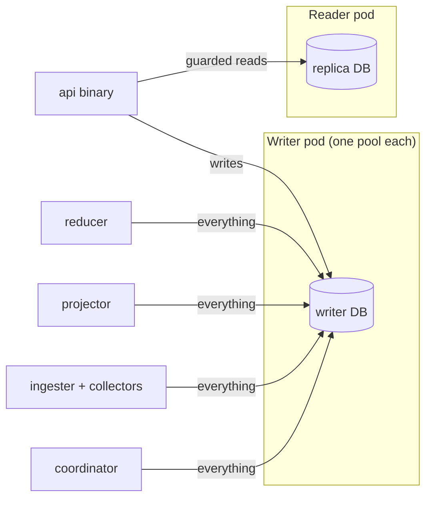
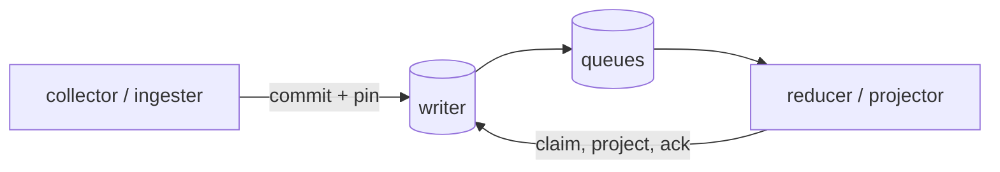
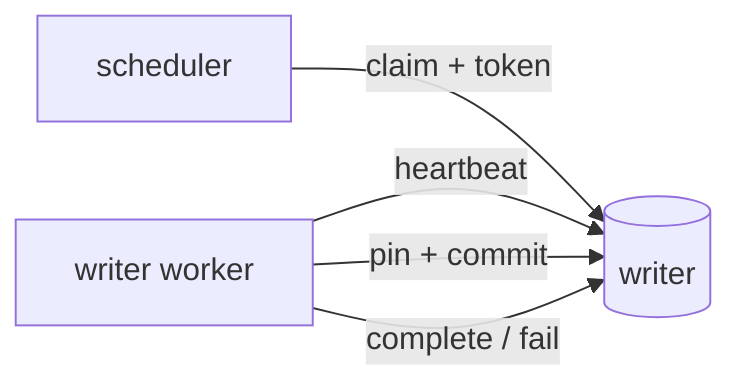
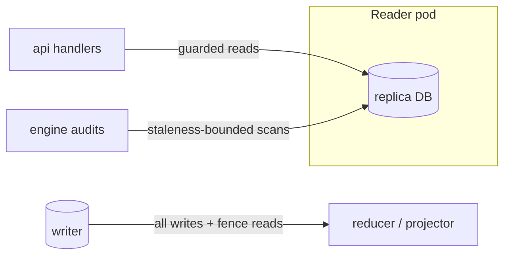

# Postgres reader routing (#10416)

Seven scan lanes mapped every Postgres query family in `go/`; an arbiter
ruled on reader eligibility. This document records the target state, the
rule, and the proof bar. The per-family verdicts live in
[postgres-reader-routing-families](postgres-reader-routing-families.md).
Evidence: lane reports and arbiter ruling on
[eshu-hq/eshu#10416](https://github.com/eshu-hq/eshu/issues/10416).

## Where queries run today

Every binary except the API opens exactly one shared writer pool. The API
is the only binary with a split setup: writes go to the writer pool,
guarded business reads go to the reader pool. Collectors, the ingester,
the projector, the reducer, and the coordinator all send everything —
including minute-long analytical scans — down the single writer
connection. That is why the writer saturates while the replica idles.

## The rule for moving a read

A read may move to the replica only when all four hold:

1. It is SELECT-only on that handle — the type system must make writes
   impossible, not just unlikely.
2. Its result never feeds a fence, claim, lease, pin, commit, auth, or
   projection decision in the same cycle.
3. A seconds-old answer changes only *when* the next cycle acts, never
   *what* gets committed, projected, or authorized.
4. Replaying a stale snapshot is harmless (idempotent).

Fail any one, and the read stays on the writer. A read inside a writer
transaction, or a read-then-write pair with no writer-side recheck
(CAS, fence, row lock), can never be split.

Two corollaries the census forced:

- Reads that feed a fence or elapsed-bound computation stay put even
  when SELECT-only. The readiness scans looked movable until the census
  showed one of their outputs anchors the fence timer — a stale read
  would move the fence itself.
- Auth reads (allow, deny, revoked token) stay put. Lag changes *what* a
  login decides, so only the writer or a checkpoint-bounded fenced read
  qualifies — never a bare replica.

## The paths, as built

Write path. Producers commit facts, generations, and queue rows through
the writer pool; every commit that needs fencing pins first.

Fence and lease path. Claims, heartbeats, completions, fencing tokens,
and pins all run on the writer, most fenced by row locks taken in the
same statement (`SKIP LOCKED`, `FOR UPDATE`). Nothing on this path may
ever read from the replica: a lagging copy could approve a stale epoch.

Read path (target state). Query handlers, status snapshots, content
reads, and audit lists go to the replica. The API already works this
way; the remaining binaries gain a reader-backed twin for exactly these
families, chosen in each binary's wiring.

Audit path. The winners audit splits in two: its slow candidate scan
(the 60-second query burning the writer today) runs on the replica and
returns candidates; queuing repairs stays on the writer in a
transaction. Lag only delays *when* a repair is queued. The scan drains
into memory first (peak O(candidates) idents) so the standby connection
is released before the writer transaction opens; corpus-scale candidate
counts are a tracked follow-up gating default-enable on
[eshu-hq/eshu#10416](https://github.com/eshu-hq/eshu/issues/10416).

## Proof bar for every moved family

No family moves on argument alone. Each needs, cited in its PR:

1. A verb audit showing its statements are SELECT-only.
2. A caller trace proving no in-cycle fence, claim, commit, or auth
   consumer.
3. A lag test: replica held N transactions behind, asserting the same
   outcome or a when-only delay.
4. A replay test: duplicate delivery stays harmless.
5. A declared staleness budget (default 30 seconds replay age).

Plus before/after writer CPU under comparable load, standby replay-age
numbers for the window, and a guard test so a later edit cannot
silently rewire the family back — or wire a fencing path onto the
replica. Rollback of any slice is a config flip, documented in the
rollout note.

## What never moves

Multi-writer, writes through the reader, the reader for fencing tokens,
claims, leases, pins, commits, auth verdicts, or generation activation.
No raising the old fence timeout to force a fit. No silent fallback to
the writer when the replica lags — fallback is the operator's visible
config flip. No cutting workers or batch sizes to "protect" anything;
if the replica cannot carry a family's concurrency, the family does
not move.

## Not yet verified

- The MCP tool-to-family map (MCP holds no pool of its own; it reuses
  query-router stores — each tool's path needs tracing before routing).
- About fifteen coordinator store bodies and a dozen collector bodies
  were pattern-checked, not line-opened; they default to writer-only.
- The projector canonical writer's pool reuse past one call site.
- Standby headroom under concurrent minute-long scans (cancellation
  rate must be measured before the first engine slice ships).
- Per-family staleness tolerance beyond readiness and winners.
