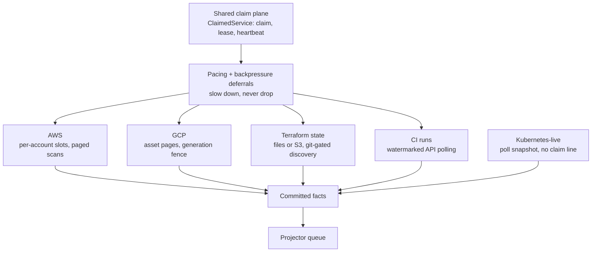

<!-- docs-catalog
title: Cloud Collector Flows
description: How AWS, GCP, Kubernetes, Terraform state, and CI runs become facts.
type: concept
audience: practitioner, operator, contributor
entrypoint: false
landing: false
-->

# Cloud Collector Flows

Five collectors watch non-git sources. All cross one shared claim plane —
a fair waiting line with pacing and backpressure — then each reads its own
source in its own way. Kubernetes-live is the exception: it snapshots on
poll with no claim line.

## Walk

- **Claim plane.** AWS, GCP (claimed mode), Terraform-state, and CI-run
  collectors take turns through a fair dispatcher: claim a unit of work,
  hold it with a lease, renew the lease with heartbeats, complete or fail
  it. Pacing and source-backpressure deferrals slow grants instead of
  dropping work.
- **AWS.** One claim per account, region, and service. Assume the role,
  scan the paginated list APIs (metadata only — secret bodies are never
  stored), emit resource, relationship, tag, DNS, image, and posture facts.
  Per-account slots cap parallel scans; checkpoints resume pagination.
- **GCP.** Page Cloud Asset Inventory, parse each page through typed
  extractors, fence with a generation tracker so stale pages cannot commit.
- **Kubernetes-live.** No claim line: each poll lists the fixed core set
  (namespaces, workloads, services, RBAC) read-only through the API server.
  Partial lists become durable warnings, and names only — never secret
  values.
- **Terraform-state.** Read exact snapshots from local files or S3
  (conditional GET skips unchanged state), wait for git evidence before
  resolving backends, refuse symlinks and oversized states.
- **CI runs.** Poll the hosted APIs newest-first within page caps,
  normalize both providers into one fact family keyed by provider, run id,
  and attempt. The durable watermark advances only when the generation
  commits — never while reading.

## Where it waits

- Workflow claim rows with lease TTL and heartbeat renewal.
- Pacing and source-backpressure deferrals.
- AWS per-account slots, STS credential leases, pagination checkpoints.
- GCP page-continuation resume and the stale-generation fence.
- Terraform `waiting_on_git_generation` blocks.
- CI provider rate limits, page caps, watermark gaps.

## Proof it is moving

- AWS: `eshu_dp_aws_api_calls_total`, resources/relationships emitted,
  scan duration, throttle counts.
- GCP: facts emitted per scope, page-token resumes, freshness lag.
- Kubernetes: `kubernetes live snapshot completed`, resources listed.
- Terraform: snapshots observed, conditional-GET short-circuits, parse
  duration.
- CI: provider requests, facts emitted, rate-limit and watermark-gap
  warnings.

Code: `go/internal/collector/awscloud/`, `gcpcloud/`, `kuberneteslive/`,
`terraformstate/`, `cicdrun/`, and the shared `claimed_service*.go`.
