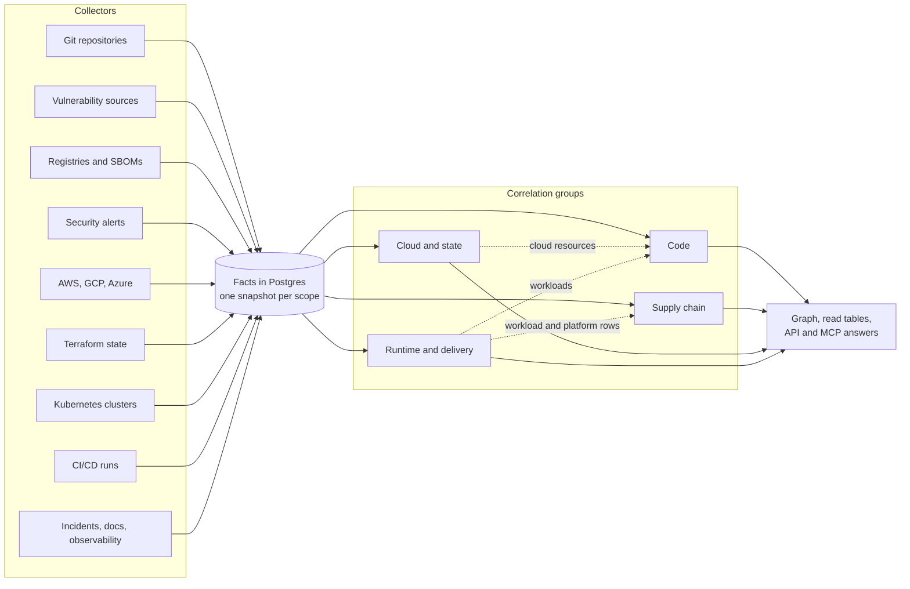
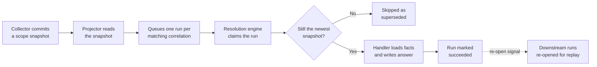

<!-- docs-catalog
title: Cross-Source Correlations Flow
description: Shows how collectors feed cross-source correlation groups, how runs start and re-open, and where staleness can appear.
type: concept
audience: practitioner, operator, contributor
entrypoint: false
landing: false
-->

# Cross-Source Correlations Flow

Collectors write facts under a single scope — one repository, one Kubernetes
cluster, one cloud account, or one advisory window. Correlations join facts
across those scopes so Eshu can answer questions like which running workload
uses a vulnerable image built from a specific repository.

## How collectors feed correlations

Each new scope snapshot queues the correlations that read its record kinds. A
correlation writes its answer to the canonical graph, to a Postgres read table,
or back as a derived fact that another correlation reads.

Dotted lines mark places where one correlation reads another correlation's
output. When an answer looks stale even though the primary source updated, check
whether the upstream side on a dotted arrow re-opened the downstream run.

## How a run starts and re-opens

Every correlation takes the same path on its first run for a scope snapshot:

Across the whole system, a correlation run starts or re-opens through one of
eight mechanisms (one normal own-scope path, six cross-source triggers, and one
scheduled sweep):

| Mechanism | How it works | Typical consumers |
| --- | --- | --- |
| New own-scope snapshot | Normal projector enqueue when a scope commits a new generation. | Every correlation |
| Completion announcement | Producer finishes and re-opens active consumer runs (or flags in-flight runs to replay). | Supply-chain impact (from image identity and CI/CD), value-flow refresh |
| Keyed producer finish | Producer finishes and re-opens only runs matching the same repository key. | Service catalog, deployable unit, workload materialization |
| Producer-activation settle | Active generation re-opens runs sharing image keys or cloud resource ARNs (when the producer-activation consumer is enabled). | Image identity, Kubernetes materialization, AWS drift |
| Maintenance re-open | Periodic post-ingest pass checks six cross-scope correlations when their input fingerprint changes. | Deployable unit, workload, service catalog, Kubernetes, image identity, AWS drift |
| Holder fan-out | A finding change re-opens other scopes that hold a copy of the same finding. | Supply-chain impact |
| Parked wait | A run waits for a named upstream dependency and wakes when it finishes. | Supply-chain impact, security alerts, advisory groups |
| Timed sweep | A periodic pass queues runs on a schedule regardless of source events. | Config-against-state drift (every 5 minutes), search index |

## Diagnosing stale correlations

1. Check `/api/v0/index-status` and `/admin/status` to confirm whether the
   upstream collector snapshot actually committed.
2. Check whether the correlation run is queued, retrying, dead-lettered, or
   superseded (see [Reducer Queues](reducer-queues.md) and
   [Troubleshooting](../../operate/troubleshooting.md)).
3. For maintainers tracing exact Go files, domain constants, and per-group
   trigger tables, see the internal Correlation Atlas (`docs/internal/correlation-atlas/README.md`).

Related: [Flow Atlas](index.md), [Supply-Chain Impact](supply-chain-impact.md),
[Freshness and Convergence](../../operate/freshness-convergence.md).
