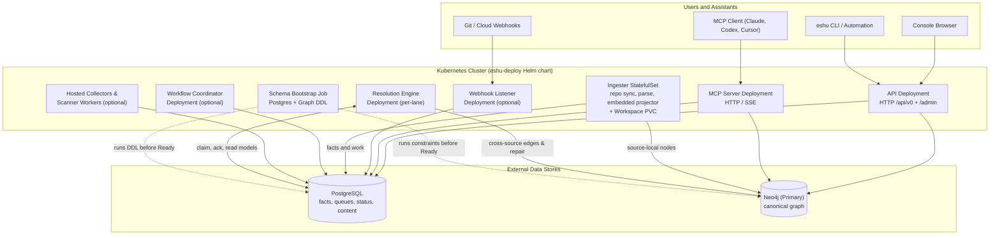

<!-- docs-catalog
title: Deployment Topology Flow
description: Compares local single-machine and shared Kubernetes topologies, showing service boundaries, stores, and ingress paths.
type: concept
audience: practitioner, operator, contributor
entrypoint: false
landing: false
-->

# Deployment Topology Flow

Eshu keeps the same facts-first contracts locally and in production. What
changes between a laptop setup and a shared Kubernetes cluster is how the
services and data stores are packaged and scaled.

## Shared Kubernetes topology (Helm)

In production, each runtime runs as its own Kubernetes workload against external
Postgres and canonical Neo4j stores. Schema bootstrap runs as a one-shot Job
before pods become Ready.

Key boundaries:

- **Fact intake vs graph writers:** Webhooks, hosted collectors, and satellite
  scanner workers commit facts and work to Postgres only. Two runtimes write
  canonical graph state behind the shared Cypher seam: the ingester's embedded
  projector (or standalone projector) writes source-local canonical nodes, and
  the resolution engine owns cross-source correlations, shared edges, replay,
  and repair.
- **Schema readiness gate:** Long-running pods probe `/readyz`, which checks
  that the Postgres migration ledger matches the binary before receiving traffic
  or draining work.
- **Read scaling:** High-traffic deployments can split Postgres read-only query
  traffic onto a read replica with freshness fencing (see
  [Postgres Read Routing](../../deployment/postgres-read-routing.md)).

## Local topologies

| Shape | Best for | Stores | Start with |
| --- | --- | --- | --- |
| Demo mode (`eshu demo up`) | Zero-credential evaluation on synthetic data | Embedded / local | [Demo Mode](../../getting-started/demo-mode.md) |
| Local binaries (`eshu graph start`) | Fast local repo indexing and stdio MCP | Embedded NornicDB + local state | [Local Binaries](../../run-locally/local-binaries.md) |
| Docker Compose (`eshu-deploy`) | Full API, MCP, Postgres, and graph stack on one machine | Compose containers | [Docker Compose](https://github.com/eshu-hq/eshu-deploy/blob/main/docs/run-locally/docker-compose.md) |
| Shared Kubernetes (`eshu-deploy`) | Team-wide indexing, hosted collectors, SSO/scoped tokens | External Postgres + Neo4j | [Deployment Overview](../../deployment/index.md) |

Related: [Deployment Overview](../../deployment/index.md),
[Service Runtimes](../../deployment/service-runtimes.md),
[System Architecture](../../architecture.md).
