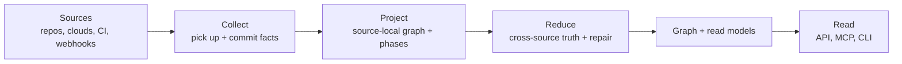

<!-- docs-catalog
title: Eshu Flow Atlas
description: One picture per road a change travels, from source observation to answered question.
type: concept
audience: practitioner, operator, contributor
entrypoint: true
landing: false
-->

# Eshu Flow Atlas

A change in the world — a pushed commit, a new cloud machine, a fresh
security warning — travels through Eshu in stages. Each stage below has its
own page with a picture, a plain-language walk, the waiting lines it can
stall in, and the signals that prove it is moving.

| Flow | Page | The one-line version |
|---|---|---|
| Repo collector | [Repo Collector](repo-collector.md) | Git sync, parse, facts, handoff to projection. |
| Cloud collectors | [Cloud Collectors](cloud-collectors.md) | AWS, GCP, Kubernetes, Terraform state, CI runs. |
| Projector | [Projector](projector.md) | Source-local graph, phase publication, reducer intents. |
| Reducer queues | [Reducer Queues](reducer-queues.md) | Every waiting line: claim, lease, retry, dead letter, replay. |
| Supply-chain impact | [Supply-Chain Impact](supply-chain-impact.md) | The deepest reducer path, end to end. |
| Read path | [Read Path](read-path.md) | Question to answer, with zero waiting lines. |

Related: [System Architecture](../../architecture.md),
[Service Workflows](../../reference/service-workflows.md).
