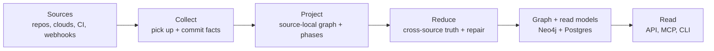

<!-- docs-catalog
title: Eshu Flow Atlas
description: Single home for Eshu's system, pipeline, correlation, read-path, and deployment diagrams.
type: concept
audience: practitioner, operator, contributor
entrypoint: true
landing: false
-->

# Eshu Flow Atlas

This is the single home for Eshu's architecture, workflow, correlation, and
deployment diagrams. Every diagram follows the **one picture, one home** rule:
each flow lives inline here alongside a plain-English walk, the waiting lines it
can stall in, and the signals that prove it is moving.

## All Diagrams & Flows

| Flow | Page | What it shows |
| --- | --- | --- |
| Repo collector | [Repo Collector](repo-collector.md) | Git sync, parse, immutable facts, and handoff to projection. |
| Cloud collectors | [Cloud Collectors](cloud-collectors.md) | AWS, GCP, Kubernetes, Terraform state, and CI runs. |
| Projector | [Projector](projector.md) | Source-local graph projection, phase publication, and reducer intents. |
| Reducer queues | [Reducer Queues](reducer-queues.md) | Every waiting line: claim, lease, retry, dead letter, and replay. |
| Cross-source correlations | [Cross-Source Correlations](correlations.md) | How collectors feed correlation groups, how runs start, and how changes re-open them. |
| Supply-chain impact | [Supply-Chain Impact](supply-chain-impact.md) | The deepest reducer path from advisory to running workload, end to end. |
| Read path | [Read Path](read-path.md) | How API, MCP, and CLI answer questions with zero waiting lines. |
| Deployment topology | [Deployment Topology](deployment-topology.md) | Local vs shared Kubernetes services, data stores, and ingress boundaries. |

Package-level code internals (diagrams that name internal Go functions directly)
stay in their owning package `README.md` or companion file (for example,
`go/internal/reducer/queue-and-runners.md`) so they never drift from code.

Related: [System Architecture](../../architecture.md),
[Deploy Eshu](../../deployment/index.md),
[Service Workflows](../../reference/service-workflows.md).
