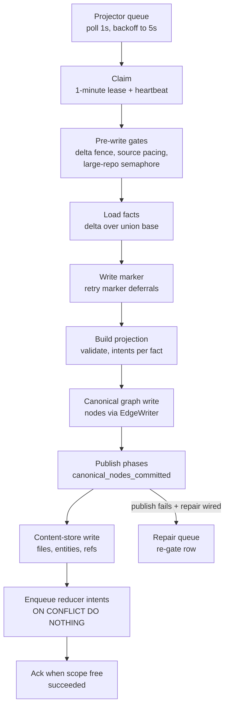

<!-- docs-catalog
title: Projector Flow
description: How claimed collector work becomes source-local graph truth and reducer intents.
type: concept
audience: practitioner, operator, contributor
entrypoint: false
landing: false
-->

# Projector Flow

The projector turns one scope's committed facts into source-local graph
nodes, publishes phase checkpoints other stages wait on, and enqueues the
reducer work that builds cross-source truth.

## Walk

1. **Claim.** Workers poll the projector queue (1 second, backing off to 5
   when idle) and claim one unit with a one-minute lease plus heartbeat.
2. **Pre-write gates.** Before writing anything: refuse stale deltas at the
   fence, release source-paced claims without spending budget, and take a
   semaphore slot for very large generations.
3. **Load facts.** Load the delta over the union base and stamp the
   generation; refuse to proceed when the base is missing.
4. **Write marker.** Mark the write as started, retrying marker deferrals —
   this is what makes a crashed projection safely re-runnable.
5. **Build.** Validate every fact's boundary and schema version, build one
   reducer intent per fact across all domains (code, cloud, Kubernetes,
   SBOM, CI, catalog, supply), and assemble the canonical materialization
   (repository, scopes, files, entities, imports, Terraform and registry
   rows).
6. **Canonical write.** Write nodes through the graph writer, never a raw
   driver. Empty materializations skip the write but still publish phases.
7. **Phase publication.** Publish `canonical_nodes_committed` checkpoints per
   scope and keyspace. This is the readiness gate the reducer waits on — and
   it must succeed before ack.
8. **Content write.** Write file, entity, and repository-ref rows to
   Postgres; a changed fingerprint enqueues one drift intent.
9. **Enqueue.** Enqueue reducer intents with insert-if-absent semantics, so
   replays admit each row once.
10. **Ack.** Ack only when the scope is free, retrying ack deferrals with
    heartbeat renewal. Superseded, claim-lost, and shutdown-cancelled work
    take their own terminal branches instead of failing.

## Where it waits

- Projector queue rows (claim, lease, heartbeat).
- Source-pace release and the large-generation semaphore.
- Fact store and union-base readiness.
- Write-marker deferral retries.
- Phase publication (plus the repair queue on failure).
- Reducer queue (the next flow's line).

## Proof it is moving

- Logs: `starting projector`, `projector work stage completed`,
  `build_projection` counts, `canonical_write` counts, `intent_enqueue`
  counts, `projection succeeded`.
- Metrics: claim duration, fact-load and build stage timings, canonical
  writes, intents enqueued, ack deferrals, projections completed by status.
- Warns: `projector delta refused before projection`, marker deferrals.

Code: `go/internal/projector/` (`service.go`, `runtime/projection.go`,
`runtime/stages.go`, `runtime/phase.go`). Env knobs:
`ESHU_PROJECTOR_WORKERS`, `LargeGenThreshold`, `LargeGenMaxConcurrent`,
retry policy, `ESHU_CANONICAL_WRITE_TIMEOUT`.
