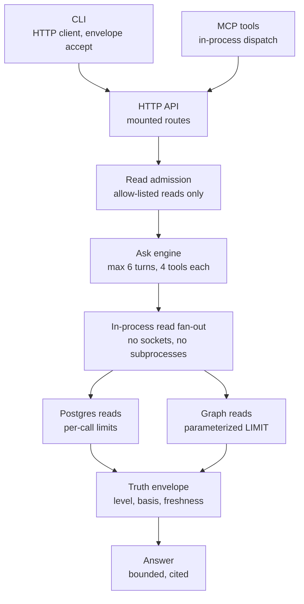

<!-- docs-catalog
title: Read Path Flow
description: How a question becomes a bounded, truth-labeled answer through CLI, API, or MCP.
type: concept
audience: practitioner, operator, contributor
entrypoint: false
landing: false
-->

# Read Path Flow

Reads are the one flow with no waiting lines. A question arrives through
the CLI, the HTTP API, or an MCP tool, reads Postgres and the graph
directly under strict bounds, and comes back labeled with how much to
trust it.

## Walk

1. **Arrive.** The CLI calls HTTP like any other client; MCP tools dispatch
   in-process to the same handlers. No `ask` shell command exists — asking
   goes through the API.
2. **Admit.** Read-only admission ports list exactly which reads each route
   may perform; anything else is denied before any store is touched.
3. **Bound the question.** The ask engine runs at most 6 turns with at most
   4 tool calls each, truncating beyond that with a warning.
4. **Fan out in-process.** Tool calls run synchronously inside the process
   — no network hops, no external processes.
5. **Read Postgres.** Content and status reads carry per-call limits (a few
   hundred rows), with short timeouts on coverage probes.
6. **Read the graph.** Traversals use parameterized limits and read one row
   past the limit to know whether output was truncated.
7. **Label the truth.** Every answer carries its truth class —
   deterministic, derived, fallback, observation, hint, or unsupported —
   plus freshness, backend, and what was omitted.
8. **Answer.** Bounded bytes, budgeted tokens, cited evidence handles.

## Where it waits

Nowhere. Reads cross zero queues — dispatch calls the query handlers
directly. The only contact with queue depth is observational: a backed-up
reducer shows up as a freshness warning on the answer, never as a wait.

## Proof it is moving

- Metrics: MCP tool calls, response bytes, over-budget and fallback
  counts, paged responses.
- Logs: dispatch lines, redirect and timeout warnings, budget-hit lines.
- Envelope fields: `limit`, `truncated`, truth class, freshness cause.

Code: `go/internal/query/`, `go/internal/mcp/`, `go/cmd/eshu/`.
Bounds: 30-second dispatch timeout, 256 KiB response budget, per-route
row caps.
