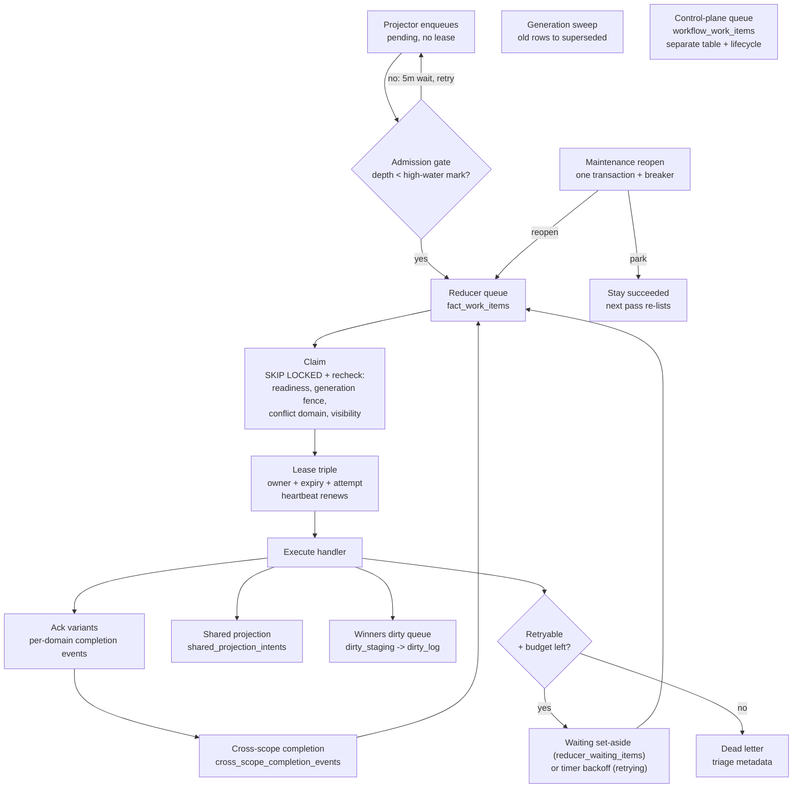

<!-- docs-catalog
title: Reducer Queues
description: Every waiting line in the reducer path, who writes, who claims, and what stalls each one.
type: concept
audience: practitioner, operator, contributor
entrypoint: false
landing: false
-->

# Reducer Queues

Eshu depends on queues, so this page maps every one in the reducer path:
the main reducer queue, the lease mirror, the deferred-wait set-aside, the
separate control-plane queue, and the maintenance reopen loop with its
breaker. For the drain-loop picture, see the reducer queue internals in
`go/internal/reducer/queue-and-runners.md`, which holds the single copy
of the drain-loop chart (this page's own chart maps the queues).

## The main reducer queue

- **States.** Pending, retrying, claimed, running do work; succeeded and
  dead-letter are terminal; superseded is terminal and never replays; a
  legacy failed state still appears in sweep filters.
- **Writers.** The projector enqueues intents (insert-if-absent, status
  pending, no lease). In-queue writers reopen succeeded rows to pending,
  flag live rows for cross-scope replay without stealing leases, and sweep
  old generations to superseded.
- **Claim.** Single and batch claim use lock-and-skip so workers never wait
  on each other, then recheck the locked row: domain readiness, a
  read-only generation fence, conflict-domain ownership (one holder per
  key, enforced by a partial unique index), dual-clock visibility, and
  batch fairness ranks.
- **Lease.** Owner, expiry, and attempt count travel together; heartbeats
  renew only on exact match. A lost lease before start re-queues quietly —
  never dead-letters.
- **Fail triage.** Only explicitly retryable failures retry, up to 3
  attempts with exponential backoff capped at an hour. Readiness waits do
  not spend budget. Dead letters carry triage metadata naming the cause.
- **Requeue labels.** Every return to an outstanding state stamps
  `last_requeue_reason` from a closed vocabulary (retry, readiness wait,
  waiting wake, maintenance reopen, producer activation, completion wake,
  cross-scope replay, holder fanout, retouch, admin replay/reopen,
  recovery re-drive), counted per reason. The column answers which path
  re-pends a row; there are no separate queues per class (a split needs
  label evidence that one class starves another first). Reducer stage only:
  projector rows stay NULL.
- **Ack variants.** The generic ack fences the lease; identity and CI
  correlation acks emit completion events that wake downstream waits;
  workload acks re-trigger catalog rows; batch acks collapse duplicate
  claims.

## The other waiting lines

- **Lease mirror** (`fact_work_item_leases`): a sidecar of claim state for
  fast conflict checks; the main row stays authoritative.
- **Waiting set-aside** (`reducer_waiting_items`): parked rows waiting on a
  named cause (activation, phase commit, producer finish, watermark) with a
  10-minute backstop, woken by provider commits or a 5-minute audit.
- **Control-plane queue** (`workflow_work_items`): a separate table and
  lifecycle for scanner and collector workflow claims, with its own fair
  claim, fencing tokens, and a sweeper that retires old completed rows.
- **Cross-scope completion** (`cross_scope_completion_events`): durable
  producer-completion events written inside producer ACKs and coalesced into
  canonical consumer reopens or `cross_scope_replay_required` flags.
- **Shared projection queue** (`shared_projection_intents` plus
  `shared_projection_partition_leases`): partitioned edge-write work gated on
  `graph_projection_phase_state` readiness checkpoints (for example
  `workload_materialization` gating `handles_route` and `runs_in`).
- **Winners dirty queue** (`supply_chain_impact_winners_dirty_staging` ->
  `supply_chain_impact_winners_dirty_log`): per-key invalidations staged by
  impact writes and drained by the single-leased winners maintainer to advance
  `supply_chain_impact_winners_materialization.materialized_at`.
- **Admission backpressure gate** (`ESHU_REDUCER_ADMISSION_HIGH_WATER_MARK`,
  default `10000` on the ingester): when outstanding reducer rows sit at or
  above the mark, the projector defers reducer enqueues and retries after
  `ESHU_REDUCER_ADMISSION_MAX_WAIT` (`5m`), coupling reducer backlog directly
  into `source_local` projector retries.
- **Maintenance reopen.** Each pass backfills evidence, then in one
  transaction reopens what the new evidence unlocks. A memo gate skips
  partitions the same pass already handled; the breaker parks a pass that
  would reopen more than half of a 20-plus pool, staying succeeded for the
  next pass instead of flooding the queue.

## Reading a stuck queue

- Pending climbs, succeeded stalls: the drain side is behind — workers,
  claim fences, handler timeouts.
- Retries surge with no successes: a failure class is burning budget —
  check the triage metadata.
- Waves on pass cadence plus the breaker log line: a collapsed upstream
  signal — find it, do not add workers.
- Dead letters grow: each names its cause; poison recovery and
  generation-liveness runners bound the rest.

## Proof signals

- Metrics: executions by domain and status, queue-wait seconds, claim
  seconds, retry surge by class, dead letters, missed heartbeats,
  claim conflicts, park-by-breaker counts, requeues by reason
  (`eshu_dp_reducer_requeue_total`) with depth and oldest age by reason.
- Logs: per-item execution lines with queue-wait seconds, breaker-open
  lines naming the domain, lease-lost warnings.

Code: `go/internal/storage/postgres/reducer_queue*.go`,
`go/internal/reducer/service*.go`.
