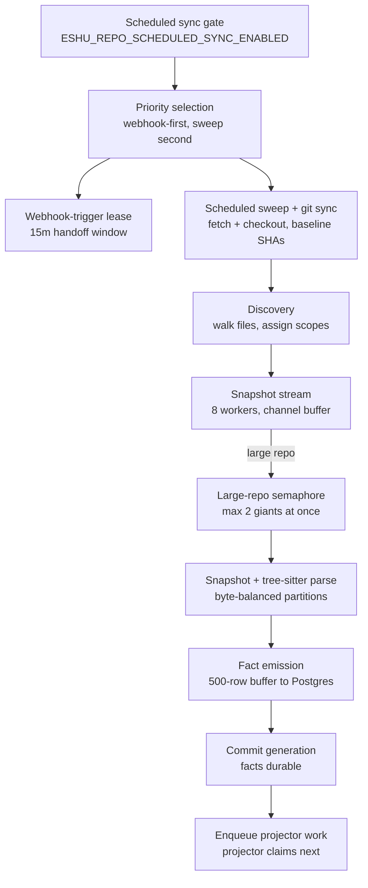

<!-- docs-catalog
title: Repo Collector Flow
description: How a git repository becomes committed facts, from sync selection to the projector handoff.
type: concept
audience: practitioner, operator, contributor
entrypoint: false
landing: false
-->

# Repo Collector Flow

The repo collector watches git repositories — GitHub, GitLab, or plain git —
and turns each chosen state of each repo into committed facts. It does not
decide graph truth; it delivers the raw material.

## Walk

1. **Sync gate.** A startup switch decides whether scheduled sweeping runs;
   without it, only webhook handoffs drive collection.
2. **Selection.** Webhook-pushed repos go first, then the scheduled sweep.
   This is ordering only — nothing waits here.
3. **Webhook lease.** A pushed repo holds a 15-minute handoff lease so two
   collectors do not sync it twice.
4. **Git sync.** Fetch and checkout at depth 1 by default. The baseline commit
   is durable, never local HEAD, and delta fences travel with the generation.
5. **Discovery.** Walk the files, group them into scopes, record how long it
   took.
6. **Snapshot stream.** Eight workers snapshot repos into a channel buffer;
   when the buffer fills, snapshotters block — that backpressure is normal.
7. **Large-repo semaphore.** Repos over 1,000 files take one of 2 giant slots
   so they cannot starve small repos.
8. **Parse.** Tree-sitter parses files in byte-balanced partitions across the
   parse workers, with prescan dedup avoiding a second pass.
9. **Emit.** Facts stream into Postgres in 500-row batches matching the
   insert rate.
10. **Commit.** The generation commits durably; metrics record observed vs
    committed fact counts.
11. **Handoff.** One projector-work row is enqueued in the same transaction —
    the projector's waiting line starts here.

## Where it waits

- Webhook handoff lease (15 minutes default).
- Snapshot channel buffer (workers block when full).
- Large-repo semaphore (giants queue two at a time).
- Projector queue (the next flow's line).

Satellite sources use a separate durable claim queue with pacing and
source-backpressure deferrals; plain git snapshots do not cross it.

## Proof it is moving

- Logs: `collector discovery completed`, `collector stream started`,
  `collector snapshot completed`, `collector commit succeeded`.
- Metrics: `ReposSnapshotted`, `FactsEmitted`, `FactsCommitted`,
  `RepoSnapshotDuration`, `FactEmitDuration`.

Code: `go/internal/collector/repo/git/`, `go/internal/collector/service.go`.
Env knobs: `ESHU_SNAPSHOT_WORKERS`, `ESHU_PARSE_WORKERS`,
`ESHU_LARGE_REPO_FILE_THRESHOLD`, `ESHU_LARGE_REPO_MAX_CONCURRENT`,
`ESHU_STREAM_BUFFER`, `ESHU_REPO_LIMIT`, `ESHU_CLONE_DEPTH`.
