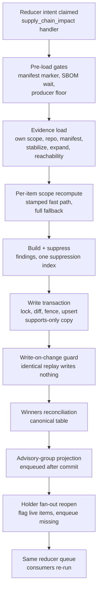

<!-- docs-catalog
title: Supply-Chain Impact Flow
description: The deepest reducer path, from vulnerability evidence to holder fan-out.
type: concept
audience: practitioner, operator, contributor
entrypoint: false
landing: false
-->

# Supply-Chain Impact Flow

This is the longest road in the reducer: vulnerability and SBOM evidence
becomes per-scope findings, findings become winners, and each change fans
out to every holder scope that depends on it. It crosses the reducer queue
three times.

## Walk

1. **Claim.** The reducer claims a supply-chain-impact intent off the main
   queue.
2. **Pre-load gates.** Wait for the manifest marker and SBOM attachments
   (bounded wait, then proceed-without and say so), arm the cross-scope
   producer floor for image identity and CI correlation.
3. **Evidence load.** Load own-scope facts, repository facts, and manifest
   dependencies; loop until stable; expand OS-package advisories,
   scanner scopes, and resolved digests; add language reachability and
   alert scoping.
4. **Scope recompute.** Re-derive only inside the claim stamp when
   possible; fall back to the full pass when rows fall outside it.
5. **Build and suppress.** Build the authorized findings and apply
   suppressions through one per-pass index.
6. **Write transaction.** Under the conflict-domain lock: diff
   suppressions, check fencing admission, upsert into the supports table —
   the only copy of a finding (stray fact writes are refused by a database
   trigger).
7. **Write-on-change guard.** An identical replay rewrites nothing; before
   the guard, every replay rewrote every row.
8. **Winners.** Reconcile the canonical winners table from the committed
   supports, keyed ticks instead of full resweeps where possible.
9. **Advisory groups.** Enqueue one group-projection intent per touched
   group after the writer commits, before holders fan out.
10. **Holder fan-out.** Reopen every holder scope: flag live items for
    replay, enqueue missing ones, reopen dead letters in full. State rides
    on the item so the continuation drains across passes.

## Where it waits

- Reducer queue claim and ack (crossed at entry).
- SBOM-attachment and producer waits (bounded, then proceed-without).
- Same-queue projection items (one per touched advisory group).
- Same-queue holder reopens (flagged live items, capped per pass with
  the remainder carried).
- Winners single-owner lease and the shared commit lock (millisecond
  scale).

## What keeps it from exploding

Scoped re-derivation, the holder prefilter, identity gates that skip
metadata-only refreshes, in-flight narrowing, the write-on-change guard,
and keyed winners ticks — each caps one amplification point.

## Proof it is moving

- Statement-duration metrics per write statement and outcome.
- Supports rows by action, rekey outcomes, fan-out counters per holder.
- Retractions, truncations, supersedes with warnings.
- Scoped CVE counts and re-pend causes; enqueue-failure records.

Code: `go/internal/reducer/supplychain/core/`,
`go/internal/storage/postgres/supply_chain_impact_*.go`.
