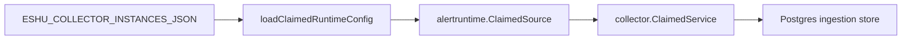

# collector-security-alerts

`collector-security-alerts` runs hosted provider security-alert collection. It
selects a `security_alert` collector instance from `ESHU_COLLECTOR_INSTANCES_JSON`,
resolves explicit credential environment references, and hands claimed work to
`alertruntime.ClaimedSource`.

Each target is repository-scoped or org-scoped (`scope: "org"`). Repository
targets require a `repository` and `allowed_repositories` allowlist; org targets
require an `organization` and `allowed_repositories` and fan the org-wide
endpoint out into per-repository facts. Every target authenticates in one
`auth_mode` (`token_env` default, or `github_app`). Static mode reads the
named `token_env` variable once at startup. App mode resolves
`github_app_id_env`, `github_app_installation_id_env`, and
`github_app_private_key_env` (the existing `GITHUB_APP_*` secret envs) and
mints one installation token per claim — never per page — from the target
`api_base_url`, signing a fresh JWT per claim with 60 seconds of clock-skew
tolerance. The two modes never mix on one target, and a minted token is never
persisted, logged, or emitted in facts. Credential values are read only
inside this process and are never copied into workflow run metadata. Run
`--preflight-provider-access` against a real installation before relying on a
new App credential: only a live pass proves the installation can reach the
Dependabot endpoints.

`--preflight-provider-access` runs a one-shot provider access check using the
same collector instance JSON, token env resolution, allowlist validation, and
provider client as the hosted runtime. The preflight makes at most one bounded
request per configured target, prints only a generic success line, and returns
sanitized failure classes such as `auth_denied` without opening Postgres or
claiming workflow work. It uses the `collector-security-alerts-preflight`
telemetry service name and flushes OTLP signals before exiting when an exporter
is configured.

Hosted mode wires the shared collector generation dead-letter store. Commit
failures record bounded scope and generation evidence in runtime status while
workflow claims remain the retry and requeue owner. A later successful claimed
commit clears unresolved replay state for the same source scope.

Observability Evidence: hosted mode exposes the shared status/admin server plus
Prometheus metrics for provider requests, emitted facts, rate-limit events, and
fetch duration through `telemetry.Instruments`. Preflight mode does not start a
status server, but it passes tracer and instruments into
`alertruntime.ClaimedSource` so `security_alert.observe`,
`security_alert.fetch`, `eshu_dp_security_alert_provider_requests_total`, and
`eshu_dp_security_alert_fetch_duration_seconds` still describe the bounded
provider check.

No-Regression Evidence: `TestRunProviderAccessPreflightReportsSanitizedAuthDenied`
proves the binary preflight resolves the same private token env, asks the
runtime for one provider page, and returns an `auth_denied` failure without
leaking token or repository values.
`TestRunProviderAccessPreflightRecordsProviderTelemetry` proves the preflight
path records the existing security-alert provider metric and spans.
