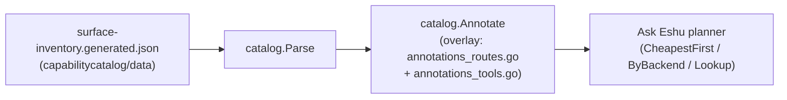

# internal/ask/catalog

## Purpose

`internal/ask/catalog` is Ask Eshu's self-knowledge of every implemented API
route and MCP tool it can call as a retrieval path to answer a question. It bridges
the canonical surface inventory (generated and drift-gated on every surface
change) with a curated annotation overlay that records each surface's backend
and cost class, enabling the Ask Eshu planner to prefer the cheapest correct
retrieval path.

## Where this fits in the pipeline



The package is **pure**: it reads the committed inventory artifact from disk and
never queries Postgres, the graph backend, or any live runtime state.

## Files

| File | Role |
|------|------|
| `catalog.go` | Core types (`Backend`, `CostClass`, `SurfaceKind`, `Entry`, `Catalog`), `Parse`, `Annotate`, `Unannotated`, `Lookup`, `ByBackend`, `CheapestFirst` |
| `doc.go` | Package godoc contract |
| `annotations.go` | `Annotation` type (backend, cost, router `Intents`/`Canonical`) + `annotations()` merger |
| `annotations_intents.go` | `toolIntent` type, `intents`/`canonicalIntents` helpers, `applyToolIntents` merge onto the overlay |
| `annotations_intents_families.go` | `toolFamilies()` (the one family list) and `sharedIntentAllowed` |
| `annotations_intents_{code,repo_service,supply,iac_drift,ops}.go` | Curated intent phrases and canonical flags per tool group |
| `annotations_routes.go` | `askRouteAnnotations()` — implemented retrieval-capable HTTP API routes |
| `annotations_tools.go` | `askToolAnnotations()` — 167 implemented MCP tools |
| `planner_exclusions.go` | Curated non-retrieval admin/auth/session control routes excluded from planner entries |
| `coverage_test.go` | Drift gate: `TestOverlayCoversInventory` — reads the real inventory, fails if any implemented surface is unannotated |
| `planner_exclusions_test.go` | Planner gate: proves every implemented surface is either cataloged or explicitly excluded |
| `parse_test.go` | `Parse` correctness tests |
| `catalog_test.go` | Type and constant contract tests |
| `annotations_test.go` | Overlay application, unannotated reporting, and backend-validity tests |
| `query_test.go` | `Lookup`, `ByBackend`, `CheapestFirst` tests |
| `router_intents_test.go` | Intent coverage, one-canonical-per-family, no shared intent in a family, and README table drift gates, plus seeded-violation proof of each checker |

## Data model

```
Catalog
  entries []Entry
    Kind      SurfaceKind  ("api_route" | "mcp_tool")
    Name      string       surface identifier
    Backend   Backend      ("nornicdb" | "postgres" | "both" | "embedded" | "unknown")
    Cost      CostClass    ("low" | "moderate" | "high")
    Intents   []string     curated router phrases (3 to 8 per MCP tool; none for API routes)
    Canonical bool         preferred tool in its family (one per family; see Router families)
```

`Backend` and `Cost` are **not** carried by the surface inventory; they are a
curated overlay in `annotations_routes.go` and `annotations_tools.go`. Every
implemented retrieval-capable `api_route` and `mcp_tool` surface must have a
matching entry or the coverage drift gate (`TestOverlayCoversInventory`) fails.

Some read-only API routes use `POST` because their query shape is too structured
for query parameters. The relationship catalog and relationship edge browser
stay in the planner overlay as NornicDB reads, while admin/recovery `POST`
routes and auth/session control routes stay out of the planner.

Non-retrieval admin/auth/session control routes are intentionally absent from
the overlay and from parsed catalog entries. They are listed in
`planner_exclusions.go` so Ask Eshu's planner only sees retrieval paths while
tests still prove those implemented surfaces are explicitly accounted for.

## Router families

The MCP router (`go/internal/mcp/router`) ranks tools against `Intents` and
breaks ties with `Canonical`. Every implemented MCP tool carries 3 to 8 lower-case
intent phrases a user or agent would type. Where several tools answer near
versions of one question, they form a family, and exactly one member is
canonical: the tool to try first. A tool belongs to at most one family; a tool
with no overlap carries intents and no canonical flag.

The family list lives in one place, `toolFamilies()` in
`annotations_intents_families.go`. The tests read it, and this table must match
it row for row (`TestReadmeFamilyTableMatchesFamilies`). Intents sit in
`annotations_intents_<group>.go`, one file per group of families, and are merged
into the overlay by `applyToolIntents`.

Canonical choices come from reading the tool descriptions, the owning handlers,
and the prompt-family guidance in `docs/public/guides/mcp-guide.md` and
`docs/public/reference/mcp-tool-contract-matrix.md`, not from tool names. For
example `find_symbol` beats `find_code`: its handler is symbol-aware (entity
type, language, exact or fuzzy match mode) and indexed, while `find_code` is a
name-substring lookup with its own ranker and paging window.

Two policies repeat across the table:

- **List, count, and inventory triples.** The `list_*` tool is canonical. Its rows
  answer "which" and "show me", while the `count_*` and `get_*_inventory` tools
  carry "how many" and "grouped by" phrases, so a count or breakdown question
  still ranks them first on its own wording.
- **List and single-item pairs.** The tool that covers every item is canonical;
  the one-item tool needs a name from the list first.

No phrase is shared by two tools of one family (`TestNoIntentSharedInsideFamily`).
`sharedIntentAllowed` is empty today. An entry there needs its phrase explained in
this section.

The epic groups drift and replatforming as one family of 11 tools. They answer
three different questions, so they are three families here (`runtime-drift`,
`iac-management`, `replatforming`) and `list_terraform_config_state_drift_findings`
stands alone.

| Family | Members | Canonical | Why |
|--------|---------|-----------|-----|
| `code-lookup` | `find_symbol`, `find_code`, `resolve_entity`, `execute_language_query`, `search_entity_content`, `search_file_content`, `inspect_code_inventory`, `investigate_code_topic` | `find_symbol` | find_symbol is symbol-aware (type, language, exact or fuzzy match), low cost, and returns source handles |
| `source-read` | `get_file_content`, `get_file_lines`, `get_entity_content`, `list_repository_files` | `get_file_content` | a repository plus path needs no earlier lookup; the others need a line range, an entity id, or a listing first |
| `code-relationships` | `get_code_relationship_story`, `analyze_code_relationships`, `find_function_call_chain`, `compare_code_paths`, `investigate_import_dependencies`, `inspect_call_graph_metrics`, `trace_route_callers` | `get_code_relationship_story` | resolves ambiguity first, then returns callers, callees, and imports with provenance in one bounded call |
| `dead-code` | `investigate_dead_code`, `find_dead_code`, `find_cross_repo_dead_code`, `find_dead_iac` | `investigate_dead_code` | adds coverage, language maturity, and exactness blockers, so a candidate is never reported as certain without them |
| `code-quality` | `inspect_code_quality`, `find_most_complex_functions`, `calculate_cyclomatic_complexity` | `inspect_code_quality` | one bounded tool covers complexity, length, argument count, and combined refactoring candidates |
| `code-divergence` | `report_code_divergence`, `find_code_divergence`, `investigate_code_divergence` | `report_code_divergence` | the one-call rollup gives counts and top findings per kind; the other two drill into it |
| `repository-overview` | `get_repo_story`, `get_repo_summary`, `get_repo_context`, `get_repository_stats`, `get_repository_coverage` | `get_repo_story` | answers "what does this repo do" in one call; summary, context, stats, and coverage are narrower slices |
| `ecosystem-overview` | `get_ecosystem_overview`, `get_graph_summary_packet` | `get_ecosystem_overview` | covers repos, tiers, infrastructure counts, and cross-repo links; the packet is a graph-shaped summary |
| `repository-language` | `list_repositories_by_language`, `count_repositories_by_language`, `get_repository_language_inventory` | `list_repositories_by_language` | rows answer which repos; the count and inventory tools carry how-many and breakdown phrases |
| `service-workload` | `get_service_story`, `investigate_service`, `get_service_intelligence_report`, `get_service_context`, `get_workload_context`, `get_workload_story` | `get_service_story` | the one-call service dossier covers identity, API surface, deployment lanes, dependencies, and consumers |
| `change-impact` | `investigate_change_surface`, `find_blast_radius`, `find_change_surface`, `analyze_pre_change_impact`, `plan_developer_change`, `investigate_contract_impact`, `explain_dependency_path` | `investigate_change_surface` | one bounded call spans code, repositories, workloads, infrastructure, and transitive impact for a service, module, resource, topic, or path set |
| `changed-since` | `get_changed_since`, `get_service_changed_since` | `get_changed_since` | repository and scope diffs are the general case; the service form needs a service materialization generation |
| `deployment` | `trace_deployment_chain`, `investigate_deployment_config`, `compare_environments` | `trace_deployment_chain` | answers "how is this deployed" end to end; config and environment comparison are follow-ups |
| `infra-resource-search` | `find_infra_resources`, `count_infra_resources`, `get_infra_resource_inventory` | `find_infra_resources` | rows answer which resources; the count and inventory tools carry how-many and grouping phrases |
| `infra-resource-trace` | `investigate_resource`, `analyze_infra_relationships`, `trace_resource_to_code` | `investigate_resource` | resolves a queue, database, cloud, or Terraform resource into users, provisioning repositories, and next calls |
| `vulnerability-impact` | `list_supply_chain_impact_findings`, `count_supply_chain_impact_findings`, `get_supply_chain_impact_inventory`, `explain_supply_chain_impact`, `list_advisory_evidence`, `export_supply_chain_impact_packet` | `list_supply_chain_impact_findings` | returns the reducer-owned impact findings with CVE, package, repository, and image anchors; the others count, group, explain, or export them |
| `security-alert-reconciliation` | `list_security_alert_reconciliations`, `count_security_alert_reconciliations`, `get_security_alert_reconciliation_inventory` | `list_security_alert_reconciliations` | rows answer which alerts; the count and inventory tools carry how-many and grouping phrases |
| `sbom-attestation` | `list_sbom_attestation_attachments`, `count_sbom_attestation_attachments`, `get_sbom_attestation_attachment_inventory` | `list_sbom_attestation_attachments` | rows answer which images have an SBOM or attestation; the count and inventory tools carry how-many and grouping phrases |
| `container-image-identity` | `list_container_image_identities`, `count_container_image_identities`, `get_container_image_identity_inventory` | `list_container_image_identities` | rows answer which image a reference or digest is; the count and inventory tools carry how-many and grouping phrases |
| `package-registry-packages` | `list_package_registry_packages`, `count_package_registry_packages`, `get_package_registry_package_inventory`, `search_registry_bundles` | `list_package_registry_packages` | rows answer which packages exist; the count and inventory tools carry how-many and grouping phrases, and bundle search is the PURL path |
| `ci-cd` | `list_ci_cd_run_correlations`, `count_ci_cd_run_correlations`, `get_ci_cd_run_correlation_inventory` | `list_ci_cd_run_correlations` | rows answer which runs built or deployed an artifact; the count and inventory tools carry how-many and grouping phrases |
| `documentation-findings` | `list_documentation_findings`, `count_documentation_findings`, `get_documentation_finding_inventory` | `list_documentation_findings` | rows answer which findings exist; the count and inventory tools carry how-many and grouping phrases |
| `secrets-iam-posture` | `count_secrets_iam_posture`, `list_secrets_iam_identity_trust_chains`, `list_secrets_iam_privilege_posture_observations`, `list_secrets_iam_secret_access_paths`, `list_secrets_iam_posture_gaps` | `count_secrets_iam_posture` | one call summarizes all four record kinds and shows which list to open |
| `runtime-drift` | `list_cloud_runtime_drift_findings`, `list_aws_runtime_drift_findings`, `export_cloud_runtime_drift_packet` | `list_cloud_runtime_drift_findings` | aggregates AWS, GCP, and Azure drift in one query; the AWS list is its single-provider subset |
| `iac-management` | `find_unmanaged_resources`, `find_unmanaged_resource_owners`, `get_iac_management_status`, `explain_iac_management_status` | `find_unmanaged_resources` | scope-level entry point; the other three drill into owners or one resource |
| `replatforming` | `compose_replatforming_plan`, `get_replatforming_rollups`, `propose_terraform_import_plan` | `compose_replatforming_plan` | composes the whole plan with waves, safety gates, and owner candidates; rollups and import candidates are slices of it |
| `runtime-health` | `get_operator_control_plane`, `get_hosted_readiness`, `get_index_status`, `get_collector_readiness` | `get_operator_control_plane` | one call returns queue depth, reducer backlogs, collector verdicts, and dead-letter state |
| `ingester-status` | `list_ingesters`, `get_ingester_status` | `list_ingesters` | the list covers every configured ingester and the one-ingester call needs a name first |
| `extraction-readiness` | `list_collector_extraction_readiness`, `get_collector_extraction_readiness` | `list_collector_extraction_readiness` | the catalog covers every collector family and the drilldown needs a family name first |
| `fact-schema` | `list_fact_schema_versions`, `get_fact_schema_version` | `list_fact_schema_versions` | the registry covers every core fact kind; the single-kind call is for a candidate version check |
| `capability-catalog` | `get_capability_catalog`, `get_surface_inventory` | `get_capability_catalog` | carries maturity, owner, gaps, and authorization per capability; the inventory is the raw surface list |
| `call-plans` | `resolve_query_playbook`, `resolve_investigation_workflow`, `list_query_playbooks`, `list_investigation_workflows` | `resolve_query_playbook` | turns a question and its inputs into an ordered, bounded call sequence without running it |
| `failed-work` | `list_dead_letter_work_items`, `list_reducer_input_invalid_facts`, `list_changed_since_poisoned_links` | `list_dead_letter_work_items` | dead letters are the durable record of failed queue work; the other two cover narrower failure kinds |
| `freshness` | `get_freshness_causality`, `get_repository_freshness`, `get_generation_lifecycle` | `get_freshness_causality` | explains why answers are stale by closed cause; the others report one repository or one scope |

## Annotation overlay maintenance

When the surface inventory gains new implemented API routes or MCP tools, the
overlay must be updated:

1. Run `go test ./internal/ask/catalog -run TestOverlayCoversInventory -count=1`.
   The failure output lists every missing surface name.
2. If the new surface mutates runtime, queue, recovery, or admin state, or is an
   auth/session/control surface that cannot help answer a user question, add it
   to `planner_exclusions.go` instead of the planner overlay.
3. Otherwise add entries to `annotations_routes.go` (for `api_route` surfaces)
   or `annotations_tools.go` (for `mcp_tool` surfaces). A new MCP tool also needs
   3 to 8 intents in the matching `annotations_intents_*.go` file, and a family
   row if it overlaps an existing tool (update the table above in the same change).
4. Read the owning handler in `internal/query/` or `internal/mcp/` to determine
   the correct `Backend` and `Cost` before adding the entry.
5. Re-run all catalog tests and confirm they pass.

## Verification

```bash
cd go
gofmt -l ./internal/ask/catalog    # must print nothing
go vet ./internal/ask/catalog
go test ./internal/ask/catalog -count=1
```

The drift gate runs as part of the normal test suite and requires the committed
inventory artifact at `internal/capabilitycatalog/data/surface-inventory.generated.json`.
