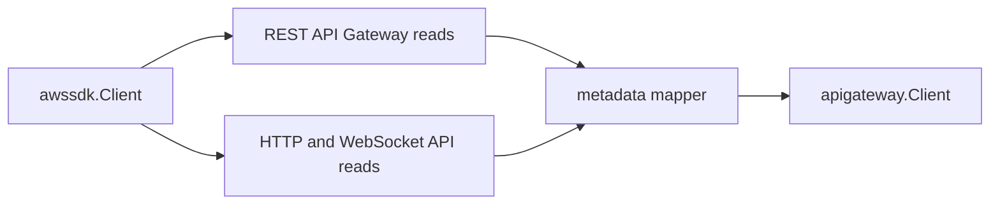

# API Gateway AWS SDK Adapter

## Purpose

`awssdk` owns the AWS SDK for Go v2 adapter for API Gateway metadata. It
implements the scanner-owned `Client` port in the parent package.

## Ownership boundary

This package owns API Gateway REST and v2 SDK pagination, API-call telemetry,
and mapping from AWS SDK response shapes into safe scanner projections. It does
not emit fact envelopes, schedule claims, load credentials, write facts, call
API execution paths, or infer workload, environment, repository, or
deployable-unit truth.

The adapter pages `GetRestApis`, `GetResources` with `embed=methods`,
`GetDomainNames`, `GetBasePathMappings`, `GetApis`, `GetStages`,
`GetIntegrations`, and `GetApiMappings` with bounded page sizes. It maps only
control-plane metadata and drops policy JSON, credentials, template bodies, and
stage variable values.

## Exported surface

See `doc.go` for the godoc-rendered package contract.

- `Client` implements the parent package client port with AWS SDK calls.
- `NewClient` builds the production adapter from an AWS SDK config and
  collector boundary.

## Dependencies

- AWS SDK for Go v2 API Gateway REST and API Gateway v2 clients.
- `internal/collector/awscloud` for boundaries and API-call status events.
- `internal/collector/awscloud/service/apigateway` for scanner-owned models.
- `internal/telemetry` for shared AWS collector API-call metrics and spans.

## Telemetry

Each AWS API call records the shared AWS collector call event and, when
available, the shared API-call metric, throttle counter, and pagination span
using the service, account, region, operation, and result labels.

No-Observability-Change: the existing AWS collector API-call metrics,
throttle counters, `SpanAWSServicePaginationPage` span, and API-call event log
cover API Gateway REST and v2 pagination. `GetResources` throttling also
produces an API Gateway throttle warning so `aws_scan_status` can expose the
claim as partial/throttled without leaking resource identifiers into labels.
Dial timeouts and retry-exhausted transport errors on any regional list read
produce an API Gateway network-timeout warning (`warning_kind=
network_timeout`, `error_class=network_timeout`) with the timed-out operation
in attributes and a static message, so endpoint addresses never reach facts.

No-Regression Evidence (#9535): baseline `go test
./internal/collector/awscloud/service/apigateway/... -count=1` fails 13
timeout subtests terminal with `dial tcp: i/o timeout`; after this change the
same suite passes with those subtests asserting an empty inventory slice plus
exactly one warning, and 4 subtests asserting access-denied, validation, and
connection-refused errors stay terminal with zero warnings. Backend: unit
fixtures only (fake SDK clients injecting a dial `net.OpError`, a flattened
retry-exhausted message, and `context.DeadlineExceeded`); no live AWS call.
Input shape: one REST API, one v2 API, and one domain per list path. Counts: a
timed-out slice returns zero records plus one warning observation while every
other slice keeps its records. Telemetry is unchanged: `recordAPICall` still
records `result=error` per timed-out call and the throttle counter is
untouched. The classifier only matches a deadline, a transport `Timeout()`, or
dial and i-o timeout phrasing, so no authorization or contract error can take
the degrade path.

Observability Evidence (#9535): each timed-out read emits one `aws_warning`
fact (`warning_kind=network_timeout`, `error_class=network_timeout`, the
operation in attributes, static message) through the existing `appendWarnings`
path, so `aws_scan_status` exposes the partial scan. No new metrics, spans, or
log lines were added.

## Gotchas / invariants

- Do not add API execution, API export, API key, authorizer, or mutation calls.
- `GetResources` must keep `Embed: []string{"methods"}` so REST integrations
  come from the same bounded resource page rather than unbounded per-method
  calls.
- `GetResources` throttling after SDK retries is partial metadata loss, not a
  reason to discard API, stage, v2, and domain observations already available
  in the same claim.
- Do not map policy JSON, management policy JSON, credentials, credential
  ARNs, request templates, response templates, variables, or stage variables
  into scanner models.
- Keep `recordAPICall` wrapped around every AWS operation so scan status and
  throttle counters stay useful.

## Related docs

- `docs/public/services/collector-aws-cloud.md`
- `docs/public/reference/telemetry/index.md`
