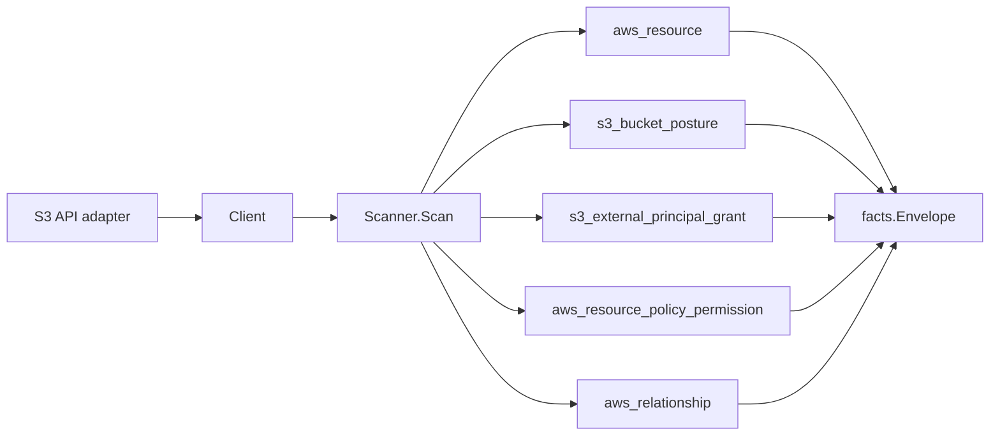

# AWS S3 Scanner

## Purpose

`internal/collector/awscloud/service/s3` owns the Amazon S3 scanner contract
for the AWS cloud collector. It converts bucket control-plane metadata into
`aws_resource` facts, emits a derived metadata-only `s3_bucket_posture` fact per
bucket, emits bounded `s3_external_principal_grant` facts for external
bucket-policy principals, emits normalized `aws_resource_policy_permission`
facts (one per bucket-policy statement, the resource-side analog of
`aws_iam_permission`), and emits relationship evidence when S3 reports a bucket
server-access-log target bucket.

## Ownership boundary

This package owns scanner-level S3 fact selection and identity mapping. It does
not own AWS SDK pagination, STS credentials, workflow claims, fact persistence,
graph writes, reducer admission, or query behavior.

## Exported surface

See `doc.go` for the godoc contract.

- `Client` - minimal S3 bucket metadata read surface consumed by `Scanner`.
- `Scanner` - emits bucket resources, derived `s3_bucket_posture` facts,
  bounded `s3_external_principal_grant` facts, and logging-target relationship
  facts for one boundary.
- `Bucket` - scanner-owned bucket representation with safe metadata only,
  including replication presence, policy-derived booleans, bounded
  external-principal grant metadata, and the normalized
  `ResourcePolicyStatements` projection (no raw policy).
- `ExternalPrincipalGrant` - scanner-owned metadata-only bucket-policy
  principal observation for public, cross-account, AWS service, and unsupported
  principal types.
- `ResourcePolicyStatement` - scanner-owned normalized, derived bucket-policy
  statement (effect, normalized actions/resources, condition key/operator NAMES,
  and derived grantee principal facts). The raw policy Statement body and
  condition values are never represented on it. It feeds the
  `aws_resource_policy_permission` fact.
- `Versioning`, `Encryption`, `PublicAccessBlock`, `Website`, `Logging`, and
  `Replication` - scanner-owned control-plane metadata groups.

## Dependencies

- `internal/collector/awscloud` for boundaries, resource constants,
  relationship constants, and envelope builders.
- `internal/facts` for emitted fact envelope kinds.

The package depends on a small `Client` interface rather than the AWS SDK for Go
v2 so tests can use fake clients and runtime adapters can own SDK behavior.

## Telemetry

This scanner emits no spans or logs directly. `awsruntime.ClaimedSource`
records scan duration and emitted resource counts after `Scanner.Scan` returns.
The `awssdk` adapter records S3 API call counts, throttles, and pagination
spans.

## Gotchas / invariants

- S3 facts are metadata only. The scanner must not read objects, list object
  keys, mutate buckets, or persist object inventory.
- Raw bucket policy JSON, statement bodies, statement Sids, condition VALUES,
  ACL grants, replication rules, lifecycle rules, notification configuration,
  inventory configuration, analytics configuration, and metrics configuration
  are not persisted. Normalized/derived policy actions, resources, and
  condition key/operator NAMES are allowed via `aws_resource_policy_permission`.
- The `s3_bucket_posture` fact carries only derived booleans and safe
  identifiers/ARNs. `s3_external_principal_grant` carries only bounded
  principal kind, value, account, partition, service, outcome, and statement SID
  metadata. `aws_resource_policy_permission` carries the normalized per-statement
  projection (effect, normalized actions/resources, condition key/operator
  NAMES, derived grantee principal facts). The SDK adapter reads the bucket policy document
  transiently (`GetBucketPolicy`) to derive the public-grant and
  cross-account-principal booleans, external-principal metadata, and the
  normalized resource-policy statements, then discards the raw document; the
  policy JSON, statement bodies, and condition values never reach the
  scanner-owned `Bucket` model or any fact payload. Replication is reduced to a
  presence boolean (`GetBucketReplication`), not rule detail.
- Website configuration is reduced to status flags, redirect host, and routing
  rule count. Index and error document object keys are not persisted.
- Logging target grants and object-key format are not persisted. The scanner
  records only the target bucket and target prefix needed for relationship
  evidence.
- Tags are raw AWS tag evidence. Do not infer environment, owner, workload, or
  deployable-unit truth from tags in this package.

## Evidence

Collector Performance Evidence: `go test ./internal/collector/awscloud/service/s3/...`
covers the bounded S3 metadata path: regional paginated ListBuckets with
MaxBuckets set, HeadBucket,
GetBucketTagging, GetBucketVersioning, GetBucketEncryption,
GetPublicAccessBlock, GetBucketPolicyStatus, GetBucketOwnershipControls,
GetBucketWebsite, GetBucketLogging, GetBucketReplication, and GetBucketPolicy;
no object inventory calls, no persisted policy JSON, no ACL grant reads, no
mutations, and no graph writes in the collector. Per-bucket API fan-out is a
fixed, bounded set of control-plane describes (no N+1 against object inventory
or pagination per bucket).

Collector Observability Evidence: S3 uses the existing AWS collector
`aws.service.pagination.page` span plus `eshu_dp_aws_api_calls_total`,
`eshu_dp_aws_throttle_total`, `eshu_dp_aws_resources_emitted_total`,
`eshu_dp_aws_relationships_emitted_total`, and `aws_scan_status` rows. Metric
labels stay bounded to service, account, region, operation, result, and status.

### Partition-aware bucket node identity (#862, keystone)

Node-identity note: in GovCloud/China deployments the bucket `CloudResource`
node identity (a uid input) changes from `arn:aws:s3:::<bucket>` to the
partition-correct ARN. Within a single-partition deployment there is no
migration — buckets are materialized with the correct ARN from the first scan.

Collector Deployment Evidence: S3 runs inside the existing hosted
`collector-aws-cloud` runtime, so `/healthz`, `/readyz`, `/metrics`, and
`/admin/status` stay covered by the command wiring and Helm collector runtime.

## Related docs

- `docs/public/services/collector-aws-cloud.md`
- `docs/public/guides/collector-authoring.md`
