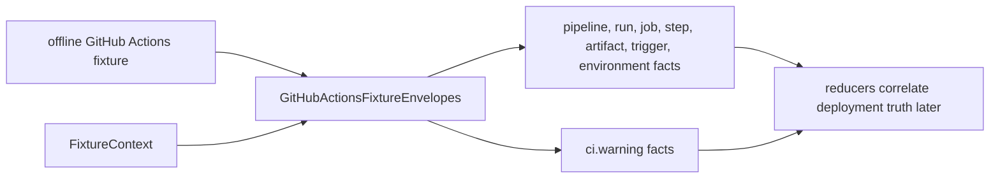

# CI/CD Run Collector Contracts

## Purpose

`internal/collector/cicdrun` owns CI/CD provider normalization for the
`ci_cd_run` collector family. It turns offline fixtures and bounded hosted
GitHub Actions snapshots from `ghactionsruntime` into reported-confidence fact
envelopes that reducers can consume, and does the same for GitLab CI/CD
pipeline fixtures (issue #5427) — a second provider on the same `ci.*` fact
contract and reducer join-key shape (provider, run_id, run_attempt), not a
parallel fact-kind family. GitLab CI/CD support today is fixture/cassette
only: there is no hosted GitLab client yet (no `gitlabciruntime` counterpart
to `ghactionsruntime`), so live GitLab polling is out of scope until a
follow-up wires one the same way `ghactionsruntime` wires GitHub Actions.

The parent package does not call hosted APIs or manage credentials. The
claim-driven GitHub Actions runtime lives in `ghactionsruntime`, which owns
provider polling, request limits, redaction, telemetry, and status. Neither
package ingests logs, reads artifact contents, writes graph state, or promotes
deployment truth.

## Fixture-to-fact flow

The package reports provider runtime evidence from the shared normalized
payload shape. It does not promote CI success, artifacts, or environments to
deployment truth.

## Exported Surface

- `CollectorKind` — durable collector family name: `ci_cd_run`.
- `ProviderGitHubActions` — provider value used for GitHub Actions facts.
- `FixtureContext` — scope, generation, collector instance, fencing token,
  observed time, and source URI copied into emitted envelopes.
- `GitHubActionsFixtureEnvelopes` — parses one fixture-shaped GitHub Actions
  payload and returns CI/CD fact envelopes. Offline fixtures pass that payload
  directly; `ghactionsruntime` marshals its bounded `RunSnapshot` into the same
  shape before calling this normalizer.
- `ProviderGitLabCI` — provider value used for GitLab CI/CD facts.
- `GitLabCIFixtureEnvelopes` — parses one fixture-shaped GitLab pipeline+jobs
  payload (GitLab Pipelines API + Jobs API shape) and returns the SAME
  `ci.run`/`ci.job`/`ci.artifact`/`ci.warning` fact kinds
  `GitHubActionsFixtureEnvelopes` emits, joined by the same
  (provider, run_id, run_attempt) key. Repository identity derives from the
  pipeline's `web_url` (GitLab always renders pipeline pages under the
  project root at `/-/pipelines/<id>`) or the fixture's `gitlab-ci://` scope
  ID as a fallback, through the same `repositoryidentity.CanonicalRepositoryID`
  join contract GitHub Actions and the git collector use.
- `GitHubActionsDeploymentEnvelopes` — parses one fixture-shaped batch of
  GitHub deployments (each with its bounded window of `deployment_status`
  events) and returns `ci.deployment_event` facts, one per status row (or
  one with an empty `status_id` for a deployment with zero fetched
  statuses). `ghactionsruntime` marshals its bounded `DeploymentPage` into
  the same shape before calling this normalizer (#5425 STEP 3).
- `GitHubActionsDeploymentWarningEnvelope` — builds one `ci.warning` fact for
  a deployment-collection-scoped issue that is not about a specific
  `ci.run` (the whole deployments list truncated, a deployment missing a
  required field, or a deployment event whose `sha` matches no fetched
  run).

## Invariants

- Provider-native IDs and run attempts are part of fact identity, so retries do
  not overwrite prior attempts.
- Facts use `source_confidence=reported` because the fixture represents provider
  runtime metadata.
- Artifact download URLs are stripped when they carry query strings.
- Missing or partial provider payloads emit `ci.warning` facts instead of
  silently claiming complete coverage.
- CI success and environment observations remain evidence only. Reducers decide
  whether stronger artifact or deployment anchors exist.

## Telemetry

This package emits no metrics, spans, or logs directly. Hosted runtime
telemetry belongs to `ghactionsruntime`: provider request counts, fetch
duration, rate limits, fact emission, partial generations, and source spans.
The normalizer proof is bounded by the number of runs, jobs, steps, artifacts,
triggers, and warnings in one payload.

### Canonical repository_id (#5418)

| Benchmark | ns/op | B/op | allocs/op |
|-----------|-------|------|-----------|
| `BenchmarkRepositoryID` | ~430–540 | 536 | 11 |
| `BenchmarkGitHubActionsEnvelopesEndToEnd` | ~35,000–40,000 | 54,420 | 680 |

The canonicalization cost (~480 ns) is ~1.2% of total envelope-build time
(~38 µs) for a realistic success fixture (run + 1 job + 1 step + 1 artifact
+ 1 trigger). The old `repositoryID` function (string concat only) ran at
~115 ns/op / 168 B/op / 2 allocs/op; the new path buys a stable
cross-collector join key at a bounded, measured per-fact cost.

### GitLab CI provider (#5427)

| Benchmark | ns/op | B/op | allocs/op |
|-----------|-------|------|-----------|
| `BenchmarkGitHubActionsEnvelopesEndToEnd` | ~57,500–60,700 | ~52,590 | 645 |
| `BenchmarkGitLabCIEnvelopesEndToEnd` | ~43,600–43,900 | ~39,118 | 486 |

The two benchmarks exercise different-sized fixtures (GitLab's has no step,
trigger, or pipeline-definition envelope, matching the scope narrowed above),
so the lower absolute numbers reflect fewer envelopes built per call, not a
per-envelope speedup; both normalizers share the same envelope-construction
helpers (`newEnvelope`, `mergeContractPayload`, `facts.StableID`) so per-fact
cost is the same code path on both providers.

### GitHub Deployments API events (#5425 STEP 3)

`GitHubActionsDeploymentEnvelopes` (`github_actions_deployments.go`) and its
decode types (`types_deployments.go`) are a normalizer, not a runtime: they
have no I/O of their own. Hosted deployment polling, the
`eshu_dp_ci_cd_run_provider_requests_total`/`eshu_dp_ci_cd_run_fetch_duration_seconds`/
`eshu_dp_ci_cd_run_rate_limited_total` recording for that polling, and the
new `eshu_dp_ci_cd_run_partial_generations_total{reason="deployments_truncated"}`
value all live in `ghactionsruntime` (see that package's README for the
Collector Performance/Observability/Deployment evidence for the live fetch
path). This package's own contribution is bounded by the number of
deployments and statuses in one fixture-shaped payload, same as every other
normalizer here.

Collector Performance Evidence: `deploymentEventEnvelope` does the same
bounded per-fact work `runEnvelope` already does (one `mergeContractPayload`
+ `factschema.EncodeCICDDeploymentEvent` call, one `facts.StableID` call, no
loops over unbounded provider data) — no separate benchmark is needed beyond
`BenchmarkGitHubActionsEnvelopesEndToEnd`'s existing per-fact cost profile,
since the construction path (`newEnvelope`, `mergeContractPayload`,
`facts.StableID`) is identical code shared with every other kind in this
package.

Collector Observability Evidence: every `ci.deployment_event` and
`ci.warning` fact this normalizer builds is counted by the SAME generic
`eshu_dp_ci_cd_run_facts_emitted_total{fact_kind=...}` counter (keyed by
`FactKind`, already generic across every kind this package or
`gitlab_ci_fixture.go` emits) `ghactionsruntime`'s `recordFacts` records —
adding a new fact kind to an existing generic-by-kind counter is not a new
signal surface, matching the `gitlab_ci_fixture.go`/`gitlab_ci_helpers.go`
rows in `docs/public/observability/telemetry-coverage.md`.

Collector Deployment Evidence: no new Deployment, ServiceMonitor, port, or
container image surface. `ci.deployment_event` collection reuses the
existing `ghactionsruntime` GitHub Actions claim-source `Deployment`/
`ServiceMonitor` already wired for `ci.run` collection (see that package's
own Collector Deployment Evidence entry); there is no separate deployment
polling workload to deploy.
