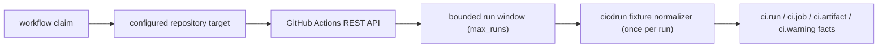

# GitHub Actions Runtime Collector

## Purpose

`ghactionsruntime` owns the hosted GitHub Actions provider polling slice for the
`ci_cd_run` collector family. Every claim cycle fetches a bounded window of the
target's most recent runs (`max_runs`, default 10, hard cap 100) plus bounded
job and artifact metadata for each run in the window, and delegates fact
construction to `internal/collector/cicdrun` once per run. Re-fetching the same
window on a later cycle is an idempotent upsert at projection (each run's facts
are keyed by provider run ID); a persistent watermark/cursor is not needed to
RESUME collection.

A persistent watermark (`runwatermark.Store`, wired through
`SourceConfig.Watermarks`) does exist, but it exists to DETECT a cross-cycle
collection gap, not to resume one (#5429): when more than `max_runs` runs land
between two claim cycles, only the newest `max_runs` are fetched, and the
older new-runs between the previous cycle's newest observed run and this
window's floor are never fetched by either cycle. Before #5429 that loss was
completely silent. Watermarks is optional and nil-safe -- a nil `Store` skips
gap detection entirely, matching `awsruntime.ClaimedSource.Checkpoints`.

The watermark itself only advances AFTER a claim cycle's facts have durably
committed, never inside `NextClaimed`. `NextClaimed` stashes the newest
observed run ID in an in-memory staging map (`pending_watermark.go`);
`ClaimedSource.ObserveClaimedGenerationCommitted`
(`source_commit_observer.go`) is what persists it, and
`collector.ClaimedService` calls that method exactly once, right after the
commit it describes has succeeded. An earlier version of this package saved
the watermark directly on `NextClaimed`'s own success path, independent of
whether the commit later failed -- so a retryable commit failure followed by
a retry of the same work item compared its re-fetched window against an
already-advanced watermark and silently stopped re-detecting the very gap
the watermark exists to catch. That commit-ordering bug is what this
watermark-staging split fixes.

The package does not read artifact ZIP contents, workflow logs, secrets, graph
state, or query state. Reducers decide whether emitted run and artifact evidence
proves a source-to-image bridge.

## Ownership boundary

This package owns claim-to-provider polling for GitHub Actions. It validates
runtime targets, calls bounded REST endpoints, redacts artifact download URLs,
and returns `ci.*` source facts through the collector commit boundary.

It does not own workflow planning, credential environment resolution, chart
wiring, reducer admission, graph writes, API reads, or deployment truth.

## Exported surface

See `doc.go` for the godoc contract. Callers use:

- `SourceConfig`, `TargetConfig`, and `NewClaimedSource` to construct a
  claim-aware source.
- `ClaimedSource.NextClaimed` to resolve one `workflow.WorkItem`.
- `ClaimedSource.ObserveClaimedGenerationCommitted` implements
  `collector.ClaimedGenerationCommitObserver` (#5429): `collector.ClaimedService`
  calls it once, after a claim cycle's facts commit durably, to persist the
  watermark that cycle's `NextClaimed` staged. Callers should not invoke it
  directly outside tests -- it exists for `collector.ClaimedService`'s
  post-commit hook, not as a general-purpose API.
- `ClaimedSource.ObserveClaimedGenerationRefused` implements
  `collector.ClaimedGenerationRefusalObserver` (#10037): a refused commit stored
  none of the cycle's runs, so the watermark holds and the staged entry is
  dropped. The next cycle still detects the gap those runs left.
  `collector-cicd-run` reaches both hooks through `providerRoutedSource`, which
  forwards them by `scope_id`; a wrapper that hides them stops the watermark.
- `Client`, `GitHubClient`, `RunSnapshot`, and `RunPage` to fetch or provide a
  bounded window of GitHub Actions runtime data (`Client.FetchRuns` returns one
  `RunPage`, which carries one `RunSnapshot` per fetched run plus a `Truncated`
  signal for whether more runs exist beyond the window).
- `DeploymentFetcher`, `GitHubClient.FetchDeployments`, `DeploymentSnapshot`,
  and `DeploymentPage` (#5425 STEP 3) to fetch or provide a bounded window of
  GitHub Deployments API state, mirroring `Client`/`RunPage` above.
  `DeploymentFetcher` is an OPTIONAL capability a `Client` implementation may
  satisfy (type-asserted in `appendDeploymentEnvelopes`), not a required
  method on `Client` itself.
- `ErrRateLimited` to preserve provider throttling classification.
- `RateLimitError` to carry bounded GitHub retry guidance from `Retry-After` or
  `X-RateLimit-Reset` into shared claim retry pacing.
- `SourceConfig.Watermarks` (a `runwatermark.Store`) to opt into cross-cycle
  gap detection (#5429). See `run_watermark.go`.

## Dependencies

The package imports `internal/collector` for `CollectedGeneration`,
`internal/collector/cicdrun` for fact normalization,
`internal/collector/cicdrun/runwatermark` for the cross-cycle gap-detection
watermark contract, `internal/collector/sdk` for shared bounded HTTP
primitives, `internal/scope` for scope identity, and `internal/workflow` for
claim rows and `internal/github/app` for installation-token minting. The
external boundary is Go's `net/http` client.

## Telemetry

This package emits `ci_cd_run.observe` and `ci_cd_run.fetch` spans when callers
provide a tracer. It records provider request, fetch-duration, rate-limit,
fact-emission, and partial-generation metrics when callers provide
`telemetry.Instruments`. Cross-cycle gap detection (#5429) records the same
`eshu_dp_ci_cd_run_partial_generations_total` counter with
`reason="runs_backfill_gap"` (and `reason="deployments_truncated"` when
deployment polling truncates) -- no new metric name, just reason values on
the existing partial-generation counter. App mint denials and direct-App provider
non-rate-limited 401/403/404 reads use the existing provider-request counter with
`status_class="auth_error"`; throttled provider reads and mints keep `rate_limited`. Host-token
file failures and Actions-refused host bearers use `auth_denied`. A
Deployments-only 403/404 keeps the run facts with a permission warning and
the generic `error` class for host or static credentials. Static-token
provider failures otherwise keep the generic `error` class.

Metric labels stay bounded to provider, status class, fact kind, and partial
reason. Repository names, workflow run IDs, artifact names, URLs, token
environment names, token values, and provider response bodies stay out of
labels.

## Gotchas / invariants

- Targets require `scope_id`, `repository`, `allowed_repositories`, and exactly
  one credential shape: a static `token`, a scoped host-managed token file,
  or GitHub App ID, installation ID, and private key. Host mode reads its file
  for each claim; direct App mode mints one installation token before provider
  reads. The claim-scoped token is reused for runs, jobs, artifacts, and
  deployments. No token cache or persisted App credential is introduced.
- `max_runs`, `max_jobs`, and `max_artifacts` bound provider request shape. An
  omitted or zero `max_runs` resolves to `defaultMaxRuns` (10); the hard cap
  stays 100. A fetched runs page that is full (GitHub's `total_count` exceeds
  the fetched window, or the full-page heuristic when `total_count` is absent)
  emits a `ci.warning` fact with `reason: "runs_truncated"` on the newest run
  in the window and records
  `eshu_dp_ci_cd_run_partial_generations_total{reason="runs_truncated"}`.
  Per-run jobs and artifact-list pages carry the same signal at the run level:
  a jobs page whose `total_count` exceeds the fetched jobs emits a `ci.warning`
  fact with `reason: "partial_jobs_payload"` and records
  `eshu_dp_ci_cd_run_partial_generations_total{reason="jobs_truncated"}`; an
  artifact-list page whose `total_count` exceeds the fetched artifacts emits a
  `ci.warning` fact with `reason: "partial_artifacts_payload"` and records
  `eshu_dp_ci_cd_run_partial_generations_total{reason="artifacts_truncated"}`
  (#5389).
- Consumers of `ci.run`/`ci.artifact`/etc. facts must key by `run_id` (and
  `run_attempt`), never assume "the only run fact in a generation is the
  latest run": GitHub returns runs newest-first, but nothing downstream of
  this package preserves emission order as recency. The reducer/query
  consumers already key everything by run ID for this reason.
- Provider HTTP response bodies are closed after each bounded JSON decode or
  status classification so long-running claim loops do not leak connections.
- Non-rate-limit provider status failures are returned as bounded SDK
  `HTTPError` values without provider response bodies. The runtime still uses a
  local JSON decoder with `UseNumber` so GitHub run, job, and artifact IDs do
  not lose precision.
- GitHub 429 responses, 403 responses with `X-RateLimit-Remaining: 0`, and
  403 responses carrying `Retry-After` return `RateLimitError`. The shared
  claim runner records the existing rate-limit metrics and delays the next
  visible retry by the provider guidance when it is longer than the poll
  interval.
- Token values and token-bearing URLs never enter facts, logs, metrics, or
  status payloads.
- Artifact `archive_download_url` values are persisted only after query strings
  and fragments are removed.
- CI success, job names, artifact names, and environment names remain provider
  evidence only. Reducers decide whether stronger artifact or deployment
  anchors exist.
- When more than `max_runs` runs land between two claim cycles, the fetched
  window's oldest run can be newer than the previous cycle's newest observed
  run (tracked via `runwatermark.Store`). `detectRunBackfillGap`
  (`run_watermark.go`) detects this and, when `SourceConfig.Watermarks` is
  wired, emits a `ci.warning` fact with `reason: "runs_backfill_gap"` and
  records `eshu_dp_ci_cd_run_partial_generations_total{reason="runs_backfill_gap"}`
  (#5429). This PR does not implement backfill (fetching additional pages
  back toward the watermark); it makes the loss visible instead of silent. A
  target's first-ever claim never reports a gap (no prior watermark to
  compare against), and an untruncated page never reports a gap (every run
  that currently exists was fetched).
- `SourceConfig.Watermarks` left unset (nil) skips gap detection entirely; no
  error, no warning fact, no metric point. Production wiring uses a durable
  `Store` (`cicdstore.CICDRunWatermarkStore`) so gap detection survives
  process restarts and works across collector replicas; see
  `go/internal/storage/postgres/cicd/watermark.go`.
- `max_deployments` bounds the GitHub Deployments API window (#5425 STEP 3),
  mirroring `max_runs`: an omitted or zero value resolves to
  `defaultMaxDeployments` (10); the hard cap stays 100
  (`maxDeploymentPages`). GitHub's deployments-list and deployment-statuses
  endpoints return a bare JSON array with no `total_count`, so truncation is
  always the full-page heuristic (fetched length == the bound) rather than
  an exact provider-reported total; a full page emits a `ci.warning` fact
  with `reason: "deployments_truncated"` and records
  `eshu_dp_ci_cd_run_partial_generations_total{reason="deployments_truncated"}`.
- `ci.deployment_event` facts are appended into the SAME claim cycle's
  `CollectedGeneration` as its `ci.run` facts, never a separate one --
  `appendDeploymentEnvelopes` runs before `NextClaimed` builds
  `collector.FactsFromSlice`. A deployment whose `sha` matches none of the
  claim's fetched run head shas still emits its fact, plus a
  `deployment_unanchored` `ci.warning` (`unanchoredDeploymentWarnings`) so
  the gap stays visible instead of the fact quietly going nowhere once the
  reducer's sha-based attach finds no match.
- `unanchoredDeploymentWarnings` compares a claim's deployment events only
  against `runHeadSHAs` -- the runs fetched in THIS SAME claim window -- not
  against every run fact the reducer has active in scope. The reducer's
  `attachDeploymentEventsToRuns` attaches across all active scope facts, so a
  deployment whose sha belongs to a run outside the current `max_runs`
  window (an older run) is flagged `deployment_unanchored` at collection time
  even though the reducer will correctly attach it once that run's facts are
  in scope. Treat `deployment_unanchored` as a false-positive-prone operator
  signal in steady state, not proof the reducer will never join the event.
- `DeploymentFetcher` is optional: a `Client` that does not implement it
  (most of this package's run-collection test doubles) simply skips
  deployment collection with no error.

## Related docs

- `docs/public/reference/collector-reducer-readiness.md`
- `docs/public/reference/http-api/evidence-and-supply-chain.md`
- `go/internal/collector/cicdrun/README.md`

## Runtime flow



## Bounded request budget

Each claim fetches one bounded run page (`per_page` equals `max_runs`), one
bounded job page and artifact page per run (`max_jobs`, `max_artifacts`), and
at most `1 + max_deployments` deployment requests (`max_deployments` defaults
to 10, hard-capped at 100). No repository fanout or artifact ZIP download
happens in this runtime.

## Benchmarks

Run the local PAT-vs-App authentication benchmarks from `go/` on a quiet host:

```bash
go test ./internal/collector/cicdrun/ghactionsruntime -run '^$' \
  -bench 'Benchmark(BoundedPATFetch|AppCredentialMint)$' -benchtime=300ms \
  -count=5 -benchmem
```
