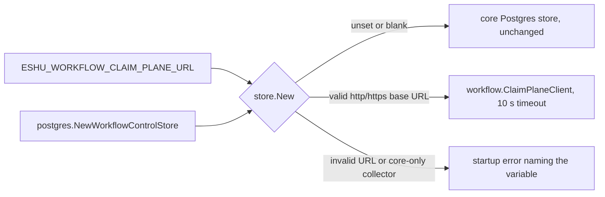

# Collector Claim Store Selection

## Purpose

`claim/store` picks the workflow claim store a claim-aware hosted collector
runs against. It is the one place that reads `ESHU_WORKFLOW_CLAIM_PLANE_URL`
(#8875), so the collector commands do not each repeat the selection.

## Ownership boundary

The package owns selection, URL validation, and the startup telemetry. It does
not own the claim protocol (`go/internal/workflow`), the Postgres store or the
ingestion commit fence (`go/internal/storage/postgres`), or the runner
(`go/internal/collector`). The caller injects the Postgres store, so this
package does not import `storage/postgres`.

## Exported surface

See `doc.go`. The surface is `New`, `Options`, `Selection`, `Backend` with
`BackendPostgres` and `BackendClaimPlane`, `EnvClaimPlaneURL`,
`RequestTimeout`, and `ErrClaimPlaneUnsupported`.

## Behavior

- Unset or blank: `New` returns `Options.Postgres` unchanged, so the claim
  path is unchanged (pointer identity asserted). It adds one startup log and
  one counter tick.
- Valid URL: `http` or `https`, a host, and an empty or `/` path. `New` returns
  a `workflow.ClaimPlaneClient` with a `RequestTimeout` (10 s) HTTP client.
  There is no client retry and no fallback to Postgres.
- Invalid URL: user info, query, fragment, path, another scheme, a host that
  is not printable ASCII (whitespace included), or a port outside 1-65535
  stops startup. The error names the variable and never echoes the raw value.
- `Options.CoreOnlyReason` set and the variable set: startup stops with
  `ErrClaimPlaneUnsupported` and the reason.

The claim plane takes no HTTP credential (the `eshu-workflow` server checks
only the protocol version header), so the URL must not carry one.

## Telemetry

- Log `collector.workflow_control_store.selected` with `service`,
  `workflow_control_store`, and `claim_plane_endpoint`.
- `eshu_dp_workflow_control_store_selections_total{backend_kind}`.
- The claim-plane client `Observe` hook is bound to
  `eshu_dp_workflow_claim_plane_requests_total` and
  `eshu_dp_workflow_claim_plane_request_duration_seconds`, both by
  `operation` and `outcome`.

See [Workflow Claim Store Signals](../../../../../docs/public/reference/telemetry/workflow-claim-store.md).

## Performance and concurrency

Unset: no new work on the claim path; the injected store is returned as is,
with one startup log and one counter tick. Claim-plane mode
replaces one SQL round trip per claim operation with one HTTP round trip. The
client holds no mutable state after construction and `http.Client` is safe for
concurrent use, so the store is shared across a collector's workers exactly
like the Postgres store.

## Related docs

- [Design note](../../../../../docs/internal/design/8875-claim-plane-collector-wiring.md)
- [Removal prep](../../../../cmd/workflow-coordinator/REMOVAL_PREP.md)
