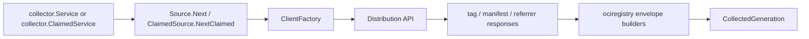

# OCI Registry Runtime Adapter

## Purpose

`internal/collector/ociregistry/ociruntime` turns configured OCI registry
targets into `collector.CollectedGeneration` values. It scans tags, manifests,
image indexes, descriptors, and referrers, then hands fact envelopes to the
shared collector service.

## Runtime Flow

## Exported Surface

- `Config` and `TargetConfig` describe bounded repository scan inputs.
- `TLSConfig` customizes a target's transport trust. The zero value uses the
  host system trust pool. `CACertPath` trusts a PEM bundle in addition to the
  system pool so a registry served with a private or self-signed CA (such as a
  local `registry:2` over TLS) can be scanned without a cloud account.
  `InsecureSkipVerify` disables verification and is test/local-only,
  default-off, and rejected alongside a custom CA. `TargetConfig.HTTPClient` and
  `TargetConfig.TLSMode` resolve the bounded HTTP client and the
  low-cardinality `tls_mode` for telemetry.
- `RegistryClient` is the Distribution API contract used by scans.
- `ClientFactory` and `ClientFactoryFunc` create provider-specific clients.
- `Source` implements `collector.Source` for OCI registry targets.
- `ClaimedSource` implements `collector.ClaimedSource` by resolving a
  workflow `scope_id` to exactly one configured target and using the claimed
  generation ID for idempotent retries.

Internal manifest helpers parse OCI and Docker-compatible response bodies,
classify media families, and compute digest fallback values from exact manifest
bytes when a registry omits the digest header.

## Telemetry

`Source` records OCI registry runtime metrics when instruments are provided:

| Metric | Type | Labels | Purpose |
| --- | --- | --- | --- |
| `eshu_dp_oci_registry_api_calls_total` | Counter | `provider`, `operation`, `result` | Counts ping, tag-list, manifest, and referrer API calls and their success or error result. |
| `eshu_dp_oci_registry_tags_observed_total` | Counter | `provider`, `result` | Counts bounded tag observations that will drive manifest reads. |
| `eshu_dp_oci_registry_manifests_observed_total` | Counter | `provider`, `media_family` | Counts digest objects by `image_manifest`, `image_index`, or `descriptor`. |
| `eshu_dp_oci_registry_referrers_observed_total` | Counter | `provider`, `artifact_family` | Counts referrer artifacts by bounded family: `sbom`, `signature`, `attestation`, `vulnerability`, `unknown`, or `other`. |
| `eshu_dp_oci_registry_scan_duration_seconds` | Float64 histogram | `provider`, `result` | Measures one target scan from client creation through fact envelope construction. `result` is `success`, `failed`, `retryable_transport`, or `retryable_status`. |

Trace spans:

| Span | Purpose |
| --- | --- |
| `oci_registry.scan` | One target scan. Carries a `tls_mode` attribute (`system_roots`, `custom_ca`, or `insecure_skip_verify`) so an operator can see the resolved transport trust posture. Use it to see whether the repository scan or the later commit is slow. |
| `oci_registry.api_call` | One registry API call. The `operation` span attribute is `ping`, `list_tags`, `get_manifest`, or `list_referrers`. |

Metric labels deliberately exclude registry hosts, repository names, tags, and
digests. Those values are high cardinality and may describe private topology.

## Invariants

- Tags are mutable observations; digest identity wins.
- The Distribution client returns a bounded tag window with an explicit
  completeness bit. The runtime sorts and compacts that window, retains at
  most `TagLimit` tags, and emits one `tag_list_truncated` warning whenever the
  client reports an incomplete list or observes more than the limit. This also
  covers a short first page with an OCI `rel="next"` continuation. The
  container-image-identity reducer consumes the warning to hold evicted tag
  references instead of treating a partial scan as authoritative absence. An
  incomplete window may be shorter than `TagLimit` or empty; it still emits the
  warning and never attempts to slice beyond the observed tags.
- A transient transport error (connection reset or refused, broken pipe,
  unexpected EOF, network timeout; see `sdk.IsTransientTransportError`) or a
  retryable registry HTTP status (408, 5xx, or 429; see
  `collector.RegistryFailureClassForHTTPStatus`) during a non-claimed
  `Source.Next` scan skips that target for the cycle, logs a bounded warning
  (`cause_class`, `consecutive_transport_failures`), records
  `result=retryable_transport` or `result=retryable_status`, and continues to
  the next target in the same call so the collector process keeps running and
  the batch is not reported as drained early (issue #7110). After
  `sdk.MaxConsecutiveTransportFailures` (20) consecutive failed cycles for the
  same target the error is returned as fatal, so a wrong host or port
  crash-loops instead of idling. At the default 5-minute poll interval the 19
  waits take about 95 minutes of wall clock before the exit; a shorter
  `ESHU_OCI_REGISTRY_POLL_INTERVAL` shortens it. Cancellation,
  TLS/certificate failures, empty-body decode errors, and other HTTP status
  failures (auth denial, not-found, terminal) still propagate. Claimed scans
  keep returning the error to `ClaimedService`, which retries the claim.
- Claimed scans must match one configured target by normalized `scope_id`; an
  unmatched claim releases without emitting facts.
- Referrers API absence emits a warning fact instead of false negative truth.
- Missing Docker-Content-Digest headers emit warning evidence. When manifest
  bytes are present, the runtime computes the OCI digest from those exact bytes
  and emits `computed_manifest_digest` warning evidence.
- Unknown media types still become descriptor evidence when the registry
  reports a valid digest.
- Provider-specific auth and endpoint shape stay outside this package behind
  `ClientFactory`.

Unchanged-generation decision (#8003): this collector sends a stable content
hint. `ociFreshnessHint` covers the sorted reference-to-digest pairs, the
per-reference digest provenance (registry header, computed from manifest
bytes, or missing), the sorted referrer identities (subject plus referrer
digest, media, and artifact type), the sorted warning outcomes (code, message,
and digest for referrer-API and config-blob warnings), and tag-list
truncation; it is attached to the generation post-scan because digests exist
only after `buildEnvelopes` fetches manifests. Identical registry state at a
later tick shares the hint, so the store skips the duplicate instead of
minting per tick. `TestOCIFreshnessHintSkipsIdenticalTick`
proves identical ticks share one non-empty hint and skip, `TestOCIFreshnessHintStoresRotatedDigest`
proves a rotated digest stores, `TestOCIFreshnessHintStoresReferrerDrift`
proves a new referrer stores, `TestOCIFreshnessHintEncodesWarningOutcomes`
proves referrer and warning input changes the hint, and `TestOCIFreshnessHintEncodesDigestGapsAndTruncation`
proves digest gaps and truncation change the hint.

No-Regression Evidence (#8003 F1): baseline `go test ./internal/collector/ociregistry/ociruntime -count=1` on HEAD passes the three pre-existing freshness tests; after the referrer/warning fold the same suite plus `TestOCIFreshnessHintStoresReferrerDrift` and `TestOCIFreshnessHintEncodesWarningOutcomes` passes in ~0.04s (Go 1.26.9, clang 22.1.8, unit backend with no Docker). Input shape is one bounded tag window (TagLimit 1) with a single manifest plus stubbed referrers; terminal queue and row counts are unchanged because the hint is generation metadata computed from already-emitted in-memory envelopes, adding one sort over at most TagLimit entries plus one StableID encode with no new I/O, no new goroutine, and no cardinality change. The B-7 golden-corpus unit (`go test ./cmd/golden-corpus-gate/ -count=1`) and the static corpus contract (`bash scripts/test-verify-golden-corpus-gate.sh`) stay green with unchanged cassettes and snapshot, so no fixture drift. Safe because the computation is linear in the already-bounded scan window and proven by the new RED-first tests.

No-Observability-Change: the hint fold adds no metric, span, or log; scan volume and duration stay covered by `eshu_dp_oci_registry_api_calls_total`, `eshu_dp_oci_registry_scan_duration_seconds`, and the existing OCI registry telemetry rows.

## Related Docs

- `go/internal/collector/ociregistry/README.md`
- `go/internal/collector/README.md`
- `go/internal/telemetry/README.md`
