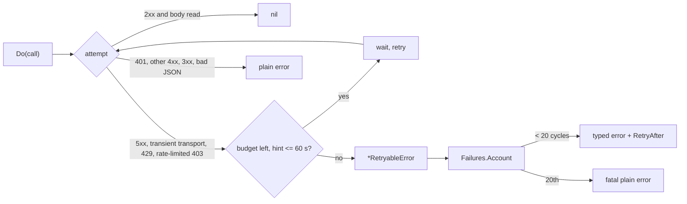

# rest

## Purpose

`rest` runs the GitHub REST calls that repository discovery makes under
one bounded retry (#8084). The org repository listing page and the GitHub App
installation token mint share `Do`, so both get the same attempt budget, the
same fault classes, and the same typed error. The package also owns the
consecutive-failure policy (`Failures`) that decides when a retryable
discovery failure stops being skippable.

## Ownership boundary

This package owns HTTP-call retry, classification, the rate-limit hint rules,
the retryable error type, and the `eshu_dp_github_api_*` signals. It does not
build repository selections, own the selector, or wait between cycles:
`NativeRepositorySelector` in the parent `git` package holds a `Failures`, and
`collector.Service.Run` (phase 2 of #8084) waits `RetryAfter`.

## Flow

## Exported surface

- `Do`, `Call`, `Config`, `DefaultConfig`, `Settings`, `BaseURL`, `Jitter`,
  `SleepContext`: the retried call.
- `RetryableError`, `NewRetryableError`: the typed failure. It implements
  `collector.RetryableError` and unwraps to its cause.
- `Failures`: consecutive-cycle counter and between-cycle backoff.
- `IsTransient`, `TransportClass`, `RateLimitHint`: classification helpers.
- `WithObserver`: puts the instruments and logger on the context.

## Constants

| Rule | Value |
| --- | --- |
| Attempts per call | 4 |
| Backoff | 1 s, 2 s, 4 s, each spread over 75% to 125% |
| In-call rate-limit wait | `retry-after` or `x-ratelimit-reset` of at most 60 s replaces the backoff and uses one attempt |
| Longer or absent hint | The call ends; `RetryAfter` is the hint capped at 1 h, or 60 s when no header names one |
| Consecutive-cycle cap | 20 (`sdk.MaxConsecutiveTransportFailures`) |
| Between-cycle wait | 5 s doubling to a 60 s base cap, spread 75% to 125%, or the hint when larger (capped at 1 h) |

There is no environment variable. The values are pinned by
`TestRetryBudgetConstantsArePinned`, so a permanent failure cannot be hidden by
raising a cap.

## Telemetry

`eshu_dp_github_api_attempts_total` (`operation`, `failure_class`,
`outcome`), `eshu_dp_github_api_retries_total` (`operation`,
`failure_class`), the `github.api_retry` span event, and the
`GitHub API call retrying` WARN log. Cancellation is never retried and never
typed retryable.

## Gotchas

- A 429 with no rate-limit header ends the call at once with a 60 s
  `RetryAfter`; GitHub's guidance is to wait at least a minute, and the cycle
  should not be held for it.
- An HTTP/2 stream reset on a response body is not accepted by
  `sdk.IsTransientTransportError`; `IsTransient` adds it by type name and
  `TestIsTransientAcceptsTheBundledHTTP2StreamError` pins the name.
- Do not wrap `*RetryableError` with `%w` when you mean to make a failure
  fatal: `errors.As` still finds it. `Failures.Account` wraps only the cause.
